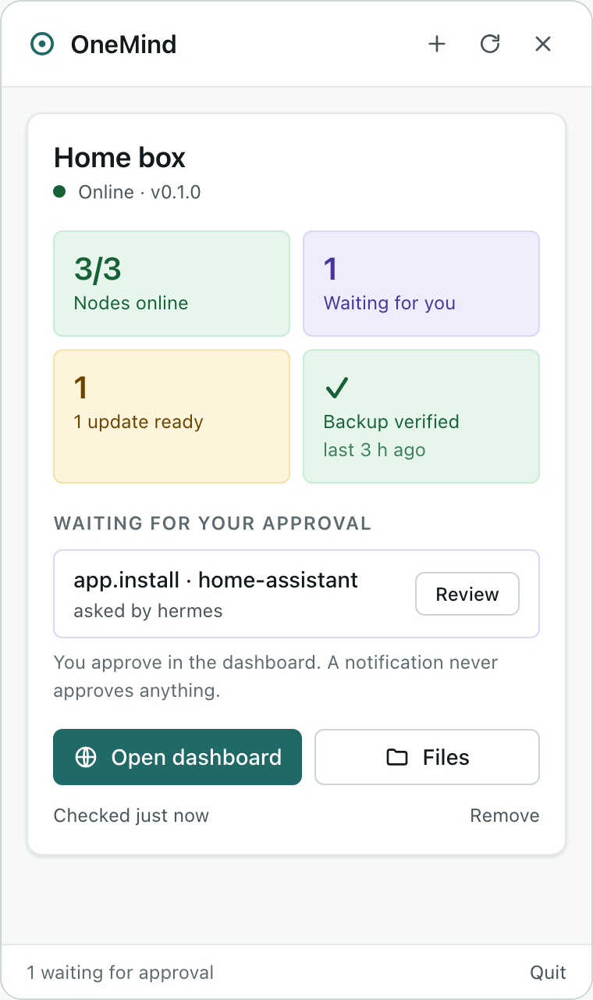
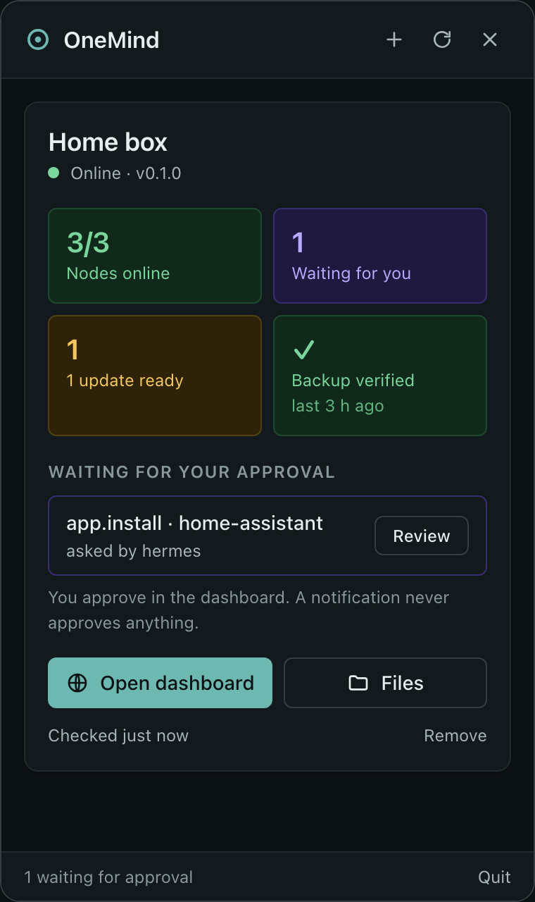
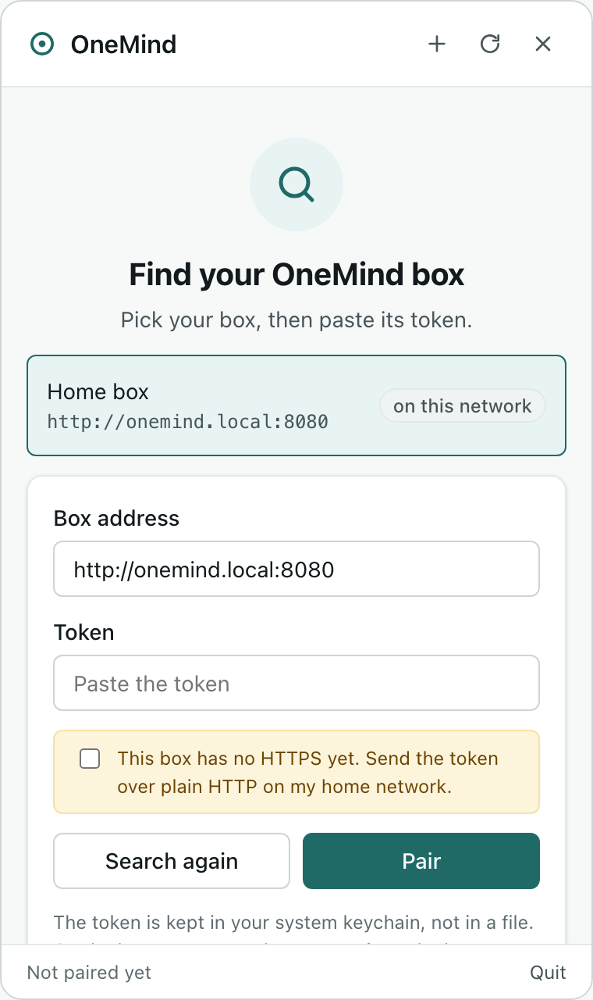
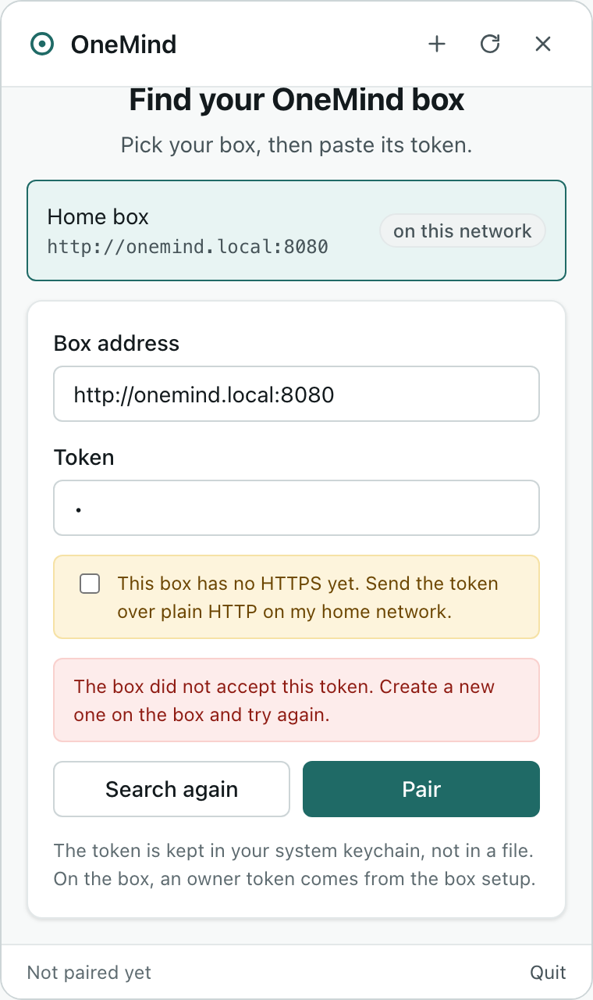
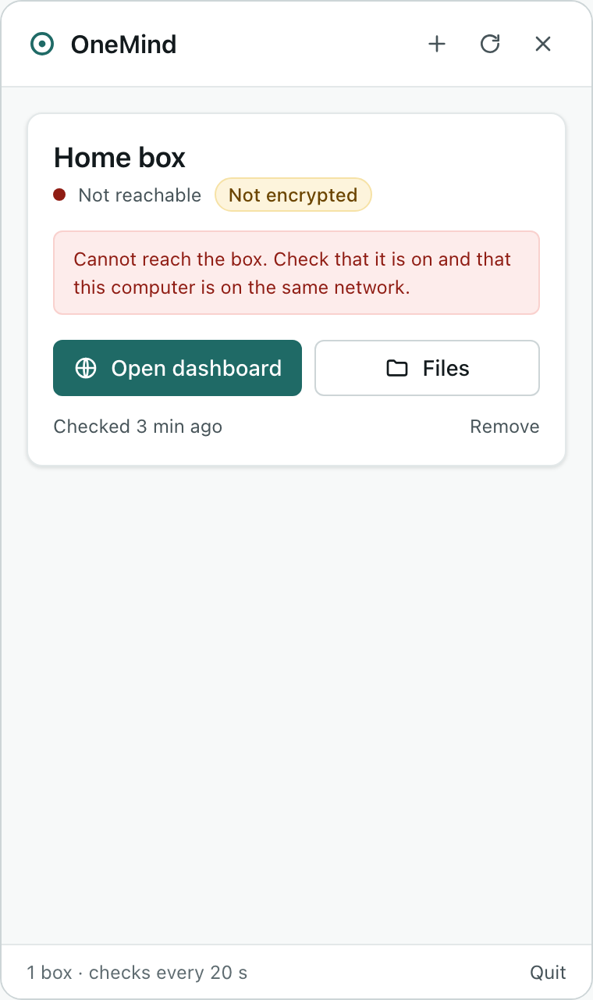
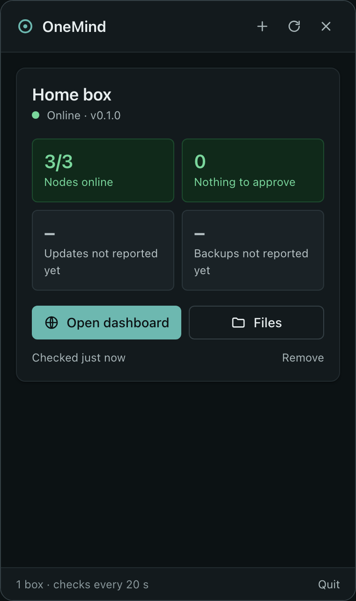

<!-- SPDX-License-Identifier: Apache-2.0 -->
# OneMind desktop client

A small menu-bar app (macOS) and tray app (Windows) for your OneMind box. It finds the box on your network, pairs with it, shows whether everything is fine, tells you when something needs you (from your notifications inbox and from pending approvals), lets you approve or deny a request after seeing its exact plan, and opens the dashboard and the box's files.

This is **desktop v1**: the CLIENT-8 skeleton plus CLIENT-10 (approvals, alerts and events) from the clients plan ([`docs/umbrel2/clients.md`](../docs/umbrel2/clients.md) §4.2 and §5). It is built with **Tauri 2**, the stack that study chose: one codebase for Mac, Windows and later Linux, a small download, and a permissive licence.

> **Does umbrelOS have a desktop app?** Yes. It has a small Mac menu-bar app and a Windows tray app. They find the box, sign in, mount its shared folders and open its web page. The "desktop" look in umbrelOS screenshots (wallpaper, dock, app grid) is its **web page**, not a native app. (Described from the clients study; no umbrelOS code, text or assets are used here. umbrelOS is PolyForm Noncommercial.) OneMind's "desktop" in that sense is the dashboard and Home in `ui/`. This app is the native companion.

| Status, light | Status, dark | Finding a box | Wrong token |
|---|---|---|---|
|  |  |  |  |

| Box unreachable (plain-HTTP box) | Calm box, older gateway (dark) |
|---|---|
|  |  |

The screenshots are the real `src/` files rendered in a browser through `tools/mock-bridge.js` (`npm run preview`), because this build machine had no screen-recording permission. They show the skeleton; the v1 approval card and inbox render with the scenes `approval`, `approval-passkey` and `inbox` (`/tools/preview.html?scene=approval`) and have no screenshots yet. The pending action has the shape the Rust core read from a local dev gateway (an `app.install` requested by the Hermes agent). Nodes, updates and backups are fixture values: a dev gateway without NATS reports no nodes, and the update and backup routes are not served yet.

## What it does today

| Feature | How |
|---|---|
| Lives in the menu bar / tray | Tauri tray icon (template icon on macOS, no Dock icon). Left click opens the popover under the icon; right click opens a menu (Show, Open dashboard, Files, Quit). On macOS, the number of pending approvals shows next to the icon. |
| Find boxes | mDNS browse of `_onemind._tcp` for 2.5 s (`mdns-sd`), plus a probe of `onemind.local:8080/healthz`. You can also type an address. Discovery only suggests an address. It creates no trust. |
| Pair | Paste a token. The app checks it with `GET /v1/instance`, then stores it in the **OS keychain** (macOS Keychain, Windows Credential Manager) under the box's hub node id. The box list (name, address) is a JSON file in the app's config folder and holds no secrets. |
| Box status | Every 20 s, on demand, and within about a second of a box event (below): `GET /v1/instance`, `/v1/nodes` (online/total), `/v1/actions?state=awaiting_approval`, and the contract §12 reads `/v1/os/status`, `/v1/backups/status`, `/v1/me` and `/v1/notifications?unread=true`. A §12 route answers 404 until its module ships; the app then shows "not reported yet" in grey, never a green tick. Every card says how old its data is. |
| Live updates | One `GET /v1/events` stream per box (§12.8, server-sent events), resumed with `Last-Event-ID`. An `action.*`, `alert.*`, `notification.created` or `node.status` event triggers a status refresh, so a new request shows within seconds. Event data is never shown or trusted as state; it only wakes a REST refresh. The card shows **Live** while the stream is open. A box without the route is polled as before. |
| Notifications | Native banners from the person's **inbox** (§12.14) and from pending approvals, one per new item, an approval announced once even when both sources carry it, at most three per refresh plus one summary, and the unread backlog found at start-up as one summary. A banner only informs: it never approves and carries no action buttons. The **Notifications** view lists the inbox; opening an item marks it read and opens its approval card or, for a link, the box's page in the browser. |
| Approvals | **Review** opens an approval card: risk class (§12.3), who asked and their reason (an agent's words marked as unchecked), the plan (summary, warnings, images, storage, machines, plan hash), expiry, and the exact request with its API equivalent. **Approve** needs a second click that names the consequence. **Deny** takes an optional reason. See "Approvals and passkeys" below. |
| Open dashboard | Opens the box address in the system browser. Box pages never load inside the app's web view (the study's DESK-S1 rule, until pinned trust in web views is proven). A link from the box (an inbox item) opens only if it stays on the box's own scheme, host and port. |
| Manage | **Manage…** on a box card opens three tabs. **Apps**: Start, Stop, Restart, Update, Remove on an installed app; each shows the box's plan first (`GET /v1/apps/{id}/plan?type=`, files nothing), then files the request bound to the plan hash (`POST /v1/actions`). **Backups**: health, last backup and restore check, destinations, recent runs; **Back up now** and **Check latest backup** file a request with `approve: false`. A restore is not offered (it needs a passkey, see below). **Box**: owner-only first-run preferences (name, time zone, backup choice; `GET`/`PUT /v1/onboarding/settings`, contract §12.41), which start no backup. Nothing here approves anything: every request waits in the approval list. Code: `src-tauri/src/manage.rs`, `src/manage.js`. Automation, files and migration views are not in the tray yet. |
| Files | Opens `smb://<box>/` in Finder (macOS) or `\\<box>\` in File Explorer (Windows). There is no mount yet: the gateway serves no WebDAV or SMB. [docs/FILES.md](docs/FILES.md) is the WebDAV mount plan for when UMB-FILES-5 ships. |
| Updates of this app | None yet, on purpose. [docs/UPDATER.md](docs/UPDATER.md) is the channel and signing design (Tauri updater, our Ed25519 key, `stable`/`beta`); the key and the host are founder decisions (F-59, F-61). |

### Approvals and passkeys (spike DESK-S2, finding)

The rule from the contract (§12.3, F-2): once the owner has a passkey, every owner approval carries a WebAuthn assertion, and `destructive` and `actuate` requests always need one.

**A passkey prompt cannot run inside this app's web view.** A WebAuthn assertion is bound to the web origin that asked for it, and the box accepts only its own origins (`https://<box name>`, see `core/onemind_core/identity` on the identity branch and founder decision F-33 on passkey domains). The tray's web view runs on the app's own origin (`tauri://localhost` on macOS, `http://tauri.localhost` on Windows), so even where the web view can show a passkey prompt, the box would reject the result. Native platform calls (macOS AuthenticationServices, Windows `webauthn.dll`) could sign for the box's domain, but macOS allows that only for domains the app is entitled to through Associated Domains, which a `.local` name served with a private CA cannot provide. That path stays a follow-up spike.

So v1 does this:

| Case | What the app does |
|---|---|
| The box reports the request as `destructive` or `actuate`, or `/v1/me` says this token's person has a passkey | The button reads **Approve in browser**. It opens the box's approvals page in the system browser, where the passkey prompt is bound to the box's origin. Nothing is sent from the app. |
| No passkey is needed | **Approve…**, then **Confirm approve**. The app reads the action again, refuses locally if its plan hash differs from the one on the card, and sends `POST /v1/actions/{id}/approve` with that `plan_sha256` and `OneMind-API-Version: 1`. The box records it as "approved without passkey" (F-12). |
| The box answers `401 step_up_required` or `409 plan_unchecked` anyway | Nothing was approved; the card says so and offers **Open approvals in browser**. |
| The box answers `409 stale_precondition` (`plan_changed`), or the action is no longer waiting | Nothing was approved; the card reloads and shows the new plan or state. |
| Deny | Never needs a passkey (it removes power). `POST /v1/actions/{id}/deny` with the optional reason. |

The dashboard's Approvals page does not yet run the passkey step (`approve-options` plus WebAuthn) and has no per-request route (`/approvals/<id>`, which the inbox links already use). Until it does, the browser hand-off lands on the list page; see "Next steps".

**Plain-HTTP rule.** HTTPS is always accepted. Plain HTTP is accepted only to this computer (loopback), or when you tick "This box has no HTTPS yet". Such a box then carries a "Not encrypted" badge. Redirects are never followed, so the token cannot be forwarded to another host.

## Layout

```
desktop/
  src/                 popover UI: plain HTML, CSS and ES modules, no bundler
    app.js             rendering and events; box text only ever goes through textContent
    format.js          pure wording/tone helpers (tested with node --test)
    tokens.css         exact copy of ui/src/tokens/tokens.css (npm run sync:tokens; check:ui fails on drift)
    brand.generated.css  logo colours; the header logo and name in index.html are generated too
  src-tauri/           Rust core: everything that touches the network, the keychain or the OS
    src/lib.rs         commands, tray, popover placement, poller, event followers, banners
    src/api.rs         gateway client, status parsing, the id rule for URL paths
    src/approvals.rs   approval card, plan check, passkey rule, approve and deny
    src/inbox.rs       inbox items and the banner rules
    src/events.rs      server-sent events parser and reconnect policy
    src/discovery.rs   mDNS browse and the onemind.local probe
    src/address.rs     address normalising, the plain-HTTP rule, box-only links
    src/store.rs       box list (JSON) and keychain tokens
    capabilities/      the web view gets core:default only: no opener, shell, fs or http permission
  tools/               browser preview with a fixture bridge (used for the screenshots)
  docs/                FILES.md (WebDAV mount plan), UPDATER.md (update channels and signing)
  test/                UI unit tests
  assets/              icon sources (SVG) written by scripts/brand-sync.py from brand/brand.json; src-tauri/icons
                       is rendered from them with the Tauri CLI (npm run icons, npm run icons:tray; CI does it again)
```

**Why this split.** The web view draws the UI. All network calls, tokens and OS actions stay in Rust and are reached only through named commands. A bug in the page therefore cannot read a token or open arbitrary URLs. The content security policy allows scripts and styles only from the app itself.

**What the Rust side checks on everything that comes from the box or the page:** ids that go into URL paths are plain id characters only (`api::safe_id`), so `../` or `?` cannot steer a request to another route; links open only on the box's own origin (`address::box_link`); event lines and data are capped at 1 MiB; text is clipped before it reaches a banner or the page; request settings over 16 KiB are not shown in the card.

## Build and run

You need Node 22+ and Rust (rustup reads `src-tauri/rust-toolchain.toml`; Homebrew `rust` 1.99.1 also works). On Windows you also need the MSVC build tools; WebView2 is part of Windows 11.

```sh
cd desktop
npm ci
npm run dev                 # run with hot reload of src/
npm run build:app           # macOS: src-tauri/target/release/bundle/macos/OneMind.app
npx tauri build --bundles nsis   # Windows: ...\bundle\nsis\OneMind_0.1.0_x64-setup.exe
```

Builds are **unsigned**. On macOS, open the app with right-click → Open the first time. Signing, notarization, MSIX and the signed updater are CLIENT-12.

To try it against a local gateway (dev tokens, loopback only):

```sh
cd core
ONEMIND_HOST=127.0.0.1 ONEMIND_TOKENS_FILE=examples/tokens.example.yaml uv run python -m onemind_core
# in the app: address http://127.0.0.1:8080, token from that example file
```

Set `ONEMIND_DESKTOP_PIN=1` to keep the popover open when it loses focus (handy while developing).

### Windows build in CI

`.github/workflows/ci-desktop.yml` runs on every PR that touches `desktop/**`, on `macos-15` and `windows-2025`. Each run:

1. Runs the UI tests.
2. Runs `cargo test --locked`.
3. Builds the DMG (macOS) or the NSIS installer (Windows).
4. Fails if the installer is 25 MB or larger.
5. Uploads the installer as a build artifact for 14 days.

Actions are pinned by commit, as listed in `os/versions.lock.yaml`. Tauri's bundler downloads the NSIS tools on Windows at build time; pinning or caching them belongs to CLIENT-12.

## Tests

| Test | Command | What it proves |
|---|---|---|
| UI | `npm run check:ui` | wording, tile tones, "not reported" is never green, the plain-HTTP check matches Rust, risk and outcome wording (nothing reads as approved unless the box said so), an agent's reason marked unchecked, footer only says "live" with an open stream |
| Rust unit | `cd src-tauri && cargo test` | address rules (credentials, schemes, loopback), box-only links, the id rule, status parsing (§3 and §12 shapes), error envelopes, the plan check and passkey rule before approving, refusal mapping, inbox parsing and banner rules, the SSE parser and reconnect policy |
| Live gateway | `ONEMIND_TEST_GATEWAY=http://127.0.0.1:8080 ONEMIND_TEST_TOKEN=… cargo test -- --ignored live_gateway` | real status read, and a wrong token gives `unauthorized` |
| Live mDNS | advertise with `dns-sd -P "Test box" _onemind._tcp local 8080 onemind.local 127.0.0.1 id=t v=1`, then `cargo test -- --ignored live_mdns` | the browse finds the box |
| Keychain | `cargo test -- --ignored keychain_roundtrip` | write, read and delete one keychain item |

### Measured on the first build (Apple silicon Mac, macOS, 2026-11-12)

- `OneMind.app`: **5.5 MB** (the target is an installer under 25 MB).
- Idle memory after 25 s: **about 53 MB** physical footprint (app 26 MB, WebKit content 22 MB, WebKit networking 4.6 MB, measured with `footprint`). The target is under 120 MB.
- The Windows numbers come from the first CI run.

## Licences (pinned versions)

| Component | Version | Licence | Ships how |
|---|---|---|---|
| tauri, tauri-build | 2.12.5, 2.7.4 | Apache-2.0 OR MIT | linked |
| @tauri-apps/cli | 2.12.4 | Apache-2.0 OR MIT | build tool only |
| tauri-plugin-notification, -opener, -single-instance | 2.8.0, 2.7.2, 2.5.5 | Apache-2.0 OR MIT | linked |
| mdns-sd | 0.21.6 | Apache-2.0 OR MIT | linked |
| reqwest (rustls) | 0.13.5 | MIT OR Apache-2.0 | linked |
| keyring | 3.6.3 | MIT OR Apache-2.0 | linked |
| tokio | 1.54.1 | MIT | linked |
| serde, serde_json, url | 1.0.229, 1.0.154, 2.5.8 | MIT OR Apache-2.0 | linked |
| WKWebView / WebView2 | OS component | Apple / Microsoft terms | part of the OS, not shipped by us |

The 313 crates in the macOS dependency graph are all permissive licences (MIT, Apache-2.0, BSD, ISC, Zlib, Unicode-3.0, Unlicense, CC0, 0BSD), except five under **MPL-2.0** that Tauri brings in (`cssparser`, `cssparser-macros`, `dtoa-short`, `option-ext`, `selectors`). MPL-2.0 is file-level copyleft. Shipping them unmodified inside a commercial app is allowed, as long as we point to their source. A generated third-party notices file (`cargo about`) is part of CLIENT-12.

keyring 4.x exists, but it splits into separate store crates whose API was not checked for this skeleton. 3.6.3 is the last 3.x release.

## Next steps (in epic order)

1. **CLIENT-2 + CLIENT-3:** replace the pasted token with a device request the owner approves (`device.add`): a non-exportable device key (Secure Enclave on Mac, TPM via CNG on Windows) with DPoP on refresh, and fingerprint words plus a check code for first trust. Pin the box CA per instance id, and refuse a changed CA clearly.
2. **CLIENT-9 / DESKTOP-FILES-1:** shares. Create a per-device SMB user (`POST /v1/shares/credential`, password kept in the keychain), then mount from Rust: NetFS on macOS, `WNetAddConnection2` on Windows (Windows picks the drive letter), gio on Linux. Re-adopt mounts only after the box proves its identity. The WebDAV mount plan, and what it needs from the box, is in [docs/FILES.md](docs/FILES.md) (founder decision F-45).
3. **Approvals, rest of CLIENT-10:** native platform passkeys (a follow-up spike on macOS AuthenticationServices and Windows `webauthn.dll`, after F-33 settles the passkey domain); in the dashboard (CORE-SEC-2, dashboard stream): the passkey step on the Approvals page and an `/approvals/<id>` route, so the browser hand-off opens the exact request; bringing the popover forward when a banner is clicked (Tauri's desktop notifications report no click today).
4. **Quiet hours:** banners ignore the person's quiet hours (§12.14 preferences) for now; the box already holds channel deliveries during quiet hours.
5. **CLIENT-11:** laptop folder backup with restic to the box, with verified restores and a pause on battery or metered networks.
6. **CLIENT-12:** Developer ID signing and notarization, MSIX or a signed NSIS installer, the Tauri updater as designed in [docs/UPDATER.md](docs/UPDATER.md), and third-party notices.
7. Linux (`.deb`, AppImage) in CI, and autostart at login (`tauri-plugin-autostart`).
