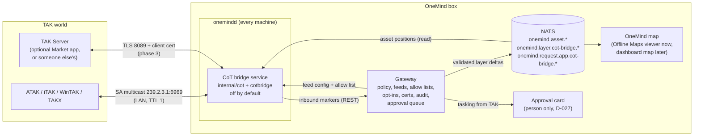

<!-- SPDX-License-Identifier: Apache-2.0 -->
# TAK native: the OneMind CoT bridge

**Date:** 2026-11-26 · **Status:** design, with a first tested slice (`internal/cot`). Nothing is wired into the image yet.
**Asked by:** the founder, 2026-11-26 (decision [D-032](../DECISIONS.md)).
**Serves:** M-LIVE [#234](https://github.com/onemindos/ONEMINDOS/issues/234) (positions from real machines on a map), the map packs and sites work (`core/onemind_core/geo/`), the radios plan (D-024), D-027 (approvals), D-029 (the gateway decides, NATS enforces), D-001 (Apache-2.0, no GPL code).
**Plain-language version:** [docs/learning/founder/14-tak-native-explained.md](../learning/founder/14-tak-native-explained.md).

Facts about TAK below are cited to primary sources. `AC` = `https://github.com/TAK-Product-Center/atak-civ/blob/main/`, `SV` = `https://github.com/TAK-Product-Center/Server/blob/main/`. Anything not confirmed from a primary source is marked **UNVERIFIED**.

---

## 1. Plain language first

**TAK** (Team Awareness Kit) is a family of map apps used by first responders, search-and-rescue teams, the military and hobbyists: ATAK on Android, iTAK on iPhone, WinTAK and its successor TAKX on desktops, and TAK Server in the middle. Everyone on a team sees everyone else, and every marker, on one shared map.

**CoT** (Cursor on Target) is the language those apps speak. A CoT message is a small XML note that says *"this thing, with this id, of this kind, is at this latitude and longitude, from this time until this time."* That is all a TAK map needs to draw a dot.

**"TAK native" for OneMind** means: a OneMind box speaks CoT itself. Turn it on, and

- every OneMind machine, sensor, camera and alert with a location shows up as a marker on every ATAK, iTAK, WinTAK or TAKX device on the same network, with no TAK Server needed;
- markers and positions from those TAK devices show up on the OneMind map;
- if the owner also wants a full TAK Server (for teams, missions, federation) or the TAKX desktop client, they install them from the Market as optional apps.

**What it never does:** a TAK message can never make OneMind *do* anything. Anything in CoT that asks for an action (a task, a route, "go here") arrives as an approval card, and only a person approves it (D-027). Nobody's location is shared without the owner opting in, and a child's location is never shared.

---

## 2. What CoT and the TAK protocol are (verified)

### 2.1 The CoT event

The base schema is MITRE's *CoT Base-Event Schema*, version 2.0 (13 June 2003), shipped in atak-civ at `AC` `takcot/mitre/CoT Base-Event Schema  (PUBLIC RELEASE).xsd` (**VERIFIED**). TAK-specific detail schemas are in `AC` `takcot/xsd/` and `takcot/xsd/details/`, examples in `AC` `takcot/examples/` (**VERIFIED**).

```xml
<event version="2.0" uid="ANDROID-..." type="a-f-G-U-C" how="h-e"
       time="2026-11-26T15:00:00.000Z" start="2026-11-26T15:00:00.000Z" stale="2026-11-26T15:06:00.000Z">
  <point lat="40.689247" lon="-74.044502" hae="12.5" ce="9.9" le="9999999.0"/>
  <detail>
    <contact callsign="RIVER-1"/>  <__group name="Cyan" role="Team Member"/>
    <takv .../>  <track course="270.0" speed="1.2"/>  <status battery="88"/>
  </detail>
</event>
```
(Hand-written OneMind fixture, `internal/cot/testdata/sa-team-member.xml`.)

| Field | Meaning | Source |
|---|---|---|
| `version` | decimal, at least 2.0 | base XSD, **VERIFIED** |
| `uid` | stable id of the thing; the same uid updates the same marker | base XSD, **VERIFIED** |
| `type` | what the thing is, as dash-separated atoms (below) | base XSD + `AC` `takcot/mitre/types.txt`, **VERIFIED** |
| `how` | how the position was obtained: `h-e` human estimated, `h-g-i-g-o`, `m-g` GPS, `m-p`, `m-f` ... | `types.txt`, **VERIFIED** |
| `time` / `start` / `stale` | `time` = when generated; `start`..`stale` = when it is valid. ISO 8601 UTC, `CCYY-MM-DDThh:mm:ss.ssZ`, fractions optional | base XSD, **VERIFIED** |
| `point` | WGS 84 `lat`, `lon`; `hae` = height above the WGS 84 ellipsoid in metres; `ce`/`le` = circular/linear error, metres, 1-sigma | base XSD, **VERIFIED** |
| `detail` | optional; any child elements | base XSD, **VERIFIED** |

**"Unknown" value.** The base XSD defines none. TAK's sample files use `9999999.0` (seven nines, e.g. `AC` `takcot/examples/Marker - Spot.cot`), while the comment in `AC` `commoncommo/core/impl/protobuf/cotevent.proto` says "use 999999 for unknown" (six nines). Both conventions are observed (**VERIFIED**); which is canonical is **UNVERIFIED**. OneMind writes seven nines and reads both (`cot.IsUnknown`).

**Type taxonomy** (`AC` `takcot/mitre/types.txt`, **VERIFIED**): the first atom is `a` (atoms: things on the map), `b` (bits: chat, markers, images...) or `t` (tasking). For atoms, the second letter is the affiliation (`p u a f n s h j k o`, e.g. `f` friendly, `h` hostile, `u` unknown), the third the battle dimension from MIL-STD-2525 (`P` space, `A` air, `G` ground, `S` sea surface, `U` subsurface, `X` other), then the 2525 function tree (e.g. `U-C` combat unit). GeoChat is `b-t-f` (real capture in `AC` `commoncommo/core/atakcotcaptures.txt`, **VERIFIED**); the spot marker sample is `b-m-p-s-m` (**VERIFIED**).

**Detail elements OneMind models now:** `contact` (callsign, endpoint), `__group` (name, role), `takv` (device, platform, os, version), `track` (course, speed), `status` (battery), `remarks`, `link`, `usericon`. The first five have protobuf equivalents in TAK Protocol v1 (§2.2); `remarks`, `link` and `usericon` stay XML (**VERIFIED**, `AC` `commoncommo/core/impl/protobuf/`). Every other detail element is kept as raw XML so a decoded event re-encodes without loss, and is never interpreted.

### 2.2 TAK Protocol version 0 and version 1

Source: `AC` `commoncommo/core/impl/protobuf/protocol.txt` (**VERIFIED**).

- **Version 0** is plain CoT XML. On mesh (UDP), one XML event per datagram; on a TCP stream, messages are split after `</event>`.
- **Version 1** is protobuf. The payload is one `TakMessage` (protobuf v3).
  - Mesh header: `0xbf <version varint> 0xbf <payload>`.
  - Streaming header: `0xbf <length varint> <payload>`. Varints are unsigned protobuf varints, at most 10 bytes.
- **Negotiation on a stream:** the server sends `t-x-takp-v` (TakProtocolSupport), the client answers `t-x-takp-q` (TakRequest), the server replies `t-x-takp-r` (TakResponse). The client waits at least one minute for the answer.
- **Negotiation on mesh:** each device broadcasts a TakControl (min/max version) at least every 60 s and sends at the highest version every known contact supports; it falls back to XML if any contact speaks only version 0; a contact silent for 2 minutes reverts to its last-seen version.
- Whether ATAK sends v1 on multicast SA by default in practice: **UNVERIFIED** (the rule implies v1 only when every peer supports it, so a OneMind box that speaks only v0 keeps the mesh on XML).
- **The `.proto` files** are in `AC` `commoncommo/core/impl/protobuf/` (takmessage, cotevent, detail, contact, group, precisionlocation, status, takcontrol, takv, track; package `atakmap.commoncommo.protobuf.v1`) and in `SV` `src/takserver-protobuf/src/main/proto/` (the same set plus server-only messages). Both repos are **GPL-3.0** (repo-level `LICENSE.md`; the `.proto` files carry no header of their own) (**VERIFIED**). **OneMind must not copy them** (D-001). Phase 6 writes OneMind's own `.proto` from `protocol.txt`'s description and wire-compatibility tests (see §10, open question Q6).

### 2.3 Transports and ports

| What | Default | Source |
|---|---|---|
| SA (situational awareness) multicast | `239.2.3.1:6969` UDP | `SV` `src/takserver-core/example/CoreConfig.example.xml` (as a commented-out multicast proxy input), **VERIFIED** |
| GeoChat multicast | `224.10.10.1:17012` UDP | same file (commented out) and the chat capture in `atakcotcaptures.txt`, **VERIFIED** |
| TCP streaming (plain) | 8087 (commented out by default) | CoreConfig example, **VERIFIED** |
| TLS streaming | 8089 (enabled, `coreVersion="2"`) | CoreConfig example, **VERIFIED** |
| QUIC | 8090 (enabled) | CoreConfig example, **VERIFIED** |
| Web UI / API (client cert) | 8443 | CoreConfig example, **VERIFIED** |
| Federation HTTPS | 8444 | CoreConfig example, **VERIFIED** |
| Certificate enrollment (no client cert) | 8446, `clientAuth="false"` | CoreConfig example, **VERIFIED** |
| Federation | 9000 (v1, off) / 9001 (v2, on) | CoreConfig example, **VERIFIED** |

**Certificate enrollment** lives under `/Marti/api/tls` (`SV` `src/takserver-core/src/main/resources/security-context.xml`): `/tls/config`, `/tls/signClient`, `/tls/signClient/v2`, `/tls/makeClientKeyStore`, reachable without a client cert (`SV` `.../com/bbn/tak/tls/CertManagerApi.java`) (**VERIFIED**). The server config uses JKS keystores and truststores; the configuration guide signs in to `https://localhost:8443` with `admin.p12` (`SV` `src/docs/TAK_Server_Configuration_Guide.pdf`, v5.7, March 2026) (**VERIFIED**). Data packages are zip files with a `MANIFEST/manifest.xml` (path seen in `AC` `.../missionpackage/file/MissionPackageManifest.java`; full format **UNVERIFIED**, not read).

**Mesh vs server.** A *mesh* connection is peer-to-peer on the LAN (multicast SA, no server). A *server* connection is a TCP/TLS stream to a TAK Server, which relays to everyone connected and adds missions, data packages, federation and history.

### 2.4 TAK Server and TAKX

| | TAK Server | TAKX |
|---|---|---|
| Repo | [TAK-Product-Center/Server](https://github.com/TAK-Product-Center/Server) | [TAK-Product-Center/TAKX](https://github.com/TAK-Product-Center/TAKX) (default branch `develop`) |
| Licence | GPL-3.0 (`LICENSE.md`) **VERIFIED** | GPL-3.0 (`LICENSE.md`) **VERIFIED** |
| What | Java server: streaming, API, missions, data packages, federation, plugins | Java desktop client; the repo calls it the "culmination of two prominent Windows-based C2 platforms: WinTAK and RaptorX" **VERIFIED** |
| Needs | Java 17; PostgreSQL + PostGIS (guide: `postgis33_15`; README: `postgis/postgis:15-3.3` container); Apache Ignite (`TAKIgniteConfig.xml`) **VERIFIED** | JDK 17; plugin API in the `Platform` module; building needs TAK.gov Artifactory credentials **VERIFIED** |
| Hardware | minimum 4 cores, 8 GB RAM, 40 GB disk; a Raspberry Pi 4 8 GB for a minimal setup; single server for fewer than 500 users (configuration guide §3.2, §4.1) **VERIFIED** | not documented in the README; **UNVERIFIED** |
| OS | Rocky/RHEL 9, 8, 7; Ubuntu 22; Raspberry Pi OS 64-bit; CentOS 7. **Debian is not listed** **VERIFIED** | README has Windows and macOS/Linux build commands; a shipped Linux build is **UNVERIFIED** |
| Plugins / federation | `src/takserver-plugins` module and a plugin manager service exist (**VERIFIED**); the plugin SDK API itself **UNVERIFIED** (not read). Federation v2 on 9001 by default (**VERIFIED**) | plugin API (**VERIFIED** that it exists) |

The third repo asked about, [TAK-Product-Center/VR](https://github.com/TAK-Product-Center/VR), is the "VR-TAK Plugin SDK" (C++, Unreal Engine 5.3.2), also GPL-3.0 (**VERIFIED**). It is not part of this plan. ATAK-CIV ([atak-civ](https://github.com/TAK-Product-Center/atak-civ)) is GPL-3.0 (**VERIFIED**).

### 2.5 Libraries we may learn from (never copy GPL)

| Library | Licence (`gh api repos/<r>`) | Use |
|---|---|---|
| [snstac/pytak](https://github.com/snstac/pytak) | Apache-2.0 **VERIFIED** | patterns (Python), compatible |
| [snstac/takproto](https://github.com/snstac/takproto) | MIT **VERIFIED** | patterns; its `src-protobuf/` may vendor TAK's GPL `.proto` files (**UNVERIFIED**): check before reusing anything |
| [dfpc-coe/node-CoT](https://github.com/dfpc-coe/node-CoT) | MIT **VERIFIED** | patterns (TypeScript) |
| [kdudkov/goatak](https://github.com/kdudkov/goatak) | **AGPL-3.0** **VERIFIED** | do not copy |
| [FreeTAKTeam/FreeTakServer](https://github.com/FreeTAKTeam/FreeTakServer) | EPL-2.0 **VERIFIED** | do not copy |

No permissively licensed Go CoT library was found. `internal/cot` is written from the schema description above; it uses only the Go standard library and `golang.org/x/net/ipv4` (BSD-3-Clause, already a direct dependency). **No new dependency.**

---

## 3. What OneMind has today (where the bridge plugs in)

- **There is no map in the dashboard yet.** The only map that draws is the **Offline Maps** Market app (`apps/offline-maps/`: MapLibre GL, PMTiles and a Protomaps basemap, served by a small Python viewer). It does not read positions from the gateway today.
- **The gateway already has the geo pieces:** sites with anchors that tie a local metre grid to WGS 84 (`GET/POST /v1/sites`, `core/onemind_core/routers/geo.py`, `geo/sites.py`), signed map packs (`GET /v1/map/packs`, `routers/map_packs.py`), and **live positions** over Server-Sent Events: `GET /v1/events?kind=&bbox=` (`routers/events.py`), fed from the `asset-state` key-value bucket (`fanout.py`, `AssetState.position()`).
- **Positions are datapoints.** `sdk/schema/onemind.datapoint.schema.json` defines `position = {lat, lon, alt_m, heading_deg, accuracy_m}` (WGS 84; exactly 0,0 is refused as a missing fix). Assets publish on `onemind.asset.<asset_class>.<asset_id>.<field>` (gateway-published); "the map pin, video tile and dashboard card are views of it" (`sdk/schema/onemind.subjects.json`). Node heartbeats, alerts and radios carry no location today.
- **The subject registry** (`sdk/schema/onemind.subjects.json`) has root `onemind` and the kinds `node, audit, event, alert, asset, intel, metric, plugin, layer, notification, request`. `layer` is "map layer metadata and deltas; owner is core or the app id, as the map namespaces plug:<app>:<id>". `cmd`, `radio`, `lora`, `device`, `message` are **reserved and refused**: commands never travel on the bus.
- **NATS accounts** (`core/onemind_core/natsconf.py`): `ONEMIND` (gateway and hub onemindd), one `NODE_<id>` per joined machine, `AGENTS`. D-029: only the gateway decides.
- **Optional onemindd services** (`internal/service/service.go`): `Service{Name, Enabled, Run, Mount, Handler}`, listed one line each in `cmd/onemindd/registry.go`; a failing service never takes the heartbeat down.
- **Built-ins that the owner turns on and off** live in Settings → Apps (`dashboard/src/pages/BuiltIn.tsx`), gated by `core/onemind_core/builtins.py` (`BuiltinGate`, 409 `app_disabled`), each with a descriptor `core/onemind_core/<id>/onemind.app.yaml`.
- **Plugin sockets E1–E10** (`research-output/29-PLATFORM-ECOSYSTEM-MARKETPLACE.md`, phases in `docs/leap/dev/PLUGIN-SDK.md`): there is no radio or comms socket. A device adapter uses E1, E2, E6, E7; **E2 host grants (hostNetwork, devices) are phase 3**, and third-party plugins run as Pod Security `restricted` pods; `effect: actuate` (it names TAK) is lab-only.
- **Approvals and audit:** `/v1/actions` (approve/deny, `routers/actions.py`), passkey step-up, the hash-chained audit log (`audit.py`, published on `onemind.audit`).
- **Radios:** detection in `internal/detect/radios.go`; `POST /v1/radios/{id}/confirm` is a person-only action; a radio transmits only on a signed gateway job (#855); D-024: MeshCore in 1.0, the Meshtastic bridge in 1.1 in its own GPL repo.

### Docs that conflict with the current design (flagged, not changed)

- `docs/APPS.md` (Situational Awareness row) and `research-output/09-iot-mesh-offgrid-tak.md` §7–8 use a `tak.cot.*` / `tak.cot.inject` subject doctrine and put TAK Server inside a `tak-node` profile bundle. The registry has no `tak` root and reserves `cmd`; D-032 makes TAK Server an optional Market app, not part of the image. This design uses registry subjects only (§5.3).
- `docs/DECISIONS.md` D-011 and `docs/leap/BACKLOG.md` (PLAN-E14 "TAK field kit preview", "parked by founder focus") still show TAK as parked. D-011's radio part was already replaced by D-024. Whether D-032 fully unparks PLAN-E14 is open question Q1.

---

## 4. Recommendation: native, optional, off by default

**Build the bridge as a native OneMind built-in:** a small Go service inside `onemindd`, shipped in the image but **off**, switched on by the owner from Settings → Apps (an owner approval), with all policy in the gateway.

Why native, not a Market plugin:

| | Native built-in (recommended) | Pure Market plugin (k3s pod) |
|---|---|---|
| LAN multicast (the core of TAK mesh) | onemindd already has host networking | needs **E2 hostNetwork**, which is phase 3 and denied to `restricted` pods |
| Works when k3s is down, in rescue, at first boot | yes (onemindd is the heartbeat process) | no: needs k3s and the app running |
| Runs on every joined machine (a Pi on a vehicle as its own CoT node) | yes: onemindd runs on every machine | only where k3s schedules it |
| Bus access | the `ONEMIND` / `NODE_<id>` accounts that exist today | 1.0 apps have **no bus account**, only the gateway relay (D-029); per-app accounts are 1.1 |
| "TAK native" claim | true out of the box | true only after installing an app |
| Updates | with the signed OS image (RAUC A/B, rollback) | independently, from the Market |
| Licence | Apache-2.0, written from the spec | same |

**What we keep from the plugin model:** the bridge's only interface to the rest of OneMind is the gateway contract (REST plus registry subjects). If an independent release cadence is wanted later, the same code can move to an E3 system extension (OneMind-only, BD-15) or a pod with E2 grants, without changing the gateway, the map or the CLI. The heavy, optional parts that really are apps (TAK Server, TAKX) stay apps (§8).

**What a pure plugin would lose:** multicast until E2 exists; working during rescue or with k3s down; a CoT beacon on leaf machines without k3s; direct bus access in 1.0; and "TAK native" would become "TAK installable".

---

## 5. Architecture

### 5.1 Diagram



### 5.2 Directions

**OUT (OneMind to TAK).** The bridge reads asset positions the gateway already publishes (`onemind.asset.<class>.<id>.position`, read-only), keeps only the feeds and assets the owner allowed, turns each into a CoT event (`cot.ToEvent`) and sends it:
- by **LAN multicast** to `239.2.3.1:6969` with TTL 1 (packets are not routed off the local network), and/or
- to a **TAK Server** over TLS 8089 with a client certificate (phase 3).

What can go out: the box itself (`a-f-G-I`, ground installation), machines (`a-f-G-E`, ground equipment), sensors and cameras (`a-f-G-E-S`, sensor), alerts with a location (`b-m-p-s-m`, spot marker), and **people only when the owner opted that person in** (`a-f-G-U-C`, the type ATAK uses for a team member). Each uid starts `onemind-` so the bridge drops its own echoes. Each event is valid for 2 minutes by default and resent before it goes stale.

**IN (TAK to OneMind).** The bridge receives CoT, validates it (`cot.Decode`, `cot.FromEvent`) and posts markers to the gateway. The gateway checks the feed is enabled and the sender is allowed, then publishes them as a map layer (`onemind.layer.cot-bridge.<feed>.<field>`), so the map shows TAK markers as a layer that can be hidden, with their own colour and staleness. Stale markers fade and are removed at `stale`.

**Anything that would ACT** (CoT `t-*` tasking, routes, "go here", requests for a camera or a radio) is never executed. The gateway turns it into an **approval request** (`onemind.request.app.cot-bridge.<type>`, the existing request kind) and a person decides (D-027, D-028). Bypass never covers it: tasking from outside the box is treated like outside text (D-028, tainted).

### 5.3 Subjects and accounts (registry-conformant)

| Purpose | Subject | Publisher | Notes |
|---|---|---|---|
| positions to send | `onemind.asset.<class>.<id>.position` | gateway (existing) | bridge subscribes read-only |
| raw intake (optional, debugging) | `onemind.plugin.cot-bridge.in.<path>` | gateway relay | phase-1 E7 pattern; never durable |
| TAK markers on the map | `onemind.layer.cot-bridge.<feed>.<field>` | gateway | `layer` kind, `latest` retention |
| tasking from TAK | `onemind.request.app.cot-bridge.<type>` | gateway | becomes an approval card |
| what was sent, who allowed it | `onemind.audit` | gateway | one audit line per feed change and per feed start/stop |

No new top-level kind and no `tak.*` root. `cot-bridge` is the built-in's app id (matches `app_id`).

### 5.4 Where each piece lives

| Piece | Location | Phase |
|---|---|---|
| Encoder/decoder, validation, position mapping, UDP sender/receiver | `internal/cot` (this PR) | P1 (done here) |
| The service (feeds, resend loop, echo filter, rate limits) | `internal/cotbridge`, one line in `cmd/onemindd/registry.go` | P1 |
| Built-in descriptor and on/off | `core/onemind_core/cot_bridge/onemind.app.yaml`, `builtins.py` | P1 |
| Feed config, allow lists, opt-ins, audit | gateway routes `/v1/cot/feeds` (owner writes through approvals) | P1–P2 |
| Map view | Offline Maps viewer reads `/v1/events?kind=asset&bbox=` and the CoT layer; later the dashboard map | P1–P2 |
| CLI | `onemind cot status`, `onemind cot feeds [--json]`, `onemind cot enable` (requests only) | P1 |
| Certificates for server links | gateway-issued and stored on `/data` (§6) | P3 |

---

## 6. Security

- **Off by default.** Nothing listens or sends until the owner turns the built-in on (owner approval, L2 per D-028 since it is a security-related setting).
- **LAN only for multicast.** TTL 1; the receiver joins only on interfaces the owner picked (default: the main LAN, never the Headscale mesh or a guest network). The firewall keeps 6969/UDP closed unless the feature is on.
- **Server links use TLS with client certificates.** OneMind generates the key on the box; the certificate comes from the TAK Server's enrollment API (`/Marti/api/tls`, port 8446) or an imported `.p12` / data package the owner uploads. Keys and truststores live on `/data` (read-only root, BUILDER-BRIEFING item 3), are never exported to an agent, and rotate on the owner's request. Plain TCP 8087 is refused unless the owner explicitly allows it for a lab link.
- **Per-feed allow lists.** A feed is a named direction + destination + set of assets (or senders, inbound). Nothing is shared by default; the owner picks which machines, sensors and cameras go out.
- **People and children.** A person is shared only after the owner turns it on for that person; a child's or teen's location (family roles, `core/onemind_core/family.py`) is **never** sent, whatever any other setting says. This is enforced in the gateway policy **and** in `cot.ToEvent` (defence in depth: `Minor` always refuses, `KindPerson` needs `OwnerOptIn`).
- **No echo loops:** markers that came in from TAK are never re-sent (`ToEvent` refuses them), and OneMind's own uids are dropped on the way in.
- **Hostile packets:** a 64 KiB size cap, no DOCTYPE or entity declarations, strict XML, a single root element, coordinate and time checks, and a 5-minute future-clock limit. Invalid packets are counted and dropped; they never stop the receiver. TAK Protocol v1 packets are counted and skipped until P6. A fuzz test (`FuzzDecode`) checks that anything accepted re-encodes and re-decodes.
- **Audit:** every feed created, changed, started or stopped, and every inbound tasking request, is an audit line. A per-feed counter (sent, received, refused) is visible in Settings and `onemind cot status`.
- **AI:** agents can read the CoT layer like any other map data (it is outside text, so tainted per D-028). They can request a feed change; they cannot approve one, and they can never send tasking out.

## 7. Privacy

Location is personal data. Defaults: only things (machines, sensors, cameras, the box) can be shared; people need a per-person opt-in by the owner; children never. A server link sends data off the box to whoever runs that TAK Server, so the Settings screen says so in plain words and names the server. Inbound markers are kept only until `stale` (plus a short history window the owner sets, default none) and are not backed up off-site by default.

## 8. The optional Market apps

- **TAK Server app** (later): containers for TAK Server + PostgreSQL/PostGIS on k3s, built from the GPL-3.0 source in its own repo (like the Meshtastic bridge under D-024), off the base image. Needs at least 4 cores and 8 GB RAM (guide §3.2): fine on the Dell AIO 16 GB hub, not on a Pi 5 4 GB. Debian is not an officially supported host, but the app runs in containers, so the host OS matters less (**UNVERIFIED** until tested). Whether a pre-built image may be redistributed, or must be built from source, is **UNVERIFIED** (TAK.gov downloads need an account). When installed, the bridge offers "connect to the TAK Server on this box" with a certificate issued through its enrollment API.
- **TAKX app** (later): a Java desktop client, Windows-first. On OneMind it would be a streamed desktop app (the VM/desktop work of D-014). A Linux build is **UNVERIFIED**; building needs TAK.gov Artifactory credentials (**VERIFIED**), which may block packaging.

Neither is needed for "TAK native": ATAK/iTAK/WinTAK devices on the same network see OneMind with only the bridge.

## 9. Offline, mesh and radios

- **Fully offline:** multicast SA needs no internet, no server and no DNS. With map packs (`/v1/map/packs`) the OneMind map works offline too.
- **Headscale mesh:** multicast does not cross it. To link sites, use a server link (P3) over the mesh, or a second OneMind box per site, each bridging its own LAN.
- **LoRa radios (D-024):** a CoT-over-LoRa path (positions from a MeshCore or, in 1.1, Meshtastic radio shown as CoT markers) is a natural later step. **The guard rails are unchanged:** a radio transmits only on the owner's tap or a signed gateway job; nothing on the bus and nothing from TAK makes a radio transmit. Inbound radio positions would become map markers through the same gateway path.

## 10. Performance budget

| Item | Budget |
|---|---|
| Outbound rate | 1 event per asset per 10 s by default, never more than 1/s per asset; a global cap of 50 events/s |
| Event size | typically under 1 KB; hard cap 64 KiB |
| CPU | under 1% of one core on a Pi 5 at 200 assets in + out |
| Memory | under 20 MB resident for the service at 1,000 tracked markers |
| Latency | position published to CoT on the wire in under 1 s on the LAN |

These are targets for P1's benchmarks, not measured yet.

## 11. Testing

- **Unit tests (this PR):** `go test -race ./internal/cot` covers decode of hand-written fixtures (team member, spot marker, unknown details), round trip with unknown details kept, time format, every validation rule, hostile input (DOCTYPE, unknown entity, two events, too large, wrong root), CDATA, position mapping both ways, privacy refusals, echo refusal, 0,0 refusal, unicast UDP loopback with invalid and protobuf packets counted, and a multicast loopback on a scoped test group (`239.255.77.77:46969`, never the real SA group) that skips on hosts without multicast. Plus `FuzzDecode`.
- **Fixtures:** hand-written, not copied from the TAK repos (GPL-3.0). `AC` `commoncommo/core/atakcotcaptures.txt` (real ATAK captures) and `AC` `takcot/examples/` may be read to check compatibility but not committed.
- **Integration (P1):** onemindd + gateway in the `core` integration suite: an asset position published on NATS appears as CoT on a local multicast loop; an inbound marker appears on `onemind.layer.cot-bridge.*`; a child's position never appears.
- **Interop (P1, manual):** ATAK-CIV on an Android phone on the same Wi-Fi sees the box's machines; a marker dropped on the phone shows on the OneMind map. Recorded as a hardware kit for Zeus.
- **QEMU (later):** a check with prefix **CT** (not used yet; existing prefixes include T, F, FW, B, NW, SB, WZ), pre-registered in a new `test/qemu/CRITERIA-COT.md` committed before its harness, with its hash appended to `test/qemu/PREREGISTRATION.sha256` (BUILDER-BRIEFING item 4). It boots the image with the built-in off (no socket on 6969), turns it on, and checks a CoT packet on the guest LAN.

## 12. Phased plan

| Phase | What | Done when |
|---|---|---|
| **P1** | Encoder/decoder (done in this PR); `internal/cotbridge` service in onemindd; built-in descriptor, Settings → Apps toggle; feed config API; LAN multicast **out** of machine, sensor and box positions; positions also on the OneMind map (Offline Maps viewer reading `/v1/events`); `onemind cot` CLI | ATAK on the same Wi-Fi shows the box and its machines; integration test green |
| **P2** | **Inbound** markers to the OneMind map as the `cot-bridge` layer; GeoChat (`b-t-f`) shown read-only (replying is a person's action) | a marker dropped in ATAK appears on the OneMind map and disappears at stale |
| **P3** | **TLS server link** with client-certificate enrollment (`/Marti/api/tls`) or `.p12` / data package import; certs on `/data` | the box appears on a TAK Server's map over TLS 8089 |
| **P4** | **TAK Server** and **TAKX** Market apps (separate GPL repos) | one-tap install; the bridge links to the local TAK Server |
| **P5** | **Approvals for inbound tasking:** `t-*` and other action-like CoT become approval cards | a tasking message from ATAK produces a card; nothing acts without a person |
| **P6** | **TAK Protocol v1** (protobuf), mesh and streaming framing, with OneMind's own `.proto` written from the spec | v1 peers decode; mixed v0/v1 mesh keeps working |

## 13. Open questions for Zeus

1. **Unparking:** does D-032 also unpark PLAN-E14 (TAK field kit) in the backlog, or only the CoT bridge and the two apps?
2. **Release:** is the bridge part of 1.0 (P1–P2 only) or 1.1?
3. **Default feeds when turned on:** only the box itself, or the box and all machines?
4. **Which TAK Server** do you link to first: the one in your existing cluster (context/01 lists TAK Server 5.8 there), or a new Market app on the hub?
5. **People:** should owner opt-in for adults be per person and per feed (recommended), and for how long (always, or until turned off)?
6. **Protocol v1:** OK to write OneMind's own `.proto` from the public description, keeping TAK's GPL `.proto` files out of the repo (recommended), or skip v1 until a TAK device needs it?
7. **TAKX:** worth the packaging work as a streamed desktop app, given the TAK.gov build credentials it needs?
8. **Radios:** should CoT-over-LoRa (MeshCore now, Meshtastic in 1.1) be in this plan, or a separate issue?

## 14. The first slice in this PR

`internal/cot` (Go, Apache-2.0, no new dependency):

| File | What |
|---|---|
| `event.go` | `Event`, `Point`, `Detail` and the detail elements; `Decode` (size cap, DOCTYPE refusal, strict XML, single root), `Encode` (TAK's XML header, millisecond UTC times), `Validate` |
| `position.go` | `Position` and `ToEvent` / `FromEvent`, with the privacy, echo and 0,0 rules |
| `udp.go` | `Sender` (TTL 1, loopback off by default) and `Receiver` (counts invalid, oversized and protobuf packets) |
| `*_test.go`, `testdata/` | the tests in §11, with hand-written fixtures |

It is not imported by onemindd or the image, so it changes nothing on a running box.
