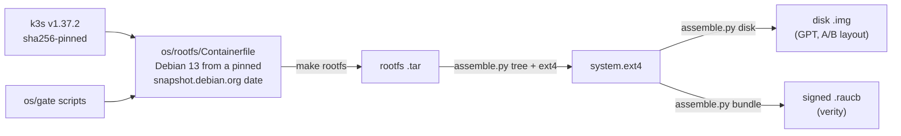
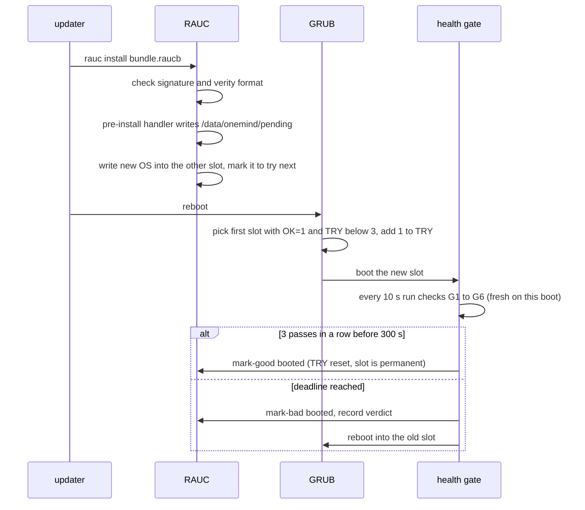

<!-- SPDX-License-Identifier: Apache-2.0 -->
# Lesson 07: The Image, A/B Updates and the Health Gate

**For:** Zeus (learning track) · **Date:** 2026-11-12
**Status:** founder-requested learning entry. It explains what PR [#10](https://github.com/onemindos/ONEMINDOS/pull/10) (image build, BM0/BM1) put on `main` and adds no decision.
**Sources (all on `main`):** [`os/`](../../os/), [`os/gate/onemind-health-gate`](../../os/gate/onemind-health-gate), [`os/gate/onemind-k3s-check`](../../os/gate/onemind-k3s-check), [`os/assemble/grub.cfg.in`](../../os/assemble/grub.cfg.in), [`os/rauc/handlers/rauc-pre-install`](../../os/rauc/handlers/rauc-pre-install), [`os/boards/x86_64-efi/layout.yaml`](../../os/boards/x86_64-efi/layout.yaml), [`test/qemu/CRITERIA.md`](../../test/qemu/CRITERIA.md), [`Makefile`](../../Makefile).
**Builds on:** [03](03-base-os-debian-vs-ubuntu.md) (why Debian 13), [06](06-image-building-on-our-hardware.md) (boards and kits).
**Feeds:** brief 30 B2 (boards), B5 (health gate); decisions D-007, REC-DEC-07 (fresh checks), REC-DEC-45 (verdicts), BD-08 (GRUB route), BD-DO-1 (DigitalOcean BIOS board).

---

## 1. The idea in one paragraph
A OneMind box never changes its operating system file by file. The OS is one sealed, **read-only** copy, and the disk holds **two** places for it, slot A and slot B. An update writes a whole new OS into the slot you are *not* running, then reboots into it **on trial**. A small program, the **health gate**, then watches that trial boot. If k3s and the OneMind core come up healthy *on this boot*, it makes the new slot permanent. If they don't, it marks the slot bad and reboots into the old one, with no human help. Your data lives on a third partition that neither update touches.

## 2. Vocabulary
- **Root filesystem (rootfs):** every file the OS needs (`/usr`, `/etc`, the kernel modules). Ours is built from a Containerfile on Debian 13.
- **Image:** the rootfs packed into a filesystem file plus a partitioned disk you can write to a USB stick or SSD.
- **Slot:** one of the two system partitions (`onemind-system-a`, `onemind-system-b`).
- **RAUC:** the open-source updater that writes a bundle into the other slot and tells the bootloader to try it. We build RAUC v1.15.2 from a pinned commit instead of using Debian's package.
- **Bundle (`.raucb`):** a signed file holding a new system image. We accept only the **verity** format, where every block of the image is hash-checked as it is read.
- **grubenv:** a tiny file on the EFI partition where GRUB keeps notes between boots: `A_OK`, `A_TRY`, `B_OK`, `B_TRY`, `ORDER`.
- **Trial boot / commit:** the first boots of a new slot are trials. "Commit" (RAUC's `mark-good`) makes the slot permanent.
- **Watchdog:** a hardware timer that resets the machine if the OS stops "petting" it. We set `RuntimeWatchdogSec=30s` in [`onemind-watchdog.conf`](../../os/rootfs/layers/base/etc/systemd/system.conf.d/onemind-watchdog.conf).

## 3. From recipe to disk

Every version that can change the output is pinned in [`os/versions.lock.yaml`](../../os/versions.lock.yaml): the Debian snapshot date, the RAUC commit, k3s and its air-gap images by sha256. Building twice from the same commit should give the same OS.

The x86 disk layout ([`layout.yaml`](../../os/boards/x86_64-efi/layout.yaml)):

| Partition | Size | Holds |
|---|---|---|
| `onemind-esp` | 1 GiB | GRUB and `grubenv` |
| `onemind-boot-a` / `-b` | 512 MiB each | reserved for signed kernels (the UKI route, milestone BM2) |
| `onemind-system-a` / `-b` | 10 GiB each | the read-only OS, one per slot |
| `onemind-recovery` | 1 GiB | rescue system, **empty in v0** |
| `onemind-data` | the rest | `/data`: k3s state, logs, apps, the gate's notes. Survives every update |

The root is mounted read-only (`ro` on the kernel command line). Things that must be writable, like `/var/lib/rancher` and `/var/log`, are bind-mounted from `/data/state/` by [`/etc/fstab`](../../os/rootfs/layers/base/etc/fstab).

## 4. One update, step by step

Two details carry most of the safety:
- **The trial marker is written *before* the slot.** RAUC marks the new slot active before its post-install step runs, so a marker written afterwards could be lost to a power cut and leave an ungated slot. That is why [`rauc-pre-install`](../../os/rauc/handlers/rauc-pre-install) writes `/data/onemind/pending` ("slot version") first.
- **GRUB counts tries.** A slot is tried while `OK=1` and `TRY<3`; `TRY` goes up on every boot and `mark-good` resets it. A kernel that panics or hangs never reaches the gate, so after three attempts GRUB falls back on its own. This logic is copied from Home Assistant OS's PC board (cited in the file header).

## 5. The health gate in detail
The gate ([`onemind-health-gate`](../../os/gate/onemind-health-gate)) reads the trial marker and picks one of three modes:

| Mode | When | What it does |
|---|---|---|
| `trial` | the marker names the booted slot | run the checks; commit or reject |
| `fell-back` | the marker names the *other* slot | that slot failed before a decision (crash, hang, power cut): mark it bad so it is never retried |
| `committed` | no marker | a normal boot: mark-good (resets the try counter), check k3s for the log only, **never** roll back |

The checks ([`onemind-k3s-check`](../../os/gate/onemind-k3s-check)):

| Check | Passes when |
|---|---|
| G1 | this boot's kubeconfig exists and the API server's `/readyz` answers |
| G2 | the local kubelet answers `/healthz` |
| G3 | the node is Ready **with a heartbeat newer than this boot** |
| G4 | each core pod (DNS, storage, `onemind-core`) is Ready **and became Ready after this boot** |
| G5 | `/data` is mounted read-write and a real write, `fsync` and read-back works |
| G6 | the local OneMind API answers with **this boot's ID** |
| G7 | the version that booted equals the version in the trial marker |

**Why "fresh" matters (the stale-Ready trap).** After a reboot, the Kubernetes API server serves the status it *stored before the reboot*. A naive check that asks "is the node Ready?" can read yesterday's answer while the kubelet is not running at all. Every check therefore compares timestamps with this boot's start (`btime` in `/proc/stat`). There is deliberately no switch to turn freshness off; the naive version lives only in a test fixture (T10) to prove the trap is real.

**Market apps are excluded.** One broken app must not roll back your whole OS. The gate logs the `apps` namespace but never decides on it.

**Two verdicts.** If the deadline passes, the gate records `image-bad` (the new OS is broken; never offered again) or `environment-bad` (only a core pod failed after the basics passed; re-offered a bounded number of times). Both go into `/data/onemind/bad-releases`, which the updater reads (lesson 08).

**When there is nowhere to go back to.** If the other slot is not marked good either, the gate stays on the current slot and raises an alert instead of rebooting into nothing.

## 6. How we know it works: the QEMU battery
[`test/qemu/CRITERIA.md`](../../test/qemu/CRITERIA.md) was written and hashed **before** any image was built (the hash is in `PREREGISTRATION.sha256`), so the pass marks could not be moved after seeing results. Each test boots a real image in QEMU:

| Test | Breaks | Expected result |
|---|---|---|
| T2 / T11 | wrong signing key / unsigned-format bundle | refused, boot order untouched |
| T3 | nothing (good update) | 3 fresh passes, `mark-good` on slot B |
| T4 | k3s broken | `mark-bad`, reboot to the old slot, verdict `image-bad` |
| T5 | API up, kubelet never starts (stale-Ready trap) | the gate is **not** fooled: `mark-bad` |
| T6 / T7 | kernel panic / hang with watchdog | 3 attempts, then GRUB falls back |
| T8 / T9 | power cut while writing / before commit | old slot boots / trial resumes |
| TC1 | DigitalOcean first boot (`vm-do`) | cloud-init done, SSH key installed, host keys on `/data` |

PR [#10](https://github.com/onemindos/ONEMINDOS/pull/10) records the CI result: on `x86_64-efi`, T0 T1 T2 T11 T3 T4 T4v T5 T5v all PASS (13.9 min); on `vm-do` the same plus TC1 (14.0 min); on `arm64-efi`, T0 and T1 PASS (emulated, slow). T6–T9 are part of the battery but were not required for this milestone, so their results are "reported, never required" (CRITERIA §4).

## 7. What is on `main`, and what is not yet
- **Boards on `main`:** `x86_64-efi`, `arm64-efi`, `vm` and `vm-do` (BIOS boot for DigitalOcean, from lesson 06 §4). There is **no `rpi5` or Jetson board directory yet**; those come with later kits.
- **Recovery partition** exists but is empty. **Disk encryption** of `/data` (LUKS2) and **Secure Boot** with signed kernels (UKI) are planned for BM2.
- **G6 uses a stand-in.** Until `onemindd` ships in the image, a tiny `socat` service ([`onemind-local-api.service`](../../os/gate/onemind-local-api.service)) answers with the boot ID.
- **The updater is not in the image yet.** [`internal/update/README.md`](../../internal/update/README.md) says the image does not ship `onemindd`, its unit, `update.conf` or a channel root yet. Updates in the battery are installed by the test driver.

## 8. Try it
1. **Read the gate.** Open [`onemind-health-gate`](../../os/gate/onemind-health-gate) next to §5 above. Find the line that decides `environment-bad`, and the line that refuses to roll back a committed slot.
2. **Run the layout tests** (they check `layout.yaml` and the BIOS board against the spec). They need PyYAML, so use a throwaway virtual environment:
   ```sh
   python3 -m venv .venv && .venv/bin/pip install -r sdk/tools/requirements.txt
   .venv/bin/python -I -m unittest discover -s test/unit -v
   ```
3. **Look at a real gate log.** In GitHub, open Actions → the `image` or `battery` workflow → a run → the `battery-…` artifact. Its serial log shows lines such as `HEALTH-GATE: … CHECK pass 2/3` and `RESULT mark-bad slot=A version=3 verdict=image-bad`.
4. **Thought exercise.** The box runs v2 on slot B. A v3 update has a kernel that panics. Write down the grubenv values (`A_OK`, `A_TRY`, `B_OK`) after each of the next four boots, then check your answer against T6 in `CRITERIA.md`.
5. **Build an image yourself (heavy, optional).** On a Mac this needs a Lima VM with Docker; see `make help` and [`os/update/README.md`](../../os/update/README.md) "Running it locally". Expect it to take a long time and a lot of disk.

## 9. Why it is built this way
- **Whole-image A/B over package upgrades:** an interrupted `apt upgrade` can leave a half-updated system. Writing the inactive slot means a failure always leaves one complete, known-good OS (Home Assistant OS and others ship this pattern).
- **RAUC from source, pinned:** the lab (`research-output/evidence/lab/rauc-1152/`) proved v1.15.2's verity bundles; Debian's package is a different version.
- **GRUB first, UKI later (BD-08):** GRUB works on every x86 and on BIOS-only clouds today; signed kernels arrive with Secure Boot.

## 10. Check yourself
1. Why is the trial marker written in the **pre**-install handler and not after the slot is written?
2. What would go wrong if G3 only checked "node Ready" without comparing to the boot time?
3. A Market app crash-loops on the new slot while everything else is healthy. Does the gate roll back? Why?
4. Which failures are caught by GRUB's try counter, and which only by the gate?
