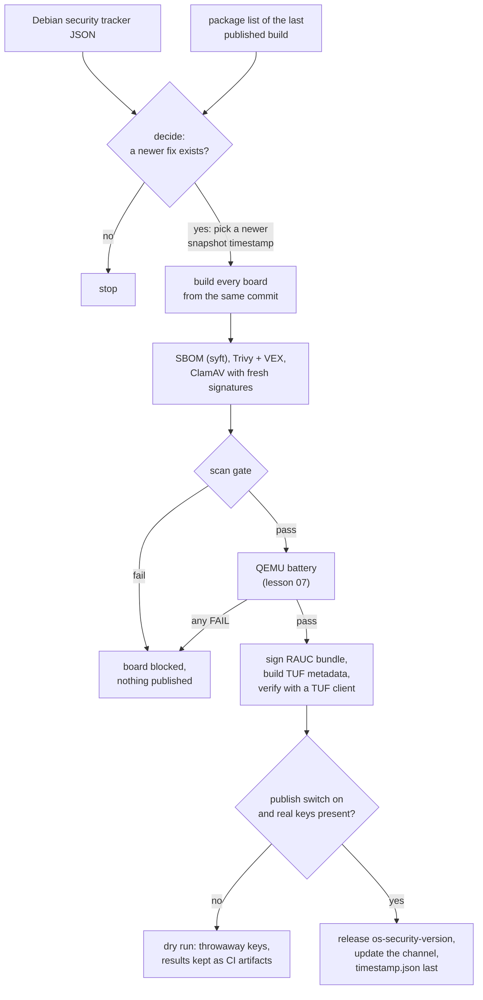
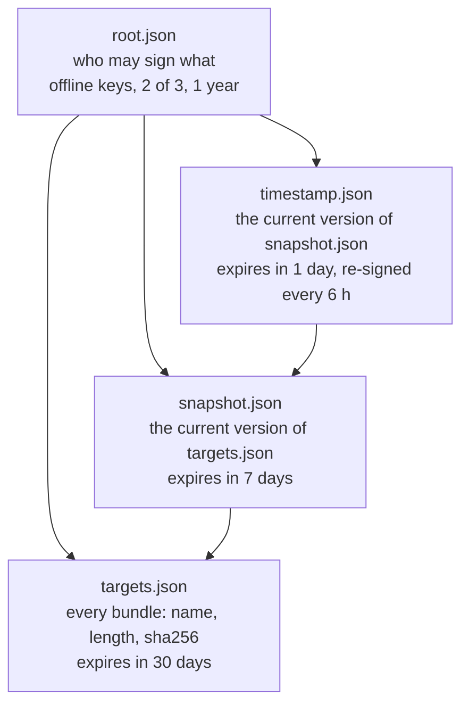
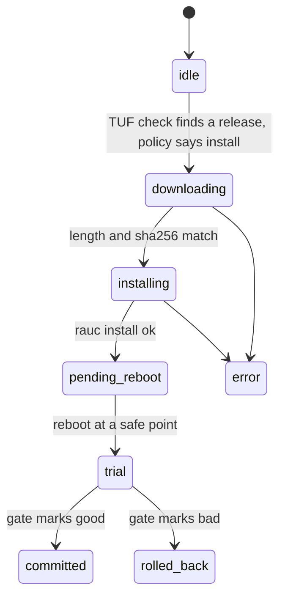

<!-- SPDX-License-Identifier: Apache-2.0 -->
# Lesson 08: From a Debian Fix to Your Box: the Security Pipeline and TUF

**For:** Zeus (learning track) · **Date:** 2026-11-12
**Status:** founder-requested learning entry. It explains PR [#14](https://github.com/onemindos/ONEMINDOS/pull/14) (OS security pipeline, CI side) and PR [#15](https://github.com/onemindos/ONEMINDOS/pull/15) (the `onemindd` updater, box side) and adds no decision.
**Sources (all on `main`):** [`os/update/README.md`](../../os/update/README.md), [`os/update/CHANNEL.md`](../../os/update/CHANNEL.md), [`.github/workflows/security-nightly.yml`](../../.github/workflows/security-nightly.yml), [`internal/update/README.md`](../../internal/update/README.md), [`internal/update/engine_test.go`](../../internal/update/engine_test.go), contract [`sdk/contracts/poc-v0.md`](../../sdk/contracts/poc-v0.md) §10.1.
**Builds on:** [07](07-image-ab-updates-health-gate.md) (A/B slots and the health gate).
**Feeds:** contract §10.1; brief 30 B4.2 (updater), B4.3 and B4.6 (keys); BD-09 (update policy); K-ROOT and K-TUF-ONLINE (key model); SB-10 (no production key in CI).

---

## 1. The idea in one paragraph
Every night a CI job asks one question: **"Does Debian have a security fix that our image lacks?"** If yes, it rebuilds the OS from a newer frozen copy of Debian, scans the result for known vulnerabilities and malware, boots it through the QEMU battery from lesson 07, signs it, and lists it on the **security channel**. On each box, the updater checks that channel every hour. It trusts the list only if it is signed by keys the box already knows, is newer than anything it saw before, and has not expired. Then the owner's policy decides when to install, and the health gate decides whether to keep it.

## 2. Vocabulary
- **CVE:** a public ID for a known vulnerability (for example `CVE-2026-1234`).
- **Debian security tracker:** Debian's public database of which CVE affects which source package and which version fixes it. The pipeline downloads it as JSON.
- **snapshot.debian.org:** an archive of every Debian package set at every point in time. Our image pins one timestamp (`20261111T000000Z` today), so a rebuild gets exactly the same packages.
- **SBOM:** Software Bill of Materials, a list of every package in the image (made with syft).
- **Trivy:** a scanner that matches the SBOM against CVE databases.
- **VEX:** a statement such as "this CVE does not affect us" or "fixed". The pipeline turns the Debian tracker into OpenVEX so Trivy stops reporting what Debian already decided is not a problem.
- **ClamAV:** an open-source antivirus scanner.
- **TUF (The Update Framework):** a standard for signing the *list* of available updates, so a mirror or attacker cannot lie about what exists.
- **Channel:** one TUF repository. Two are defined: `security` and `stable`.

## 3. The nightly pipeline

**The scan gate fails a board when** ClamAV finds anything (or did not run), or Trivy reports a **CRITICAL** CVE whose Debian fix the image does not carry. Other fixable findings are reported but do not block, because blocking on them would block the fix for the critical one.

**Reproducible from a commit.** The only input that changes between nights is the snapshot timestamp. The job writes it into [`os/rootfs/debian.args`](../../os/rootfs/debian.args) and `os/versions.lock.yaml`, commits that change and tags it `os-security-<version>`. So "what was built" is always a commit you can check out and rebuild.

The jobs, scripts and their roles are listed in [`os/update/README.md`](../../os/update/README.md) "Pipeline". The scripts are small and readable: [`check-security.py`](../../os/update/check-security.py), [`pick-snapshot.py`](../../os/update/pick-snapshot.py), [`debian-vex.py`](../../os/update/debian-vex.py), [`scan-gate.py`](../../os/update/scan-gate.py), [`tuf-repo.py`](../../os/update/tuf-repo.py).

## 4. TUF: why a signature on the bundle is not enough
The RAUC bundle is already signed (lesson 07, test T2). That proves **"OneMind built this bundle."** It does not prove **"this is the newest bundle."** An attacker who controls a mirror, or a broken CDN, could:
- keep serving last month's list, so your box never sees a security fix (a **freeze** attack);
- serve an older, validly signed list again after you saw a newer one (a **rollback** or replay attack);
- mix files from different releases.

TUF closes these gaps with four signed files, each with its own job and key:


- The box trusts only the `root.json` **shipped inside its own image** (`/usr/lib/onemind/tuf/<channel>/root.json`).
- Because `timestamp.json` expires after **one day**, a frozen mirror is noticed within a day.
- The box keeps the last metadata it trusted under `/data`, so an older version is refused. The test [`TestReplayedOlderMetadataRefused`](../../internal/update/engine_test.go) plays exactly this attack.
- The bundle's length and sha256 must match `targets.json` **before RAUC ever sees the file**.
- The root keys never touch CI. Rotating the root is an offline ceremony ([`scripts/tuf-bootstrap-root.sh`](../../scripts/tuf-bootstrap-root.sh), which refuses to run in CI).

We use the maintained `go-tuf/v2` client on the box and `python-tuf` in CI, never our own verifier.

## 5. The box side: the updater
[`internal/update`](../../internal/update/README.md), run as `onemindd update`:


What decides "install now?" (BD-09):

| Rule | Effect |
|---|---|
| channel `security` | installs automatically, inside the maintenance window (default 02:00–05:00) |
| channel `stable` | notifies only |
| `policy = off` | never installs by itself |
| `postpone-until` file | no auto-install before that time |
| a previous update still on trial | nothing installs until the gate decides |
| `/run/onemind/reboot-inhibit` exists | the reboot waits (a robot mid-mission creates this file) |
| the release is in `bad-releases` | `image-bad`: never again; `environment-bad`: re-offered at most 3 times |

Before installing, the updater takes a **restic snapshot of `/data`** if restic is configured (lesson 12). The security channel installs even without a snapshot, recording `snapshot: none`, because a security fix outranks a backup that does not exist. The stable channel refuses.

**It never trusts "install succeeded".** After the reboot it reads what actually booted plus the gate's files. Trusting `rauc install`'s exit status was a field failure in ZimaOS (research claim `C-TD-casaos-zimaos-044`), so we read the result instead.

## 6. What is on `main`, and what is not yet
- **Nothing is published yet.** There is no `root.json` in `os/rootfs/layers/base/usr/lib/onemind/tuf/` and the repo has no releases. Every nightly run is a **dry run** with throwaway keys made and deleted inside the job. Publishing needs the offline root ceremony and the online keys as repository secrets: both are founder steps.
- **The image does not ship the updater yet** (lesson 07 §7), so the end-to-end path "nightly fix → real box" has not run.
- **Not built yet** ([`internal/update/README.md`](../../internal/update/README.md) "v0 shortcuts"): gateway approval for OS updates, offline grace when the timestamp expires, USB or LAN mirror installs.
- **Flagged, not decided:** the brief proposed longer expiries (7/30/180 days); the pipeline uses 1/7/30. The founder owns this choice ([`CHANNEL.md`](../../os/update/CHANNEL.md) §7).

## 7. Try it
1. **Watch TUF refuse attacks** (Go is enough; about a second):
   ```sh
   go test -count=1 -v -run 'Replayed|Tampered|WrongRoot|ExpiredTimestamp|WrongBoard' ./internal/update/
   ```
   Read each test next to §4 and say which attack it plays.
2. **Run the pipeline's unit tests** (standard library only):
   ```sh
   python3 -I -m unittest discover -s os/update/tests -p 'test_[cdps]*.py' -v
   ```
   `test_tuf_repo.py` needs the pinned `python-tuf`; [`os/update/README.md`](../../os/update/README.md) shows the venv command with `--require-hashes`.
3. **See which CVEs Debian decided do not affect it.** Open the Debian tracker page for any package (for example `security-tracker.debian.org/tracker/source-package/openssl`) and find a "no-dsa" or "not-affected" entry. That is what `debian-vex.py` turns into VEX.
4. **Read a dry run.** GitHub Actions → `security-nightly` → a run → the `decide` artifact shows what the job found and why it built or stopped.

## 8. Why it is built this way
- **Debian's own policy, at build time.** Debian installs security updates automatically and leaves feature updates to you. A read-only root cannot run `unattended-upgrades`, so the pipeline applies the same rule when it builds, and ships the result as an A/B update.
- **Every fix goes through the same battery** as a feature release. A security fix that breaks boot is still a broken box.
- **Two independent locks:** RAUC signature (who built it) and TUF (is this the newest honest list). Breaking one is not enough.

## 9. Check yourself
1. Why does `timestamp.json` expire after one day while `root.json` lasts a year?
2. An attacker serves your box last week's validly signed `targets.json`. Which file and which check stop it?
3. Why does the security channel install without a backup snapshot, while stable refuses?
4. What must the founder do before the first real publish?
