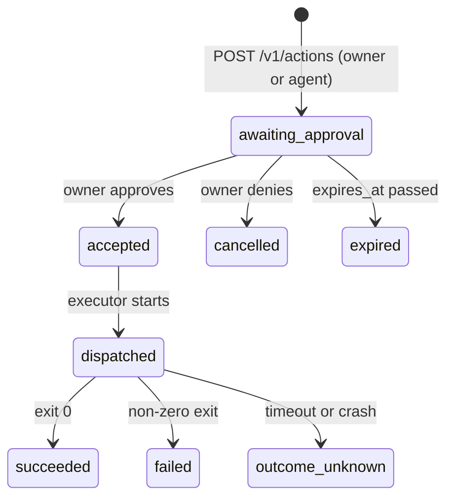
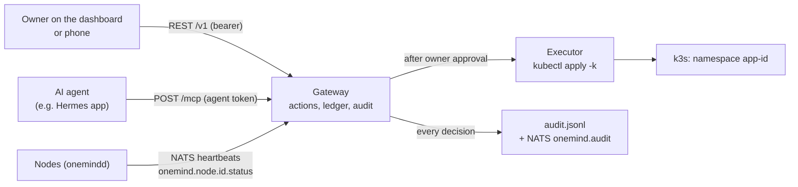

<!-- SPDX-License-Identifier: Apache-2.0 -->
# Lesson 09: The Gateway: Approvals, Agents and MCP

**For:** Zeus (learning track) · **Date:** 2026-11-12
**Status:** founder-requested learning entry. It explains the gateway on `main` (PR [#9](https://github.com/onemindos/ONEMINDOS/pull/9) v0, PR [#24](https://github.com/onemindos/ONEMINDOS/pull/24) wave 2, PR [#38](https://github.com/onemindos/ONEMINDOS/pull/38) plumbing) and adds no decision. Every "try it" step below was run against `main` on 2026-11-12.
**Sources (all on `main`):** [`core/README.md`](../../core/README.md), [`core/onemind_core/actions.py`](../../core/onemind_core/actions.py), [`ledger.py`](../../core/onemind_core/ledger.py), [`audit.py`](../../core/onemind_core/audit.py), [`auth.py`](../../core/onemind_core/auth.py), [`mcp/`](../../core/onemind_core/mcp/), [`docs/leap/core/PLUMBING.md`](../leap/core/PLUMBING.md), contract [`sdk/contracts/poc-v0.md`](../../sdk/contracts/poc-v0.md) §3, §11.2, §11.3.
**Builds on:** [07](07-image-ab-updates-health-gate.md) (the box it runs on).
**Feeds:** the locked rule "AI never actuates without human approval"; brief 30 B9 (D-B9.5 ledger, D-B9.6 approvals, D-B9.7 audit); BD-02 (Python + FastAPI), BD-04 (PostgreSQL target).

---

## 1. The idea in one paragraph
The **gateway** is the front door of a OneMind hub: the dashboard, the phone app, every node and every AI agent talk to the box through it. Its main job is to enforce one rule **in code, not in a prompt**: *AI never actuates without human approval.* Nobody, person or agent, changes anything directly. They file an **action**, a written request with exact parameters and an expiry. Only a **person with the owner role** can approve it. Only then does the **executor** touch the outside world. Every step lands in an **audit log** that is chained by hashes, so nobody can quietly edit history.

## 2. Vocabulary
- **Principal:** who is calling, with a kind (`person` or `agent`) and a role (`owner`, `adult`, `guest`, `agent`).
- **Bearer token:** a secret string sent as `Authorization: Bearer <token>` that identifies the principal. v0 reads them from a YAML file.
- **Action:** a request such as `app.install` for `ntfy`, stored in the **ledger** (a database table).
- **Idempotency key:** an ID the client picks. Sending the same request twice returns the same action, not a second one.
- **Compare-and-swap (CAS):** "change state A to B only if it is still A". Two owners clicking Approve at once cannot both start an install.
- **Executor:** the only code that changes the world: `kubectl apply -k` (real) or `noop` (demo, reports what it *would* do).
- **Hash chain:** each audit line stores `sha256(previous hash + this line)`. Same idea as git commits.
- **MCP (Model Context Protocol):** the standard way an AI agent discovers and calls tools.

## 3. The life of an action

Rules worth remembering:
- **An agent can request but never approve.** It gets `403 permission_denied`, and the attempt itself is audited.
- **Preconditions are checked twice:** when the request is filed and again at approval. If two install requests exist for the same app, approving the second returns `409 stale_precondition`.
- **`outcome_unknown` is never retried automatically.** If the executor timed out, we cannot know what was applied, so a person decides.
- **No install without a fresh passing scan.** Approving `app.install` returns `409 stale_precondition` if the app's `scan.json` is missing, failed, or older than 7 days (lesson 10).

## 4. Who talks to the gateway


## 5. Agents as principals
An app can be an AI agent. If its manifest says `spec.agent: {principal: true, secret: <name>}` (the Hermes app does), then at install approval the gateway:
1. creates the principal `agent:<app-id>` with a fresh random 256-bit token, and stores **only its sha256**;
2. writes a Kubernetes Secret with `ONEMIND_GATEWAY_URL` and `ONEMIND_AGENT_TOKEN` into the app's namespace **before** the app's pods start, passing the token on kubectl's stdin so it never appears in a log, the audit line or the action result;
3. revokes the principal at once if the install fails, and **first** on `app.remove`, so a removed app's credential is dead even if a later delete step fails.

The agent then talks to the box through the same approval path as everyone else. Its requests show `requested_by: agent:hermes-agent`, and the approval shows `approved_by: owner`.

## 6. MCP: tools for agents
`POST /mcp` speaks MCP Streamable HTTP (revision 2025-06-18), one JSON-RPC message per request. Only `kind: agent` principals may call it; a person gets 403.

| Tool | Does |
|---|---|
| `list_nodes` | same as `GET /v1/nodes` |
| `list_apps` | same as `GET /v1/apps` |
| `request_action` | files an action like `POST /v1/actions`, with a 24 h expiry |

**There is no approve tool.** That is the whole design: an agent can do everything up to the point of asking.

## 7. How the code is organised (plumbing)
PR #38 split the gateway so feature teams do not collide: one file per route group in [`core/onemind_core/routers/`](../../core/onemind_core/routers/), registered with one line in `ROUTERS` in [`app.py`](../../core/onemind_core/app.py). Each feature owns its tables, its `ONEMIND_<FEATURE>_*` settings and its events (`publish_event` writes the audit log, publishes on NATS `onemind.event.<domain>.<name>` and calls in-process listeners). Read [`PLUMBING.md`](../leap/core/PLUMBING.md) §1 "The map" before adding anything.

## 8. What is on `main`, and what is not yet
- **On `main` and tested:** actions, approvals, the ledger (SQLite by default, PostgreSQL tested), the hash-chained audit log, the scan check, agent principals, `/mcp` with three tools, node heartbeats over NATS.
- **v0 shortcuts** (from [`core/README.md`](../../core/README.md)): static bearer tokens from a file (passkeys replace them, lesson 13); NATS without auth or TLS (the mesh and leaf work in lesson 11 replace this); the audit log is a local file, not yet a JetStream stream; dispatch runs inside the approve request.
- **Not built yet:** a policy engine, standing approvals, approval push to a phone, MCP's authorization-server metadata, and expiry for app agent tokens. The kubernetes executor is tested with a fake runner, not yet against a live k3s.

## 9. Try it (about 10 minutes; needs `uv`)
Start a gateway on your Mac with the `noop` executor, so nothing is really installed:
```sh
cd core
ONEMIND_NATS_URL= make run          # http://127.0.0.1:8080, dev tokens from examples/tokens.example.yaml
```
In a second terminal (the tokens are the public placeholders in [`tokens.example.yaml`](../../core/examples/tokens.example.yaml); never use them on a reachable box):
```sh
OWNER=dev-owner-token-change-me; AGENT=dev-agent-token-change-me
EXP=$(python3 -c 'import datetime as d;print((d.datetime.now(d.UTC)+d.timedelta(hours=1)).isoformat())')

# 1. The agent asks to install ntfy
curl -s -X POST localhost:8080/v1/actions -H "Authorization: Bearer $AGENT" -H 'Content-Type: application/json' \
  -d "{\"type\":\"app.install\",\"params\":{\"app_id\":\"ntfy\"},\"idempotency_key\":\"try-1\",\"expires_at\":\"$EXP\"}"
# -> "state":"awaiting_approval"; copy the "id"
ID=<paste the id>

# 2. The agent tries to approve its own request
curl -s -X POST localhost:8080/v1/actions/$ID/approve -H "Authorization: Bearer $AGENT"
# -> {"error":"permission_denied","message":"agent/agent may not approve actions"}

# 3. The owner approves
curl -s -X POST localhost:8080/v1/actions/$ID/approve -H "Authorization: Bearer $OWNER"
# -> "state":"succeeded", result "noop executor: app.install ntfy recorded, nothing changed"

# 4. The agent's tools, and a person trying to use them
curl -s -X POST localhost:8080/mcp -H "Authorization: Bearer $AGENT" -H 'Content-Type: application/json' \
  -H 'Accept: application/json, text/event-stream' -d '{"jsonrpc":"2.0","id":1,"method":"tools/list"}'
curl -s -X POST localhost:8080/mcp -H "Authorization: Bearer $OWNER" -H 'Content-Type: application/json' \
  -H 'Accept: application/json, text/event-stream' -d '{"jsonrpc":"2.0","id":1,"method":"tools/list"}'
# -> list_nodes, list_apps, request_action; then 403 "agents only"
```
If step 3 answers `409 stale_precondition`, ntfy's `scan.json` is more than 7 days old: that is the scan gate working. For a local demo only, restart with `ONEMIND_ALLOW_UNSCANNED=1`.

**Break the audit log on purpose.** Stop the gateway, then:
```sh
make audit-verify                                   # OK: N lines verified
cp data/audit.jsonl /tmp/t.jsonl && sed -i.bak 's/"approved_by":"owner"/"approved_by":"mallory"/' /tmp/t.jsonl
ONEMIND_AUDIT_PATH=/tmp/t.jsonl make audit-verify   # BROKEN: ... hash mismatch (line was altered)
```
**Run the tests** for this lesson: `uv run pytest -q tests/test_actions.py tests/test_mcp.py tests/test_agent_principals.py tests/test_audit_auth_exec.py`.

## 10. Why it is built this way
- **The rule lives in the server.** A prompt can be talked around; a 403 cannot. The dashboard has no special powers either: every button is an API call an agent could make under the same rules.
- **Approve is a separate, human step.** This is what lets OneMind give agents real tools without giving them the keys.
- **Hash chain, not just a log file.** Someone on the box can still edit, delete or reorder lines, but `audit-verify` shows where the chain breaks. Cutting off the *newest* lines leaves a valid shorter chain, so that is caught only by comparing with a copy: today the NATS `onemind.audit` feed, later the checkpoints of contract §12.16.

## 11. Check yourself
1. Why does the gateway check preconditions again at approval time, not only at request time?
2. What stops an agent from minting itself an owner token through MCP?
3. Why is `outcome_unknown` never retried automatically?
4. In the hash chain, why does editing line 5 break verification at line 5 and not at the end?
