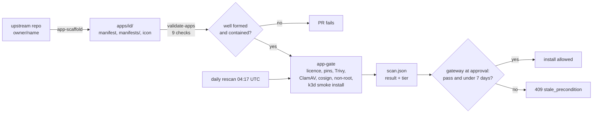

<!-- SPDX-License-Identifier: Apache-2.0 -->
# Lesson 10: The App Pipeline, the Scan Gate and the Install Sandbox

**For:** Zeus (learning track) · **Date:** 2026-11-12
**Status:** founder-requested learning entry. It explains PR [#11](https://github.com/onemindos/ONEMINDOS/pull/11) (manifest schema and validator) and PR [#25](https://github.com/onemindos/ONEMINDOS/pull/25) (app pipeline) on `main`, and names what the open PR [#40](https://github.com/onemindos/ONEMINDOS/pull/40) would add. It adds no decision.
**Sources (all on `main`):** [`sdk/tools/README.md`](../../sdk/tools/README.md), [`sdk/schema/onemind.app.schema.json`](../../sdk/schema/onemind.app.schema.json), [`.github/workflows/ci-apps.yml`](../../.github/workflows/ci-apps.yml), [`.github/workflows/apps-rescan.yml`](../../.github/workflows/apps-rescan.yml), [`apps/`](../../apps/), [`core/onemind_core/scan.py`](../../core/onemind_core/scan.py), contract [`sdk/contracts/poc-v0.md`](../../sdk/contracts/poc-v0.md) §4, §9, §10.2–§10.3, §11.1.
**Builds on:** [08](08-security-pipeline-and-tuf.md) (the same scanners, applied to the OS), [09](09-gateway-approvals-agents-mcp.md) (the gateway that refuses unscanned installs).
**Feeds:** founder requirement "100+ apps, added continuously" (contract §9); "nothing unscanned installs" (§10.3, §11.1).

---

## 1. The idea in one paragraph
A OneMind app is a folder, `apps/<id>/`, with a manifest (`onemind.app.yaml`), plain Kubernetes files and an icon. A **scaffolder** writes most of that folder from the upstream project's own files. A **validator** checks the folder is well formed and safe to apply. A **gate** then scans every container image for known vulnerabilities, malware and leaked secrets, checks the licence, test-installs the app on a throwaway k3s, and writes the verdict into `apps/<id>/scan.json`. CI repeats the scan every day. The gateway refuses to install any app whose last scan is missing, failed, or older than seven days.

## 2. Vocabulary
- **Manifest:** `onemind.app.yaml`: id, name, version, licence, links, tier, web port, resources, update policy. Its schema rejects unknown keys, so a new field is a contract change first.
- **Kustomize:** a tool that renders a folder of Kubernetes YAML into one stream. The gateway installs with `kubectl apply -k`.
- **kubeconform:** checks rendered YAML against the Kubernetes API schemas.
- **Digest pin:** `image:2.37.2@sha256:…`. The tag tells a person the version, the digest fixes the exact bytes, so a scan stays true for what runs.
- **Tier:** `verified`, `community` or `blocked`, computed by the gate, never hand-set upwards.
- **k3d:** k3s running inside Docker, used in CI as a throwaway cluster.
- **Licence classes:** L1 permissive, L2 copyleft, `blocked` (unknown, unconfirmed, source-available or non-commercial).

## 3. The pipeline

- **On every PR** that touches an app, [`ci-apps.yml`](../../.github/workflows/ci-apps.yml) runs the unit tests, `validate-apps`, the README check and gitleaks, then the full gate for each changed app on a fresh k3d cluster.
- **Every day**, [`apps-rescan.yml`](../../.github/workflows/apps-rescan.yml) re-runs the gate for every app, because new CVEs are published about old images.
- **Renovate** proposes image updates; patch updates auto-merge only for `verified` apps whose manifest allows it (`spec.updates.automerge: patch`), and `validate-apps` check 9 keeps `renovate.json` in step with the manifests.

## 4. What the gate checks (contract §9.4)
| Check | Fails the scan when |
|---|---|
| Licence | the class is `blocked`: unknown, unconfirmed by GitHub or the research licence matrix, source-available (BUSL, Elastic, FSL), non-commercial, or a `LicenseRef-` term |
| Pinning | a declared architecture (`spec.archs`) is missing from the image index |
| Trivy, per architecture | a **CRITICAL** CVE has a fixed version available, or a secret is found in the image |
| ClamAV | any hit |
| cosign | the upstream publishes a signature and it does not verify (unsigned is allowed and recorded) |
| Non-root | a container runs as root without `allowPrivilegeEscalation: false` and all capabilities dropped |
| Smoke | `kubectl apply -k` into `app-<id>`, every rollout finishes, and `GET /` on the web port answers 200–399 |

**Tier** follows: `blocked` if the licence is blocked, ClamAV hits or a fixable CRITICAL exists; `verified` if everything passes, upstream is not archived, the last release is under 18 months old and nothing in the folder says `UNVERIFIED`; otherwise `community`. The daily rescan may lower a tier but **never lifts `blocked`**; unblocking is a human PR.

**The gate on real apps today** (`apps/*/scan.json`, all scanned 2026-11-12):

| App | Result | Why |
|---|---|---|
| ntfy, Vaultwarden, Actual Budget, Zigbee2MQTT | pass, `verified` | — |
| Home Assistant, Uptime Kuma, Node-RED, Hermes agent | fail, `blocked` | the upstream image has 1–4 CRITICAL CVEs with a fix available |
| Mosquitto | fail, `blocked` | licence not confirmed: GitHub says `NOASSERTION`, and the research matrix spells it `EDL-1.0`, which is not an SPDX id ([its README](../../apps/mosquitto/README.md) explains) |

This is the gate doing its job: popular apps are not trusted because they are popular. They become installable when upstream ships a fixed image (Renovate proposes it) or when a person fixes the licence record.

## 5. The install sandbox: what holds an app in today
An app is installed with cluster rights, so the pipeline must make sure the YAML cannot reach outside its box. On `main` this is done at three points:
1. **Before merge, by `validate-apps` check 8:** only namespaced kinds (Deployment, Service, ConfigMap, PVC, NetworkPolicy and a few more), no `metadata.namespace`, no `Secret` objects, no `hostNetwork`, `hostPID`, `hostIPC`, `hostPath`, `hostPort` or privileged containers. Check 6 requires CPU and memory requests **and** limits on every container, so one app cannot starve a Pi.
2. **In the gate:** the non-root check and the smoke install on a throwaway k3d cluster, never on a real box.
3. **At install:** each app gets its own namespace `app-<id>`, and the gateway applies only the app's own folder there (lesson 09).

**What is not on `main` yet.** Open PR [#40](https://github.com/onemindos/ONEMINDOS/pull/40) ("security P0") proposes the cluster-side sandbox: an allow-list of what an app may create, Kubernetes Pod Security "restricted" on app namespaces, default-deny network policies, a gateway service account scoped to app namespaces, and k3s secrets encryption. Until it merges, the checks above are the whole sandbox, and they run in CI, not on the box.

## 6. Try it
1. **Validate the apps** (needs `kustomize` and `kubeconform`; the PyYAML part needs a venv):
   ```sh
   python3 -m venv .venv && .venv/bin/pip install -r sdk/tools/requirements.txt
   .venv/bin/python -I -m unittest discover -s sdk/tools/tests -v      # no network; recorded answers
   .venv/bin/python -I sdk/tools/validate-apps ntfy                    # needs kustomize + kubeconform on PATH
   ```
2. **Read one scan record:** open [`apps/ntfy/scan.json`](../../apps/ntfy/scan.json). Find the Trivy counts, the ClamAV signature version and the smoke result. Then open [`apps/home-assistant/scan.json`](../../apps/home-assistant/scan.json) and find the number that blocked it.
3. **Break an app on purpose** in a scratch branch: add `hostNetwork: true` to `apps/ntfy/manifests/deployment.yaml` and run `validate-apps ntfy` again. Read the failure, then revert.
4. **See the gate refuse an install:** in lesson 09's gateway, file an `app.install` for `home-assistant` and approve it as the owner. You get `409 stale_precondition`, because its scan says `fail`.

## 7. Why it is built this way
- **Facts from primary sources only.** The scaffolder reads the upstream repo, its compose file and the registry, and writes `UNVERIFIED` where it cannot confirm something. That caps the tier, so guesses never look verified.
- **Scan the bytes that run.** Digest pins make the scan, the smoke test and the install refer to the same image.
- **The gate writes a record, the gateway reads it.** CI does the expensive work; the box only checks a small file and a date. An honest failure can merge (the app stays uninstallable); an over-claimed tier cannot.

## 8. Check yourself
1. Why pin both a tag and a digest instead of just one?
2. Why does the daily rescan exist if every PR is already scanned?
3. An app needs a USB Zigbee stick (`hostPath` to `/dev`). What happens today, and what would have to change?
4. Why may the rescan lower a tier but never lift `blocked`?
