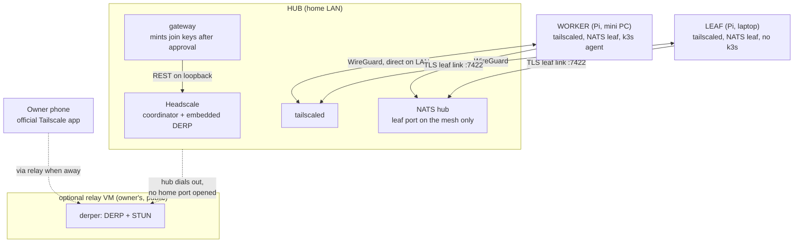
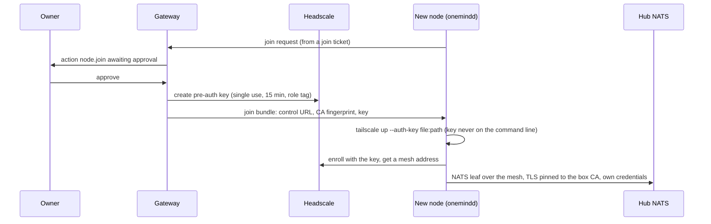
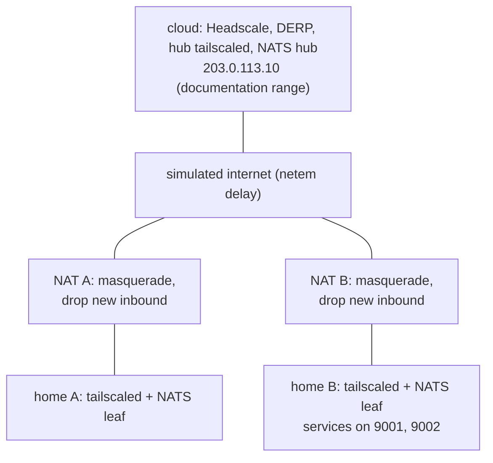

<!-- SPDX-License-Identifier: Apache-2.0 -->
# Lesson 11: The Mesh: Headscale, DERP, NATS Leaves and the FB-3 Lab

**For:** Zeus (learning track) · **Date:** 2026-11-12
**Status:** founder-requested learning entry. It explains PR [#37](https://github.com/onemindos/ONEMINDOS/pull/37) (core-net part 1) on `main` and adds no decision. The coordinator default (Tailscale or Headscale, Z-34) is still an open founder question.
**Sources (all on `main`):** [`docs/architecture/NETWORKING.md`](../architecture/NETWORKING.md), lab [`research-output/evidence/lab/fb3-mesh-nat/README.md`](../../research-output/evidence/lab/fb3-mesh-nat/README.md), [`internal/mesh/`](../../internal/mesh/), [`internal/leaf/`](../../internal/leaf/), [`core/onemind_core/mesh.py`](../../core/onemind_core/mesh.py), [`ca.py`](../../core/onemind_core/ca.py), [`proxy.py`](../../core/onemind_core/proxy.py).
**Builds on:** [09](09-gateway-approvals-agents-mcp.md) (approvals; the join is an approved action).
**Feeds:** mission 02 workstream FB-3; hardening items H-06 (NATS TLS and per-node credentials), H-17 (encrypted node-to-node traffic), H-05 (HTTPS on the LAN), H-29 (sign-in in front of apps); NETWORKING requirements N-R1 to N-R13.

---

## 1. The idea in one paragraph
Today a OneMind node talks to the hub's NATS bus in **plain text, with no password, and only on the same LAN**. The mesh fixes all three. Every OneMind machine, and every phone you add, joins one **private encrypted network** that your hub runs itself. Machines connect directly when they can, even through two home routers that let nothing in, and through your own relay when they cannot. Over that network each node runs a small local NATS server, a **leaf**, that forwards to the hub with TLS and its own credentials, and keeps events safe on disk while the hub is unreachable. No third-party company's servers are needed.

## 2. Vocabulary
- **WireGuard:** a small, fast, encrypted tunnel built into the Linux kernel.
- **Tailscale client (`tailscaled`):** open-source (BSD-3) software that sets up WireGuard tunnels between many devices automatically.
- **Headscale:** an open-source (BSD-3) **coordinator** for Tailscale clients. It hands out addresses and keys and enforces access rules. It never sees your traffic.
- **NAT:** a home router sharing one public address. By default it lets nothing start a connection from outside.
- **Hole punching:** two machines behind NATs send to each other at the same moment, so each router thinks the reply is part of an outgoing conversation.
- **DERP:** a relay that forwards already-encrypted WireGuard packets over HTTPS when no direct path works. It cannot read them.
- **Pre-auth key:** a one-time code that lets a machine join without a login screen. Ours are single-use and expire in 15 minutes.
- **Tags and ACL:** each machine carries a role tag (`tag:onemind-hub`, `-worker`, `-leaf`); the access policy, generated from OneMind roles, says which tag may reach which port.
- **NATS leaf node:** a NATS server on the node that forwards to the hub. With **JetStream** on, it stores events in a local "outbox" stream while the link is down.
- **Per-box CA:** a certificate authority created on the box itself, restricted by X.509 *name constraints* to the box's own names.

## 3. The design in one picture

Three layers, each with one job ([NETWORKING.md](../architecture/NETWORKING.md) §2):
1. **Mesh** (WireGuard, coordinated by Headscale): addresses, encryption, NAT traversal, access rules.
2. **Fabric over the mesh:** NATS leaf links, k3s between nodes, `onemindd` calls to the hub.
3. **Edge on the hub:** one HTTPS front door for people: `onemind.local` and `<app>.onemind.local`, behind OneMind sign-in.

## 4. How a machine joins
This is the design ([NETWORKING.md](../architecture/NETWORKING.md) §5, contract §12.11). The pieces exist on `main`; the wiring between them does not yet (§6).

Small details that matter: the key is passed as a **file**, so it never shows in `ps` (H-09); Headscale's DERP list is emptied (`derp.urls: []`), so Tailscale Inc's relays are never used; the relay verifies clients against Headscale and is set to **fail closed**, because `derper`'s default is to fail open.

## 5. The FB-3 lab: does it actually work?
Before building, we ran a pre-registered lab (criteria written and hashed before any VM existed). It simulated a cloud hub and two homes, each behind its own Linux NAT router that drops every new inbound connection, all inside one disposable 4 vCPU / 4 GiB arm64 VM sized like a Pi 5.



| Test | Question | Result (run 1, 2026-11-12) |
|---|---|---|
| T0 | every download matches its pinned sha256? | PASS (Headscale v0.29.7, Tailscale v1.104.6, nats-server v2.15.2) |
| T1a | nodes join with single-use keys; a reused key is refused? | PASS: `authkey already used` |
| T1b | the two homes find a **direct** path through both NATs? | PASS: first ping direct, median 48 ms on a 40 ms link |
| T1c | no inbound port open on either router? | PASS: port scans got no answer; every flow started inside |
| T2 | with UDP blocked, traffic falls back to **our** relay? | PASS: via DERP after 10 s, median 139 ms; direct again when unblocked |
| T3 | NATS events survive a **30-minute** hub outage? | PASS: 500 events per node kept locally, all 1,200 at the hub 44 s after the link returned, in order, none lost or doubled |
| T4 | the role-based access rules block what they say? | PASS: allowed port answers, denied ports give 0 bytes |
| T5 | fits a Pi-sized leaf? | PASS: about 60 MiB memory and 0.42 % of one core for `tailscaled` + leaf together |

**Three findings that change the build** (lab §7.3):
1. NATS took **3 to 7 minutes** to notice a silently dead link. Leaf ping settings must be tuned so "link down" shows within about a minute.
2. In simple config mode, NATS **cannot** stop one leaf from publishing as another node (experiment E2). Per-node isolation needs NATS accounts or JWT mode.
3. Behind a "hard" NAT (a new random port per destination, like many mobile carriers), two homes talk through the relay instead of directly. Slower, but it works.

## 6. What is on `main`, and what is not yet
Built and unit-tested, in the repo:
- [`internal/mesh`](../../internal/mesh/mesh.go): validates a join bundle and drives the system Tailscale client (`tailscale up`, `tailscale status --json`), never putting the key on a command line.
- [`internal/leaf`](../../internal/leaf/config.go): renders the node's `leaf.conf` (loopback-only listener, `tls://` hub URLs only, pinned CA, outbox capped at 256 MB) and reports leaf health.
- [`core/onemind_core/mesh.py`](../../core/onemind_core/mesh.py): the gateway's Headscale client, pinned to v0.29.7's API (the OpenAPI file's sha256 is in the code), minting keys only for approved actions.
- [`ca.py`](../../core/onemind_core/ca.py) (per-box CA, key 0600, no function returns it) and [`proxy.py`](../../core/onemind_core/proxy.py) (app reverse proxy with sign-in, no open proxy, no cross-site posts).

**Not wired in yet** (checked on `main`, 2026-11-12):
- the gateway's `app.py` does not mount the mesh client, the CA or the proxy;
- `onemindd`'s service registry ([`cmd/onemindd/registry.go`](../../cmd/onemindd/registry.go)) has no mesh or leaf service;
- `onemind mesh status` exists in [`cmd/onemind/mesh.go`](../../cmd/onemind/mesh.go) with tests, but is not registered in `cmd/onemind/cli/root.go`, so the built binary does not offer it;
- Headscale and `tailscaled` are not in the image, and the Go edge (`onemind-edge`) is not written.
So today the mesh is a **proven design plus tested building blocks**, not a running feature.

## 7. Try it
1. **Run the building blocks' tests** (Go and `uv`, about a minute):
   ```sh
   go test -count=1 ./internal/mesh/ ./internal/leaf/ ./cmd/onemind/
   (cd core && uv run pytest -q tests/test_mesh.py tests/test_ca.py tests/test_proxy.py)
   ```
2. **Read the evidence:** open the lab's [`results.json`](../../research-output/evidence/lab/fb3-mesh-nat/results.json) and find T3's message count and the time to drain. Then read `policy.hujson` in `run-1/` and match each rule to T4.
3. **Reproduce the lab (optional, about an hour).** Only inside a **disposable** Debian 13 arm64 Lima VM (4 vCPU / 4 GiB), never on your Mac: the scripts need root and create network namespaces. Inside the VM, install the Debian packages listed in the lab's [`versions.md`](../../research-output/evidence/lab/fb3-mesh-nat/versions.md), then from the lab folder run `scripts/fetch.sh`, then `OUTAGE_S=120 scripts/run-all.sh 1` for a 2-minute outage instead of 30. Delete the VM afterwards (`limactl delete -f <name>`).
4. **Think it through:** your phone is on LTE, the hub is at home behind CGNAT, and there is no relay VM. Which requirement in NETWORKING.md §1 fails, and which "reach mode" (§4.3) fixes it?

## 8. Why it is built this way
- **Self-hosted by default (N-R3):** Headscale, DERP and the clients are BSD-3 code you run. If a company changes its terms, your house keeps working.
- **No inbound port at home (N-R2):** the hub dials **out** to an optional relay; homes never forward ports.
- **Joining is an approved action (N-R4, N-R11):** adding reach needs the owner; removing it is instant.
- **The system Tailscale client, not an embedded one:** k3s, the NATS leaf and every other process need the kernel tunnel interface, and one identity per box keeps memory down on a Pi.
- **Evidence before code:** the lab caught the NATS impersonation gap before anyone built on the wrong assumption.

## 9. Check yourself
1. What can a DERP relay see of your traffic, and why?
2. Why are join keys single-use and short-lived, and why are they passed as a file?
3. In T3, why did no event get lost during the 30-minute outage?
4. What did experiment E2 prove, and what must change before nodes can be kept from impersonating each other?
