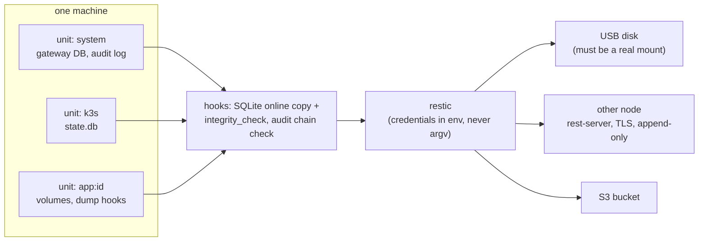
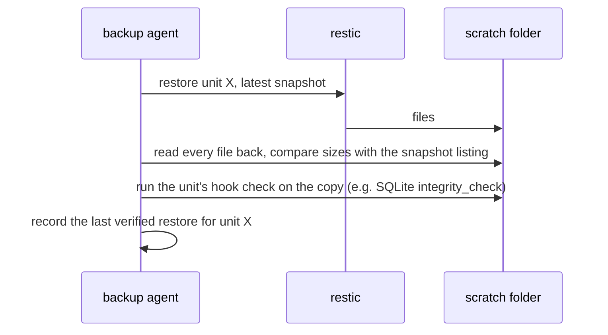

<!-- SPDX-License-Identifier: Apache-2.0 -->
# Lesson 12: Backups and Restore

**For:** Zeus (learning track) · **Date:** 2026-11-12
**Status:** founder-requested learning entry. It explains PR [#32](https://github.com/onemindos/ONEMINDOS/pull/32) (the `onemindd` backup agent) and PR [#31](https://github.com/onemindos/ONEMINDOS/pull/31) (disk inventory and health) on `main`, and adds no decision.
**Sources (all on `main`):** [`internal/backup/README.md`](../../internal/backup/README.md), [`docs/architecture/BACKUPS.md`](../architecture/BACKUPS.md), [`internal/storage/README.md`](../../internal/storage/README.md), contract [`sdk/contracts/poc-v0.md`](../../sdk/contracts/poc-v0.md) §12.12.
**Builds on:** [07](07-image-ab-updates-health-gate.md) (`/data` survives OS updates), [08](08-security-pipeline-and-tuf.md) (the pre-update snapshot).
**Feeds:** BACKUPS.md build steps K2 (agent) with parts of K5–K7; D-B7.2 (three keys); W5-R4, W5-R6, W5-R14; the locked stack choice "restic".

---

## 1. The idea in one paragraph
A backup is only worth something if you can restore from it. So OneMind does three things. **Every hour** each machine asks **restic** to copy what changed into an encrypted repository on a USB disk, another OneMind machine or an S3 bucket. **Every week** it actually restores each piece into an empty scratch folder and reads every file back; only then does the backup count as *verified*. And **before any restore overwrites something**, it snapshots what is there now, so every restore can itself be undone.

## 2. Vocabulary
- **restic:** a widely used open-source (BSD-2) backup program. It splits files into chunks, removes duplicates, encrypts everything, and stores it in a **repository**.
- **Snapshot:** a frozen copy of some folders at one moment. Restoring a snapshot gives you those folders as they were.
- **Unit:** one thing OneMind backs up separately: `system` (the box's own records), `k3s`, `app:<id>`, `node:<id>`.
- **Target:** where a repository lives: `usb`, `node` (another OneMind machine running `rest-server`), or `s3`.
- **Append-only:** a target that accepts new data but refuses deletions, so ransomware on the box cannot wipe the backups.
- **Retention ladder:** which old snapshots to keep: one per hour for a day, per day for a week, per week for a month, per month for a year.
- **Hook:** a step that makes data safe to copy, for example an SQLite online backup instead of copying a database file mid-write.
- **Fence:** a marker that says "this box was replaced by a restore", so two machines never write backups as the same box.

## 3. How a backup run works

Rules in the code ([`internal/backup/README.md`](../../internal/backup/README.md) "Safety rules"):
- **An unplugged USB disk is refused.** Otherwise the agent would happily fill an empty folder on the system disk.
- **A free-space check** runs before writing to USB.
- **A failed hook fails the unit:** a damaged k3s database or a broken audit chain writes no snapshot for that unit, and the run is marked `partial`.
- **"Some files unreadable" counts as failed**, not as success.
- **Every snapshot is tagged** (`box=`, `unit=`, `reason=`, `keep=` …), so plain `restic snapshots` explains the repository without OneMind.
- **Safety snapshots keep their own clock:** `pre-update` and `pre-restore` snapshots are kept 14 days and `pre-delete` 30 days, outside the ladder.

## 4. Verified restores

Separately, a daily `restic check` reads a rotating slice of the stored data (1/7 per day on local targets, 1/28 on S3), so every stored byte is read about once a week (once every four weeks on S3).

## 5. Undo for restores (Rewind)
Restoring one file or folder ([`rewind.go`](../../internal/backup/rewind.go)): first snapshot what is there now (`reason=pre-restore`), then restore into a temporary place, then swap it in with an atomic rename. It refuses paths outside the unit's own folders and parents that are symlinks, so a crafted path cannot write elsewhere on the box.

## 6. Keys, the emergency kit and whole-box restore (the design)
These parts are designed in [BACKUPS.md](../architecture/BACKUPS.md) §5 and §7.3 and **not built yet**:
- **Three keys** open the same repository: the **device** key (on the box), the **owner recovery** key (only in a printed emergency kit, never stored on the box) and an optional **escrow** key for a trusted person. Each is 256 random bits, never derived from a password.
- **The emergency kit** prints the recovery key (text and QR), where the targets are, and **plain restic commands** to restore without OneMind. Setup will not finish until you type back two key groups, proving you saved it.
- **Whole-box restore onto new hardware:** enter the recovery key, pick the box and the moment, and the default "portable" mode restores the system records, starts a fresh k3s and re-applies each app's recorded version before restoring its data. That works even across CPU types when images are multi-arch.
- **The fence:** the restored box raises its generation number and writes a fence to every target, so the old box (if it comes back) stops backing up instead of overwriting the new one's history. `WriteFence` exists in the agent today; the restore flow that calls it does not.

## 7. Storage: knowing your disks first
[`internal/storage`](../../internal/storage/README.md) answers "which disks are there, are they healthy, is the data mirrored?" using `lsblk`, `smartctl` and `btrfs`. It produces **dry-run plans** (exact commands plus the checks they passed, sealed by a hash of the target disks' identity), and **changes nothing**. A disk that holds the system or is in use is never offered for wiping. Running a plan will be an owner-approved `storage.*` action in a later epic.

## 8. What is on `main`, and what is not yet
- **On `main`, tested:** the backup agent (restic and rest-server pinned by sha256, the three targets, units and hooks, the ladder, verified restores, rewind, fence check, loopback-only API) and the storage collector and planner. The agent's integration test passed against **real** restic 0.19.1 and rest-server 0.14.0 in a Debian 13 arm64 VM on 2026-11-12, including "the server refuses `forget` on an append-only target".
- **Not wired in:** `onemindd`'s service registry is still empty ([`cmd/onemindd/registry.go`](../../cmd/onemindd/registry.go)), so the agent does not run on a box yet; the updater still uses its own restic settings for the pre-update snapshot; the `onemind storage` command exists in [`cmd/onemind/storage.go`](../../cmd/onemind/storage.go) but is not registered in the CLI.
- **Phone photo backup** (PR [#34](https://github.com/onemindos/ONEMINDOS/pull/34), merged 2026-11-12) is a different path: the phone app uploads photos in resumable chunks, skipping duplicates by hash, to a OneMind Photos service on the hub. That service does not exist yet, so the app is built and tested against a documented interim API and a mock ([`mobile/README.md`](../../mobile/README.md) "Photo backup").
- **Not built:** the gateway coordinator and `/v1/backups` API, the keys and emergency kit, whole-box restore, app verification in a sealed namespace, alerts on failure, and an S3 test against a real S3 server. The README's "Wiring still needed" lists all eight steps.

## 9. Try it
1. **Run the unit tests** (Go only, a few seconds; an in-memory fake repository and a scripted restic):
   ```sh
   go test -count=1 -v -run 'Retention|Fence|Restore' ./internal/backup/ | grep -E '^(=== RUN|--- )'
   go test -count=1 ./internal/storage/
   ```
2. **Run the real thing in a VM (optional, about 10 minutes).** The script makes a small Debian 13 VM (2 vCPU, 2 GiB, no host mounts), downloads the pinned binaries inside it, checks their sha256 and runs the integration test:
   ```sh
   internal/backup/testdata/lima-integration.sh --delete
   ```
3. **Use restic by hand** inside that VM to see what OneMind builds on: `restic init`, `restic backup`, `restic snapshots`, `restic restore latest --target /tmp/r`. Then read `restic.go` and find the line that keeps the password out of the command line.
4. **Thought exercise:** the USB disk is unplugged on Sunday night. What happens at the next hourly run, and why is that better than a "successful" backup?

## 10. Why it is built this way
- **restic, not our own format:** encrypted, deduplicated, widely audited, and restorable with plain restic if OneMind is gone (W5-R14).
- **Verify by restoring:** a backup that was never restored is a hope, not a backup.
- **Append-only remote targets:** a compromised box can add data but cannot delete its history.
- **Keys from randomness, not passwords:** a password-derived key is only as strong as the password.

## 11. Check yourself
1. Why must the agent check that the USB path is a real mount point?
2. What does "verified" mean for a backup here, exactly?
3. Why is a `pre-restore` snapshot kept outside the retention ladder?
4. Two machines both think they are box X after a restore. What stops them corrupting each other's backups?
