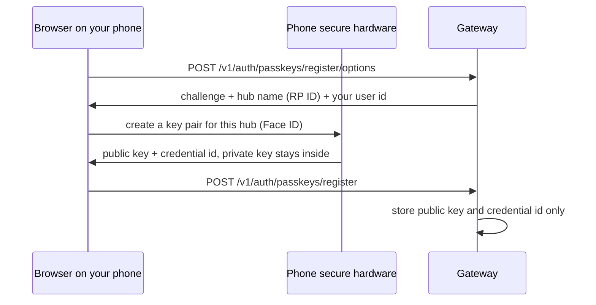
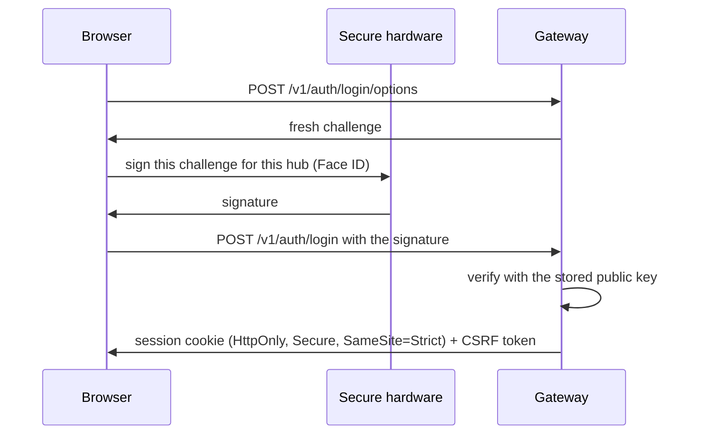
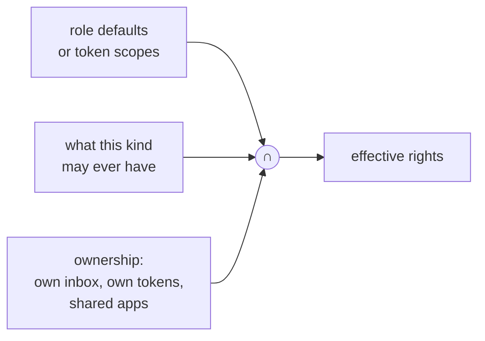

<!-- SPDX-License-Identifier: Apache-2.0 -->
# Lesson 13: Identity and Passkeys

**For:** Zeus (learning track) · **Date:** 2026-11-12
**Status:** founder-requested learning entry. On `main` today: static tokens in the gateway, and the **binding contract** for identity (PR [#39](https://github.com/onemindos/ONEMINDOS/pull/39), contract §12.6). The implementation is in the open PR [#41](https://github.com/onemindos/ONEMINDOS/pull/41) and is **not on `main`**; this lesson does not describe its code. No decision is added.
**Sources (on `main`):** [`core/onemind_core/auth.py`](../../core/onemind_core/auth.py), contract [`sdk/contracts/poc-v0.md`](../../sdk/contracts/poc-v0.md) §12.6 and §12.7, [`docs/leap/core/SECURITY.md`](../leap/core/SECURITY.md), [`ui/src/shell/Onboarding.tsx`](../../ui/src/shell/Onboarding.tsx), [`dashboard/src/pages/SignIn.tsx`](../../dashboard/src/pages/SignIn.tsx).
**Builds on:** [09](09-gateway-approvals-agents-mcp.md) (principals and roles), [11](11-mesh-headscale-derp-nats-leaf.md) (the per-box CA that gives the LAN HTTPS).
**Feeds:** CORE-SEC epics E3 (HTTPS + owner passkey) and E8 (identity floor); hardening H-05, H-09, H-16; BD-03 (identity provider).

---

## 1. The idea in one paragraph
Today you sign in to a OneMind hub by pasting a long **token**, like a password, and anyone who copies it *is* you. The plan, now fixed in the contract, replaces that with **passkeys**: a key pair made by your phone or laptop, where the private half never leaves the device and the hub keeps only the public half. Signing in means your device signs a fresh challenge from the hub, after Face ID or a fingerprint. Programs (the CLI, agents, plugins) get **scoped, expiring tokens** instead, each limited to what its job needs, and an agent can never get the right to approve.

## 2. Vocabulary
- **Authentication vs authorization:** *who are you?* vs *what may you do?*
- **Passkey (WebAuthn):** a public/private key pair created by a device's secure hardware for **one site**. The site stores the public key; the device keeps the private key and signs with it.
- **Challenge:** a random value the server sends; the device signs it, so an old signature can never be replayed.
- **Relying party (RP) ID:** the site name a passkey is bound to. A passkey made for your hub will not sign for a look-alike phishing site.
- **Session:** proof that you signed in recently. Browsers keep it in a cookie; programs keep a short-lived bearer token.
- **CSRF:** a trick where another site makes your browser send a request to your hub. A CSRF token that the page must echo back stops it.
- **Scope:** a named right such as `apps:read` or `actions:approve`.
- **Break-glass credential:** an emergency way in when everything else is lost, used once and then replaced.

## 3. What is on `main` today
[`auth.py`](../../core/onemind_core/auth.py) reads a YAML file that maps each token to a principal `{id, kind, role}`:
- tokens can be stored as `sha256:<hex>`, so the file need not hold the secret, and lookup is by hash, which keeps comparisons timing-safe;
- `is_owner` is true only for `kind: person` with `role: owner`, so **an agent can never act as an owner**, whatever its file entry says;
- app agent tokens (lesson 09 §5) are random 256-bit values stored only as sha256.

The sign-in screens say the same: [`SignIn.tsx`](../../dashboard/src/pages/SignIn.tsx) asks for an access token ("v0 uses a static token. Passkeys and accounts come later"), and the design system's onboarding wizard has a **"Create passkey"** step whose default handler is a 0.7-second stand-in, waiting for the real API.

## 4. How a passkey works
**Registering** (at first boot, or when the owner adds a person):

**Signing in:**

**Why this is better than a token or password:** the hub stores nothing that would let a thief sign in; a phishing site gets no usable signature because the passkey is bound to the hub's name; and every login signs a new challenge, so nothing can be replayed. Passkeys need HTTPS (a "secure context"), which is one reason the per-box CA and HTTPS on `:8443` (contract §12.7) come first.

## 5. What the contract fixes (§12.6)
- **Roles:** `owner`, `adult`, `guest`, `child` for people; `agent` for agents. The **last active owner** cannot be demoted, disabled or lose their last passkey (`409 last_owner`), so you cannot lock yourself out.
- **The old owner token becomes break-glass:** console-only, single use, rotated after use.
- **Sessions you can see and end:** `GET /v1/auth/sessions` lists them; revoking is instant.
- **Tokens with a visible type:** `om_pat_` (person), `om_agt_` (agent), `om_plg_` (plugin), `om_nod_` (node), `om_aut_` (automation). The prefix lets leak scanners (like the gitleaks we run in CI) spot a pasted token. Only the sha256 is stored; the token is shown once.
- **Scopes:** what a caller may do is *(role defaults or the token's scopes) ∩ what its kind allows ∩ what it owns*.


- **Never minted for agents, plugins, automations or nodes:** `actions:approve`, any `:admin` scope, `users:*`. The gateway refuses to create such a token (403) and refuses a manifest that asks for one (422).
- **Kill switch:** `POST /v1/agents/{id}/suspend` revokes all of an agent's tokens and cancels its pending actions at once.
- **Per-app sharing:** owners and adults see every installed app; guests and children see only apps shared with them, and the app proxy (lesson 11) enforces it on the next request.

## 6. Try it
1. **Store a token as a hash** (what a real v0 box should do today):
   ```sh
   TOKEN=$(openssl rand -hex 32); echo "keep this: $TOKEN"
   printf %s "$TOKEN" | shasum -a 256          # put "sha256:<this hex>" in the tokens file
   ```
   Start lesson 09's gateway with a tokens file that uses that `sha256:` key and confirm `curl -H "Authorization: Bearer $TOKEN" localhost:8080/v1/instance` works. The file now holds no secret.
2. **See passkeys on a real site.** On your phone, create a passkey for any account that offers one (Settings → Passwords shows it). Notice you never typed a secret, and the site never learned one.
3. **See the planned onboarding:** run the design-system demo (`cd ui && npm ci && npm run dev`), open `http://localhost:5173/#/shell/onboarding-1` and walk the first-run wizard to the "Create passkey" step (lesson 15). The passkey is simulated there.
4. **Read the rules:** in contract §12.6, find the line that stops an agent's rights from ever exceeding its owner's.

## 7. Why it is built this way
- **Passkeys over passwords:** nothing to phish, nothing reusable stored on the box.
- **Tokens for programs, but narrow and expiring:** a leaked agent token can do only what its scopes allow, for at most 90 days by default (personal agent tokens), and can be killed at once.
- **Approval stays human:** the scope `actions:approve` can exist only on a person with the owner role. SECURITY.md also proposes signing each approval with the owner's passkey over the exact action, so even a stolen session cannot approve silently.

## 8. Check yourself
1. Where does the private key of a passkey live, and what does the hub store?
2. Why can a phishing copy of your hub's sign-in page not use your passkey?
3. Why does the token format carry a visible prefix like `om_agt_`?
4. Why does the contract protect "the last active owner"?
