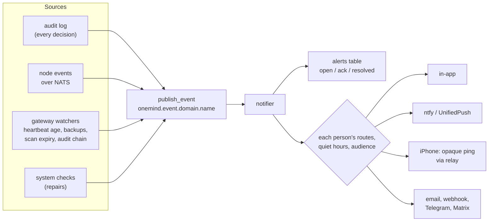

<!-- SPDX-License-Identifier: Apache-2.0 -->
# Lesson 14: Notifications and Alerts

**For:** Zeus (learning track) · **Date:** 2026-11-12
**Status:** founder-requested learning entry. On `main` today: the event plumbing every notification will start from, the binding contract for notifications (PR [#39](https://github.com/onemindos/ONEMINDOS/pull/39), contract §12.14), the design, the ntfy app, and poll-based alerts in the phone app. The notifier itself is in the open PR [#44](https://github.com/onemindos/ONEMINDOS/pull/44) and is **not on `main`**; this lesson does not describe its code. No decision is added.
**Sources (on `main`):** [`docs/architecture/NOTIFICATIONS.md`](../architecture/NOTIFICATIONS.md), contract [`sdk/contracts/poc-v0.md`](../../sdk/contracts/poc-v0.md) §12.14, [`core/onemind_core/events.py`](../../core/onemind_core/events.py), [`mobile/README.md`](../../mobile/README.md) "Notifications", [`mobile/src/lib/alerts.ts`](../../mobile/src/lib/alerts.ts), [`ui/src/shell/notifications.ts`](../../ui/src/shell/notifications.ts), [`apps/ntfy/`](../../apps/ntfy/), [`docs/DECISIONS.md`](../DECISIONS.md) D-005.
**Builds on:** [09](09-gateway-approvals-agents-mcp.md) (actions and the audit log), [13](13-identity-and-passkeys.md) (who receives what).
**Feeds:** D-005 (iOS push carries an opaque signal only); core-alignment items NOT-P1 to NOT-P3, NOT-B1 to NOT-B3; H-28 (alert on update freeze, scan expiry, audit break).

---

## 1. The idea in one paragraph
Everything that happens on the box becomes an **event**. Some events are worth telling someone about; those become **notifications** on the channels each person chose: the dashboard, a phone push, ntfy, email or a chat app. Problems that last, like "node offline" or "backup failing", become **alerts** that stay open until the condition clears, and many carry a **Fix** button. A Fix is an ordinary request that you approve, so even repairs follow the approval rule. Your iPhone gets only a meaningless "something new" ping through Apple, then fetches the real message from your own box.

## 2. Vocabulary
| Word | Meaning |
|---|---|
| **event** | a fact that happened, in the `onemind.event.v1` envelope (for example `action.failed`) |
| **alert** | a condition that is true now. One open alert per `dedupe_key`; it is opened, updated and resolved by events |
| **notification** | one message to one person on one channel |
| **channel** | a way to reach a person: `inapp`, `webpush`, `unifiedpush` (ntfy), `apns` (iPhone), `email`, `webhook`, `telegram`, `matrix` |
| **content level** | how much a channel may carry: `opaque` ("OneMind: new alert"), `title`, or `full` |
| **APNs** | Apple Push Notification service, the only way to wake an iPhone app instantly |
| **UnifiedPush** | an open standard for Android push that does not need Google; ntfy can be the server |

## 3. From event to your phone

**What exists on `main`:** the left half. [`publish_event`](../../core/onemind_core/events.py) appends the event to the hash-chained audit log, publishes it on NATS `onemind.event.<domain>.<name>` (best effort: a NATS outage never fails the caller) and calls in-process subscribers whose pattern matches. The notifier will be one such subscriber. Payloads carry ids and small facts, never secrets, because they are kept in the audit log for a year.

## 4. The iPhone path (D-005)
Apple only accepts pushes signed with the app developer's key, so a phone cannot be woken without going through Apple. D-005 keeps Apple blind:
```mermaid
sequenceDiagram
  participant Box as Your hub
  participant Rel as OneMind relay (stateless)
  participant Ap as Apple APNs
  participant Ph as Your iPhone
  Box->>Rel: ping with device token and opaque id only
  Rel->>Ap: push a new-alert signal with no content
  Ap->>Ph: wake the app
  Ph->>Box: GET /v1/notifications/id over HTTPS
  Box->>Ph: the real title and body
```
Apple learns *that* something arrived, never *what*. The relay holds no data. Android and desktop do not need any vendor: the hub's own ntfy (the [`apps/ntfy`](../../apps/ntfy/) app, tier `verified`) can be the UnifiedPush server.

## 5. Rules from the contract (§12.14)
- **Topics form a fixed tree:** `approvals`, `backups`, `updates`, `nodes`, `apps`, `storage`, `security`, `automation`, `plugin.<app-id>`. A plugin may send only under its own `plugin.<app-id>`.
- **Senders never pick recipients.** A plugin or agent may call `POST /v1/notifications/send` with a topic and text; the person's own routing decides who hears it and where. Sending changes no state, so it needs no approval, but it is rate-limited and audited.
- **Quiet hours** hold notifications and deliver one summary when they end; critical alerts and approvals can be set to go through.
- **No spam:** an alert re-notifies at most once every 30 minutes per `dedupe_key` and severity.
- **Approval notifications open the approval itself** (deep link `/approvals/<action_id>`), so you approve with a passkey in one step.
- **Children and guests** receive only alerts that concern them.

## 6. What the apps do today
- **Phone app (v0):** while open, it polls the hub every 10 s and raises a *local* notification for a new approval, a finished action, or a node going offline, coming back or joining. The first poll after launch stays silent, so you do not get a burst of old news. Nothing arrives while the app is closed; that needs the push paths in §4. The decision logic is a pure, unit-tested function in [`alerts.ts`](../../mobile/src/lib/alerts.ts).
- **Design system:** a notification centre component with severity, source, Fix and deep link ([`ui/src/shell/notifications.ts`](../../ui/src/shell/notifications.ts)), shown in the demo at `#/notifications` and `#/shell/notifications`.
- **Dashboard:** no notifications yet; Approvals is a page you open.

## 7. Try it
1. **Watch one event go three ways:** read `test_publish_event_audits_publishes_and_fans_out` in [`core/tests/test_plumbing.py`](../../core/tests/test_plumbing.py), then run it and its neighbours:
   ```sh
   (cd core && uv run pytest -q tests/test_plumbing.py -k publish_event)
   ```
   The `..._survives_broken_bus_and_subscriber` test shows why a dead NATS or a buggy listener never breaks the action that raised the event.
2. **Read the phone's alert rules as code:** open [`mobile/src/lib/alerts.ts`](../../mobile/src/lib/alerts.ts) and its test, and find the rule that stops `online ↔ stale` flapping from alerting.
3. **Design an alert:** using the catalogue in [NOTIFICATIONS.md](../architecture/NOTIFICATIONS.md) §3, write down the type, severity, `dedupe_key`, audience and Fix action for "the USB backup disk was unplugged". Compare with `backup.failed`.
4. **See it in the design system:** `cd ui && npm ci && npm run dev`, then open `#/notifications`.

## 8. Why it is built this way
- **One event bus, many listeners:** the producers (gateway, nodes, updater) do not know about phones or email. Adding a channel never touches them.
- **Alerts have a lifecycle:** "node offline" is one open alert that resolves itself, not a notification every minute.
- **Fix through approval:** a repair is still a change to your box, so it follows the same rule as everything else.
- **Privacy by default:** the less a carrier sees, the less can leak. The owner chooses the content level per channel.

## 9. Check yourself
1. What is the difference between an alert and a notification?
2. Why does the iPhone path need a relay, and what does Apple learn?
3. Why may a plugin send a notification without approval, but not choose who receives it?
4. Where on `main` does an event first appear, and which three things happen to it?
