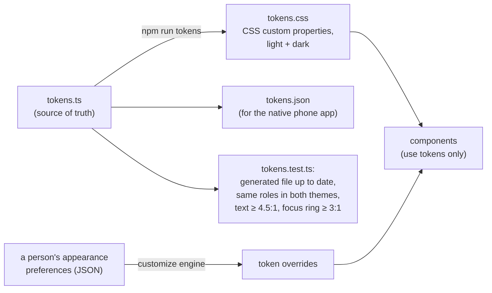

<!-- SPDX-License-Identifier: Apache-2.0 -->
# Lesson 15: The Design System and the Dashboard

**For:** Zeus (learning track) · **Date:** 2026-11-12
**Status:** founder-requested learning entry. It explains the dashboard (PR [#8](https://github.com/onemindos/ONEMINDOS/pull/8), app page in PR [#24](https://github.com/onemindos/ONEMINDOS/pull/24)), the design system `@onemind/ui` (PR [#20](https://github.com/onemindos/ONEMINDOS/pull/20)) and the UI leap (PR [#29](https://github.com/onemindos/ONEMINDOS/pull/29)) on `main`. It adds no decision.
**Sources (all on `main`):** [`docs/design/`](../design/README.md) (PRINCIPLES, IA, TOKENS, COMPONENTS, CRITIQUE), [`ui/README.md`](../../ui/README.md), [`ui/src/tokens/tokens.ts`](../../ui/src/tokens/tokens.ts), [`ui/src/customize/README.md`](../../ui/src/customize/README.md), [`dashboard/README.md`](../../dashboard/README.md), [`docs/strategy/umbrel-parity.md`](../strategy/umbrel-parity.md).
**Builds on:** [09](09-gateway-approvals-agents-mcp.md) (every button is an API call), [10](10-app-pipeline-scan-gate-sandbox.md) (trust information on app cards).
**Feeds:** core-alignment item 7 (UX-P1, design system v0); REC-W11-01 (one React + TypeScript web UI), REC-W11-19 (WCAG 2.2 AA), REC-W11-20 (headless first); umbrel parity gaps PU-03 (appearance) and PU-05 (onboarding); BD-02.

---

## 1. The idea in one paragraph
There are two pieces of UI code on `main`. The **dashboard** (`dashboard/`) is the working web app the gateway serves today: Sign in, Home, Nodes, Market, an app page and Approvals, talking to the real API. The **design system** (`ui/`) is a separate library of colours, spacing, components and full demo screens that shows where the product is going: a calm Home with widgets and a dock, an App Store, a notification centre, a command palette, settings and a first-run wizard, in light and dark, with personal themes and wallpapers. The plan (phase B) is to move the dashboard onto the design system; that has not happened yet.

## 2. Vocabulary
- **SPA (single-page app):** one HTML file plus JavaScript. The browser loads it once; afterwards only small JSON requests travel. The gateway serves it as plain files.
- **Design token:** a named design value, such as `--om-color-bg` or `--om-font-size-md`, kept in one place so every component uses the same value.
- **Theme:** a full set of token values (light, dark).
- **WCAG 2.2 AA:** the web accessibility standard we target: for example, normal text needs a contrast ratio of at least 4.5:1.
- **axe-core:** an automated accessibility checker run inside the tests.
- **Information architecture (IA):** what screens exist, what each is for, and how you move between them ([IA.md](../design/IA.md)).

## 3. The five principles
From [PRINCIPLES.md](../design/PRINCIPLES.md); every screen is reviewed against them:

| Principle | In practice |
|---|---|
| P1 Approval first | buttons say "Request install", not "Install"; a request shows who asked, why, what happens, exact parameters and expiry; agents can never approve |
| P2 Honest about state | nothing shows as live once its source stops reporting; "unknown" is a state; colour is never the only signal |
| P3 Calm | Home answers "is everything fine?" and "does anything need me?"; one accent colour; short motion, off under reduced-motion |
| P4 Headless first | every action is an API call an agent or the CLI could make; approval cards show the API equivalent |
| P5 Accessible and portable | WCAG 2.2 AA, 44 px touch targets, visible focus, one codebase for desktop and phone widths |

## 4. How tokens flow

Because components use only tokens, a theme or a personal accent changes every screen at once. The **customize engine** turns a person's choices (theme, accent, wallpaper, density, text size, reduced motion) into overrides of those tokens, and `deriveAccent()` adjusts any chosen colour until its text passes AA in that theme. So a person can make OneMind theirs without making it unreadable.

## 5. The dashboard: honest by construction
[`dashboard/README.md`](../../dashboard/README.md) explains the rules; three are worth learning as general UI engineering:
- **Never compare the server's timestamps with the browser's clock.** A node is stale after 30 s and offline after 120 s without a heartbeat. The dashboard ages `last_seen` on the **hub's** clock (learned from the HTTP `Date` header) and keeps re-checking every second, so a laptop with a wrong clock does not paint healthy machines red, and an open tab does not show old data as live.
- **"Install" files a request.** It creates an action with a fresh idempotency key and takes you to Approvals.
- **Trust is visible before you ask.** Market cards and the app page show licence, tier and last scan date (lesson 10), and grey out Install with the reason written next to it and read out to screen readers.

## 6. What is on `main`, and what is not yet
- **Dashboard (works against the real gateway):** Sign in (static token), Home, Nodes, Market, app page, Approvals. Tests use vitest, Testing Library and axe-core.
- **Design system (demo data only, never calls the API):** tokens, about a dozen components (AppShell, ApprovalCard, NodeCard, TrustCard, StatusPill, Meter, Dialog, Toast and more), Home with widgets and dock, App Store with install progress, Settings, notification centre, command palette, first-run wizard, and the customize engine. Screenshots are in [`docs/design/screens/`](../design/screens/).
- **Not done:** the dashboard does not import `@onemind/ui` yet (phase B), and the phone app does not read `tokens.json` yet. A rendered-page accessibility pass in a real browser is in the open PR [#42](https://github.com/onemindos/ONEMINDOS/pull/42), not on `main`.

## 7. Try it (needs Node.js 20.19+)
1. **The design system demo:**
   ```sh
   cd ui && npm ci && npm run dev        # http://localhost:5173
   ```
   Visit `#/home`, `#/approvals`, `#/app/home-assistant` and `#/gallery`. Add `?theme=dark`. Open `#/shell/onboarding-1` for the first-run wizard and `#/appearance/…` routes for customization.
2. **The dashboard with fake data:**
   ```sh
   cd dashboard && npm ci && npm run dev:mock   # sign in with owner-demo, agent-demo or adult-demo
   ```
   Sign in as `agent-demo` and open Approvals: the buttons are disabled and the page says only the owner can approve or deny. Then sign in as `owner-demo`. Compare with lesson 09's 403: the UI explains the rule, the gateway enforces it.
3. **The dashboard against a real gateway:** start lesson 09's gateway, then `npm run dev` in `dashboard/` (it proxies `/v1` to `:8080`) and sign in with the dev owner token.
4. **Break contrast on purpose:** in `ui/src/tokens/tokens.ts`, set the light theme's `text-muted` to a very light grey such as `#d0d0d0`, run `npm run tokens && npm test`, and read which test fails and why. Then revert.

## 8. Why it is built this way
- **The UI is a window, not a control room:** because every action goes through the API, the UI can never do something an approval did not allow.
- **A separate design-system package** let two streams work at the same time without editing the same files; the dashboard moves onto it once its wave-2 changes settled.
- **Accessibility tested as code:** contrast is a number, so it is a unit test, not a review comment.

## 9. Check yourself
1. Why does the dashboard read the hub's clock from the `Date` header?
2. What makes a stale node card look different, and why is colour alone not enough?
3. How can a person pick any accent colour without breaking contrast?
4. Which principle explains why an approval card shows `POST /v1/actions/{id}/approve`?
