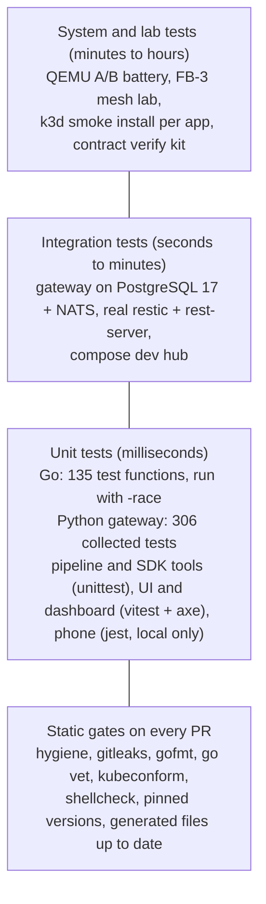

<!-- SPDX-License-Identifier: Apache-2.0 -->
# Lesson 16: How We Test: Unit, Integration, System, Attacks, and What Is Still Missing

**For:** Zeus (learning track) · **Date:** 2026-11-12
**Status:** founder-requested learning entry. It describes the tests and CI gates on `main` as of 2026-11-12 and names, without deciding, the kinds of testing that are **not** on `main` yet: fuzzing, property-based tests, a dedicated attack suite and browser end-to-end tests. No decision is added.
**Sources (all on `main`):** [`.github/workflows/`](../../.github/workflows/), [`test/qemu/CRITERIA.md`](../../test/qemu/CRITERIA.md), [`research-output/evidence/lab/fb3-mesh-nat/README.md`](../../research-output/evidence/lab/fb3-mesh-nat/README.md), [`deploy/verify/verify.sh`](../../deploy/verify/verify.sh), [`scripts/hygiene.py`](../../scripts/hygiene.py), the test files linked below.
**Builds on:** lessons [07](07-image-ab-updates-health-gate.md)–[15](15-design-system-and-dashboard.md); each one has a "Try it" that runs some of these tests.
**Feeds:** brief 30 §2 rule 4 (pre-registered criteria) and rule 9 (hygiene); the merge bar in [`docs/leap/WORKSTREAMS.md`](../leap/WORKSTREAMS.md) ("CI green, gitleaks clean").

---

## 1. The idea in one paragraph
Each kind of test answers a different question. A **unit test** asks "does this function do what I meant?" in milliseconds. An **integration test** asks "does it still work with the real database, bus or binary?" A **system test** asks "does the whole box behave when we boot it, break it and cut its power?" **Negative or attack tests** ask "does it refuse what it must refuse?" **Fuzzing** and **property tests** ask "is there *any* input that breaks it?", using inputs nobody thought of. OneMind has the first four on `main`, run in CI on every pull request. It does not yet have the last two.

## 2. The layers on `main`

Fewer tests as you go up, because they are slower and need more machinery; but only the top layer proves the box survives real failures.

| Layer | Where | CI workflow |
|---|---|---|
| Go unit tests (`onemindd`, `onemind`, updater, backup, mesh, leaf, storage) | `*_test.go` beside the code | [`ci-onemindd.yml`](../../.github/workflows/ci-onemindd.yml): `gofmt`, `go vet`, `go test -race` |
| Gateway tests (SQLite) and the same suite on PostgreSQL 17 + real NATS | [`core/tests/`](../../core/tests/) | [`ci-core.yml`](../../.github/workflows/ci-core.yml) |
| Pipeline, SDK and image-layout tests | [`os/update/tests/`](../../os/update/tests/), [`sdk/tools/tests/`](../../sdk/tools/tests/), [`test/unit/`](../../test/unit/) | `security-nightly.yml`, `ci-apps.yml`, `ci.yml` |
| UI and dashboard tests, with axe-core accessibility checks | `ui/src/**`, `dashboard/src/**` | `ci-ui.yml`, `ci-dashboard.yml` |
| Phone app tests (jest) | `mobile/src/**` | **none on `main`**: run locally with `npm test` in `mobile/`; open PR [#42](https://github.com/onemindos/ONEMINDOS/pull/42) adds mobile builds to CI |
| App gate with a throwaway k3d cluster | [`sdk/tools/app-gate`](../../sdk/tools/app-gate) | [`ci-apps.yml`](../../.github/workflows/ci-apps.yml), daily `apps-rescan.yml` |
| Compose dev hub + contract verify kit (end to end over HTTP and NATS) | [`deploy/`](../../deploy/) | [`ci-deploy.yml`](../../.github/workflows/ci-deploy.yml) |
| QEMU A/B battery | [`test/qemu/`](../../test/qemu/) | `image.yml` and `nightly.yml` call `battery.yml` |
| Hygiene and secrets | [`scripts/hygiene.py`](../../scripts/hygiene.py), gitleaks | `hygiene.yml`, gitleaks steps in the app and deploy workflows |

## 3. Pre-registration: deciding what "pass" means before you look
The QEMU battery ([`CRITERIA.md`](../../test/qemu/CRITERIA.md)) and the FB-3 lab were written **before** anything ran, hashed, and committed separately. Afterwards the criteria may not change; any deviation is logged. Two habits come with it:
- **BLOCKED is not PASS.** A test that could not run because of the environment is reported as BLOCKED with the reason.
- **A harness bug is named as such.** The FB-3 lab logs every script bug it fixed and keeps the failed run's logs (lab §8).
This is borrowed from science: it stops anyone, human or AI, from quietly moving the goalposts to make a result look good.

## 4. Attack-style tests that already exist
There is no folder called "attack suite" yet, but many tests already play an attacker and check the refusal:

| Attack | Test |
|---|---|
| a mirror replays older, validly signed update metadata | [`TestReplayedOlderMetadataRefused`](../../internal/update/engine_test.go) |
| a tampered bundle, a wrong TUF root, an expired timestamp | `TestTamperedBundleRefused`, `TestWrongRootRefused`, `TestExpiredTimestampRefused` (same file) |
| a bundle signed with the wrong key, or in the unchecked format | QEMU T2 and T11 |
| a kubelet that never starts, hidden behind stale "Ready" status | QEMU T5 (and T10 proves a naive gate would be fooled) |
| an agent approving its own request; a person using the agent-only MCP endpoint | [`core/tests/test_actions.py`](../../core/tests/test_actions.py), [`test_mcp.py`](../../core/tests/test_mcp.py) |
| an app proxy used as an open proxy, cross-site posts, an app planting the session cookie | [`test_proxy.py`](../../core/tests/test_proxy.py) |
| a restore path that escapes its folder through `..` or a symlink | `TestRestoreRefusals` in [`rewind_test.go`](../../internal/backup/rewind_test.go) |
| a reused one-time join key; a NATS leaf without TLS or with a wrong password | FB-3 lab T1a and T3 |
| editing the audit log | `audit-verify` (lesson 09 "Try it") |

## 5. What is not on `main` yet
Checked on 2026-11-12: there are no Go fuzz functions (`func Fuzz…`), no property-test libraries (Hypothesis, fast-check or rapid), no dedicated attack-suite folder, and no browser end-to-end tests.
- **Browser end-to-end** (Playwright across browsers, axe on rendered pages, visual comparison) is proposed in the open PR [#42](https://github.com/onemindos/ONEMINDOS/pull/42).
- **Fuzzing** is named in the backlog for the file server (UMB-FILES-1: "symlink and `..` fuzz: zero escapes"), but not built.
- **Property tests and an attack suite** have no epic yet.

**What each would add (explanation, not a decision):**
- **Fuzzing** feeds a function millions of generated inputs and keeps the ones that reach new code paths. It is best at parsers that read untrusted input. Candidates on `main`: the heartbeat parser in the gateway, `mesh.Bundle.Validate`, the leaf config renderer, the proxy's host and path routing, the restore path checks. Go has fuzzing built in, so this needs no new dependency.
- **Property tests** state a rule that must hold for all inputs ("comparing a with b is the opposite of comparing b with a"; "an action never leaves `succeeded`"; "the retention ladder never deletes a `pre-restore` snapshot") and let a library hunt for a counter-example. Python and TypeScript would need a new, licence-checked dependency.
- **An attack suite** would collect the threat model's abuse cases ([`docs/security/THREAT-MODEL.md`](../security/THREAT-MODEL.md)) as one runnable set against a live dev hub, so "is H-xx still fixed?" has one answer.

## 6. Try it
1. **Everything fast, the way CI runs it** (Go and `uv`; about a minute):
   ```sh
   go test -race -count=1 ./...
   (cd core && uv run pytest -q)
   ```
2. **The whole contract, end to end, against your own gateway.** Start lesson 09's gateway, put the dev owner and agent tokens into two files (`chmod 600`), then:
   ```sh
   deploy/verify/verify.sh http://127.0.0.1:8080 --token-file owner.token --agent-token-file agent.token --nats none
   ```
   Expect 32 PASS and one FAIL: "GET /v1/nodes returned no node". Nothing is sending heartbeats. Explain why to yourself, then look at how [`deploy/compose/compose.yaml`](../../deploy/compose/compose.yaml) adds a node simulator so CI gets a clean pass.
3. **Write your first fuzz test (do not commit it).** Create `internal/update/fuzz_try_test.go`:
   ```go
   package update

   import "testing"

   func FuzzCompareVersions(f *testing.F) {
   	f.Add("0.1.2", "0.1.10")
   	f.Add("0.1.0-dev", "0.1.0")
   	f.Fuzz(func(t *testing.T, a, b string) {
   		ab, errA := compareVersions(a, b)
   		ba, errB := compareVersions(b, a)
   		if (errA == nil) != (errB == nil) {
   			t.Fatalf("errors differ for %q, %q", a, b)
   		}
   		if errA == nil && ab != -ba {
   			t.Fatalf("not antisymmetric: %q vs %q gives %d and %d", a, b, ab, ba)
   		}
   	})
   }
   ```
   Run `go test -run '^$' -fuzz=FuzzCompareVersions -fuzztime=30s ./internal/update/`. It is both a fuzz test and a property test: the property is "swapping the arguments flips the sign". (A 5-second run on 2026-11-12 found no counter-example.) Delete the file and any `testdata/fuzz/` folder afterwards.
4. **Run the public-repo gates before any push:** `python3 -I scripts/hygiene.py` and `gitleaks dir .`.

## 7. Why it is built this way
- **Test the failure, not only the success.** An updater is judged by what happens when the update is bad, so most battery tests break something on purpose.
- **Real dependencies where it matters:** the gateway suite also runs on PostgreSQL and NATS, the backup agent on real restic, the mesh in a real NAT lab, because fakes cannot show the differences that bite in production.
- **Pinned everything:** Actions by commit SHA, tools by sha256, images by digest. A test result is only meaningful if the thing tested cannot change underneath it.

## 8. Check yourself
1. Why are the QEMU criteria hashed and committed before the battery code?
2. Which layer would catch a kubelet that never starts after an update, and why can no unit test catch it?
3. What is the difference between a fuzz test and a property test? Can one test be both?
4. Name one parser on `main` you would fuzz first, and say why.
