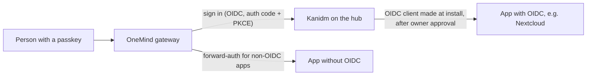

<!-- SPDX-License-Identifier: Apache-2.0 -->
# Kanidm and single sign-on: what it is, and is it the right pick?

**For:** Zeus · **Written:** 2026-11-19 · **Why this exists:** while finishing lane 4 (leap:4-core), issue #236 (SEC-SSO-01, sign in to every app with your OneMind account) turned out to be blocked on Kanidm. You asked what Kanidm is and whether it is the best pick for OneMind OS.
**Decision status:** Kanidm is already chosen (**BD-03**, build brief [`research-output/30-NEXT-ULTRACODE-BUILD-BRIEF.md`](../../../research-output/30-NEXT-ULTRACODE-BUILD-BRIEF.md) D-B9.1). This note does **not** reopen it. The open question is **F-34**, *where* it runs ([`docs/leap/DECISIONS-NEEDED.md`](../../leap/DECISIONS-NEEDED.md)).
**Builds on:** lesson [13, identity and passkeys](../13-identity-and-passkeys.md); the accounts design in [`docs/umbrel2/accounts.md`](../../umbrel2/accounts.md).

---

## 1. What Kanidm is, in plain words
Kanidm is an open-source **identity provider** (IdP): one program that holds the list of people and their sign-in keys, and that other programs ask "who is this person?".

Without one, every app on the box (Nextcloud, Jellyfin, photos…) keeps its own user list and passwords. A family of five has five accounts in every app, and removing someone means visiting every app. With one, you sign in once and every app trusts that sign-in.

## 2. Words you will see
- **Identity provider (IdP):** the service that proves who you are. Kanidm is ours.
- **OIDC (OpenID Connect):** the standard behind "Sign in with Google". An app sends you to the IdP, you sign in there, the IdP tells the app who you are. The app never sees your password or passkey.
- **OIDC client:** an app registered with the IdP so the IdP will sign people in to it. In OneMind, the client is created when the owner approves an app install (ACCT-6).
- **Forward-auth:** for apps that cannot speak OIDC, the OneMind gateway stands in front of the app and lets only signed-in, allowed people through (`core/onemind_core/proxy.py`, issue #139).
- **Passkey:** a key pair on your phone or laptop; the private half never leaves the device (lesson 13).
- **Scope map / group:** Kanidm groups such as `onemind_owners` and `onemind_children` decide which apps a person may open ([`accounts.md`](../../umbrel2/accounts.md) §roles).

## 3. How it would fit OneMind

- Kanidm holds **who you are** (people, passkeys, groups). The gateway database holds **what OneMind lets you do** (roles, family controls from FAM-01, approvals). No password or TOTP secret is ever in the gateway database ([`accounts.md`](../../umbrel2/accounts.md)).
- Removing a member in Kanidm cuts their access to every OIDC app at once; that is #236's second done-when.

## 4. Is it the best pick? The comparison
Facts marked *(repo)* come from this repository's research; *(UNVERIFIED)* means general knowledge not yet checked against a primary source here.

| Option | Language and weight | License | Passkeys | OIDC provider | Fit for a small home box |
|---|---|---|---|---|---|
| **Kanidm** (chosen, BD-03) | Rust, one server program *(UNVERIFIED: footprint not measured yet; brief 30 says so)* | MPL-2.0, ship as a separate component *(repo: license matrix)* | Yes, first-class *(repo: v1.12.0 README)* | Yes *(repo)* | Good if ACCT-1 measures it inside the 4 GB slim profile |
| Authelia + LLDAP (Olares uses this) | Go + a small LDAP server | Apache-2.0 *(UNVERIFIED)* | As a second factor, passkey-only sign-in less mature *(UNVERIFIED)* | Yes *(UNVERIFIED)* | Light, but two programs and a separate user store |
| Authentik (your cloud cluster uses it) | Python, needs PostgreSQL and more *(UNVERIFIED)* | Has an `enterprise/` open-core directory we must never enable *(repo: license matrix)* | Yes *(UNVERIFIED)* | Yes | Heavier; better for the cloud tier than a Pi |
| Keycloak | Java, heavy *(UNVERIFIED)* | Apache-2.0 *(UNVERIFIED)* | Yes *(UNVERIFIED)* | Yes | Too big for the slim box |
| Pocket ID / Zitadel | Go, newer projects *(UNVERIFIED)* | Check before any use; Zitadel's license changed recently *(UNVERIFIED)* | Yes | Yes | Not evaluated in the research |

**My reading: yes, Kanidm is a sound pick for the box, and nothing found today argues for reopening BD-03.**
- **Passkeys first.** OneMind's design is passkey sign-in with no passwords (lesson 13). Kanidm is built around that; most others add it on top.
- **One program, built for this job.** It is a single identity server, not a big platform. That matters on a Pi.
- **Works offline.** First boot with the network cable out is a hard requirement (ACCT-1 tests it).
- **Replication.** Kanidm supports replication *(repo: v1.12.0 README)*, which the One Mind fabric can use later for more than one hub.
- **License is fine.** MPL-2.0 is file-level copyleft: we ship it unchanged as its own component and keep its notices; our Apache-2.0 code is not affected.

**Known gaps, and how the plan already covers them**
- Kanidm does not cover every OAuth extension agents need (RFC 8707). The gateway's MCP auth façade fills that gap either way (brief 30 D-B9.2).
- Apps that cannot do OIDC still need forward-auth. That is the gateway's job (#139), not Kanidm's.
- Its memory footprint is **not measured yet**. Brief 30 says: if it does not fit the 4 GB slim profile, record it and propose an option; do not switch silently.

**What would change this recommendation**
- ACCT-1 shows it cannot enrol the owner's passkey offline, or a restored box rejects the same passkey.
- It does not fit the 4 GB slim profile next to the gateway and PostgreSQL.
If either happens, the agent must flag it to you with evidence; switching identity provider stays your decision.

## 5. F-34: where should it run?
The proposal is a **host service on the hub** (a systemd service in the OS image), not an app inside k3s. The reason: sign-in must still work when k3s is down or being updated, which is exactly when you need to log in and fix things. Research 30's file tree lists a `kanidm` chart, so the two documents disagree; F-34 settles it.

**Recommendation: (a) host service on the hub.** It is the safer choice for the "box is broken, owner must get in" case, and the image already carries other host services the same way.

## 6. What unblocks #236
1. You answer **F-34**.
2. **ACCT-1**, the Kanidm lab test (offline first boot, groups, an OIDC client, account expiry, backup and restore), runs and reports with commands and outputs.
3. **#139** (each app at its own URL behind the OneMind login) finishes; its end-to-end proof is draft PR #347.
Then #236 can be built for real: OIDC clients created at install after owner approval, and member removal revoking app access.
