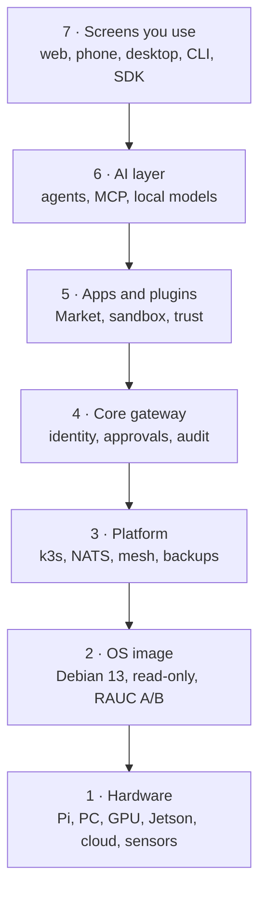
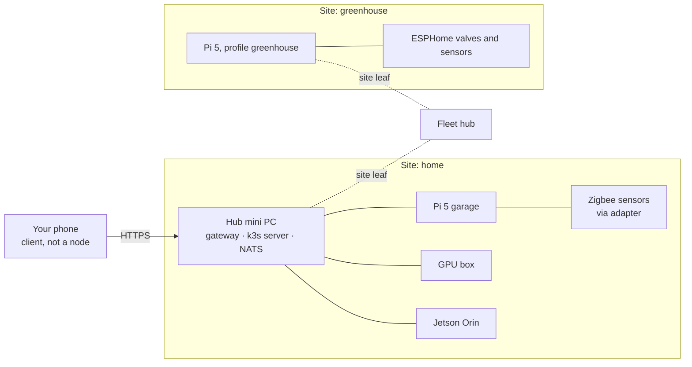

<!-- SPDX-License-Identifier: Apache-2.0 -->
# Founder note 06: The finished OS, with every epic done

**Founder-requested learning entry · 2026-11-16.** Zeus asked: "What would it technically look like after we do everything we say we're going to do?" This note answers that. It describes the target, not what ships today. Each part is marked **built**, **partly built** or **planned**, judged from the code on `main` on 2026-11-16.

**Interactive version:** [06-the-finished-os.html](06-the-finished-os.html). Open it in a browser to click through the layers, step through three scenarios and explore the fabric map. It needs no server.

**Sources (nothing here is new design):**
- [Build brief 30](../../../research-output/30-NEXT-ULTRACODE-BUILD-BRIEF.md): layers, extension points E1–E10, profiles
- [Fabric summary](../../../research-output/fabric/00-FABRIC-SUMMARY.md): how many machines join one OneMind
- [BACKLOG](../../leap/BACKLOG.md) and [STATUS](../../leap/STATUS.md): stages and counts
- [DECISIONS](../../DECISIONS.md) D-001 to D-014
- [REQUIREMENTS](../../REQUIREMENTS.md)

## 1. The idea in one sentence

Every machine you own becomes one system that runs your apps, files, devices and AI agents. AI can see all of it when you allow it, and nothing risky or physical happens until you approve it on your phone. The brand line says it: **"AI can ask. Only you approve."** ([brand.json](../../../brand/brand.json))

That last part is the moat. The fabric research found no competitor that gates AI actions in the gateway (FB-11): Viam's MCP tools act at once, and Foxglove's MCP adds no approval.

## 2. Seven layers, one machine

Read from the bottom up. Each layer talks only to the layers next to it. That is what lets one developer build it safely (M-6): a bug in an app cannot reach the OS image, and an agent cannot skip the gateway.

| # | Layer | What it does when finished | Inside it (status today) |
|---|---|---|---|
| 7 | **Screens you use** | One web app is the front door, the phone is where approvals arrive, and developers and AI tools get the same API through a CLI and SDKs. | Web dashboard (built) · `onemind` CLI (built) · generated TS and Python SDKs (built) · phone app with passkey approvals (partly built) · desktop app (partly built) · app widgets, E5 (planned) · XR, UX-9 (planned) |
| 6 | **AI layer** | Everything on the OS is context for AI, with permission (AI-1). Agents are users with their own identity: they can read and ask, never approve. | `/mcp` endpoint (built) · agents as principals, approve returns 403 (built) · Hermes app (built) · local models placed on the GPU node, AI-8 (partly built) · every installed app becomes an AI tool, E6 (partly built) · `actuate` needs a fresh owner approval (partly built) · one AI door per site, FB-6 (planned) |
| 5 | **Apps and plugins** | The app store. Every app is scanned before it is offered, installing is a request you approve, and each app runs walled off. | Market and app gate, E1, about 65 manifests (built) · scan gate (built) · sandbox per app (partly built) · hardware grants, E2 (planned) · profiles, E8 (planned) · plugin signing and revocation, E9 (planned) · plugin SDK and community store, A-5 and A-6 (planned) |
| 4 | **Core gateway** | The front desk. Every request is checked for who is asking and what will change, waits for your approval, and is written to a log that cannot be edited quietly. | Approvals and action ledger (built) · plan fingerprint `plan_sha256` (built) · hash-chained audit with verification (built) · accounts and passkeys (partly built) · automation rules (partly built) · notifications (partly built) · app secrets (partly built) |
| 3 | **Platform** | The plumbing that makes many machines act like one: k3s runs the apps, NATS is the one bus, a private mesh reaches home from anywhere, and backups run themselves. | k3s (built) · NATS bus, E7 grants (built) · mesh per site (partly built) · restic backups (partly built) · storage and files (partly built) · VMs and web terminal, D-014 (partly built) · offline outbox, FB-7 (planned) |
| 2 | **OS image** | Never changed by hand: the whole system is replaced as one signed image, and a bad update rolls back automatically. | Debian 13 read-only image, D-007 (partly built: builds and boots in QEMU) · RAUC A/B with health gate (built) · TUF-signed updates (built) · rescue console, D-008 (built) · LUKS2 encryption (planned, waits on F-61 and F-62) · signed driver packs, E3 and E4 (planned) · firmware pins, E10 (planned) |
| 1 | **Hardware** | Bring your own, or buy a OneMind box. Machines that can run OneMind become nodes. Sensors, PLCs and flight controllers never run it; a nearby node translates for them. | x86 hub (partly built: QEMU only, real boot waits on F-25) · Raspberry Pi 5 (planned, D-013) · Jetson on L4T (planned) · cloud VM as a node, ZF-02 (planned) · devices through adapters, FB-3 (planned) · robots (parked) · zero-touch boxes with FDO, FB-2 (planned) |

**What "partly built" means:** code exists on `main`, but the epic is not done or has not been proven on hardware.

## 3. What using it feels like: three moments

These show how a request passes through the layers. Every step uses a mechanism named in the specs.

### An AI agent installs an app

1. You tell Hermes on your phone: "Set up a password manager for the family." (layers 7, 6)
2. Hermes asks the gateway to install Vaultwarden through MCP. It cannot approve its own request: an approve from an agent returns 403. (6, 4)
3. The gateway works out exactly what will be created, checks it against the sandbox rules and fingerprints it (`plan_sha256`). (4, 5)
4. Your phone shows what the app will get. You approve with your passkey. (7, 4)
5. The gateway checks again: the scan is still clean, the plan is unchanged, and nobody else is installing it at the same moment (an atomic claim). Then it writes your approval to the audit chain. (4)
6. The app starts in its own namespace with a default-deny network, so it cannot reach other apps or the system. (5, 3)
7. Vaultwarden appears on Home. Its abilities are registered for AI, with permission, and it joins the nightly backup. (7, 6, 3)

### AI wants to water the greenhouse

1. A soil sensor reports 18% moisture over MQTT, and the greenhouse Pi's adapter bridges the reading onto NATS. (1, 3)
2. The local model proposes `cmd.greenhouse.zone2.set_valve`, which has the risk class `actuate`. (6)
3. The gateway will not run an `actuate` action on any rule or agent's say-so. A standing policy that covers one is refused. (4)
4. Your phone shows the reading and the proposal, and you approve. (7, 4)
5. The gateway signs the command with a time limit (TTL) and sends it on NATS. Only the gateway may publish commands. (4, 3)
6. The Pi opens the relay. A command that arrives late is dropped, never replayed. (3, 1)
7. The whole story is in the audit chain. If the greenhouse was offline, its outbox delivers the record later (FB-7). (4, 3)

### A new machine joins

1. You flash the image onto a Pi 5 and plug it in. It boots slot A. (1, 2)
2. The health gate checks the new system before accepting it, or the board rolls back. (2)
3. The Pi shows a 6-digit code, and your phone asks whether this is your machine. Boxes OneMind sells can use an FDO voucher instead (FB-2). (2, 7)
4. Once you approve, the Pi gets its own identity, a mesh address, a NATS user limited to its own subjects, and a k3s agent join. (4, 3)
5. It reports its CPU, memory, disks and attached devices, which decide which apps can run on it. (3, 5)
6. It appears in Nodes on every screen. Update rings use its enrolment, never labels the node reports about itself. (7, 5, 3)

## 4. One OneMind, many machines (the fabric)

A **site** is one place: your home, the greenhouse, an office. Each site has its own hub, cluster, mesh and bus, and keeps working offline with no time limit. Sites connect through a **fleet hub** that rolls out updates in rings and shows every site in one view. The fabric research rejected one cluster stretched across sites (FB-4) and one mesh for the whole world (FB-3).

Phones are clients: they never join the bus. Approvals for a site go to that site's owners (FB-10).

## 5. Every machine has a superpower (D-002)

The same image pipeline builds every tier. A tier is a profile, not a fork. Apps declare what they need, and node capabilities decide where they run (P-6, N-3).

| Tier | Hardware | Its superpower |
|---|---|---|
| Edge | Raspberry Pi 5 | Sensors, home automation, a garage or greenhouse node |
| Lite | x86 mini PC | The household hub: apps, files, photos, backups |
| Pro | PC with a GPU | Local AI models, media transcoding |
| Robotics | NVIDIA Jetson | Vision, robots, drones through companion computers |
| Omni | Workstation | Simulation and training |
| Cluster | Many machines, cloud | Business sites, many sites in one fleet |

**Profiles (E8)** turn a box into one job with one command: `lite`, `greenhouse`, `tak-node` (situational awareness on a Pi) and `robot-agent`.

## 6. From today to finished

On 2026-11-12, [STATUS.md](../../leap/STATUS.md) counted 31 epics done, 4 in review, 37 in progress, 258 to do, and 5 parked plus 1 superseded. That is about 1 in 10 done. The 90-day plan's Day 1 is 2026-11-16.

| Stage | When | What it adds |
|---|---|---|
| S0 | Weeks 0–2 | Land the half-done work: image line and installer, updater and security pipeline, seed apps, Hermes |
| S1 | Weeks 1–5 | Plumbing and security: HTTPS with the box's own CA, passkey-signed approvals, app sandbox and network walls, authenticated NATS |
| S2 | Weeks 5–9 | Many machines, one mind: fabric join and placement, backups and restore drills, notifications, the phone app |
| S3 | Weeks 9–13 | It runs itself: automation, plugin SDK v0, website launch, moving your own services over |
| S4+ | After 2027-02-14 | Phase 2: multi-site fleets, the Industrial edition (RHEL-family bootc, year 2), robotics once there is a robot |

**Not proven yet:** nothing has booted on a real board ([ALPHA-CHECKLIST](../../leap/ALPHA-CHECKLIST.md), F-25), and no release can be signed until the root key ceremony (D-010, F-27). Until then, the vision above is a target backed by code and tests, not by hardware.

## Check yourself

1. Why does an AI agent get a 403 when it tries to approve, even for a harmless app?
2. What stops an approval from running a plan that changed after you read it?
3. Why does the greenhouse valve need your approval even if you wrote an automation rule for it?
4. Why is each site its own cluster instead of one big cluster spanning every place?
5. What is the difference between a tier and a profile?
