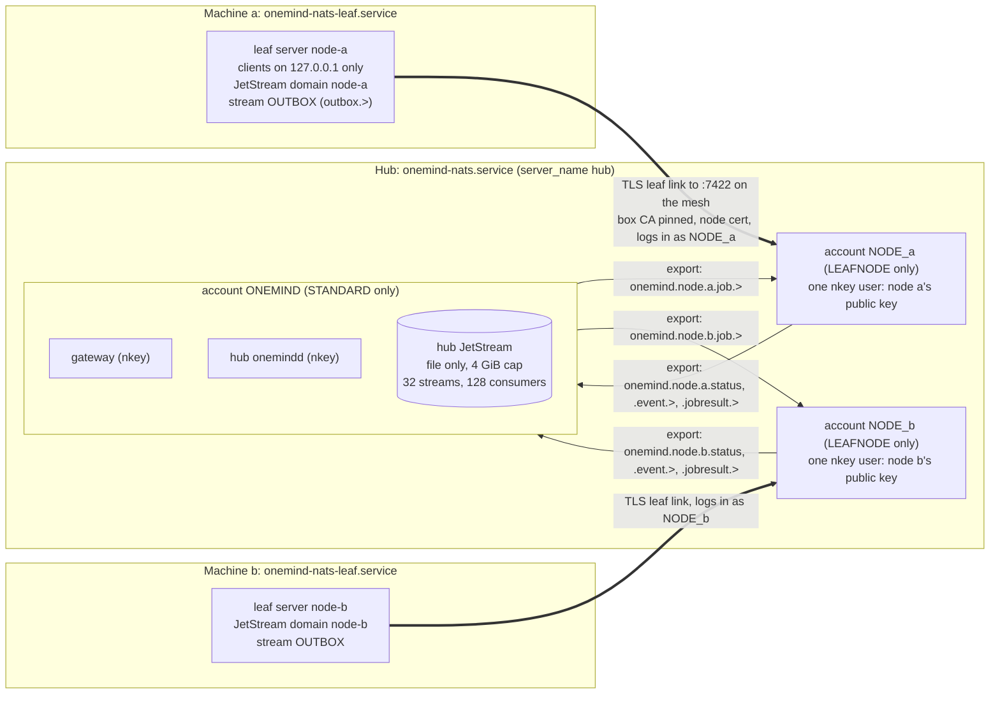

<!-- SPDX-License-Identifier: Apache-2.0 -->
# The NATS fabric in plain words

**For:** Zeus (learning track) · **Date:** 2026-11-21 · **Issue:** [#625](https://github.com/onemindos/ONEMINDOS/issues/625)
**Status:** founder-requested learning entry. It explains what is on `release/next` today and adds no decision. Where a part is only a design, or a founder decision is still open, it says so.
**Builds on:** [lesson 11](11-mesh-headscale-derp-nats-leaf.md) (the mesh and the FB-3 lab) and [lesson 09](09-gateway-approvals-agents-mcp.md) (approvals and MCP).
**Feeds:** CORE-FABRIC [#170](https://github.com/onemindos/ONEMINDOS/issues/170) (hub, leaves, outbox), hardening item H-06 (per-node NATS credentials), contract [§12.9](../../sdk/contracts/poc-v0.md#129-nats) (the OS subjects), and the agent work that waits on the two-door rule (section 11).

**How to read the sources.** Every section ends with a **Sources** line. Three kinds count as primary here:

- a page on [docs.nats.io](https://docs.nats.io/) (the official NATS documentation);
- a file in the [nats-server source](https://github.com/nats-io/nats-server/tree/v2.15.2/server) at tag `v2.15.2`, the version the image pins;
- our own lab evidence under [`research-output/evidence/lab/`](../../research-output/evidence/lab/), or our own code.

Anything nobody could confirm from one of these is marked **UNVERIFIED**.

---

## 1. NATS in one paragraph

NATS is one small server program that carries messages between programs. A program **publishes** a message to an address, and every program that has **subscribed** to that address gets a copy. Nobody needs to know who is on the other end. On its own (called **core NATS**) it delivers a message only to whoever is listening at that moment: "at most once, never replayed". If nobody is listening, the message is gone. **JetStream** (section 5) is the optional part that writes messages to disk so they can be read later. OneMind runs one NATS server on the hub and one small NATS server, a **leaf**, on every other machine.

**Sources:** [JetStream concept page](https://docs.nats.io/concepts/jetstream) (the "at most once, never replayed" wording); [`os/rootfs/layers/onemind/usr/lib/onemind/onemind_firstboot.py`](../../os/rootfs/layers/onemind/usr/lib/onemind/onemind_firstboot.py) `hub_nats_conf` (the hub server); [`internal/leaf/config.go`](../../internal/leaf/config.go) (the leaf server).

## 2. Subjects: the addresses

- A **subject** is a name made of words joined by dots, like `onemind.node.abc.status`. Subjects are case-sensitive and cannot contain spaces.
- Two **wildcards** exist, for subscribing only (never inside a published name): `*` matches exactly one word (`onemind.node.*.status` gets every node's status) and `>` matches one or more words at the end (`onemind.node.abc.event.>` gets every event from node `abc`).
- Names that start with `$` are reserved for NATS itself: `$SYS` (server events), `$JS` (the JetStream control API), `$KV`, `$O`, `$SRV` (service discovery), and `_INBOX` (automatic reply addresses).
- **OneMind's rule:** the OS owns everything under `onemind.>`. Apps and plugins never publish there. The subjects in use today are in contract §12.9:

| Subject | Who publishes | What it carries |
|---|---|---|
| `onemind.node.<node_id>.status` | that node | its heartbeat (latest wins, not kept) |
| `onemind.node.<node_id>.event.<type>` | that node | an event envelope; the gateway checks it and re-publishes it as `onemind.event.<type>` |
| `onemind.node.<node_id>.job.<kind>` | gateway | a job for that one node |
| `onemind.node.<node_id>.jobresult.<job_id>` | that node | progress and result of a job |
| `onemind.event.<type>`, `onemind.alert.<source>.<kind>`, `onemind.audit`, `onemind.plugin.<app-id>.<event>` | gateway only | the checked, re-published versions |

The gateway subscribes to `onemind.node.*.status` today ([`core/onemind_core/bus.py`](../../core/onemind_core/bus.py), `HEARTBEAT_SUBJECT`). App event streams declared in a manifest are placed under `onemind.plugin.<app_id>.` ([`core/onemind_core/streams.py`](../../core/onemind_core/streams.py), `SUBJECT_ROOT`), so an app can never name another app's or a node's subjects.

**Open point (not a decision):** more than one subject grammar exists across the repo and drafts (§12.9's `onemind.node/event/alert/audit/plugin`, `onemind.app.<id>.` in `streams.py`, and the older app grammar `evt.`, `cmd.`, `tel.`, `svc.` that §12.9 mentions). One later slice reconciles them. Build on the §12.9 names until then.

**Sources:** [Subjects concept page](https://docs.nats.io/concepts/subjects) (wildcards, reserved prefixes); [contract §12.9](../../sdk/contracts/poc-v0.md#129-nats).

## 3. Accounts: sealed rooms

- An **account** is a sealed room inside one NATS server. Two accounts never see each other's messages. The subject `x.y` in account A and the subject `x.y` in account B are two different subjects.
- The one deliberate way through a wall is a pair: account A **exports** a subject and account B **imports** it. Nothing else crosses.
- A **user** logs into exactly one account. OneMind users are **nkey** users: a key pair (Ed25519) where the machine keeps the secret half (the **seed**) and the server stores only the public half, a 56-character string starting with `U`.

**Why one account per machine, not one shared account with rules.** The FB-3 lab (experiment E2) tried the obvious way first: put every leaf in one account and give each leaf user a permission list that allows only its own subjects. nats-server v2.15.2 refused the config (`unknown field "permissions"` on a leaf user), kept the old config, and leaf A could then publish as node B (3 of 3 messages reached the hub). So OneMind puts **each machine in its own account**. Whatever a machine's leaf publishes lands in that machine's own room, and the hub's room imports only that machine's own subjects from it. If node A publishes `onemind.node.B.status`, it stays in A's room, where nobody listens.

**What [`natsconf.py`](../../core/onemind_core/natsconf.py) writes** (the include file `nats-accounts.conf`, rewritten by the gateway on every join and removal, public keys only):

| Account | Who logs in | Allowed connection type | Exports | Imports |
|---|---|---|---|---|
| `ONEMIND` (`HUB_ACCOUNT`) | the hub's own services (`gateway`, `onemindd`), one nkey each (`ServiceKey`); with no service keys, the passwordless fallback user `hub-local` (`HUB_LOCAL_USER`, via `no_auth_user`) | `STANDARD` only, so a leaf can never fall into it | `onemind.node.<id>.job.>` to each `NODE_<id>` | each node's `status`, `event.>`, `jobresult.>` |
| `NODE_<node_id>` (`NodeAccount.account`), one per joined machine | that machine's leaf, with the public nkey it sent at join | `LEAFNODE` only | `onemind.node.<id>.status`, `.event.>`, `.jobresult.>` to `ONEMIND` (`NODE_EXPORTS`) | `onemind.node.<id>.job.>` from `ONEMIND` (`NODE_IMPORTS`) |

Only the hub account may use JetStream (file storage only, at most 32 streams and 128 consumers, capped bytes). Node accounts never get JetStream on the hub: a machine's events are kept by its own outbox (section 7).

**Sources:** [Accounts and multitenancy](https://docs.nats.io/learn/security/accounts-and-multitenancy); [Authentication basics](https://docs.nats.io/learn/security/authentication-basics) (nkeys); lab [`fb3-mesh-nat/README.md`](../../research-output/evidence/lab/fb3-mesh-nat/README.md) §7.2 (E2); [`natsconf.py`](../../core/onemind_core/natsconf.py) `render_accounts`.

## 4. Leaf nodes: a server that dials out

- A **leaf node** is a full NATS server on a machine that opens **one outbound connection** to another NATS system (the **hub**) and bridges subscriptions across it. The hub never dials the leaf, so the leaf's machine needs no open inbound port.
- The hub **listens** for leaves (default port 7422); the leaf declares a **remote** with the hub's address. People often reverse this and nothing connects.
- Programs on the leaf's machine connect to the leaf as ordinary clients. The hub never sees them: it sees **one leaf link**. Only subjects someone on the other side is interested in cross the link.
- Which subjects cross is an **account** decision, not something the leaf link gives for free. In OneMind the leaf's link logs into the hub as the machine's `NODE_<id>` user, so only that account's exports reach the hub.

**OneMind's leaf, as rendered by [`internal/leaf/config.go`](../../internal/leaf/config.go):** client port and monitor on loopback only (`127.0.0.1:4222`, `127.0.0.1:8222`), hub URLs must be `tls://` (no plain-text leaf), the box CA is pinned, the node presents its own certificate, and exactly one of an nkey file or a creds file authenticates it. The hub's leaf listener sits on its mesh address port 7422 with `verify: true`, so a machine without a certificate from the box CA is refused ([`onemind_firstboot.py`](../../os/rootfs/layers/onemind/usr/lib/onemind/onemind_firstboot.py) `hub_nats_conf`). systemd runs them as `onemind-nats.service` (hub) and `onemind-nats-leaf.service` (each machine).

**Sources:** [Leaf nodes](https://docs.nats.io/learn/topologies/leaf-nodes); nats-server [`server/const.go`](https://github.com/nats-io/nats-server/blob/v2.15.2/server/const.go) (`DEFAULT_LEAFNODE_PORT = 7422`).

## 5. JetStream: messages kept on disk

- **JetStream** adds storage on top of core NATS: "at least once" delivery, messages survive restarts and can be read again.
- A **stream** is one kept list. It captures the subjects you tell it to, gives each message a sequence number, and has limits (bytes, age) and a **retention policy**: `Limits` (the limits decide when a message goes), `Interest` (every interested consumer must acknowledge), or `WorkQueue` (the first acknowledgement removes it).
- A **consumer** is a bookmark on a stream: it remembers how far a reader got.
- **Duplicates:** a publisher can tag each message with a `Nats-Msg-Id` header. The stream refuses a second message with the same id inside its duplicate window (NATS default: 2 minutes). OneMind's outbox sets its window to 24 hours (`DefaultDedupeWindow`).

On the hub, JetStream is file-only with a 4 GiB cap and `max_memory_store: 0` (no memory store, so a restart never silently loses events).

**Sources:** [JetStream concept page](https://docs.nats.io/concepts/jetstream); [Retention policies](https://docs.nats.io/learn/jetstream/retention-policies); [Publishing](https://docs.nats.io/learn/jetstream/publishing) ("Avoiding duplicate writes"); nats-server [`server/stream.go`](https://github.com/nats-io/nats-server/blob/v2.15.2/server/stream.go) (`StreamDefaultDuplicatesWindow = 2 * time.Minute`); [`onemind_firstboot.py`](../../os/rootfs/layers/onemind/usr/lib/onemind/onemind_firstboot.py) (`JETSTREAM_MAX_BYTES`).

## 6. Domains and sources: copying across the link

- A leaf that runs its own JetStream needs its own **JetStream domain**: a name that keeps the leaf's streams separate from the hub's. Without distinct domains the two JetStream systems collide, and a stream created on the leaf may land on the hub instead.
- OneMind names each leaf's domain `node-<node_id>`, and `config.go` refuses the name `hub`.
- A **source** is a stream that copies messages out of other streams and keeps copying after a break, resuming where it stopped. Messages from one source keep their order; across several sources there is no ordering guarantee, and the copy gets **new** sequence numbers. (A **mirror** is the exact one-to-one copy; OneMind uses sources.)
- Reaching a stream in another domain is done with an **external** API prefix: the hub's stream points at `$JS.node-<id>.API`, and those requests travel over the leaf link. Reaching across **accounts** as well needs exports of the JetStream API and delivery subjects with the right types; the docs call setting this wrong "a common mistake".

`internal/leaf/outbox.go` `HubSourceStream(domain)` builds the hub-side stream: name `NODE_node_<id>_OUTBOX`, `Limits` retention, file storage, one source `OUTBOX` with `APIPrefix: "$JS.node-<id>.API"`.

**Sources:** [Leaf nodes](https://docs.nats.io/learn/topologies/leaf-nodes) ("JetStream over a leaf", "Pitfalls"); [Mirrors and sources](https://docs.nats.io/learn/jetstream/mirrors-and-sources) (ordering, fresh sequence numbers, cross-account and cross-domain reach); [`internal/leaf/outbox.go`](../../internal/leaf/outbox.go).

## 7. The outbox: keep it until the hub has it

The **outbox** is a small JetStream stream on each leaf, on that machine's own disk. Anything the machine must not lose goes there first; the hub's source stream (section 6) collects it.

| Setting | Value in [`outbox.go`](../../internal/leaf/outbox.go) | Why |
|---|---|---|
| Stream name, subjects | `OUTBOX`, `outbox.>` | one place per machine |
| Retention | `WorkQueue` | a message leaves the leaf once the hub's source has it, and is kept while no reader exists yet (the outage case) |
| Size, age | 128 MiB, 7 days (`DefaultOutboxMaxBytes`, `DefaultOutboxMaxAge`), inside the leaf's 256 MB `max_file_store` | fits an SD card |
| When full | `DiscardNew`: the new message is **refused** (`ErrOutboxFull`), never an unread old one dropped | no silent loss |
| Duplicates | `Nats-Msg-Id` required, 24-hour window | a retry after a lost acknowledgement is stored once |

Heartbeats are deliberately **not** put in the outbox: they are latest-wins. Try it on a machine with a leaf: `onemind fabric outbox init`, `onemind fabric outbox status`, `onemind fabric outbox send SUBJECT TEXT --id ID` ([`cmd/onemind/cli/fabric_outbox.go`](../../cmd/onemind/cli/fabric_outbox.go)).

**Proof so far.** Lab W8-1 (pre-registered, nats-server v2.15.2): 100 messages, then the hub stopped, 500 more published at the leaf (all accepted), hub restarted: the hub's sourced stream held all 600, sequence 1 to 600, no gaps, no duplicates, **about 40 seconds** after restart. The leaf link itself was back in about 1 second; the delay was the source retrying. Plain core-NATS messages sent during the outage: 0 arrived.

**What is not proven or not wired yet (checked on `release/next`, 2026-11-21):**

- W8-1 ran in the **default account**, not in the per-machine accounts OneMind ships. `natsconf.py` exports no `$JS.node-<id>.API` or delivery subjects from `NODE_<id>` to `ONEMIND`, so cross-account sourcing is **not configured** and **UNVERIFIED**.
- Nothing outside tests calls `HubSourceStream` yet: the hub side is not running.
- Sourcing **from a `WorkQueue` stream** is not covered by the Mirrors and sources page or by W8-1 (which used a plain stream): **UNVERIFIED**.

**Sources:** lab [`w8-nats-leaf-buffer/README.md`](../../research-output/evidence/lab/w8-nats-leaf-buffer/README.md) and [`results.md`](../../research-output/evidence/lab/w8-nats-leaf-buffer/results.md); [`internal/leaf/outbox.go`](../../internal/leaf/outbox.go); [Retention policies](https://docs.nats.io/learn/jetstream/retention-policies).

## 8. The picture: hub, leaves and accounts as `natsconf.py` writes them

The same thing in words: the hub runs one NATS server with one room for its own services (`ONEMIND`) and one room per machine (`NODE_<id>`). Each machine's leaf dials out over the mesh, proves who it is with its certificate and its nkey, and lands in its own room. Only four kinds of subjects cross a wall: the machine's status, events and job results go up; its jobs come down. A node's room never gets JetStream on the hub; its outbox lives on its own disk.

**Sources:** [`natsconf.py`](../../core/onemind_core/natsconf.py) (`render_accounts`, `NODE_EXPORTS`, `NODE_IMPORTS`, `JETSTREAM_MAX_STREAMS`, `JETSTREAM_MAX_CONSUMERS`); [`internal/leaf/config.go`](../../internal/leaf/config.go); [`onemind_firstboot.py`](../../os/rootfs/layers/onemind/usr/lib/onemind/onemind_firstboot.py).

## 9. Monitoring: asking a server what it sees

- Each NATS server can answer small JSON pages on a separate **monitoring port** (conventionally 8222). It is plain HTTP, read-only, and answers only when asked. The pages used most: `/varz` (the server: version, uptime, memory, counters such as `slow_consumers`), `/connz` (its connections; `?acc=` filters by account), `/jsz` (JetStream use), `/healthz` (health), `/leafz` (leaf links), `/accountz` (accounts).
- **`/leafz` exists in nats-server v2.15.2** (it is registered in `server/monitor.go` at that tag), so the image's pinned version has it. OneMind's leaf supervisor reads it for leaf health ([`internal/leaf/supervise.go`](../../internal/leaf/supervise.go)).
- On both hub and leaf, the monitor binds to **127.0.0.1:8222** only. Nothing off the machine can read it, and screens never read it directly.
- **System account:** NATS can also *push* events (a client connected, disconnected) as `$SYS.ACCOUNT.<account>.CONNECT` and `.DISCONNECT` into a special **system account**. OneMind configures **no** system account today (no `system_account` in `natsconf.py` or first boot).

**Sources:** [Monitoring endpoints](https://docs.nats.io/learn/monitoring/monitoring-endpoints); [Advisories and events](https://docs.nats.io/learn/monitoring/advisories-and-events) (system account, `$SYS.ACCOUNT.*`); nats-server [`server/monitor.go`](https://github.com/nats-io/nats-server/blob/v2.15.2/server/monitor.go) (`LeafzPath`, `HealthzPath`, `JszPath`).

## 10. What survives a cut, and what does not

A **cut** is any break in the leaf link: the hub reboots, the mesh drops, a cable is pulled. If the mesh is down, the leaf link is down too.

| What | During the cut | After the link returns | Source |
|---|---|---|---|
| Plain messages: heartbeats (`.status`), live metrics, agent heartbeats and prompts | **Lost.** Core NATS keeps nothing for a listener that is not there. | Only new messages arrive. The screen shows the last value with its age. | W8-1 (0 of 50 core messages arrived); JetStream concept page |
| Request and reply across the link | **Fails** (no responder reachable). | Must be retried by the caller. | W8-1 observations |
| Messages written into the leaf's `OUTBOX` | **Kept** on the machine's disk, up to 128 MiB or 7 days. When full, new writes are refused, not old ones dropped. | Copied to the hub by the source stream, in order for that machine; about 40 s for 600 messages in W8-1. | `outbox.go`; W8-1 results |
| Programs on the same machine talking to their leaf | Keep working: the leaf is a full server on its own. | Unchanged. | Leaf nodes page (a standalone server); not separately measured in our labs |
| Order across different machines | Not guaranteed. | Not guaranteed; each machine's order is. | Mirrors and sources page |

**How fast is a cut noticed?** With NATS defaults (ping every 2 minutes, 2 missed pings allowed, from `server/const.go`), the FB-3 lab saw a silently dead link noticed after **194 s** by a leaf and **405 s** by the hub. The hub now sets `ping_interval: "20s"` and `ping_max: 2`, so the hub notices within about a minute. The leaf config (`config.go`) sets no ping values, so the **leaf side still uses the 2-minute default**. Leaves retry the hub every second by default (`DEFAULT_LEAF_NODE_RECONNECT`); FB-3 saw them reconnect 4 to 8 s after the link came back.

**One leaf setting to watch:** `config.go` sets `max_file_store` but not `max_memory_store`. When it is not set, nats-server sizes the JetStream memory limit at **75 percent of system memory** (`dynJetStreamConfig` in `server/jetstream.go`). The hub sets it to 0; the leaf does not yet.

**Sources:** lab [`w8-nats-leaf-buffer/results.md`](../../research-output/evidence/lab/w8-nats-leaf-buffer/results.md); lab [`fb3-mesh-nat/README.md`](../../research-output/evidence/lab/fb3-mesh-nat/README.md) §7.2 ("Observation, outage detection"); nats-server [`server/const.go`](https://github.com/nats-io/nats-server/blob/v2.15.2/server/const.go) (`DEFAULT_PING_INTERVAL`, `DEFAULT_PING_MAX_OUT`, `DEFAULT_LEAF_NODE_RECONNECT`) and [`server/jetstream.go`](https://github.com/nats-io/nats-server/blob/v2.15.2/server/jetstream.go) (`dynJetStreamConfig`); [Leaf nodes](https://docs.nats.io/learn/topologies/leaf-nodes).

## 11. Agents and the two-door rule

**Status: a proposal waiting for Zeus. Nothing of it is in the code yet**, except the gateway's MCP door, which is.

- **The agent protocol.** The "NATS agent SDK" the founder asked about is the **Synadia Agent Protocol for NATS**, version 0.3.1, status **Draft**, from Synadia (not from the `nats-io` project). An agent registers as a NATS service and uses subjects such as `agents.prompt.<agent>.<owner>.<name>` (prompts), `agents.hb.<agent>.<owner>.<name>` (heartbeat; recommended every 30 s, offline after 3 missed) and `agents.status...`. The SDKs are Apache-2.0; the spec repository has no licence file, so we read it and do not copy its text.
- **What it does not do:** tools, approvals, audit or guaranteed delivery. A "yes" an agent asks for in the middle of an answer is chat, never a OneMind approval.
- **The two-door rule (proposed):**
  1. **Door one, talk:** agents talk and show they are alive over NATS on `agents.*` only, from their own account. Talking gives no power.
  2. **Door two, power:** tools and data only through the gateway's **MCP** server, and actions only as requests a person approves with a passkey. An agent can never approve its own request, through either door.
- **Door two exists today.** The gateway's MCP tools are read tools plus one `request_action`; there is no approve, deny, grant or token tool, and `request_action` tells the agent "you cannot approve it yourself" ([`core/onemind_core/mcp/tools.py`](../../core/onemind_core/mcp/tools.py)). This is the locked rule: AI never actuates without human approval ([D-008](../DECISIONS.md), [D-014](../DECISIONS.md)).
- **Door one is not built.** No `AGENTS` account exists in `natsconf.py`, and agent heartbeats are plain messages, so during a cut they are lost and the roster goes stale (section 10).

**Sources:** [synadia-ai/synadia-agents](https://github.com/synadia-ai/synadia-agents) (Apache-2.0 SDKs); [synadia-ai/synadia-agent-sdk-docs `core-protocol.md`](https://github.com/synadia-ai/synadia-agent-sdk-docs/blob/main/core-protocol.md) (§2 subjects, §8 heartbeat; read only); [`core/onemind_core/mcp/tools.py`](../../core/onemind_core/mcp/tools.py); [`docs/DECISIONS.md`](../DECISIONS.md).

## 12. Where the files disagree (flagged, not changed)

Found while writing this guide. Each needs an owner to settle, so nothing is built on the wrong name.

1. **Outbox names.** Contract §12.9 names the leaf stream `ONEMIND_NODE_OUTBOX` and puts node events on `onemind.node.<node_id>.event.<type>`. The code ([`outbox.go`](../../internal/leaf/outbox.go)) names it `OUTBOX` with subjects `outbox.>`, and the hub copy `NODE_node_<id>_OUTBOX`.
2. **Per-node auth wording.** Contract §12.9 describes "one user per node ... that may publish only its own" subjects, which reads like user permissions. FB-3 E2 showed v2.15.2 refuses permissions on leaf users, and `natsconf.py` correctly uses one account per node. The contract text should say "account".
3. **Cross-account sourcing** is described as the plan but not configured (section 7).
4. **Leaf memory store and leaf ping** are not set on the leaf (section 10).

**Sources:** [contract §12.9](../../sdk/contracts/poc-v0.md#129-nats); the files named in each item.

## 12a. The system-account observer (#620)

- **What:** a NATS server can announce on a special **system account** (`SYS`) every client or leaf that connects, every one that drops, and every sign-in it refuses. OneMind adds one user to `SYS`, the gateway's **observer**, with its own nkey (`observer.nk`). It may subscribe to exactly three announcements and may publish nothing; nobody else is in `SYS`, so no app, agent or machine can read or send `$SYS`.
- **The subjects** (checked in nats-server v2.15.3 `server/events.go`, which settles the "exact auth-error subject" item the plan listed as unverified): `$SYS.ACCOUNT.<account>.CONNECT`, `$SYS.ACCOUNT.<account>.DISCONNECT` and `$SYS.SERVER.<server id>.CLIENT.AUTH.ERR`. The body carries the client's public nkey, never its password or token.
- **What the gateway does** ([`fabricwatch.py`](../../core/onemind_core/fabricwatch.py)): one audit line per event (`fabric.connect`, `fabric.disconnect`, `fabric.auth_failed`, no client address), rate limited per key. An alert for a key this box never issued (`fabric.unknown_key`), for a key that signed in before and was removed (`fabric.revoked_retry`), for a refused sign-in that names a key that *is* on the list (`fabric.key_refused`: the server reports the key the client claimed, signature checked or not, and public keys are readable, so this is what posing as a live device looks like), and for a key that connects five times in two minutes (`fabric.flapping`). Alerts go to the inbox under the `security` topic, so the on/off switch is the existing notification preference, not a new one.
- **Seen in the real server:** a refused sign-in sends *two* announcements (the auth error and a DISCONNECT in the global account `$G`). The observer keeps the first and drops the second.
- **Where to look:** `GET /v1/fabric/events`, `onemind fabric events`, and Settings > About > Security events. All read-only.

## 13. Check yourself

1. Node A's leaf publishes `onemind.node.B.status`. Which account does the message land in, and why does the gateway never see it?
2. The hub is off for an hour. Which of these reach the hub afterwards: A's heartbeats, A's job results, an event A wrote with `onemind fabric outbox send`?
3. Why does the outbox refuse new messages when full instead of dropping the oldest?
4. What is the difference between a JetStream **domain** and a NATS **account**?
5. An agent asks "shall I restart the app?" in its reply and you type "yes". Has anything been approved? Which door must the restart go through?
