# OneMind mobile (Android + iPhone app shells)

The phone app for a OneMind hub. It shows what is happening — instance, nodes, apps, approvals, activity, alerts — and lets an owner approve or deny changes from anywhere. **v1** (`feat/mobile-v1`) adds passkey sign-in, owner-approved device registration, approvals bound to the plan with a passkey step-up, the notifications inbox, live updates over the event stream, content-free push (UnifiedPush on Android, an APNs relay on iPhone) and the OneMind design tokens and logo. Every v1 feature switches itself on only when the hub serves its route (contract §12: "absent from `/openapi.json` until its module ships"), so a v0 hub keeps working exactly as before.

- **Serves:** founder focus 2026-11-12 (phone shells that show everything happening), contract §3/§5/§11/§12 (`sdk/contracts/poc-v0.md`), D-005 (alerts), F-2 (passkey on every owner approval), F-12, brief 30 B11; CORE-MOBILE-1…6 in `docs/leap/core/MOBILE.md`.
- **Rule kept:** the phone never decides anything itself. Every change is an action on the hub, and only an owner can approve it. The gateway enforces that; the app only avoids offering what will be refused.

## Screens

| Screen | Shows | API (§3) |
|---|---|---|
| **Connect** | OneMind mark; hub address; **Sign in with a passkey** (§12.6) first, an access token as the fallback for v0 hubs; "sign in again" with the hub kept after a session ends; "Try the demo" with Owner / Adult / Agent | `/openapi.json`, `POST /v1/auth/login/options`, `/login`; `GET /v1/instance` (checks the sign-in before anything is saved) |
| **Home** | Instance name, version, hub node; nodes by status; installed apps; pending approvals; recent activity | all four lists |
| **Nodes** (under More) | One card per node: status, `last_seen`, board, arch, OS, k3s, A/B slot, memory, disk, TPM / Secure Boot, OS update state when the heartbeat has one | `GET /v1/nodes` |
| **Apps** + app page | Catalog with tier, last scan date, licence, links (docs, GitHub, website, support). **Ask to install / remove** creates an action; disabled with the reason when the scan is missing, failed or older than 7 days (§10.3, §11.4) | `GET /v1/apps`, `POST /v1/actions` |
| **Approvals** | Pending actions with the **exact request** (`type` + `params`), the requester **person or agent**, risk class, the requester's reason (an agent's words are labelled as unchecked), the **plan** (summary, images, storage, machines, objects, warnings, short plan hash), age and expiry; Approve (with a passkey when needed) / Deny; both off while the hub is unreachable | `POST /v1/actions/{id}/approve-options`, `/approve` `{plan_sha256, webauthn}`, `/deny` `{reason}` |
| **Activity** | Every action, newest first, with requester, decider, result and how it was approved (passkey, without a passkey, standing approval, console) | `GET /v1/actions` |
| **More** | Inbox, Nodes, Photo backup, Settings (docs/design/IA.md: four tabs plus More on phones) | — |
| **Inbox** (under More, `onemind://inbox`) | Open alerts with Acknowledge and "Ask to fix" (files the fix as a request); this person's notifications, unread marked, "Mark all read"; a notification about a request opens Approvals | `GET /v1/alerts?state=open`, `/ack`, `/fix`; `GET /v1/notifications`, `/read`, `/read-all` |
| **Settings** (under More) | You (role from `/v1/me`, sign-in method, passkeys; add a passkey), This phone (ask the owner to add it), Push, local notifications, connection (whether updates are live) and Disconnect | `/v1/me`, `/v1/auth/passkeys/*`, `/v1/devices/*`, `/v1/push/*` |
| **Photo backup** (from Home, `onemind://photos`) | Honest status, live progress, Wi-Fi-only and charging-only rules, album choice, what the box reports (received / in a box backup / restore-checked), what happens while the app is closed, items that could not be sent | `/v1/photos/...` (interim, [docs/photos-backup-api.md](docs/photos-backup-api.md)) |

The Approvals tab carries a badge with the pending count, and so does the app icon. The More tab's badge is unread notifications plus open alerts.

**Honesty rules (copied from the dashboard):**
- A node is never shown as live when it is not. Status is the gateway's (§3: stale after 30 s, offline after 120 s) and can only get worse on the phone: if the last poll is old, or `last_seen` aged on the hub's clock (from the HTTP `Date` header) crosses a threshold. Non-online cards say "Not live" and when the values are from.
- When a refresh fails, the old data stays on screen with a banner that says how old it is.
- With `/v1/me` (§12.6) the hub says who you are and whether you may approve. On a v0 hub (no "who am I" route) Approve stays enabled until the hub answers 403, and then the buttons turn off.

## How v1 talks to the hub

| Piece | What the phone does | Where |
|---|---|---|
| **Feature detection** | Reads `/openapi.json` (open, before sign-in) and uses a §12 route only if it is listed. Sends `OneMind-API-Version: 1`; keeps §12.2 `reason` and `retry_after_s`; handles unknown error codes by HTTP status class | `src/api/client.ts` |
| **Passkey sign-in** | Login options → platform passkey (Face ID, fingerprint, screen lock) → bearer + refresh token, saved in the secure store. A session renews itself once after a 401: first with this phone's device key (DPoP), then with `/v1/auth/refresh` if the hub lists it (§12.6 returns a refresh token but names no refresh route: flagged) | `src/lib/signin.ts`, `src/session.tsx` |
| **Device registration** | "Ask the owner to add this phone" sends the phone's public key and files `device.add`; the owner approves it like any request. Approved phones renew with an RFC 9449 DPoP proof (ES256). Routes follow docs/umbrel2/clients.md §4.4 (CLIENT-2), not yet in the contract | `src/lib/device.ts`, Settings → This phone |
| **Approvals** | Gets the challenge bound to the action and plan, refuses locally if the hub's plan hash differs from the card, signs with a passkey when the risk or the owner's setup needs it (destructive and actuate always; every approval once the owner has a passkey, F-2), retries once on `step_up_required`. Deny never needs a passkey | `src/lib/approvals.ts`, `src/lib/webauthn.ts` |
| **Inbox** | The hub's notifications and open alerts; when the hub has an inbox, phone notifications come from it instead of the phone diffing polls | `src/screens/InboxScreen.tsx`, `src/data.tsx` |
| **Live updates** | `GET /v1/events` (SSE) over XMLHttpRequest: resume with `Last-Event-ID`, backoff, a 45 s dead-connection watchdog, reconnect after 1 MB; an event refreshes within 300 ms and polling drops to 60 s while the stream is open | `src/lib/events.ts` |
| **Push** | Content-free pings: Android UnifiedPush (native module, ntfy as distributor), iPhone raw APNs token for the OneMind relay. Flows and the relay interface: [docs/push.md](docs/push.md) | `modules/onemind-unifiedpush/`, `src/lib/push.ts`, `src/pushPings.ts` |
| **Design tokens and brand** | Colours, spacing, radii and type come from `ui/src/tokens/tokens.ts` (`npm run tokens` copies them; a test fails on drift). The logo is the brand mark from `brand/logo`; OneMind Red stays in the logo only, because red is the danger colour in the tokens. `brand/brand.json` does not exist yet; when it does, the token source is where it should land | `src/ui/` , `assets/` |

### Passkeys: one decision needed before they work on a real phone
iOS and Android let an app use a passkey only for a name (the WebAuthn relying-party id) that the app is **linked to**: iOS checks `webcredentials:<name>` in the app's Associated Domains against `https://<name>/.well-known/apple-app-site-association` through Apple's servers; Android checks `https://<name>/.well-known/assetlinks.json`. A box at `onemind.local` (or any private name) cannot be checked that way, and a store build cannot list every household's own domain. Options for the founder: (a) one OneMind-owned public name used as the phone relying-party id, serving only those two static files (no user data passes through it; each box verifies its own assertions); (b) passkeys only for boxes with a public domain (`tls.acme.set`), with the dashboard's browser passkey elsewhere; (c) sign-in in the system browser (`ASWebAuthenticationSession` / Custom Tabs) against the box, which needs the box certificate trusted on the phone. Until one is chosen, the app reports "not linked to this name" and the token and dashboard paths keep working. The code paths are built and tested with a fake authenticator.

## Run it

Requirements: Node ≥ 22.13, Xcode (iOS), JDK 17 + Android SDK (Android). No signing keys or store accounts are needed for simulator and debug builds.

```sh
cd mobile
npm ci
npm test            # jest: API client, events stream, identity, approvals, inbox, push, photos, app shell
npm run typecheck
npm run tokens      # after a change in ui/src/tokens/tokens.ts (`-- --check` only compares)

# iPhone simulator (generates ios/, installs pods, builds, launches; needs Metro for Debug)
npx expo run:ios
# or a self-contained Release build without Metro:
npx expo prebuild --platform ios
xcodebuild -workspace ios/OneMind.xcworkspace -scheme OneMind -configuration Release \
  -sdk iphonesimulator -destination 'platform=iOS Simulator,name=iPhone 17' \
  -derivedDataPath ios/build/dd build

# Android debug APK
export JAVA_HOME=<JDK 17> ANDROID_HOME=<Android SDK>
sdkmanager "platform-tools" "platforms;android-37.0" "build-tools;37.0.0" "ndk;27.1.12297006" "cmake;3.22.1"
npx expo prebuild --platform android
(cd android && ./gradlew assembleDebug)   # → android/app/build/outputs/apk/debug/app-debug.apk
```

`ios/` and `android/` are generated by `expo prebuild` from `app.json` and are not committed (Expo's "continuous native generation"). A debug APK loads its JavaScript from Metro (`npx expo start`); a release build embeds it.

**Demo (mock mode):** tap a role under "Try the demo", or open `onemind://demo?as=owner` (also `adult`, `agent`). The demo runs entirely on the phone with the dashboard's fixtures (`src/api/fixtures.ts`), which match contract §2–§4 and §11.4: four nodes (online, online, stale, offline), six apps covering every scan state, and one pending install requested by an agent. It never talks to a network.

**Deep links:** `onemind://home`, `nodes`, `apps`, `apps/<id>`, `approvals`, `activity`, `settings`. Tapping a notification opens the matching tab.

## Security notes

- **Token storage:** `expo-secure-store` → iOS Keychain (`AFTER_FIRST_UNLOCK_THIS_DEVICE_ONLY`, so it is never synced to iCloud or restored to another phone) and Android Keystore-encrypted storage. The token is never written to AsyncStorage, logs or the demo.
- **Plain HTTP:** v0 hubs often run on `http://<lan-address>:8080`. The app allows it (iOS `NSAllowsLocalNetworking`, Android `usesCleartextTraffic`) and **warns on the Connect screen** that the bearer token is then readable on the network path. Use HTTPS, or reach the hub over a private VPN. Per-box local CA + QR pairing (research 12, "Per-box local CA" row, C-W11-033) replaces this later.
- **Sign-in:** passkey sessions (§12.6) where the hub offers them; the v0 static token stays as a fallback. Session, refresh token, device key and device link live in the secure store only, this-device-only; Disconnect signs out on the hub, turns push off there and deletes them.
- **Device key:** P-256 from a CSPRNG (`expo-crypto`), `software` storage for now (Keychain / Keystore-encrypted); the box shows that, and a hardware key (Secure Enclave, StrongBox) is a follow-up. Only the public JWK is ever sent.
- **Approvals:** bound to the plan hash shown on the card; a passkey assertion with user verification when required; a notification never approves.
- **No Google Play Services for passkeys:** `plugins/withoutPlayServicesCredentials.js` excludes `credentials-play-services-auth` (it pulls the proprietary `play-services-auth`), so passkeys need Android 14+. CI checks the release classpath for it.
- **Links** from the catalog open only if they are absolute `http(s)` URLs (`safeHttpUrl`).
- **Android permissions are trimmed** (`app.json` `blockedPermissions`): no FCM `c2dm.RECEIVE` (D-005: no Google push by default), no storage, overlay or biometric permissions. The debug APK still lists `SYSTEM_ALERT_WINDOW`, which React Native's debug manifest adds for the developer menu; release builds do not.
- **Requests time out after 10 s**, so an unreachable LAN address fails fast instead of hanging.

## Photo backup

Serves PH-4 of the photos study (`docs/umbrel2/photos.md`, decision C: a built-in OneMind Photos service, Immich only as an optional Market app). The server side (PH-3) does not exist yet, so the phone is built against a documented **interim API**, [docs/photos-backup-api.md](docs/photos-backup-api.md), and tested against an in-memory mock of it.

- **Where it uploads:** the app finds Photos in the OneMind catalog (`GET /v1/apps`, app id `photos`) and uploads to the hub's origin. If Photos is missing, not installed or not running, the screen says so and sends nothing.
- **HTTPS only** (B3, DN-1): an `http://` hub gets "Backup needs a secure connection" and no request. This is stricter than the rest of the v0 app on purpose.
- **Resumable chunks:** IETF resumable-upload draft (`POST` to create, `HEAD` for the offset, `PATCH` to append). A dropped connection, a lost Wi-Fi, a killed app or the OS ending background time all continue from the box's offset next time; tests cover three drops in one file with every byte sent once.
- **Dedupe by hash:** SHA-256 of each file (computed natively), and the box's `check` answers `have` or `need` before any upload. Duplicates on the phone are sent once. `check` only matches this phone's own receipts, so it cannot tell one person what another holds.
- **Rules:** backup off by default; Wi-Fi only (default on); charging only (default off); all photos or chosen albums.
- **Background:** `expo-background-task` (iOS BGTaskScheduler, Android WorkManager) runs the same engine when the OS allows, at best every 15 minutes, for up to 8 minutes. The screen says plainly that the phone decides when, and says so if Background App Refresh is off.
- **Honest status:** "on your OneMind" is never called "backed up"; the box's backup and restore-check counts are shown separately, and there is no "Free up space" until PH-8 (it will list restore-checked items only).

Code: `src/photos/` (engine, protocol client, mock server, ledger, status wording, Expo glue, screens); tests: `src/photos/*.test.ts(x)`.

**Gaps (honest):**
- No server yet (PH-3); the API shape is a proposal for contract §12-p. The `Upload-Draft-Interop-Version` value is UNVERIFIED until PH-3 picks a draft.
- Background uploads go through JavaScript chunks inside the OS background window, not an iOS background `URLSession`. A large video may take several background turns. Moving chunk sends to `expo-file-system`'s background `UploadTask` is the next step.
- Live Photos upload the still image only (the motion part is a separate resource; not handled yet). Edited photos are re-sent as a new version.
- iCloud-only originals are downloaded by the OS before upload; if that fails the item is listed under "Could not send".
- No browse tab, no "Free up space", no restore to a new phone yet.
- Android ≤ 12 needs `READ_EXTERNAL_STORAGE` for the photo library, so it is no longer in `blockedPermissions`; `ACCESS_MEDIA_LOCATION` is requested so photo GPS data is not stripped.

Screenshots: `docs/screenshots/photos/` (demo mode, made with the same tour as below).

| | | |
|---|---|---|
| 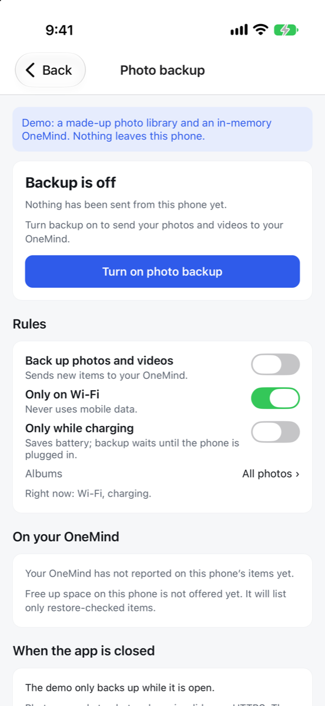 | 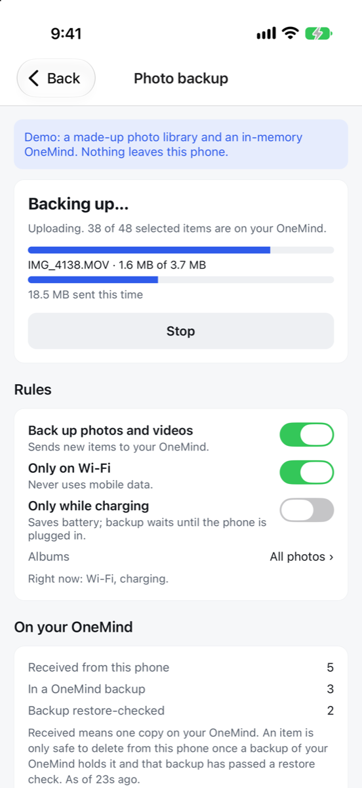 | 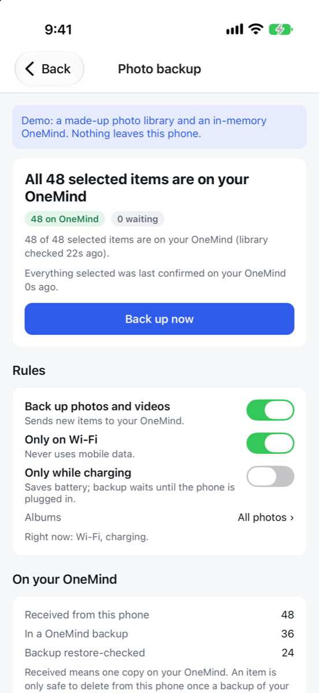 |
| 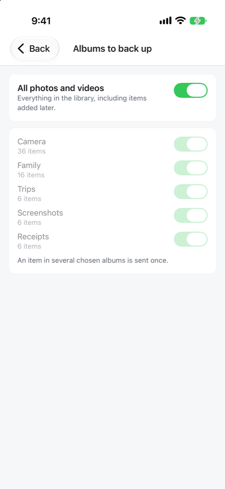 | 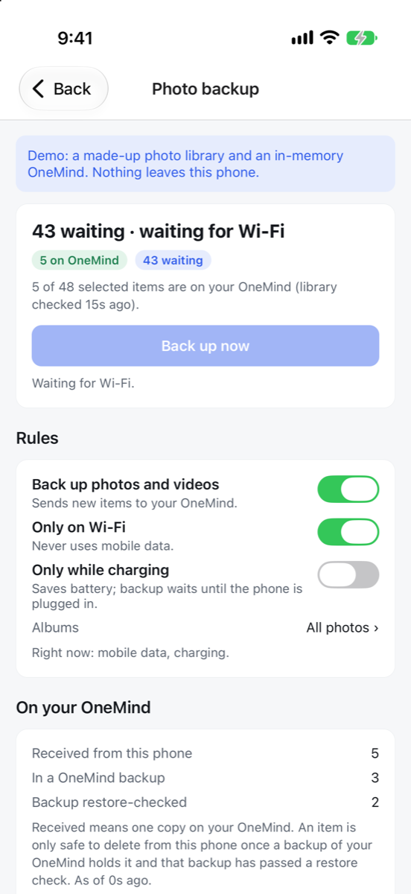 | 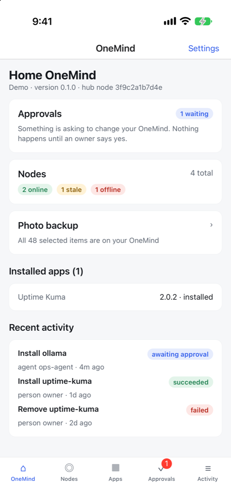 |

## Notifications

**While the app is open:** with the event stream, an event refreshes the screens within a moment; without it, the app polls every 10 s (the heartbeat interval, §1). New items from the hub's inbox become local notifications with text read from the box over HTTPS. On a v0 hub (no inbox) the app diffs its polls and raises: a new action awaiting approval, an action that finished, a node going offline or coming back, a node joining. The first refresh after launch raises nothing (no burst of old news on every start). The logic is pure (`src/lib/alerts.ts`) and unit-tested.

**While the app is closed: content-free push** (D-005). The box sends a ping that holds only an id; the phone fetches the text from the box.

| Platform | Path | What the vendor sees | State |
|---|---|---|---|
| **Android** | **UnifiedPush**: the ntfy app as distributor, the box's own ntfy (seed app `apps/ntfy`) as server, connector 3.3.5 (Apache-2.0) in an Expo native module | Nothing (self-hosted end to end) | built; not yet compiled on a device (CI job `ci-mobile` / android builds it) |
| **iPhone** | **APNs ping-then-fetch** through the stateless OneMind relay; the raw APNs token (`getDevicePushTokenAsync`), never Expo's push service | That a ping arrived, never what | phone side built; relay (`feat/push-relay`) and Notification Service Extension need the Apple developer account (F-4) |
| **Home Wi-Fi (both)** | A direct connection from the box while on the home network (Home Assistant's "Local Push" pattern) | Nothing | later; iOS allows it only on configured networks (C-W11-017) |

The full flows and the relay interface are in [docs/push.md](docs/push.md).

## How this compares (patterns only, no code copied)

- **Home Assistant** ships separate native Swift and Kotlin companion apps and sends remote pushes through Google's Firebase Cloud Messaging, where the notification **content is not encrypted** and can be read by Google (TLS protects only the transport; research 12, C-W11-015/016). OneMind keeps one TypeScript codebase for both phones and never puts alert content in a vendor push.
- **Olares** ships its phone app (LarePass) from one web codebase (C-W11-011). Same one-codebase idea here, on React Native instead of a WebView.
- **umbrelOS** has no phone push at all; its notifications are text lines on the box (C-W11-003/004). Studied only: umbrelOS is PolyForm Noncommercial, so nothing is copied from it.
- **What the phone adds that none of them show on a phone:** every change is an approval card with the exact request and whether a **person or an AI agent** asked, and an agent can never approve.

**Flag for the founder (research vs this task):** research 12 REC-W11-09 recommends **Capacitor** shells over the one web dashboard. This shell is **Expo / React Native**, as the 2026-11-12 task asked. The API client and types are shared with the dashboard by copy (below), so the two clients stay in step either way; which shell technology wins long-term is a decision for Zeus, not this PR.

## Code shared with the dashboard

`src/api/{types,client,mock,fixtures}.ts` and `src/lib/{scan,time}.ts` started as **copies** of `dashboard/src/` (the §11.4 version from the gwmcp stream) so both clients use one contract definition. Each file says so in its header, and mobile-specific changes are marked "Mobile change/addition":
- `HttpApi` requires a hub URL (`normalizeHubUrl`) and has a 10 s timeout.
- `requested_by` / `decided_by` are `PrincipalRef` with an optional `role` (the gateway stores `{id, kind}` for the requester).
- Heartbeats may carry the optional `update` object from the updater stream (not yet in contract §2).

- v1 adds the §12 routes, types and demo routes the phone uses (marked "Mobile addition"); the dashboard has not caught up, so the copies have diverged on purpose until the generated `@onemind/sdk` replaces both (DEV-SDK-4).

## Dependencies and licences

All direct runtime dependencies are **MIT** (the dev dependency TypeScript is **Apache-2.0**) and all are pinned to exact versions in `package.json` (Expo SDK 58, React Native 0.88, React 19.3, React Navigation 7, `expo-secure-store`, `expo-notifications`, `expo-build-properties`, and for photo backup `expo-media-library` 58.0.14, `expo-file-system` 58.0.13, `expo-background-task` 58.0.13, `expo-task-manager` 58.0.14, `expo-network` 58.0.5, `expo-battery` 58.0.4 and `@noble/hashes` 2.4.0, and for v1 `react-native-passkey` 3.6.2 (no dependencies), `@noble/curves` 2.4.0 and `expo-crypto` 58.0.7, all MIT; dev: jest 30, jest-expo, React Native Testing Library 14, `test-renderer`, TypeScript 6). The transitive tree is permissive (MIT, ISC, BSD, Apache-2.0); the non-MIT entries (`lightningcss` MPL-2.0, `caniuse-lite` CC-BY-4.0, `argparse` Python-2.0, `node-forge` BSD-3-Clause OR GPL-2.0) are Expo CLI build tools that do not ship inside the app. No third-party code is copied into this directory, so there is no NOTICE entry.

**Native (Gradle) dependencies added by v1:** `org.unifiedpush.android:connector` 3.3.5 (Apache-2.0, Maven Central POM; brings `kotlin-stdlib` and Google Tink, both Apache-2.0) in `modules/onemind-unifiedpush`; `androidx.credentials` 1.6.0 (Apache-2.0) through react-native-passkey, with its Play Services bridge excluded (above).
**Pre-existing, not changed here:** `expo-notifications` links Firebase Cloud Messaging on Android, which depends on proprietary Play Services libraries, even though the app never uses FCM (the permission is blocked). Removing it needs a build without FCM in `expo-notifications` or a different local-notification library; flagged as a follow-up.

## Known gaps

- **Passkeys need the relying-party decision** above before they work on a real phone; until then token and dashboard approval paths stay.
- **Not run on a device yet:** v1 is unit- and screen-tested in jest (with fakes for the authenticator, push and the hub); the UnifiedPush Kotlin module and the passkey library are compiled only by the `ci-mobile` android job. Real-phone tests from `docs/leap/core/MOBILE.md` §6 (push with the app closed, approve in under 10 s, replayed link fails) are still to do.
- **Gateway side missing:** none of the §12 identity, inbox, event or push routes, nor the device registry, are on the gateway yet; the app lights each up when its route appears.
- **iPhone push text:** until the Notification Service Extension ships (F-4), a closed iPhone shows "Something new on your box".
- **No QR pairing or per-box CA pinning** (CORE-MOBILE-2), so plain HTTP is still allowed with a warning; **no offline cache or audit checkpoint store** (CORE-MOBILE-6); **no splash screen** (needs `expo-splash-screen`).
- **Device key in software**, not in the Secure Enclave or StrongBox.
- One hub at a time.

## Screenshots

`docs/screenshots/` — iPhone 17 simulator (iOS 27), Release build, demo mode as Owner, downscaled to 1200 px high. **These predate v1** (old colours, five tabs, no inbox); retake them with the tour below, which now also visits More and the Inbox.

| | | |
|---|---|---|
| 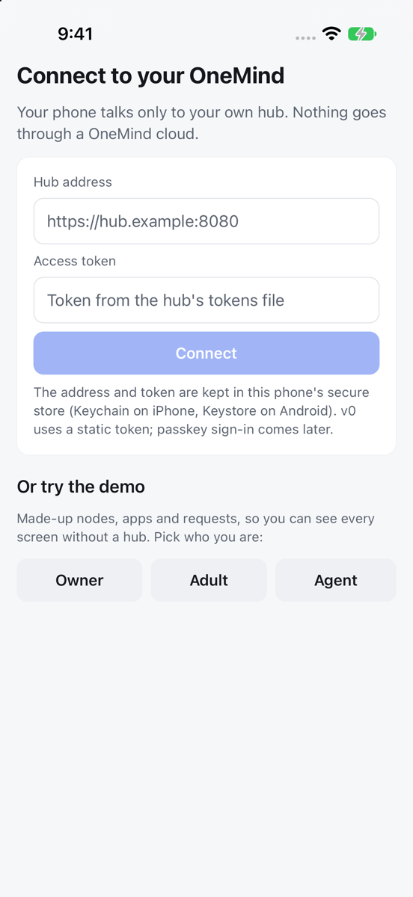 | 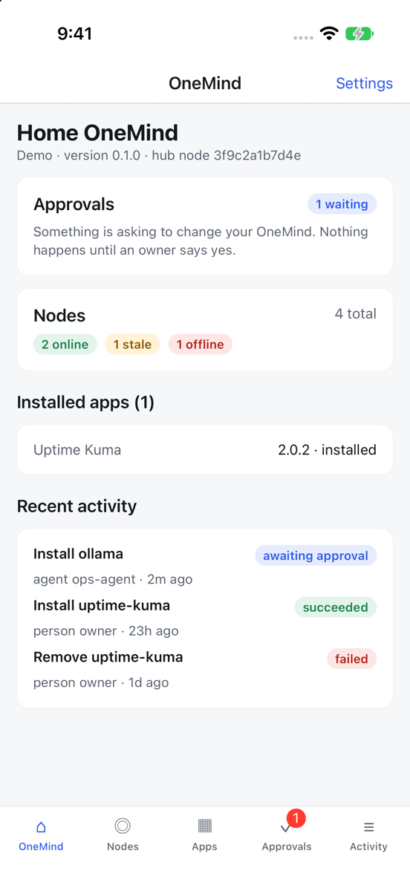 | 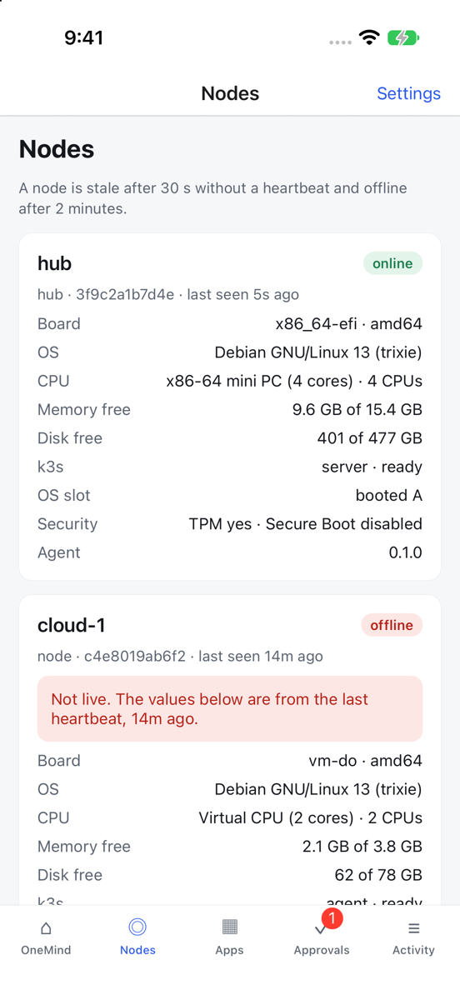 |
| 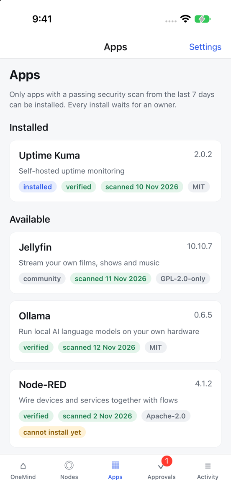 | 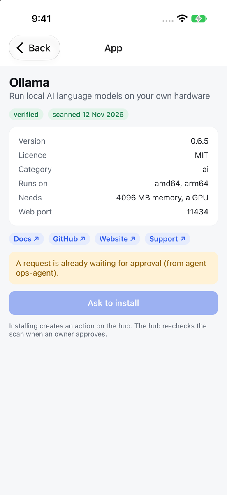 | 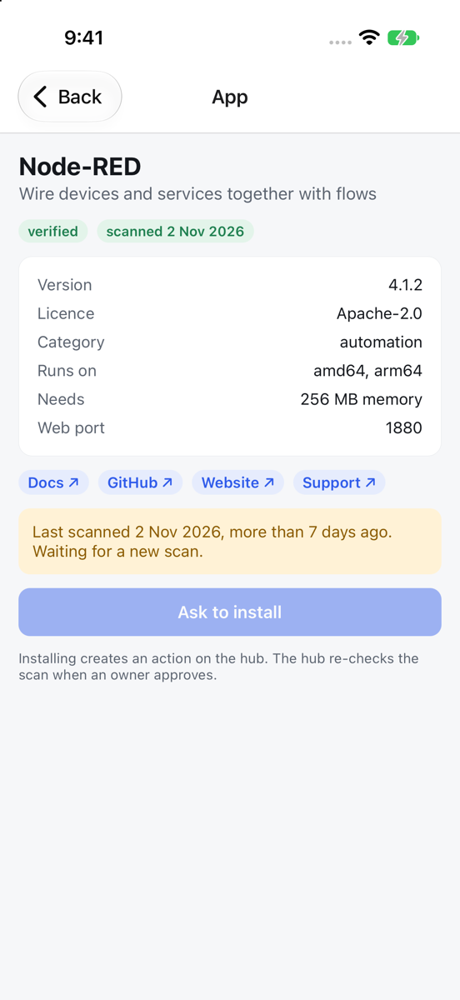 |
| 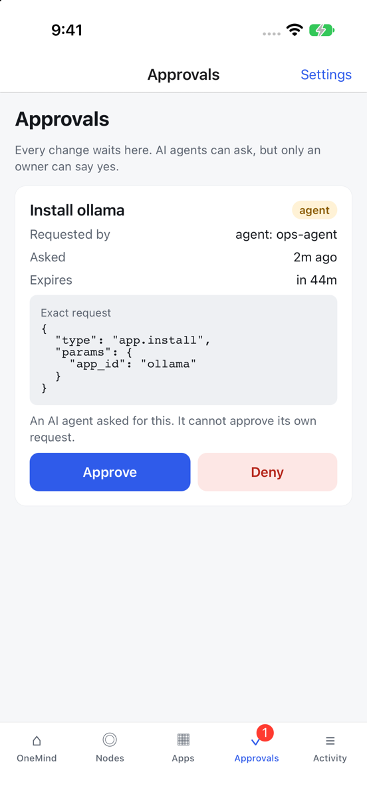 | 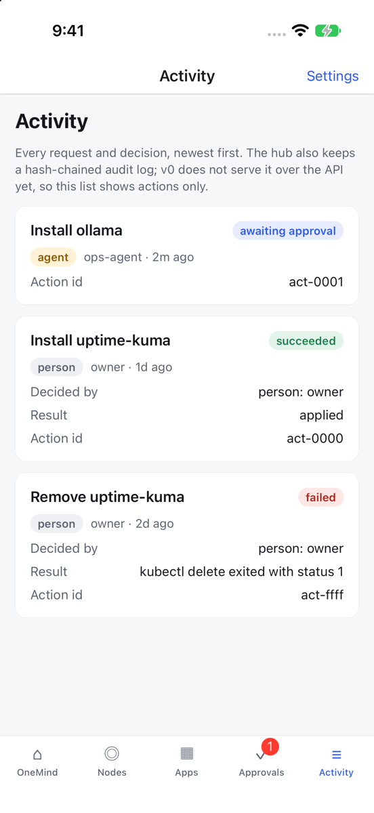 | 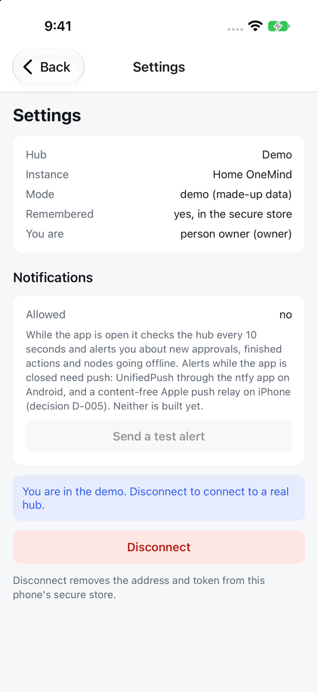 |

**How they were made (repeatable without tapping):** the bundle is built with `EXPO_PUBLIC_SCREENSHOT_TOUR=owner` in a temporary, git-ignored `.env.local` (delete it afterwards). `src/tour.ts` then opens the demo and steps through the screens every 8 s, with notification prompts suppressed; `xcrun simctl io <device> screenshot` captures each step. Normal builds never set the variable, and the tour can only open mock data.

**Simulator note:** build with the simulator's default ad-hoc signing (do not pass `CODE_SIGNING_ALLOWED=NO`). Without a signature the app has no keychain entitlement, the secure store fails with `-34018`, and the app connects for the session only (Settings shows "Remembered: no"); it never falls back to plain storage.
