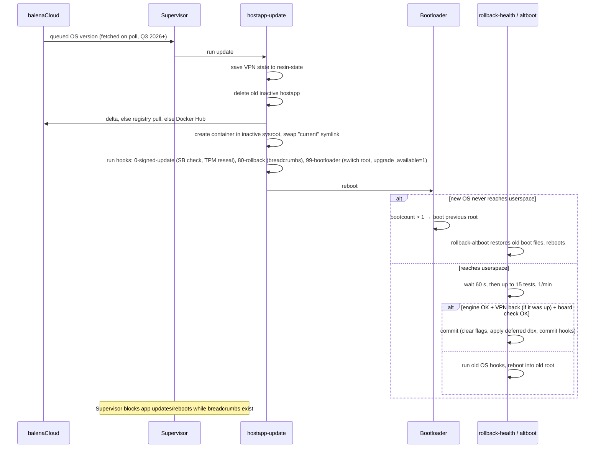

# balenaOS: Tier B condensed teardown

**Workstream:** W1 (Tier B) · **Tag:** `TD-balenaos` · **Date:** 2026-11-11 · **Status:** draft, no refuter pass (Tier B does not require one)
**Claims:** `evidence/claims/TD-balenaos.csv` (C-TD-balenaos-001…060) · **Sources:** `evidence/sources/TD-balenaos.md`, saved copies in `evidence/sources/TD-balenaos/`
**License note:** balenaOS (meta-balena), the Supervisor and balenaEngine are Apache-2.0 [C-TD-balenaos-003, C-TD-balenaos-004, C-TD-balenaos-005], the same licence as OneMind (D-001), so reuse is legally possible. The self-hosted server, openBalena, is **AGPL-3.0** [C-TD-balenaos-006]: study it only, never copy it.

> ### Explain it like I'm the founder
> balenaOS is the operating system behind **balenaCloud**, a paid service for running and updating fleets of small devices such as Raspberry Pis, Jetsons and industrial PCs. It is the strongest proof that **one company can ship one update system across a Pi 5, a Jetson Orin/Thor and an x86 PC**. It does so with **Yocto**, a toolkit that builds a custom Linux from source for each board.
>
> Three things in its code matter for OneMind:
> 1. **The OS ships as a container image.** balena builds the whole root filesystem, packs it as a Docker image and installs updates by *pulling* that image into the spare slot [C-TD-balenaos-010, C-TD-balenaos-012]. It is the same idea as Red Hat's bootc, and balena has used it in production for years.
> 2. **Its "is the update healthy?" check is shallow.** After an OS update, it checks only that the container engine runs, that the cloud VPN reconnects and one optional board script. **It never checks that your apps work** [C-TD-balenaos-019]. HAOS and umbrelOS show the same weakness. OneMind's stricter health gate is a real advantage.
> 3. **It is a cloud product first.** Device identity, OS updates, deltas, the dashboard and long-term support all run through balenaCloud. The free self-hosted server is AGPL, single-user and CLI-only [C-TD-balenaos-007]. Each long-term-support release lasts **9 months**, on paid plans only [C-TD-balenaos-039]. That is far short of the multi-year support OneMind must promise.
>
> **For OneMind:** copy the disk layout, the update locks, the per-board health-check hook, the remote signing service and the "contracts" idea, in which apps declare the hardware they need. Do better on four points: health-gate on apps and k3s, a verified (signed) root filesystem, local-first identity with no cloud needed, and multi-year support.

---

## 1. What was analysed (pinned)

| Component | Release | Date | Commit |
|---|---|---|---|
| balenaOS core layer (meta-balena) | v9.0.6 | 2026-11-09 [C-TD-balenaos-001] | `balena-os/meta-balena@48184b689a43b762c5eea6efbc16b018eed70839` |
| balena Supervisor (device agent) | v20.0.7 | 2026-11-09 [C-TD-balenaos-002] | `balena-os/balena-supervisor@321c7d3718ba6c79504e8d027f23779feac22a76` |
| Jetson Orin device repo | v9.0.5+rev1 | 2026-11-08 | `balena-os/balena-jetson-orin@862a3522f4292c6bf8a00432b5087038fae00083` |
| Raspberry Pi device repo | v9.0.3+rev2 | 2026-11-10 | `balena-os/balena-raspberrypi@64e81417cba33495afe68e923638ef9e0812e741` |
| openBalena (self-hosted server) | v4.1.996 | 2026-11-05 | `balena-io/open-balena@7b2247d5ddb5965e1e91cc5538124c94ad13592a` |
| Official docs (source) | n/a | 2026-11-11 | `balena-io/docs@6b962939c0d6cca9ee3c6cf2fb398cc9a320ae0b` |

Permalink prefixes: **MB** = `https://github.com/balena-os/meta-balena/blob/48184b689a43b762c5eea6efbc16b018eed70839/meta-balena-common/` · **SUP** = `https://github.com/balena-os/balena-supervisor/blob/321c7d3718ba6c79504e8d027f23779feac22a76/` · **JO** = `https://github.com/balena-os/balena-jetson-orin/blob/862a3522f4292c6bf8a00432b5087038fae00083/layers/meta-balena-jetson/` · **DOCS** = `https://github.com/balena-io/docs/blob/6b962939c0d6cca9ee3c6cf2fb398cc9a320ae0b/pages/`

---

## 2. Architecture

```mermaid
flowchart TB
  subgraph Cloud["balenaCloud (SaaS) or openBalena (AGPL, single user)"]
    API[API + device registry]
    REG[Container registry + delta server]
    VPN[Cloudlink VPN]
  end
  subgraph Device["Device running balenaOS"]
    BL[Bootloader: GRUB / U-Boot / balena bootloader (kexec)]
    subgraph Disk
      BOOT[resin-boot: config.json, boot files]
      RA[rootA: OS as hostapp container]
      RB[rootB: spare slot]
      ST[resin-state: persistent /etc bits, rollback flags]
      DATA[resin-data: Supervisor, apps, volumes]
    end
    ENG[balenaEngine (Moby fork)]
    SUPV[Supervisor container]
    APPS[App containers (Compose subset)]
  end
  API -- target state --> SUPV
  SUPV -- pulls --> REG
  SUPV --> ENG --> APPS
  Device -- OpenVPN --> VPN
  BL --> RA
```

- **Base OS:** a custom Yocto distribution, not a general distro [C-TD-balenaos-010]. It includes systemd, NetworkManager + ModemManager, Avahi, chrony, and OpenVPN to balenaCloud's "cloudlink" [C-TD-balenaos-059].
- **Read-only root:** persistent paths are bind-mounted from `resin-state`. The Supervisor, apps and volumes live on `resin-data` [C-TD-balenaos-060].
- **Agent:** the **Supervisor** is a privileged container. It pulls the target state from the cloud and reconciles containers on balenaEngine. It also runs OS updates [C-TD-balenaos-022].

## 3. Base OS and image build

| Step | What the code does | Citation |
|---|---|---|
| Build entry | `balena-yocto-scripts` (`barys`, containerized `balena-build.sh`) drives BitBake per device repo | `balena-os/balena-yocto-scripts@436cae1` (build/) |
| Root filesystem | Yocto builds the rootfs. `IMAGE_CMD:docker` runs `docker import`/`save`. `IMAGE_CMD:hostapp-ext4` runs `mkfs.hostapp` to write that **container image** into the root partition | MB `classes/image_types_balena.bbclass#L387-L402` [C-TD-balenaos-010] |
| Disk image | `parted` writes boot, rootA, rootB, state and data, with fixed labels | MB `classes/image_types_balena.bbclass#L26-L61`, `#L103-L115` [C-TD-balenaos-008] |
| Slot sizing | Each root slot = (1460 MiB − boot − state) / 2, about 640 MiB by default. The root must stay small, because apps live on data | MB `classes/image_types_balena.bbclass#L94-L101` [C-TD-balenaos-009] |
| Signing | If `SIGN_API` is set, the build POSTs to a **remote signing service** with an API key and gets back signatures (image `.sig`, EFI, RSA, kernel modules). Private keys never sit on the builder | MB `classes/image_types_balena.bbclass#L408-L427`; `recipes-core/images/balena-image.bb#L20` [C-TD-balenaos-011] |
| Board support | One "device repo" per board family (e.g. `balena-jetson-orin`, `balena-raspberrypi`) layers BSPs over meta-balena. Jetson builds come from **OE4T meta-tegra**, not NVIDIA's Ubuntu rootfs [C-TD-balenaos-042] | JO `.gitmodules` |

**Team behind the OS layer:** in the last 12 months about 15 people committed to meta-balena, and five of them wrote about 88 % of the human commits [C-TD-balenaos-055]. That is a small but real team, unlike Rugix's single maintainer (01 §2).

## 4. Install paths

| Path | How | Evidence |
|---|---|---|
| Flash an SD/eMMC image | Download a fleet-configured image (with `config.json`) and flash it with Etcher | DOCS `learn/getting-started/jetson-agx-thor-devkit.md` |
| USB "flasher"/installer | x86 and secured devices boot a USB stick that writes balenaOS to internal disk. All Secure Boot devices use installer images | DOCS `learn/getting-started/generic-amd64.md#L83-L94`; [C-TD-balenaos-030] |
| Unconfigured image | balenaOS without a cloud: the Supervisor still keeps containers running, but nothing manages it | DOCS `reference/os/overview.md#L64` |
| Script install on an existing distro | **None.** balenaOS is image-only | (absence in docs; not ledgered) |
| Offline/air-gapped | Reflash with a preloaded image that keeps the device identity. **Named volumes are wiped** | [C-TD-balenaos-037] |

## 5. Update and rollback (derived from code)



| Element | Code | Note |
|---|---|---|
| Update client | MB `recipes-containers/hostapp-update/files/hostapp-update#L108-L142` [C-TD-balenaos-012] | The OS update is a **container pull** into the spare slot |
| Old slot wiped first | `hostapp-update#L93-L106` [C-TD-balenaos-014] | You can never keep two known-good spares |
| Download fallback | DOCS `reference/os/updates/update-process.md#L20` [C-TD-balenaos-015] | Delta, then registry, then **Docker Hub** |
| Breadcrumbs | MB `recipes-support/hostapp-update-hooks/files/80-rollback#L25-L39` [C-TD-balenaos-016] | Flags on the state partition |
| Health gate | MB `recipes-core/balena-rollback/files/rollback-health#L28-L118` [C-TD-balenaos-017, C-TD-balenaos-018] | 60 s delay, 15 retries |
| What "healthy" means | MB `recipes-core/balena-rollback/files/rollback-tests#L26-L56` [C-TD-balenaos-019] | Engine + VPN + board hook; **no Supervisor or app check** |
| Unbootable OS | MB `../docs/rollbacks.md` [C-TD-balenaos-020] | Bootloader boot count |
| Update lock | SUP `src/lib/update-lock.ts#L36-L58` [C-TD-balenaos-023] | Agent can't reboot mid-trial |
| Retries and queueing | DOCS `reference/os/updates/self-service.md#L10-L33`, `#L76` [C-TD-balenaos-022] | 2 retries, then every 2 days |
| No manual rollback | DOCS `reference/os/updates/update-process.md#L10-L12` [C-TD-balenaos-021] | No downgrade once committed |
| User control of timing | Operator queues updates per device or fleet in the dashboard/API | [C-TD-balenaos-022] |

**Jetson specifics.** balena replaces NVIDIA's own rootfs A/B with its bootloader's choice of slot. It patches NVIDIA's UEFI to make that work [C-TD-balenaos-043]. Each OS update can also stage a **UEFI capsule** that rewrites the QSPI boot firmware [C-TD-balenaos-045]. The Jetson health check fails the update if the firmware and kernel L4T versions differ [C-TD-balenaos-044]. Major BSP jumps need a stepping-stone release (JetPack 6 → L4T 36.5.0 → JetPack 7.2) [C-TD-balenaos-041].

**Pi 5 specifics.** U-Boot is dropped. A kexec-based **balena bootloader** (a small Linux kernel that loads the real one) selects the slot [C-TD-balenaos-050].

## 6. App format

- **Docker Compose v2.1 subset.** The Supervisor allow-lists about 50 compose fields and silently drops the rest with a log warning [C-TD-balenaos-031] (SUP `src/compose/sanitise.ts#L9-L80`).
- **Update strategy per service** is set with a label. The default is `download-then-kill`; `hand-over` lets old and new run side by side [C-TD-balenaos-032] (SUP `src/compose/update-strategies.ts#L117-L133`).
- **Host access through feature labels**, e.g. `io.balena.features.dbus`, `kernel-modules`, `gpu`, `supervisor-api`. Each maps to a specific bind mount or device request [C-TD-balenaos-033] (SUP `src/compose/utils.ts#L331-L414`). This is a **capability-grant vocabulary**, the same idea as the day-one extension points DC-16 asks for.
- **Contracts:** a release can require `hw.device-type`, `sw.l4t`, `sw.os` or a Supervisor version, and a service can be optional [C-TD-balenaos-034] (SUP `src/lib/contracts.ts#L66-L71`). This is a working model for N-3 ("can my box run this?").
- **There is no app store for end users.** balenaHub exists, but the product is aimed at fleet developers who push their own releases.

## 7. Identity, accounts and fleet

- **Device identity** is a UUID plus a device API key. On first boot the Supervisor uses the **fleet provisioning key** in `config.json` to register its own key with balenaCloud [C-TD-balenaos-035] (SUP `src/lib/api-helper.ts#L121-L183`). Without a server, the device has no managed identity.
- **Users:** balenaCloud has multi-user organizations and roles. openBalena is single-user [C-TD-balenaos-007]. The device has **no local end-user accounts**. It is not a home OS.
- **Remote access** runs through the cloud VPN (OpenVPN) [C-TD-balenaos-059]. Development images expose the engine socket and passwordless root SSH [C-TD-balenaos-036].

## 8. AI features

- **None on the device.** There is no local inference service, agent or MCP endpoint. A GPU is just a feature label [C-TD-balenaos-033].
- **The docs site** has an MCP server for looking up documentation [C-TD-balenaos-056].
- **Fleet control through MCP:** the only balena-owned server is an experimental CLI wrapper that was archived after four days of activity in May 2025 [C-TD-balenaos-057]. Community servers exist (GPL-3.0 and MIT).
- **For OneMind (AI-1…AI-5):** this is open ground. balena's fleet API shows which controls an agent would need (pin a release, queue an OS update, set a variable). OneMind can expose the same controls locally, behind approvals.

## 9. Backups

**balenaOS documents no on-device backup or restore** [C-TD-balenaos-058] (status `partial`: shown by absence). Offline updates even wipe named volumes [C-TD-balenaos-037]. A host OS update does not snapshot app data, and a failed update once left the Supervisor's config un-rolled-back [C-TD-balenaos-048]. Fleet operators are expected to keep their data in the cloud. This contrasts with HAOS (SecureTar backups) and OneMind's restic plan (01 §1, Backups).

## 10. Security

| Area | What balena does | Claim |
|---|---|---|
| Secure Boot | Own keys by default (no Microsoft shim); customer keys are a paid extra | [C-TD-balenaos-027] |
| Full-disk encryption | Always paired with Secure Boot, set up by an installer. Small-RAM devices are excluded | [C-TD-balenaos-030] |
| TPM | LUKS passphrase sealed to PCRs 0,2,3,7 and re-sealed on update | [C-TD-balenaos-026] |
| Update refuses unsigned OS | Yes, in Secure Boot mode | [C-TD-balenaos-024] |
| Revocation | dbx update deferred until the new OS proves healthy (a revoked old OS stays bootable as a fallback until commit) | [C-TD-balenaos-025] |
| Root filesystem integrity | **Not verified.** The chain of trust ends at the kernel, and encryption is the only guard | [C-TD-balenaos-028] |
| App images | **Not signed**; digest-pinned pulls over TLS | [C-TD-balenaos-029] |
| Build keys | Held by a remote signing service | [C-TD-balenaos-011] |
| Kernel lockdown, signed modules | Yes in secure mode; out-of-tree modules need a paid custom build | DOCS `reference/os/secure-boot-and-full-disk-encryption/overview.md#L136-L151` |
| LSM (AppArmor/SELinux) | Not found in meta-balena's distro config. **UNVERIFIED** (absence; not ledgered) | — |

## 11. Hardware

balenaCloud lists over 150 public device types, including `raspberrypi5`, `generic-amd64`, Jetson Orin Nano/AGX and **Jetson AGX Thor** [C-W2-040]. The Pi 5 type is "released" [C-TD-balenaos-051]. Jetson Orin is on JetPack 7.2 / L4T 39.2 [C-TD-balenaos-041]. **Long-term support (ESR) covers generic x86/arm64 and Pi 5, but not Jetson** [C-TD-balenaos-040]. Unlisted boards need paid Custom Device Support [C-TD-balenaos-053]. balena also sold its own carrier board, balenaFin (press release, [C-TD-balenaos-054]).

## 12. Licence

| Part | Licence | OneMind may |
|---|---|---|
| meta-balena (OS) | Apache-2.0 [C-TD-balenaos-003] | Reuse code with attribution |
| Supervisor | Apache-2.0 [C-TD-balenaos-004] | Reuse code |
| balenaEngine | Apache-2.0 [C-TD-balenaos-005] | Reuse; prefer upstream Moby/containerd |
| openBalena server | **AGPL-3.0** [C-TD-balenaos-006] | Study only (rule 4) |
| Jetson BSP blobs inside images | NVIDIA Tegra Software License Agreement: redistributable unmodified, NVIDIA hardware only, agreement attached [C-LIC-001] [C-LIC-002] [C-LIC-003] | Same conditions apply to OneMind's Jetson flavor [C-LIC-048] |

## 13. Business model

**Per-device SaaS.** The first 10 devices are free. Prototype costs $159/month (30 devices), Pilot $329/month (60) and Production $1,439/month (110 devices), plus $2–3 per extra device per month. ESR and ARM64 Secure Boot come only on paid tiers [C-TD-balenaos-052]. Custom board support is a monthly fee [C-TD-balenaos-053]. balena was founded in 2013 and raised a $14.4M round in July 2019 [C-TD-balenaos-054]. No later round or current headcount was verified (UNVERIFIED).

## 14. Claims vs code

| Claim (docs) | Code | Verdict |
|---|---|---|
| Rollback checks the engine and VPN (DOCS rollbacks) | `rollback-tests#L26-L56` also runs a board hook; nothing checks apps | **Agree**, but narrower than "healthy" suggests |
| "Tests run every minute for 15 minutes" (MB `docs/rollbacks.md`) | `rollback-health#L28-L30`, `#L86-L111`: 60 s wait, then up to 15 retries, so the maximum is about 16 min | Agree |
| Update is atomic: a failure leaves the old system usable (update-process L14) | `hostapp-update#L93-L106` deletes the inactive slot before writing; the active slot is untouched | Agree |
| Apps "verified" on secured devices (SB overview L126-L130) | Only digest-over-TLS; no signature check in the Supervisor pull path | Agree; the docs say so themselves |
| Updates switch to a new rootfs (overview L126) | The new "rootfs" is a container created by balenaEngine in the inactive sysroot (`hostapp-update#L127-L142`) | Agree, with a nuance: the slot holds an engine data root, not a plain filesystem image |

## 15. Real-world failure reports

| Report | What happened | Lesson for OneMind |
|---|---|---|
| balena-jetson-orin #636 [C-TD-balenaos-046] | A JetPack 7.2 boot blob without NVIDIA's eMMC fix left AGX Orin 64GB modules with Kingston eMMC unable to cold-boot. Both boot chains failed | Firmware/QSPI updates are **outside** the A/B safety net. Test every module SKU and eMMC vendor before shipping a BSP jump (DC-08) |
| meta-balena #2301 [C-TD-balenaos-047] | A power cut during the first boot after an update triggered an immediate rollback | Boot-count logic needs retries. This matches our Rugix/RAUC power-cut lab cases |
| meta-balena #2833 [C-TD-balenaos-048] | A failed OS update did not roll back the agent's config, so the device needed manual repair | Roll back agent and app state **with** the OS. The pre-update snapshot belongs in the gate (W5) |
| balena-raspberrypi #1146 [C-TD-balenaos-049] | Pi 5 I2C broken in the balena kernel; the customer was told GitHub issues aren't monitored | A Yocto per-board kernel lags upstream fixes. Support channels shape trust |

## 16. Strengths and weaknesses

**Strengths:** the widest board coverage of any image-based OS studied, including Pi 5, Orin and Thor [C-W2-040]. Years of fleet-proven A/B updates with two rollback paths. The OS ships as a container image with deltas. A clean capability-label and contract model. Keys sit in a remote signing service. Secure Boot + TPM + FDE work on x86 and some ARM. The core is Apache-2.0.

**Weaknesses (for OneMind's goals):** cloud-dependent identity and management; the self-hosted server is AGPL, single-user and CLI-only [C-TD-balenaos-007]. A shallow health gate [C-TD-balenaos-019]. An unverified root filesystem and unsigned apps [C-TD-balenaos-028, C-TD-balenaos-029]. Support is only 9 months per ESR and paid-only, and Jetson has none [C-TD-balenaos-039, C-TD-balenaos-040]. No backups [C-TD-balenaos-058]. No Kubernetes. No end-user accounts or app store. Updates can fall back to Docker Hub [C-TD-balenaos-015].

## 17. What competitors do (constraint-fit)

| Topic | balenaOS | HAOS | umbrelOS | OneMind (01) | Constraint-fit with OneMind |
|---|---|---|---|---|---|
| Build | Yocto + per-board repos [C-TD-balenaos-042] | Buildroot | Debian + Rugix Bakery | Debian 13 image + L4T for Jetson | **Low-medium:** Yocto needs specialist knowledge, and balena has about 15 OS committers [C-TD-balenaos-055] against OneMind's 1 (M-6) |
| OS delivery | Container image pulled into the spare slot [C-TD-balenaos-012] | RAUC bundle | Rugix bundle | RAUC verity bundle | **Medium:** proven at fleet scale, but no verity. bootc (Industrial profile) is the same idea with signatures |
| Health gate | Engine + VPN + board [C-TD-balenaos-019] | Supervisor start [C-W3-025] | Daemon start [C-W3-036] | Fresh k3s/core-pod signals | **High** as a lesson: all three competitors gate shallowly |
| One updater on x86 / Pi 5 / Jetson | Yes [C-W2-040, C-TD-balenaos-043] | No Jetson | No Jetson | No (RAUC + NVIDIA A/B) | **Medium:** proves feasibility; costs per-board UEFI patches and firmware risk |
| App format | Compose subset + labels [C-TD-balenaos-031] | Add-on config + Docker | Compose + manifest | Helm + `onemind.app.yaml` | **Medium:** label → capability mapping transfers directly to Kubernetes |
| Identity | Cloud-issued key [C-TD-balenaos-035] | Local users | Local user(s) | Local-first (M-1, M-2) | **Low:** conflicts with local-first |
| Support period | 9 months per ESR, paid [C-TD-balenaos-039] | Rolling | Rolling | Multi-year (CRA) | **Low** |
| Backups | None [C-TD-balenaos-058] | SecureTar | Built in | restic | **Low** |
| Robotics | Customers in robotics, but no robotics stack | No | No | Core moat (M-7) | **Medium** |

## 18. What OneMind copies and what it does better

| ID | Recommendation | Requirements |
|---|---|---|
| REC-TD-balenaos-01 | **Copy** the update lock: the device agent refuses app changes and reboots while an OS update is on trial [C-TD-balenaos-023] | R-1, M-6 |
| REC-TD-balenaos-02 | **Copy** a per-board health hook (`rollback-board-healthcheck`) inside the OneMind gate, e.g. the Jetson firmware/kernel L4T version match [C-TD-balenaos-044] | R-1, N-8, M-7 |
| REC-TD-balenaos-03 | **Copy** the remote signing service pattern: CI asks an HSM-backed signer and never holds keys [C-TD-balenaos-011] | R-1, R-3 |
| REC-TD-balenaos-04 | **Copy** "contracts" and capability labels in `onemind.app.yaml` (`requires: hw.gpu`, `sw.l4t`, device grants) for "can my box run this?" [C-TD-balenaos-033, C-TD-balenaos-034] | N-3, A-1, A-5, A-8 |
| REC-TD-balenaos-05 | **Copy** deferring revocation (dbx) until commit, so rollback still boots [C-TD-balenaos-025] | R-1 |
| REC-TD-balenaos-06 | **Do better:** gate on k3s, core pods and app health, not just the runtime [C-TD-balenaos-019] | R-1 |
| REC-TD-balenaos-07 | **Do better:** a verity-protected, signed root and signed app artifacts (cosign) [C-TD-balenaos-028, C-TD-balenaos-029] | U-4, R-1 |
| REC-TD-balenaos-08 | **Do better:** local-first identity. A QR/USB claim to a local OneMind controller, with the cloud optional [C-TD-balenaos-035] | M-1, M-2, N-4, F-6 |
| REC-TD-balenaos-09 | **Do better:** a pre-update snapshot of agent and app state, rolled back with the OS [C-TD-balenaos-048] | R-1, UX-6 |
| REC-TD-balenaos-10 | **Do better:** a published multi-year support period per SKU, including Jetson [C-TD-balenaos-039, C-TD-balenaos-040] | R-2, R-3 |
| REC-TD-balenaos-11 | **Do better:** never fall back to an unauthenticated public registry for OS payloads [C-TD-balenaos-015] | R-1 |
| REC-TD-balenaos-12 | **Avoid** wiping data volumes in the offline/air-gapped update path [C-TD-balenaos-037] | N-6, R-1 |

## 19. Does balena challenge OneMind's Tier A decisions (01)?

| Tier A decision | balena evidence | Effect |
|---|---|---|
| **Jetson on stock L4T Ubuntu 24.04 with NVIDIA A/B** (DC-07, DC-09) | balena runs Orin and Thor on a **Yocto meta-tegra** build under the **same** A/B framework as Pi 5 and x86. It overrides NVIDIA's slot logic with a UEFI patch [C-TD-balenaos-042, C-TD-balenaos-043] | **Weakens "stock L4T is the only practical path"**: one updater across all three boards exists in production. It also shows the cost: per-module UEFI patches, capsule firmware outside A/B [C-TD-balenaos-045], stepping-stone BSP upgrades [C-TD-balenaos-041] and a real no-boot regression [C-TD-balenaos-046], with no long-term support for Jetson [C-TD-balenaos-040]. For a solo developer this **supports** 01's choice. Flip condition for DC-09: OneMind gains a Yocto-capable maintainer or a partner such as OE4T, *and* meta-tegra keeps JetPack parity. Recorded for the DC-09 refuters, not re-scored here |
| **RAUC A/B on the core** | balena's container-image OS delivery works at fleet scale, with deltas [C-TD-balenaos-012, C-TD-balenaos-038], but has no root verity [C-TD-balenaos-028] | No change. It supports keeping **bootc** (the signed OCI-image route) as the year-2 Industrial profile |
| **Health-gated commit** | A third competitor gates only on runtime + connectivity [C-TD-balenaos-019] | **Strengthens** 01. Note balena's 60 s wait and 15-minute retry window as a reference for gate timing |
| **k3s on ≥ 4 GB + SSD; NATS leaves below** | balena runs fleets with no on-device orchestrator, just engine + agent + cloud (same as the W4 steelman) | No new evidence beyond W4. Supports the "NATS leaf / light node below k3s" tier |
| **restic + online SQLite backup** | balena has no backup [C-TD-balenaos-058] | No challenge. A differentiator |
| **Security: verity headroom, Secure Boot later, CRA programme** | balena's paired SB + FDE, TPM re-seal on update and own-key model are a working reference [C-TD-balenaos-026, C-TD-balenaos-027]. Its 9-month ESR [C-TD-balenaos-039] is a warning on CRA support periods | Supports 01. Add "TPM re-seal in update hooks" to the security backlog |
| **Debian 13 base** | balena chose Yocto for board portability | No challenge. Already scored in 03 (L. balenaOS: fails the k3s and support-period gates) |

**Net:** balena confirms ADR-001 as amended in 01. Its one finding that can move a Tier A decision is the **Jetson-on-Yocto, one-updater** proof, which goes to the DC-07/DC-09 refuters as evidence.

## 20. Gaps and next steps

- Not run in a VM: no balenaOS image was booted. A QEMU `generic-amd64` boot plus forced-bad-update test would confirm the 60 s / 15-retry gate empirically (candidate for `22-…`).
- The AppArmor/SELinux status and the meta-tegra licence handling of NVIDIA blobs in balena images were not verified.
- Current company headcount and funding after 2019: UNVERIFIED.

## Glossary

- **A/B update:** two copies of the OS. The update writes the spare one, and the device falls back if the new one fails.
- **BSP (board support package):** the vendor's kernel, firmware and drivers for one board.
- **Capsule update:** a UEFI-standard package that rewrites boot firmware (on Jetson, the QSPI flash).
- **Compose:** Docker's YAML format for describing a multi-container app.
- **Contract (balena):** a declaration of what hardware or software a release needs.
- **dbx:** the UEFI list of revoked signatures.
- **ESR (Extended Support Release):** balena's paid long-term-support line, 9 months per version.
- **hostapp:** balena's name for the OS packaged as a container image.
- **kexec:** a Linux call that boots a new kernel from a running one, used by balena's bootloader.
- **meta-tegra (OE4T):** the community Yocto layer for NVIDIA Jetson.
- **PCR:** a TPM register that records boot measurements. Secrets sealed to PCRs unlock only if the boot chain is unchanged.
- **Supervisor:** balena's on-device agent that runs apps and OS updates.
- **Verity (dm-verity):** a kernel feature that checks every block of a read-only filesystem against a signed hash tree.
- **Yocto:** a toolkit that builds a custom Linux distribution from source for a specific board.
