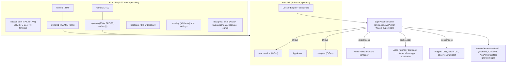

# Home Assistant OS (HAOS): Tier A teardown

**Workstream:** W1 (Tier A) · **Tag:** `TD-home-assistant-os` · **Date:** 2026-11-10 · **Status:** draft for refuter review
**Claims:** `evidence/claims/TD-home-assistant-os.csv` · **Sources:** `evidence/sources/TD-home-assistant-os.md`
**License note:** HAOS, the Supervisor, SecureTar and Core are Apache-2.0, the same license as OneMind (prior-verified: research/platform/verify-updates-rollback-backups-security.md §1). OneMind may legally reuse this code. The recommendations below are still pattern-level, because HAOS is a Docker appliance and OneMind is a k3s platform.

> ### Explain it like I'm the founder
> Home Assistant OS is the best working example of what ADR-001 proposes: a small read-only Linux image that you flash once and then update as a whole, with a spare copy (slot A and slot B) to fall back to. It is built with **Buildroot**, a tool that compiles a tiny custom Linux from source, one image per board. It is updated with **RAUC**, a tool that writes the new image into the unused slot and lets the bootloader try it. On top of the image runs one privileged container, the **Supervisor**. The Supervisor manages everything else: Home Assistant itself, the apps (formerly add-ons), backups and OS updates.
>
> Reading the code shows three things the marketing doesn't tell you:
> 1. An update is declared "good" as soon as the Supervisor process starts. That happens **before** Home Assistant or any app runs, and even if the system flags itself unhealthy [C-TD-home-assistant-os-018]. In one real case, an update broke the network card on x86 machines. The box booted, marked itself good, and the user had to roll back by hand at a local console [C-TD-home-assistant-os-044].
> 2. The OS image is signed carefully, with a proper certificate chain and a key rotation in 2026 [C-TD-home-assistant-os-014]. App and container images are **not** checked on the device [C-TD-home-assistant-os-023][C-TD-home-assistant-os-024].
> 3. The Raspberry Pi 5 path is the most fragile. It gives a new slot exactly one try, and that try depends on how you reboot [C-TD-home-assistant-os-017]. Raspberry Pi 5 users filed the most update-failure reports [C-TD-home-assistant-os-042][C-TD-home-assistant-os-043].
>
> **For OneMind:** copy the disk layout, the signed A/B bundles, the QEMU update tests and the backup UX. Do better on four points: a real health gate (k3s, core pods and network), app signature checks, an offline signing root, and a pre-update firmware check on the Pi.

---

## 1. What was analysed (pinned)

| Component | Release | Release date | Commit analysed |
|---|---|---|---|
| Home Assistant OS | 18.5 | 2026-11-06 [C-TD-home-assistant-os-001] | `home-assistant/operating-system@fc301f556647b53281e853b9ce7f44915b3c7b14` |
| Buildroot fork (submodule) | (HA fork) | n/a | `home-assistant/buildroot@5c344b3789e3f6d620cf11ffab60e522a875cc79` |
| Supervisor | 2026.11.0 | 2026-11-06 [C-TD-home-assistant-os-002] | `home-assistant/supervisor@c1c6f0a754c0656eb1af189f11009f1cfc4b3e28` |
| SecureTar (backup encryption) | 2026.10.0 | 2026-10-09 | `home-assistant-libs/securetar@224df990ebea9a9f99ee72c53564fbed710eb46b` |
| Home Assistant Core (auth, MCP server only) | 2026.11.1 | 2026-11-09 | `home-assistant/core@d8a0dc698c8946b44e455d904000db563cfbf1ba` |
| Developer docs | n/a | n/a | `home-assistant/contributors.home-assistant.io@1fb72833546780ab815de3967dd9054d8c91ceba` |

Permalink prefixes used below:
- **OS** = `https://github.com/home-assistant/operating-system/blob/fc301f556647b53281e853b9ce7f44915b3c7b14/`
- **SUP** = `https://github.com/home-assistant/supervisor/blob/c1c6f0a754c0656eb1af189f11009f1cfc4b3e28/`
- **ST** = `https://github.com/home-assistant-libs/securetar/blob/224df990ebea9a9f99ee72c53564fbed710eb46b/`
- **CORE** = `https://github.com/home-assistant/core/blob/d8a0dc698c8946b44e455d904000db563cfbf1ba/`

---

## 2. Architecture in one picture



The flow, in plain words: systemd starts Docker, then `haos-supervisor.service` creates and starts the Supervisor container [C-TD-home-assistant-os-028]. The Supervisor then pulls and starts Core, the plugins and the apps.

---

## 3. W1 field-by-field

| W1 field | What HAOS does (evidence) |
|---|---|
| **Architecture** | A minimal immutable host plus one privileged orchestrator container (the Supervisor). The Supervisor mounts the Docker and containerd sockets read-write and drives the host over D-Bus [C-TD-home-assistant-os-028]. Not Kubernetes. |
| **Base OS** | Not a distro: Buildroot builds one image per board from 14 defconfigs (Pi 3/4/5, Green, Yellow, ODROID, Khadas, generic x86-64/aarch64, OVA) [C-TD-home-assistant-os-003]. Upstream Linux 6.18.58 on x86 [C-TD-home-assistant-os-004]. On Pi 5, the Raspberry Pi vendor kernel fork pinned to one commit [C-TD-home-assistant-os-005]. |
| **Image build** | `make <board>` runs Buildroot with `BR2_EXTERNAL=buildroot-external` [C-TD-home-assistant-os-003]. genimage writes the partition image, and `hdd-image.sh` converts it to img.xz/qcow2/vmdk/vdi/ova [C-TD-home-assistant-os-006]. |
| **Install paths** | Flash an image (Pi, ODROID), write a USB stick on x86, a VM image, or Green with HAOS preinstalled. HAOS is the "recommended installation type" [C-TD-home-assistant-os-048]. "Container" installs exist but have no apps and manage their own updates [C-TD-home-assistant-os-048]. |
| **Update / rollback** | RAUC A/B with verity bundles [C-TD-home-assistant-os-009]. The user starts the update. The Supervisor installs it but never reboots by itself [C-TD-home-assistant-os-020]. GRUB tries the new slot up to 3 times [C-TD-home-assistant-os-016]. Pi 5 tryboot allows exactly 1 try [C-TD-home-assistant-os-017]. Commit = the Supervisor starts [C-TD-home-assistant-os-018]. Manual rollback with `ha os boot-slot other`, which is covered by CI tests [C-TD-home-assistant-os-041]. **But the Supervisor updates itself automatically by default** [C-TD-home-assistant-os-021]. |
| **App format** | Each app repository holds a `config.yaml` validated by a voluptuous schema (name, version, slug, arch, ports, ingress, privileges, AppArmor, role, backup hooks) [C-TD-home-assistant-os-026]. Images come from a registry or are built locally. A 1–8 "security rating" is shown to users [C-TD-home-assistant-os-025]. |
| **Identity / auth** | Core owns users: local accounts hashed with bcrypt at 12 rounds [C-TD-home-assistant-os-039]. App logins are delegated to Core [C-TD-home-assistant-os-037]. The Supervisor API trusts a per-app token or a socket principal, plus role regexes [C-TD-home-assistant-os-038]. Only admin/non-admin roles were found in the code read (finer per-user roles: UNVERIFIED). |
| **AI features** | The Core MCP server can be limited to admins and set read-only [C-TD-home-assistant-os-040]. Earlier work verified OAuth/PKCE, tool sets and the 2025.2 introduction (context/03 row 113). |
| **Backups** | A plain outer tar holds `backup.json` and one inner tar per component. Each inner tar is encrypted with SecureTar when a password is set [C-TD-home-assistant-os-031]. v3 uses Argon2id + XChaCha20-Poly1305 [C-TD-home-assistant-os-033], but only if Core ≥ 2026.3.0. Otherwise the legacy v2 format is used [C-TD-home-assistant-os-032]. Default schedule: daily, keep 3. Backup agents: local, NAS and cloud drives, plus HA Cloud (keeps 1) [C-TD-home-assistant-os-036]. Third-party audit [C-TD-home-assistant-os-035]. |
| **Security** | Read-only EROFS root [C-TD-home-assistant-os-004]. Signed OS bundles with a dev/release CA split [C-TD-home-assistant-os-012]. AppArmor: Docker's default profile for apps unless the app opts out or ships its own [C-TD-home-assistant-os-027]. Hardware watchdog at 300 s [C-TD-home-assistant-os-030]. Secure Boot, TPM and disk encryption: not found (prior search, UNVERIFIED as absent). The release signing key lives in CI secrets [C-TD-home-assistant-os-013]. No on-device check of container signatures [C-TD-home-assistant-os-023]. |
| **Hardware** | Pi 4/5 (≥2 GB), ODROID, generic x86-64, VMs, Green (preinstalled) [C-TD-home-assistant-os-048]. Earlier work lists Green at $199 and Yellow as discontinued (research/competitors/landscape.md §1.4; not re-verified here). |
| **License** | Apache-2.0 (prior-verified). |
| **Business model** | Projects are owned by the Open Home Foundation, a Swiss non-profit *Stiftung*, since 2024. It is funded by commercial partners: Nabu Casa sells Home Assistant Cloud and official hardware [C-TD-home-assistant-os-047]. Cloud pricing ($6.50/mo, renamed "Home Assistant Link") is prior work, not re-verified here. |
| **Strengths** | A decade of production A/B updates on many boards. CI boots the image in QEMU and runs a real update and slot switch [C-TD-home-assistant-os-041]. Honest docs (§5). An audited backup crypto format [C-TD-home-assistant-os-035]. A careful PKI rotation [C-TD-home-assistant-os-014]. |
| **Weaknesses** | A shallow health gate [C-TD-home-assistant-os-018]. The privileged Supervisor holds full control of Docker [C-TD-home-assistant-os-028]. No app signing [C-TD-home-assistant-os-024]. Pi 5 update fragility [C-TD-home-assistant-os-042][C-TD-home-assistant-os-043]. A single-node, Docker-only design. |

---

## 4. Code citations (teardown minimum: ≥8, all areas)

| # | Area | Citation (repo@sha:path#lines) | What it shows |
|---|---|---|---|
| 1 | Image build | OS `Makefile#L1-L42`; OS `buildroot-external/configs/generic_x86_64_defconfig#L21-L174` | Buildroot external tree; kernel 6.18.58; AppArmor, Docker, RAUC and EROFS enabled [C-TD-home-assistant-os-003][C-TD-home-assistant-os-004] |
| 2 | Image build | OS `buildroot-external/scripts/hdd-image.sh#L3-L52` | Slot sizes and two genimage passes (boot, then the full disk) [C-TD-home-assistant-os-006] |
| 3 | Partition layout | OS `buildroot-external/genimage/partitions-os-gpt.cfg#L1-L46` | Fixed partition UUIDs for kernel/system A and B, bootstate, overlay and data [C-TD-home-assistant-os-007] |
| 4 | Update client | OS `buildroot-external/ota/system.conf.gtpl#L1-L50` | RAUC slots, statusfile, keyring and bootloader backend [C-TD-home-assistant-os-008] |
| 5 | Update client | OS `buildroot-external/ota/manifest.raucm.gtpl#L1-L10`, `ota/rauc-hook#L69-L114` | Verity bundle; board `compatible` check (exit 10) [C-TD-home-assistant-os-009][C-TD-home-assistant-os-010] |
| 6 | Update client | SUP `supervisor/os/manager.py#L351-L423` | Download, D-Bus install, "reboot required" issue, no auto-reboot [C-TD-home-assistant-os-020] |
| 7 | Signing / keys | OS `buildroot-external/scripts/rauc.sh#L32-L48` | The keyring is chosen by deployment (release vs dev CA) [C-TD-home-assistant-os-012] |
| 8 | Signing / keys | OS `.github/workflows/build.yaml#L255-L274`; OS `buildroot-external/ota/rel-ca.pem` | Signing key held in CI secrets; validity window of at least 760 days; new P-384 root valid to 2046 [C-TD-home-assistant-os-013][C-TD-home-assistant-os-014] |
| 9 | Health check / rollback | OS `buildroot-external/board/pc/grub.cfg#L12-L85` | OK/TRY counters, 3 attempts, rescue fallback [C-TD-home-assistant-os-016] |
| 10 | Health check / rollback | OS `buildroot-external/board/raspberrypi/rpi5-64/rootfs-overlay/usr/lib/rauc/rpi-tryboot.sh#L52-L110` | Pi 5 single-shot tryboot; stale tryboot dropped and marked bad [C-TD-home-assistant-os-017] |
| 11 | Health check / rollback | SUP `supervisor/core.py#L216-L239`; SUP `supervisor/os/manager.py#L467-L495` | Mark GOOD at Supervisor start, before Core and apps [C-TD-home-assistant-os-018][C-TD-home-assistant-os-019] |
| 12 | App manifest | SUP `supervisor/apps/validate.py#L456-L532` | `config.yaml` schema [C-TD-home-assistant-os-026] |
| 13 | App manifest / security | SUP `supervisor/apps/utils.py#L26-L95`; SUP `supervisor/apps/model.py#L836-L838`; SUP `supervisor/docker/app.py#L313-L327` | Security rating; `signed` always False; AppArmor options per app [C-TD-home-assistant-os-024][C-TD-home-assistant-os-025][C-TD-home-assistant-os-027] |
| 14 | Backup | SUP `supervisor/backups/backup.py#L105-L118`, `#L477-L503` | Archive structure; choice between v3 and v2 [C-TD-home-assistant-os-031][C-TD-home-assistant-os-032] |
| 15 | Backup | ST `securetar/__init__.py#L1645-L1663` (v3), `#L1578-L1584` (v2) | Argon2id/XChaCha20 vs 100 rounds of unsalted SHA-256 with AES-128 [C-TD-home-assistant-os-033][C-TD-home-assistant-os-034] |
| 16 | Auth | SUP `supervisor/auth.py#L113-L188`; SUP `supervisor/api/middleware/security.py#L326-L381` | Delegated app login; token and socket principal, role regexes [C-TD-home-assistant-os-037][C-TD-home-assistant-os-038] |
| 17 | Auth | CORE `homeassistant/auth/providers/homeassistant.py#L136-L144`; CORE `homeassistant/components/mcp_server/http.py#L122-L124` | bcrypt at 12 rounds; MCP admin gate [C-TD-home-assistant-os-039][C-TD-home-assistant-os-040] |
| 18 | Host boot / trust | OS `buildroot-external/rootfs-overlay/usr/sbin/haos-supervisor#L102-L120`; OS `.../usr/libexec/haos-apparmor#L4-L24` | Privileged Supervisor; AppArmor profile fetched over HTTPS at boot [C-TD-home-assistant-os-028][C-TD-home-assistant-os-029] |
| 19 | Tests | OS `tests/smoke_test/test_os_update.py#L43-L125` | QEMU: update, then `boot-slot other` [C-TD-home-assistant-os-041] |

---

## 5. Boot → update → rollback (derived from code)

```mermaid
sequenceDiagram
    autonumber
    participant U as User / HA UI
    participant S as Supervisor (container)
    participant V as version.home-assistant.io
    participant R as RAUC (host, D-Bus)
    participant B as Bootloader (GRUB / Pi tryboot)
    Note over B: Boot: GRUB picks first slot in ORDER with OK=1 and TRY<3, TRY++ (grub.cfg L12-L45)
    B->>S: kernel + EROFS root, systemd starts Docker, then haos-supervisor
    S->>R: Mark(GOOD,"booted") at Core.start(), before Core and apps (core.py L238-L239)
    S->>R: Mark(ACTIVE,"booted") unless an update is pending (manager.py L484-L495)
    S->>V: GET {channel}.json (version + OTA URL) (const.py L34)
    S->>S: Auto-update the Supervisor itself if newer (default on) (core.py L244-L253)
    U->>S: Install OS update (optional backup first)
    S->>V: Download haos_<board>-<ver>.raucb over HTTPS (manager.py L208-L245)
    S->>R: Install(bundle) via D-Bus
    R->>R: Verify CMS signature against /etc/rauc/keyring.pem, install-check compatible (rauc-hook L104-L114)
    R->>B: Write inactive kernel+rootfs, set new slot primary (GRUB: ORDER, OK=1, TRY=0; Pi: cmdline-tryboot.txt + reboot-param)
    S-->>U: Repair issue "reboot required" (no auto-reboot) (manager.py L400-L412)
    U->>B: Reboot (Pi 5 must use systemctl reboot)
    alt New slot boots and the Supervisor starts
        S->>R: Mark GOOD, TRY reset, slot committed
    else Kernel panic / hang (watchdog 300 s) / Supervisor never starts
        B->>B: GRUB: retry up to 3 times, then the old slot. Pi 5: firmware falls back after 1 try
        S->>R: Old slot boots, marks itself good, new slot left bad (rpi-tryboot.sh L59-L71)
    else Boots, Supervisor starts, but the device is broken (e.g. no network)
        Note over S,R: Slot is already GOOD. No automatic rollback (issue #5031)
        U->>S: Manual: ha os boot-slot other (needs a local console if the network is down)
    end
```

---

## 6. Claims vs code (teardown minimum: ≥5 rows)

| # | Claim (where) | Code says | Verdict |
|---|---|---|---|
| 1 | "Once the Supervisor has started, it marks the booted slot as good" (contributors docs `update-system.md` L34) | `mark_healthy()` runs in `Core.start()` before Core and apps, even when unhealthy [C-TD-home-assistant-os-018] | **Agree.** The docs are exact. Note what this implies: "good" does not mean the device works |
| 2 | "Updates are user-controlled; HAOS never self-updates" (our own index: context/03 §1 "never self-update"; ADR D3) | The OS bundle needs a user action and a reboot [C-TD-home-assistant-os-020], but the Supervisor `auto_update` defaults to True and runs at startup [C-TD-home-assistant-os-021] | **Partly contradicts** our earlier summary. The OS is user-controlled. The control plane updates itself. Fix the wording in `04-…` |
| 3 | "Every app runs with the default AppArmor profile of Docker, unless you set `apparmor: false`" (docs `apps/guides/security.md` L28) | `security_opt` adds `apparmor=unconfined` only when disabled or AppArmor is unavailable. Otherwise the Docker default, or the app's own profile [C-TD-home-assistant-os-027] | **Agree** |
| 4 | "Profiles for the Supervisor and apps" as a security feature (docs `os/operating-system/index.md` L23) | The Supervisor runs `--privileged` with docker.sock read-write [C-TD-home-assistant-os-028]. Its profile is downloaded at boot over HTTPS only [C-TD-home-assistant-os-029] | **Agree, with a caveat.** The profile exists, but a privileged container with docker.sock is effectively root on the host |
| 5 | "Update bundles are signed … All public builds are signed by the release chain" (docs `update-system.md` L82) | Production keyring = `rel-ca.pem` [C-TD-home-assistant-os-012]. The key comes from CI secrets [C-TD-home-assistant-os-013] | **Agree.** Not stated in docs: the signing key is an online CI secret, not an offline HSM root |
| 6 | API field `signed`: "Always `false`, image signing is not checked" (docs `supervisor-api/apps.md` L148) | `signed` returns False, yet the rating still awards +1 for it [C-TD-home-assistant-os-024][C-TD-home-assistant-os-025] | **Agree.** The +1 bonus is dead code |
| 7 | "Backups are encrypted by default" (home-assistant.io `backups.markdown` L17) | The Supervisor encrypts only when given a password [C-TD-home-assistant-os-031]. The UI's automatic backups supply one. The format falls back to v2 if Core < 2026.3.0 [C-TD-home-assistant-os-032] | **Agree for the UI path.** Unencrypted backups remain possible (issue #7034 is about one) |
| 8 | "GRUB tries the new slot a limited number of times, three on GRUB" (docs L72) | `TRY -lt 3` gate [C-TD-home-assistant-os-016] | **Agree** |
| 9 | "On Pi 5 a plain `reboot` starts the old slot again" (docs L47) | Arming depends on `/run/systemd/reboot-param` = `0 tryboot`. A stale staged slot is dropped and marked bad [C-TD-home-assistant-os-017] | **Agree**, and the code shows a power cut has the same effect |

Minor code finding: `rauc-hook` L122–125 calls an undefined `post_install_boot` function. The branch is unreachable today, because the manifest registers only the `install` hook for the boot image [C-TD-home-assistant-os-011]. It is a latent bug, not a live one.

---

## 7. Real-world failure reports and lessons (≥3)

| # | Report | What happened | Lesson for OneMind |
|---|---|---|---|
| F1 | operating-system#5031 (2026-09-21, closed as a duplicate) [C-TD-home-assistant-os-044] | HAOS 18.3 on x86 with a Realtek r8169 NIC: the box boots, but the network dies. The user rolled back with `os boot-slot other` from the local console | **A health gate must include reachability.** A headless box that boots without network passed HAOS's gate. OneMind's commit must require: k3s API up, core pods Ready, **and** management-network reachability (and the Tailscale/NATS uplink when configured). Otherwise let the try-counter expire. (R-1, R-3, F-14) |
| F2 | operating-system#4632 (2026-04-10 → closed 2026-11-03) [C-TD-home-assistant-os-042] | Pi 5/CM5 with NVMe or SD: the new slot is always marked bad. Users retried for months. One report ends with a box that won't boot | **Single-shot boot paths need diagnostics.** When a slot falls back, record *why* (which boot stage failed) and show it in the UI. Don't make users retry blindly. (R-2, UX-4) |
| F3 | operating-system#4845 (2026-07-01) [C-TD-home-assistant-os-043] | A Pi 5 update from 18.0 to 18.1 reboots into the old version. The maintainer says HAOS 18 needs newer Pi bootloader firmware for tryboot. Fix: firmware update, then a power cycle | **Preflight the firmware before an OS update.** Check the bootloader/EEPROM version against the bundle's minimum before installing, and offer the firmware step in the same flow. Treat firmware as its own update layer (ADR D3 already separates layers). (R-1, N-2) |
| F4 | operating-system#4785 (open since 2026-06-20) [C-TD-home-assistant-os-045] | Pi 5 + NVMe HAT: I/O errors and filesystem corruption after 18.0. A vendor-kernel issue. The user reverted to the other slot | **A/B saved the user, but data corruption is outside A/B's reach.** Vendor BSP kernels (here, the Pi fork pinned in [C-TD-home-assistant-os-005]) carry storage risk. OneMind needs a hardware qualification list and staged rollouts per board. (R-3, H-2) |
| F5 | supervisor#7034 (2026-07-12; fix in securetar 2026.10.0) [C-TD-home-assistant-os-046] | Large backups sent to OneDrive had a bad tar size header, so restore could not find `backup.json`. Users hand-repaired archives | **An unverified backup is not a backup.** After an upload, re-read and verify each backup, and run scheduled test-restores. This is the W5 restore-drill requirement. (R-1, UX-6) |

---

## 8. What competitors do (HAOS against the other Tier A products)

umbrelOS and Olares rows are prior-verified in `research/platform/verify-updates-rollback-backups-security.md` §2–§3 (not re-verified here).

| Question | HAOS | umbrelOS 2.0 | Olares | Constraint fit with OneMind |
|---|---|---|---|---|
| Base | Buildroot, per-board image [C-TD-home-assistant-os-003] | Debian trixie + Rugix | Ubuntu/Debian host, k3s | HAOS: no apt, every package built by the vendor. Heavy for a solo developer who needs NVIDIA/ROS packages. **Partial fit** |
| Updater | RAUC verity A/B [C-TD-home-assistant-os-009] | Rugix Ctrl A/B | No OS A/B | RAUC is proven on x86 and Pi 5. **Good fit** (candidate in ADR D3) |
| Commit point | Supervisor started [C-TD-home-assistant-os-018] | UNVERIFIED | n/a | OneMind's k3s stack takes longer to become healthy. **Copy the mechanism, not the gate** |
| OS signing | x.509 CA, key in CI secret [C-TD-home-assistant-os-013] | Offline root + online signers | UNVERIFIED | Umbrel's offline root is the stronger pattern. **Combine:** HAOS CA rotation discipline plus Umbrel's offline root |
| App trust | None on device [C-TD-home-assistant-os-024] | UNVERIFIED | UNVERIFIED | OneMind's Market is multi-vendor (F-5). **Must exceed all three** |
| Orchestrator | Docker + privileged Supervisor | Docker Compose + umbreld | k3s | OneMind: k3s (ADR). **Low fit** for the runtime pattern |
| Backups | SecureTar, audited [C-TD-home-assistant-os-035] | restic-style (prior) | Velero-style (prior) | Copy HAOS's UX: default encryption, emergency kit, agents. **Good fit** |
| Hardware | Pi, ODROID, x86, Green [C-TD-home-assistant-os-048] | Pi 4/5, x86, Umbrel Home | x86 + NVIDIA, Olares One | No Jetson, no GPU focus. **Partial fit** |
| Robotics | None | None | None | No precedent. OneMind's moat |

---

## 9. Constraint-fit summary

| Constraint | HAOS | OneMind | Fit |
|---|---|---|---|
| Hardware targets | Pi 3/4/5, ODROID, Khadas, x86, VMs [C-TD-home-assistant-os-003] | Pi 5 → x86 → Jetson Orin/Thor → GPU cluster (F-14) | Partial: no Jetson, no NVIDIA stack |
| Team | Foundation-funded core team (size UNVERIFIED) [C-TD-home-assistant-os-047] | A solo founder (M-6) | Low: Buildroot per board takes a full-time team |
| Kubernetes | No (Docker + Supervisor) | k3s everywhere (ADR, N-9) | Low for the runtime. High for the image and update layer |
| Robotics / real time | None | Core moat (M-7) | None |
| Single node vs fleet | Single node | Single node to multi-node (UX-6) | Partial |
| License | Apache-2.0 | Apache-2.0 (D-001) | Full: code reuse is legal |

**Verdict.** HAOS is **the default pattern for the image, partition and update layer**, where its constraints match (a consumer appliance with A/B updates on Pi and x86). It is **one candidate among others** for the base-OS build method (Buildroot), because the team-size and package-ecosystem constraints do not match. It is **not a pattern** for the runtime or app platform (Docker + a privileged Supervisor vs k3s).

---

## 10. What OneMind copies, and what it does better

Each item lists the requirement IDs it serves (docs/REQUIREMENTS.md).

**Copy (pattern, not code):**
1. **Partition layout:** small fixed boot; kernel+root A/B; a small overlay for host settings; a data partition that grows at first boot [C-TD-home-assistant-os-006][C-TD-home-assistant-os-007]. Size the system slots larger for k3s and NVIDIA userspace. (R-1, R-3, P-7)
2. **RAUC with verity bundles and a per-board `compatible` check** [C-TD-home-assistant-os-009][C-TD-home-assistant-os-010]. RAUC stays the strongest alternative to Rugix in ADR D3. (R-1, F-14)
3. **The dev/release CA split, plus CI that fails when the signing cert would expire inside the support window**, plus cross-signed rotation [C-TD-home-assistant-os-012][C-TD-home-assistant-os-013][C-TD-home-assistant-os-014]. (R-3)
4. **Never auto-reboot. Surface "reboot required" as a repair item** [C-TD-home-assistant-os-020]. (R-1)
5. **QEMU smoke tests that perform a real update and a slot switch in CI** [C-TD-home-assistant-os-041]. (R-2, F-8)
6. **Backup UX:** encrypted by default, emergency kit, daily/keep-3 default, multiple agents, off-site advice [C-TD-home-assistant-os-036]. An audited crypto format [C-TD-home-assistant-os-035]. (R-1, M-2, UX-6)
7. **A user-visible security rating per app**, derived from requested privileges [C-TD-home-assistant-os-025]. (A-1, U-4)
8. **Cosign-signed image checksums for installers** [C-TD-home-assistant-os-015]. (R-3, P-7)

**Do better:**
1. **Health-gated commit:** mark good only after k3s, core pods Ready, network reachability and a local probe pass, within a deadline. Otherwise reboot and let the try-counter fall back. Lesson F1, against [C-TD-home-assistant-os-018]. (R-1, F-3, F-14)
2. **On-device signature verification for app and container images** (cosign/Sigstore policy at admission), and signed app manifests. HAOS has none [C-TD-home-assistant-os-023][C-TD-home-assistant-os-024]. (A-1, A-5, F-5, U-4)
3. **Offline signing root (HSM or hardware wallet) with short-lived online signers.** Not a long-lived key in CI secrets [C-TD-home-assistant-os-013]. (R-3)
4. **Least-privilege control plane:** no privileged orchestrator holding docker.sock. Use k3s RBAC and scoped service accounts instead [C-TD-home-assistant-os-028]. Ship security profiles inside the signed image, not over HTTPS at boot [C-TD-home-assistant-os-029]. (U-4, AI-4, AI-5)
5. **Explicit control-plane update policy:** apply the same user-controlled, staged policy to the orchestrator as to the OS. Or document clearly that it auto-updates, which HAOS does by default [C-TD-home-assistant-os-021]. (R-1)
6. **Firmware preflight and fallback diagnostics** (lessons F2, F3). (R-1, R-2, N-2)
7. **Verify-after-write and scheduled restore drills** for backups (lesson F5). Drop legacy KDFs instead of falling back to them [C-TD-home-assistant-os-034]. (R-1, UX-6)
8. **Secure Boot / TPM path** on x86 (none found in HAOS; UNVERIFIED as absent). (U-4, R-3)

**Feeds into:** `04-image-install-updates-rollback.md` (copy items 1–5, better items 1, 3, 5, 6), `06-backups-recovery.md` (copy 6, better 7), `07-security-compliance.md` (better 2, 3, 4, 8), `13-apps-market-plugins.md` (copy 7, better 2), `03-base-os.md` (verdict on Buildroot).

---

## 11. Open items and refuter hooks

- **For refuters:** the claim "HAOS's gate is too shallow" could be **weakened** by showing that systemd's watchdog plus the Supervisor startup catches most real-world bad updates. Issue #5031 is one counterexample. A count of "rolled back automatically" vs "manual boot-slot" reports would settle it.
- UNVERIFIED: Secure Boot/TPM absence (only "not found"); per-user roles beyond admin; HA core team size.
- Not re-verified here: HA Cloud/Link pricing and Green hardware specs (taken from research/competitors/landscape.md).

## Glossary

| Term | Meaning |
|---|---|
| **Buildroot** | A tool that compiles a whole small Linux system (kernel plus userland) from source into one image. No package manager on the device. |
| **RAUC** | "Robust Auto-Update Controller": writes a signed update bundle into the inactive slot and tells the bootloader to try it. |
| **A/B slots** | Two copies of the OS. You run one and update the other, so a bad update can fall back. |
| **Verity bundle** | A RAUC bundle format protected by dm-verity, a hash tree, so tampering is detected while reading. |
| **Commit / mark good** | Telling the bootloader "this new slot works, stop counting tries". |
| **tryboot** | A Raspberry Pi firmware feature: boot an alternate config once. If that fails, the next boot uses the default. |
| **EROFS** | A compressed, read-only Linux filesystem used for the OS slots. |
| **Supervisor** | HAOS's privileged container that manages Core, apps, backups and updates. |
| **AppArmor** | A Linux security module that limits which files and actions a program may use. |
| **SecureTar** | HA's encrypted tar format for backups (v3: Argon2id as the KDF; XChaCha20-Poly1305 as the cipher). |
| **Argon2id** | A memory-hard password-to-key function that makes guessing passwords expensive. |
| **Cosign / Sigstore** | Tools and a public service for signing software artifacts with short-lived certificates tied to an identity, such as a CI workflow. |
| **CA / PKI** | Certificate authority / public key infrastructure: the chain of keys that vouches for signatures. |
| **Constraint fit** | Whether a competitor's situation (hardware, team, Kubernetes, robotics) matches OneMind's closely enough to copy its choice. |
