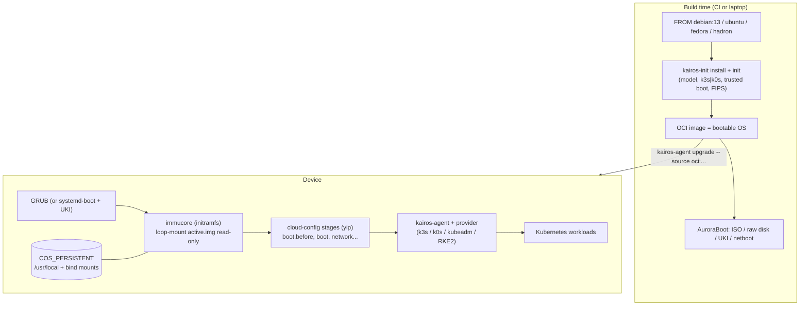

# Kairos: Tier B condensed teardown

**Workstream:** W1 (Tier B) · **Tag:** TD-kairos · **Date:** 2026-11-11
**Release analysed:** Kairos **v4.4.0** (2026-10-26), tag commit `kairos-io/kairos@6f33334a` [C-TD-kairos-001]. Docs at `kairos-io/kairos-docs@b1bf8bed`, operator at `kairos-io/kairos-operator@7317f4c1`, governance at `kairos-io/community@66ce4dd1`.
**Builds on:** `context/03-repo-findings-index.md` §1.2 (Kairos rows), `03-base-os.md` (P0-7, W2-R7), `04-image-install-updates-rollback.md` (Kairos column), `01-FOUNDATION-DECISION.md` (D3 overturned, REC-DEC-06), `evidence/adversarial/DC-23-longevity.md`.
**Claims:** `evidence/claims/TD-kairos.csv` (C-TD-kairos-001…051) · **Sources:** `evidence/sources/TD-kairos.md`, saved copies in `evidence/sources/TD-kairos/` (with `SHA256SUMS`).

> ### Explain it like I'm the founder
> Kairos is not an operating system you install apps on. It is a **kit that turns an ordinary Linux distribution into a locked, read-only, self-updating appliance for Kubernetes.** You write a Dockerfile that starts `FROM debian` (or Ubuntu, Fedora, Alpine…). Kairos's tool `kairos-init` adds its agent, boot logic and partition plan. Out comes a container image that is also a bootable OS. To update a machine, you push a new image to a registry and the machine swaps it in as an A/B update.
>
> On paper, that is very close to what OneMind is building: a read-only Debian 13 image, A/B updates and k3s. It is Apache-2.0 and a CNCF project. So why aren't we just using it? Four reasons, all checked in code:
> 1. **No Raspberry Pi 5.** Kairos supports Pi 3 and 4 only. The Pi 5 issue has been open since 2023.
> 2. **Its "is the update healthy?" check is weak.** It keeps an update once the OS gets far enough to run its first boot script. It does not wait for Kubernetes or apps. OneMind's plan waits for k3s and the core pods.
> 3. **No user-facing layer.** There is no app store, dashboard, backups, accounts or AI. Kairos is plumbing for platform teams. OneMind is a product for families, farms and robot builders.
> 4. **No promised support period.** Releases come about once or twice a quarter, and no end-of-life date is published.
>
> What Kairos *does* prove, and why it matters for us: a third-party A/B system **can** run on an NVIDIA Jetson. On Thor, Kairos replaces NVIDIA's boot launcher with its own GRUB and still updates the Jetson boot firmware during OS upgrades. Our Tier A decision said "use NVIDIA's own A/B on Jetson." Kairos shows a second route exists, but its own bug history also shows the danger of that route (§12, failure 1). The decision stands, and we add a lab spike.

---

## 0. Glossary

| Term | Meaning here |
|---|---|
| **Meta-distribution** | A layer that converts other distros (Debian, Ubuntu, Fedora…) into one standard immutable appliance format. Kairos is one. |
| **kairos-init** | The build-time tool you run inside a Dockerfile. It installs the Kairos agent, boot configuration and services into whatever base image you chose. |
| **kairos-agent** | The on-device program that installs, upgrades, resets and manages boot entries. |
| **immucore** | Kairos's early-boot (initramfs) program. It mounts the read-only image and the persistent data paths. |
| **Active / passive / recovery** | Kairos's three OS copies: the current image, the previous image (the "B" slot) and a separate rescue image. |
| **Boot assessment** | The check that decides whether a freshly updated OS "worked". If it fails, the machine boots the previous copy. |
| **Sentinel** | A small flag (here a GRUB environment variable) that records "an upgrade is being tried". |
| **UKI (Unified Kernel Image)** | Kernel, initrd and command line packed into one signed EFI file. Used by Kairos "Trusted Boot". |
| **systemd-boot boot counting** | A standard systemd feature: a boot entry gets N tries (`+3`) and is marked good when `boot-complete.target` is reached. |
| **Trusted Boot** | Kairos's mode that combines Secure Boot, measured boot (TPM) and full-disk encryption. |
| **sysext / confext** | systemd system and configuration extensions: signed or verity-protected disk images that overlay `/usr` or `/etc` without changing the base image. |
| **Bundle** | Kairos's older install-time add-on format: a container image whose files are copied in, or whose `run.sh` is executed. |
| **Provider** | A plugin that brings up Kubernetes (k3s, k0s, kubeadm/Kubernetes, RKE2) on a Kairos node. |
| **NodeOpUpgrade** | A Kubernetes custom resource from the Kairos operator that rolls an OS upgrade across nodes. |
| **Hadron** | The Kairos team's own minimal distro (musl libc + systemd), now Kairos's default base. |
| **QSPI / UEFI capsule** | Jetson boot firmware lives in QSPI flash. A capsule is the standard UEFI package used to update it. |

---

## 1. What was analysed, and who is behind it

- **Release:** v4.4.0, published 2026-10-26. Earlier stable releases: v4.3.0 (2026-09-08), v4.2.0 (2026-08-18), v4.0.0 (2026-02-27) [C-TD-kairos-001].
- **Repo shape:** since 2026 Kairos is one Go monorepo (agent, immucore, kcrypt, SDK, kairos-init, installer, p2p provider) with one release tag. The old per-component repos are archived [C-TD-kairos-003]. This corrects any reading of the archived `kairos-agent` repo as abandonment (consistent with C-W3-062).
- **Licence:** Apache-2.0 [C-TD-kairos-002]. **Governance:** CNCF Sandbox since 2024-04-13 [C-TD-kairos-004]. Five of six maintainers work for Spectro Cloud and one for Mirantis [C-TD-kairos-005].
- **Adopters:** the official list names 5 organisations (3 marked Production without a date, 2 at Proof of Concept in 2026) and 2 individuals [C-TD-kairos-006]. Spectro Cloud's commercial Palette Edge product builds on Kairos: a 2026 bug report comes from a CanvOS/Palette Edge build [C-TD-kairos-032]. This closes the `context/03` open item "Kairos production adopters": the evidence shows a small public list plus one large vendor product.

---

## 2. Architecture and base OS



- **A meta-distribution, not a distro.** `kairos-init` recognises Debian, Ubuntu, RHEL/Rocky/Alma/Oracle, Fedora, Arch, Alpine, openSUSE/SLES/SLE Micro and Hadron [C-TD-kairos-008]. The CI-tested feature matrix lists **Debian 13** with CIS L1 and system extensions; Trusted Boot and FIPS on Debian 13 are "not tested", and SELinux is not supported on Debian [C-TD-kairos-013].
- **Default base is now Hadron**, the team's own from-scratch musl + systemd + unpatched-kernel distro [C-TD-kairos-047]. That is a second distro to trust and maintain, with a small team behind it.
- **Disk layout:** `COS_STATE` holds `active.img` and `passive.img` as loop-mounted files; `COS_RECOVERY` holds a squashfs rescue image; `COS_OEM` holds cloud-config; `COS_PERSISTENT` is mounted on `/usr/local`, with bind mounts for `/var/lib/...`, `/home` and similar. The kernel and initrd come from *inside* the image and GRUB chain-loads them [C-TD-kairos-019].
- **Configuration** is cloud-config YAML run in named stages (the `yip` engine), for example `boot.before` and `after-upgrade` [C-TD-kairos-021].
- **Kubernetes is a plugin.** "Standard" images ship a provider binary that `kairos-agent` finds under `/system/providers` and talks to over stdin/stdout events. The built-in p2p mesh covers k3s only; k0s, RKE2 and kubeadm come through other providers [C-TD-kairos-042]. `provider-kubeadm` is archived and replaced by `provider-kubernetes`, which tracks the three newest upstream minors [C-TD-kairos-043]. This closes the `context/03` open item "Kairos kubeadm provider existence".

## 3. Image build

The whole build is one Dockerfile. `images/Dockerfile` takes any `BASE_IMAGE`, bind-mounts the `kairos-init` binary and runs it twice (`-s install`, then `-s init`) with the model, Trusted Boot flag, Kubernetes distro and version, and FIPS flag (`kairos-io/kairos@6f33334a:images/Dockerfile#L1-L37`) [C-TD-kairos-007]. At the v4.4.0 tag the default kairos-init is still the pre-monorepo v0.17.3; master moved it to v4.4.0 after the release (checked at `fa680143`).

- **Board support is a model flag.** `--model` takes `generic`, `rpi3`, `rpi4`, `nvidia-jetson-agx-orin`, `nvidia-jetson-orin-nx`, `nvidia-jetson-thor` or `nvidia-dgx-spark` (`kairos-init/pkg/values/values.go#L68-L78`) [C-TD-kairos-009].
- **Jetson images are Ubuntu + NVIDIA's L4T apt packages.** AGX Orin and Orin NX use `ubuntu:22.04` (L4T r36.x). Thor uses `ubuntu:24.04` or Hadron (L4T r39.2). The old `Dockerfile.nvidia` was folded into kairos-init [C-TD-kairos-015]. This closes the `context/03` open item "how Kairos builds its Jetson models".
- **Artifacts** (ISO, raw disk, UKI, netboot) come from AuroraBoot. ISO checksums and release binaries are signed keylessly with cosign from the release workflow [C-TD-kairos-028].

**Lesson for OneMind:** "an OS image is an OCI image" gives a familiar build (Docker on a Mac), registry distribution and caching for free. This is the same idea as bootc (01, REC-DEC-04), done distro-agnostically.

## 4. Install paths

Documented paths: interactive and automated ISO, manual install, **takeover** (boot a rescue system, then run the installer container against the disk), network boot through AuroraBoot, Canonical MAAS, a **WebUI** installer, a **QR code** shown at boot, p2p, raw images for SBCs, and a Trusted Boot installer [C-TD-kairos-045]. Jetson boards are flashed with NVIDIA's Jetson Linux SDK from a Linux host, using a custom partition layout [C-TD-kairos-016].

| Path | Kairos | OneMind relevance (P-7) |
|---|---|---|
| Flash image (SD/NVMe) | Pi 3/4 raw image; Jetson via NVIDIA flash tools | Same as OneMind's plan for Pi and Jetson |
| USB/ISO installer | Interactive or automated | Same |
| Takeover from rescue system | Yes | Useful for rented servers and the DOKS-to-box story |
| Netboot fleet install | AuroraBoot | Year-2 fleet feature |
| QR code at boot | Yes (standard images) | A precedent for OneMind's QR onboarding (UX, F-3) |

## 5. Update and rollback (code-derived)

```mermaid
sequenceDiagram
  participant Op as Operator / user
  participant Ag as kairos-agent
  participant St as COS_STATE
  participant G as GRUB
  participant OS as New OS
  Op->>Ag: upgrade --source oci:image (or NodeOpUpgrade Job)
  opt cosign: true (off by default)
    Ag->>Ag: cosign verify image
  end
  Ag->>St: write transition image, run finalize in target chroot
  alt booted from active
    Ag->>St: rename active.img -> passive.img
  else booted from passive
    Ag->>St: leave passive untouched
  end
  Ag->>St: transition.img -> active.img
  Ag->>G: after-upgrade: enable_boot_assessment=yes; next_entry=active
  G->>G: first try: set boot_assessment_tentative=yes
  G->>OS: boot active
  alt reaches cloud-config boot.before
    OS->>G: clear both sentinels (committed)
  else panic / systemd crash -> reboot
    G->>G: tentative already set -> default=fallback (+upgrade_failure)
    G->>St: boot passive
  end
```

1. **A/B rotation.** If the machine booted from *active*, the agent renames `active.img` to `passive.img` and writes the new image as active. If it booted from *passive* (meaning active may be broken), only active is replaced, so a working passive is never overwritten. Recovery is upgraded separately with `--recovery` (`agent/pkg/action/upgrade.go#L80-L97, #L186-L240`) [C-TD-kairos-020].
2. **GRUB health gate.** After an upgrade, GRUB sets a "tentative" sentinel on the first try. If it sees the sentinel again, it boots the fallback. The sentinels are cleared in the `boot.before` cloud-config stage (`kairos-init/pkg/bundled/cloudconfigs/08_grub.yaml#L5-L44, #L79-L131`) [C-TD-kairos-021]. The docs say it plainly: a boot is successful once cloud-init reaches that stage. It "does not wait for your workload, for Kubernetes", and a boot that leaves the app broken "will not roll back" [C-TD-kairos-022]. Kernel panic (`panic=5`) and `systemd.crash_reboot` make failed boots reboot by themselves. Immucore reboots after 90 seconds on a blocked boot so the assessment sees the failure [C-TD-kairos-044].
3. **Trusted Boot (UKI) health gate.** Loader entries get a `+3` suffix, and `systemd-bless-boot` is enabled (`agent/pkg/utils/common.go#L648-L673`, `08_efi_assessment.yaml#L1-L35`) [C-TD-kairos-023]. An entry is marked good at `multi-user.target`. After 3 failures it falls to passive, then to recovery. Services can be wired into `boot-complete.target` to make the gate stricter [C-TD-kairos-025].
4. **Docs vs code contradiction (resolves a `context/03` open item).** `boot_assessment.md` says automatic fallback is "not yet implemented" for Trusted Boot and links issue #2864. That issue was closed on 2024-11-27, the v4.4.0 code implements boot counting, and issue #5965 (open) reports the stale doc [C-TD-kairos-024]. **The code wins:** Trusted Boot has 3-try systemd-boot assessment, gated at `multi-user.target` by default.
5. **Manual rollback:** `kairos-agent bootentry --select fallback`, valid for one boot [C-TD-kairos-022].
6. **Signing on upgrade.** On GRUB installs, the image signature check is **opt-in** (`cosign: true`, default false) (`agent/pkg/elemental/elemental.go#L451-L462`, `sdk/types/config/config.go#L48-L50`) [C-TD-kairos-026]. On Trusted Boot installs, the agent refuses a UKI signed by a different certificate than the one that signed the running system, not merely any certificate in the UEFI db (`agent/pkg/uki/upgrade.go#L220-L256`) [C-TD-kairos-027].
7. **Fleet rollout.** The operator's `NodeOpUpgrade` offers `concurrency`, `stopOnFailure` (canary), `upgradeActive`/`upgradeRecovery` and `uncordonOnFailure`. There is **no schedule or maintenance-window field** (`kairos-operator@7317f4c1:api/v1alpha1/nodeopupgrade_types.go#L9-L120`) [C-TD-kairos-029]. An open issue says automatic updates are "not a feature of Kairos itself" [C-TD-kairos-030]. This closes the `context/03` item "Kairos scheduling feature": none exists.
8. **Jetson firmware rides along.** On Thor, Kairos keeps its own GRUB on the ESP. It deliberately avoids NVIDIA's bootloader package script, which would replace `BOOTAA64.efi` with NVIDIA's L4TLauncher. On install *and* upgrade it stages a UEFI capsule when the image carries newer QSPI firmware, and it aborts on a downgrade (`kairos-init/pkg/bundled/jetson_qspi.go#L3-L18`, `13_nvidia_qspi.yaml#L1-L37`) [C-TD-kairos-017, C-TD-kairos-018].

## 6. App and extension format

Kairos has **no app store and no app manifest**. Workloads are whatever Kubernetes manifests or Helm charts you deploy. For host software it offers three layers:

| Layer | Mechanism | Trust | Evidence |
|---|---|---|---|
| **Bundles** (install-time) | `container://`/`docker://` extract an image's files; `run://` extracts it and **executes `run.sh` as root**; `package://` uses luet | No signature check in the bundle installer | `sdk/bundles/bundles.go#L25, #L182-L282` [C-TD-kairos-037] |
| **System extensions** (runtime) | sysext/confext images in `/var/lib/kairos/extensions`, enabled per boot profile (active, passive, recovery, common) | Trusted Boot: must be **signed**; otherwise must be **dm-verity** | `agent/pkg/action/sysext.go#L17-L50`, `99_sysext.yaml#L47-L110` [C-TD-kairos-038, C-TD-kairos-039] |
| **Extension catalog** | `kairos-agent sysext install <name>` resolves from a published index (hadron-layers) | Every reference must be digest-pinned `@sha256` | `sdk/extensions/catalog.go#L14-L92` [C-TD-kairos-040] |

Kairos is now moving Kubernetes itself out of the image into an extension (open epic) [C-TD-kairos-041]. Its own tracker names the catch: once the OS and the extension update independently, a rollback can boot an OS/Kubernetes pairing the node never ran, and nothing preserves a known-good pairing today [C-TD-kairos-033].

## 7. Identity, multi-node and networking

- **Identity:** OS users and SSH keys come from cloud-config. There are no household accounts, SSO or roles at the OS level (no such feature in the docs index).
- **Multi-node:** the p2p provider (EdgeVPN-based) lets nodes discover each other and agree roles to form a k3s cluster with no pre-named control plane [C-TD-kairos-042].
- **Remote unlock:** `kcrypt-challenger` (an in-cluster service) can release disk keys to TPM-attested nodes [C-TD-kairos-003].

## 8. Health gate compared with OneMind's plan

| | Kairos GRUB | Kairos Trusted Boot | OneMind plan (REC-DEC-07) |
|---|---|---|---|
| Committed when | `boot.before` stage runs [C-TD-kairos-022] | `multi-user.target` (extendable via `boot-complete.target`) [C-TD-kairos-025] | Fresh signal that k3s + core pods are healthy |
| Waits for Kubernetes | No | No by default; possible | Yes |
| Auto-rollback trigger | Second boot attempt with sentinel set | 3 failed tries | Gate fails or times out |

## 9. AI features and backups

- **AI:** a documented LocalAI deployment on k3s through a community bundle. No MCP server, agent interface or AI operations layer exists in the v4.4.0 tree or docs [C-TD-kairos-050].
- **Backups:** none. Persistence is the `COS_PERSISTENT` partition and its bind mounts. The docs have no backup or restore page for user or Kubernetes data [C-TD-kairos-051]. In v4.4.0, immucore was changed to **stop the boot** when persistent binds fail. Before that, a node could silently boot with no persistence and lose k3s state [C-TD-kairos-034].

## 10. Security

- **Strong:** Trusted Boot (UKI + Secure Boot + TPM-sealed encryption, no plaintext fallback) [C-TD-kairos-044], the same-signer upgrade rule [C-TD-kairos-027], signed or verity-only extensions [C-TD-kairos-039], keyless-signed release artifacts [C-TD-kairos-028], and CIS L1 hardening on by default from v4.4.0 (account lockout, auditd immutable rules, `noexec` /tmp) [C-TD-kairos-034].
- **Weak:** upgrade signature checks are opt-in on the common GRUB path [C-TD-kairos-026]; `run://` bundles execute unsigned scripts as root [C-TD-kairos-037]; Trusted Boot and FIPS on Debian 13 are untested [C-TD-kairos-013]; and no per-release support period is published [C-TD-kairos-036].

## 11. Hardware

| Target | Status | Evidence |
|---|---|---|
| x86_64 / generic arm64 UEFI | Supported (`generic` model) | [C-TD-kairos-009] |
| Raspberry Pi 3 / 4 | Supported (64-bit); Debian gets `linux-image-arm64` + `raspi-firmware` | [C-TD-kairos-010, C-TD-kairos-011] |
| **Raspberry Pi 5** | **Not supported** ("because of how we use U-boot"); issue open since 2023-11-17 | [C-TD-kairos-011, C-TD-kairos-012]; board moved to "Q2 2027" per [C-REF-DC-longevity-008] |
| Jetson AGX Orin, Orin NX | Ubuntu 22.04 / L4T r36.x only | [C-TD-kairos-014, C-TD-kairos-015] |
| Jetson **Orin Nano** | No model | [C-TD-kairos-009] |
| Jetson AGX Thor | Ubuntu 24.04 or Hadron / L4T r39.2; Kairos-owned GRUB + capsule updates | [C-TD-kairos-015, C-TD-kairos-017] |
| DGX Spark | Ubuntu 24.04, UEFI/SBSA flow | [C-TD-kairos-014] |
| Minimum (Hadron + k3s) | 8 GB disk / 2 GB RAM smoke test; **16 GB / 4 GB practical** | [C-TD-kairos-046] |

## 12. Real-world failure reports and lessons

| # | Report | What happened | Lesson for OneMind |
|---|---|---|---|
| 1 | **#6018** (closed 2026-11-10) | Upgrading a 2023-installed UEFI + TPM node to v4.4.0 refreshed shim and GRUB on the shared ESP but kept an old `grub.cfg` on `COS_STATE`. GRUB's TPM module exhausted memory loading the 3 GiB image, and **active, fallback and recovery all failed to boot** [C-TD-kairos-031] | A/B protects only what is duplicated. A shared bootloader or ESP is a single point of failure. OneMind's layout (REC-DEC-08) must A/B the bootloader config too or never touch it in a normal update, and the update test matrix must include *old-install → new-release* upgrades, not just fresh installs. |
| 2 | **#4345** (closed 2026-09-29) | A Palette Edge Trusted Boot upgrade failed because an older on-device agent could not parse the newer image's loader-entry format [C-TD-kairos-032] | Kairos's fix was to let the *target* image's agent finalize the upgrade (upgrade.go comment). OneMind should copy that: the new image owns its boot-entry format, and the old updater only writes bytes and flips the slot. |
| 3 | **#4969** (open) | Independent OS and Kubernetes-extension updates break the guarantee that a rollback returns to a known-good pairing [C-TD-kairos-033] | OneMind's release contract (REC-DEC-06) must record the OS + k3s + platform-extension set as one tested tuple, and rollback must restore the whole tuple. |
| 4 | **v4.4.0 breaking changes** | Persisting `/usr/libexec` "broke rollback across OS versions". Silent boots without persistence lost k3s state [C-TD-kairos-034] | Keep the persistent path list minimal and image-owned paths out of it. Fail loudly when data mounts fail. |
| 5 | **#6027 / #5923** (open) | No automatic-update feature; a release cadence of 1–2 minors per quarter, with weekly releases only proposed [C-TD-kairos-030, C-TD-kairos-035] | Security cadence and user-timed updates (R-1) must be designed in, not left to the operator. |

## 13. Licence, governance and longevity

- Apache-2.0 [C-TD-kairos-002]: OneMind **may copy code**, with attribution, unlike umbrelOS (PolyForm NC) or Olares (AGPL).
- CNCF Sandbox (not Incubating) [C-TD-kairos-004], vendor-concentrated maintainers [C-TD-kairos-005], a small adopter list [C-TD-kairos-006], and no published support period [C-TD-kairos-036]. **Longevity risk: medium.** It depends on Spectro Cloud's continued interest.

## 14. Business model

Kairos is free and open, with "no commercial forks or gated features". Spectro Cloud sells support [C-TD-kairos-048]: Community (free), Basic ($2k/year for 5 tickets) and Production ($10k/year for up to 50 nodes, 24x7 P1/P2), which includes free Palette Edge for up to five edge clusters [C-TD-kairos-049]. The open-source OS feeds a commercial fleet-management plane (Palette Edge) [C-TD-kairos-032]. This is the same open-core shape OneMind plans (D-001): free OS, paid fleet, support and hardware.

## 15. Strengths, weaknesses and constraint fit

**Strengths:** distro-agnostic OCI image builds; clean A/B + recovery with a careful "booted from passive" rule; Trusted Boot with a same-signer rule; signed or verity extensions with a digest-pinned catalog; Jetson Thor firmware updates folded into OS upgrades; multiple Kubernetes providers; canary fleet upgrades; Apache-2.0.

**Weaknesses:** no Pi 5 or Orin Nano; a weak default health gate; opt-in signature checks on the GRUB path; no apps, dashboard, accounts, backups or AI; no support period; a shared-ESP brick in the latest release; documentation that lags the code; and a new house distro (Hadron) as the default.

### What competitors do: update health gate and rollback

| Product | Health gate before commit | Rollback scope | Constraints | **Constraint fit with OneMind** |
|---|---|---|---|---|
| **Kairos 4.4** | GRUB: `boot.before` stage; UKI: `multi-user.target`, 3 tries [C-TD-kairos-022, C-TD-kairos-025] | Whole OS image; recovery image; no app/data rollback | Platform-team tool; k8s-first; x86, Pi 3/4, Orin (22.04), Thor, Spark; no Pi 5; vendor-backed CNCF Sandbox | **Partial.** k3s, Jetson and Apache-2.0 match. Pi 5, consumer UX and health gate do not. A pattern source, not a base. |
| **umbrelOS 2.0** | Commits at daemon start, before apps [C-W3-036] | OS slot (Rugix) | Household box; Docker, no k8s; x86 + Pi 5; small team; PolyForm NC | High for household UX, low for k8s/robotics |
| **HAOS 18.x** | Supervisor marks the slot good even when unhealthy [C-W3-025] | OS slot (RAUC); app backups separate | Buildroot appliance; Docker; huge community; no k8s | High for appliance update mechanics, low for k8s |
| **Olares 1.12** | No OS rollback; the upgrade Rollback hook is a no-op [C-TD-olares-015] | None at OS level | k3s on a stock distro; AGPL | High for k8s app platform, low for OS updates |
| **OneMind plan** | Fresh signal that k3s + core pods are healthy (REC-DEC-07) | OS slot (RAUC) + k3s/app restore via restic | Pi 5 → GPU cluster, k3s, robotics, solo developer | (target) |

### Constraint fit summary

| OneMind constraint | Kairos fit |
|---|---|
| Pi 5 greenhouse node (F-14, N-2) | **Fails**: no Pi 5 [C-TD-kairos-011] |
| Jetson Orin Nano / Orin NX / Thor (M-7, N-8) | Partial: Orin NX/AGX on 22.04 only, Thor yes, Orin Nano no [C-TD-kairos-014] |
| Debian 13 base (REC-DEC-01) | Supported in CI; Trusted Boot untested on it [C-TD-kairos-013] |
| k3s on ≥ 4 GB + SSD nodes (REC-DEC-09) | Matches: a 4 GB practical minimum with k3s [C-TD-kairos-046] |
| Solo developer (M-6) | Mixed: one Dockerfile to build, but a large, fast-moving agent to track |
| Consumer UX, apps, AI (P-1, AI-4, A-5) | None |
| Support to 2036 (R-3) | No stated support period [C-TD-kairos-036] |

---

## 16. What OneMind copies, and what it does better

Kairos is Apache-2.0, so code reuse is allowed with attribution. The recommendations below mostly adopt patterns.

| ID | Recommendation | Evidence | Requirement IDs |
|---|---|---|---|
| **REC-TD-kairos-01** | **Copy the "booted from passive" rule.** When the device runs the fallback slot, an update overwrites only the broken slot and never the known-good one. Add it to the RAUC slot-selection logic and test it in the lab. | [C-TD-kairos-020] | R-1, R-3, M-6 |
| **REC-TD-kairos-02** | **Copy "the target image finalizes itself".** The running updater writes the image and flips the slot; boot-entry and format work runs from the new image in a chroot. This avoids failure 2. | [C-TD-kairos-032], upgrade.go#L168-L180 | R-1, R-3 |
| **REC-TD-kairos-03** | **Do better on the health gate.** Keep REC-DEC-07 (k3s + core pods). If the x86 Secure Boot route picks systemd-boot/UKI (REC-DEC-08 spike X-2R), implement the gate as a unit that `boot-complete.target` requires. This is the documented Kairos extension point. | [C-TD-kairos-022, C-TD-kairos-025] | R-1, R-2, AI-4 |
| **REC-TD-kairos-04** | **Do better on signing.** Signature verification is mandatory on every path, not opt-in, and uses the same-signer rule (the new image must chain to the same OneMind release key as the running one). | [C-TD-kairos-026, C-TD-kairos-027] | R-1, U-4, M-2 |
| **REC-TD-kairos-05** | **Never put the shared bootloader in a normal update.** Either A/B the bootloader config with the slot, or update the ESP only in a separate, explicitly gated "bootloader update" with its own recovery. Add an *old-install → new-release* upgrade test to the release CI. | [C-TD-kairos-031] | R-1, R-3, M-6 |
| **REC-TD-kairos-06** | **Treat OS + k3s + platform extensions as one release tuple.** Rollback restores the whole tuple, and the tuple is recorded in the slot's metadata. | [C-TD-kairos-033] | R-1, N-9, F-14 |
| **REC-TD-kairos-07** | **Copy the extension model for OS profiles (P-8).** Use systemd-sysext/confext for profile add-ons (TAK node, greenhouse, industrial), signed or verity-only, enabled per slot, resolved from a digest-pinned catalog. Never execute unsigned `run.sh` bundles. | [C-TD-kairos-037, C-TD-kairos-039, C-TD-kairos-040] | P-8, A-5, A-6, F-11 |
| **REC-TD-kairos-08** | **Copy the Jetson firmware rule if OneMind ever owns the Jetson bootloader:** stage the UEFI capsule from the OS image on install and upgrade, fail closed and refuse downgrades. Until then, keep NVIDIA's native A/B (REC-DEC-06). | [C-TD-kairos-017, C-TD-kairos-018] | M-7, N-8, R-3 |
| **REC-TD-kairos-09** | **Copy the install paths** for a takeover installer and a QR code at boot. OneMind's QR leads to the dashboard and account pairing, not just to cloud-config. | [C-TD-kairos-045] | P-7, F-3, UX-6 |
| **REC-TD-kairos-10** | **Do better on product.** Kairos's gaps (apps, dashboard, accounts, backups, AI, a support period, user-timed updates) are exactly OneMind's product surface. Publish a support period per release (CRA) and give the user control of update timing. | [C-TD-kairos-029, C-TD-kairos-030, C-TD-kairos-036, C-TD-kairos-050, C-TD-kairos-051] | P-1, P-2, R-1, R-2, AI-4, UX-6 |
| **REC-TD-kairos-11** | **Keep Kairos on the DC-23 watch list.** Re-check issue #2010 (Pi 5) and the Orin Nano and Orin-on-24.04 rows at the Q2 2027 board date. | [C-TD-kairos-012, C-TD-kairos-014] | RS-4, F-14 |

---

## 17. Challenges to OneMind's Tier A decisions (01)

| Tier A decision | What Kairos evidence says | Effect |
|---|---|---|
| **REC-DEC-06 / D3 overturned: NVIDIA native A/B on Jetson, not a third-party A/B layer** | Kairos runs its own GRUB-based A/B on Jetson UEFI (Thor), replacing L4TLauncher and folding QSPI firmware updates into OS upgrades [C-TD-kairos-017, C-TD-kairos-018]. So "one update framework across x86 and Jetson" is technically feasible on UEFI Jetsons, which weakens the implied "no other route" reasoning in DC-07. But: Orin is supported only on Ubuntu 22.04/r36 [C-TD-kairos-014], there is no Orin Nano [C-TD-kairos-009], flashing still needs NVIDIA's tools [C-TD-kairos-016], and Kairos's own shared-ESP brick (#6018) [C-TD-kairos-031] shows the risk NVIDIA's bootloader A/B avoids. | **Weakens slightly; does not flip.** Add a 22-… lab item: "RAUC + GRUB-EFI slot on Orin (L4T r36 UEFI), Kairos-style, versus NVIDIA rootfs A/B", run before the robotics flavor freezes. |
| **REC-DEC-01: Debian 13 core + own A/B** | Kairos already offers Debian 13 + A/B + k3s off the shelf under Apache-2.0 [C-TD-kairos-013]. So "build our own image" competes with "adopt Kairos as the image/update layer". | **Upheld.** Kairos fails the G2 Pi 5 gate [C-TD-kairos-011], has a weaker health gate [C-TD-kairos-022] and opt-in signing [C-TD-kairos-026], and states no support period [C-TD-kairos-036]. Flip condition unchanged from DC-23: Pi 5 NVMe/USB boot in a tagged release, plus a published support policy. |
| **REC-DEC-07: fresh-signal health gate** | Every Kairos path commits before Kubernetes is up [C-TD-kairos-022, C-TD-kairos-025]. | **Upheld and reinforced.** OneMind's gate is stricter than a k8s-native OS's. |
| **REC-DEC-09: k3s on ≥ 4 GB + SSD nodes** | Kairos's practical minimum for k3s is 4 GB RAM / 16 GB disk [C-TD-kairos-046]. | **Corroborated** (independent vendor guidance). |
| **REC-DEC-04: bootc Industrial profile in year 2** | Kairos's OCI-image build over Fedora/CentOS Stream 10 with SELinux is a distro-agnostic alternative [C-TD-kairos-013], but it adds a non-Red Hat updater that would not count toward RHEL support. | **No change.** |
| **Restic + online SQLite backup** | Kairos has no backup layer [C-TD-kairos-051]. | **No challenge.** |
| **REC-DEC-06 release contract** | Kairos #4969 shows independent OS and Kubernetes layers break rollback pairing [C-TD-kairos-033]. | **Adds a requirement**: the release contract must version and roll back the OS + k3s + extension tuple together (REC-TD-kairos-06). |

## 18. Open items

- Kairos Trusted Boot on Debian 13 is "not tested" upstream. Not lab-tested here (no VM run for this Tier B teardown).
- The Palette Edge relationship is evidenced by one issue and the support page. Spectro Cloud's own share of Kairos-based nodes is not public.
- Spectro Cloud's support page states prices but no support duration per Kairos release. Add a line to `evidence/outreach-drafts.md` if Kairos becomes a candidate again.
