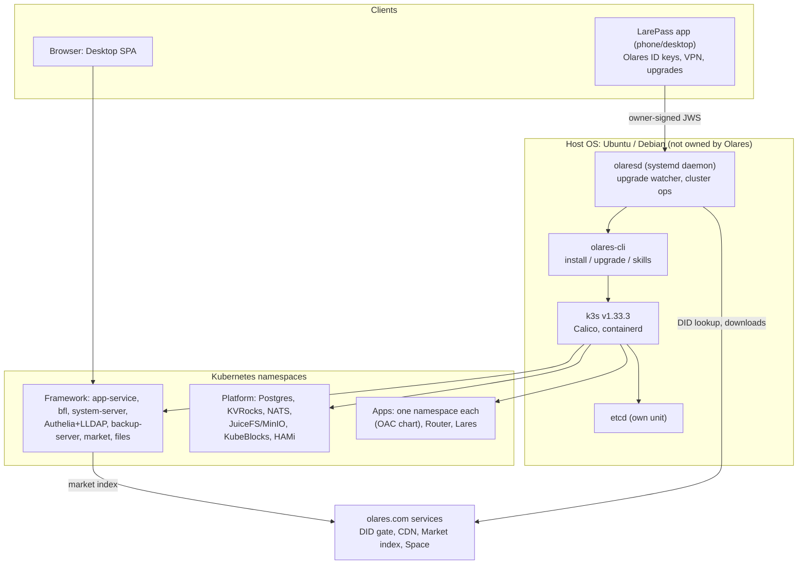
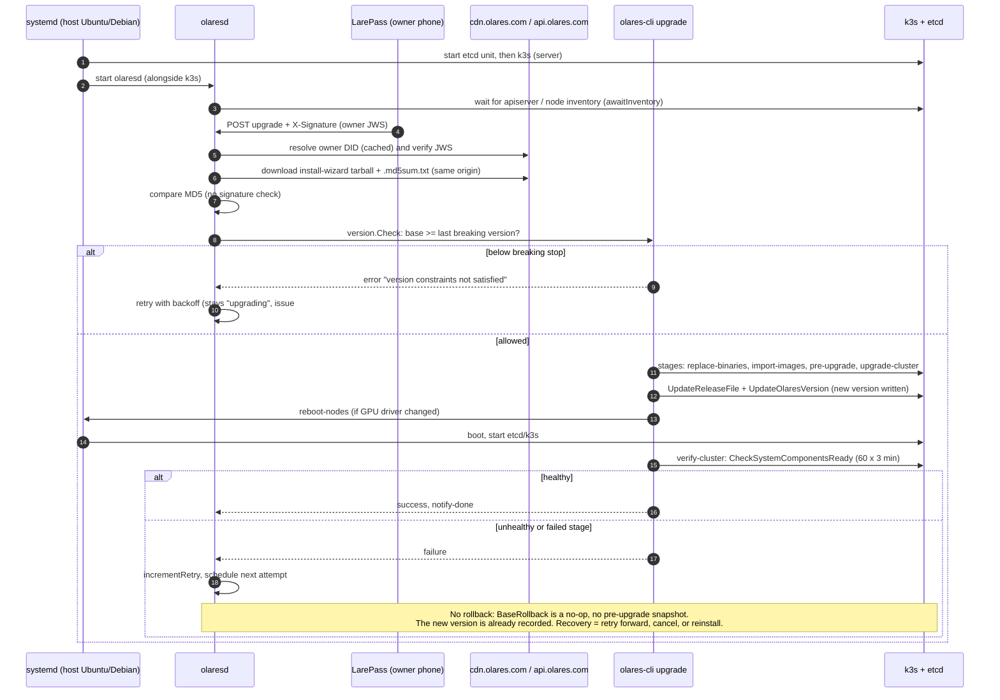

# Olares: Tier A teardown

**Workstream:** W1 (competitor teardowns), Tier A · **Tag:** TD-olares · **Date:** 2026-11-10
**Builds on:** [`research/competitors/olares.md`](../../research/competitors/olares.md) (phase-1 report, "OLA") and [`context/03-repo-findings-index.md`](../../context/03-repo-findings-index.md) §1 rows on Olares. Facts already verified there are reused and not re-derived, except where this pass found code that changes them.
**Claims:** [`evidence/claims/TD-olares.csv`](../evidence/claims/TD-olares.csv) (C-TD-olares-001 … 056) · **Sources:** [`evidence/sources/TD-olares.md`](../evidence/sources/TD-olares.md) (saved copies plus sha256 in `evidence/sources/TD-olares/`).
**License note:** Olares is AGPL-3.0 with a leftover non-commercial `LICENSE.md` [C-TD-olares-047]. This document studies its code **for patterns only**. Nothing here recommends copying Olares code into OneMind (D-001).

---

> ### Explain it like I'm the founder
> Olares is the closest thing on the market to what OneMind wants to be on the *software* side: a home "personal cloud" that runs **Kubernetes (k3s)** under the hood, installs apps from a **Market** with one click, gives every family member an account with single sign-on, and now ships an **AI gateway (Router)** and an **AI agent (Lares)**.
>
> But it is **not an operating system image** in the way Home Assistant OS or umbrelOS are. Olares is a big installer that sits *on top of* Ubuntu or Debian. It does not own the disk layout, it has no A/B partitions, and when an upgrade fails it **does not roll back**: it keeps retrying forward until it works or a human steps in [C-TD-olares-014][C-TD-olares-015]. Its updates are checked with an **MD5 checksum downloaded from the same server as the update**, not with a cryptographic signature [C-TD-olares-004][C-TD-olares-005]. It targets **x86 + NVIDIA desktop boxes**; Raspberry Pi is "not for production" and there is no Jetson, ROS 2, drone or IoT-radio code at all [C-TD-olares-042][C-TD-olares-048].
>
> **What to take:** the app format (Helm chart + a manifest + a strict linter), per-app namespaces and network policies, the one AI gateway, the CLI that ships its own agent skills, the owner-signed "dangerous operations" rule, and cooperative app backups.
> **What to do better:** own the image (signed A/B updates with real rollback), sign every release, run on Pi and Jetson for real, keep identity offline-capable, and never let the platform's own agent run privileged by default.

---

## 0. What was analyzed (pinned)

| Item | Pin | Date | Source |
|---|---|---|---|
| Olares source (main) | `beclab/Olares@e7fe1c9634f26530386c2033a33be7a9495704f3` | committed 2026-11-10 | shallow clone, [C-TD-olares-001] |
| Latest stable release | `1.12.7` → commit `e4a353dfe737d1dd924b609b7576c047153a85b9` | 2026-09-24 | [C-TD-olares-001] |
| Newest pre-releases | `1.12.8-rc.1`; daily `1.12.9-YYYYMMDD` | 2026-11-10 | [C-TD-olares-002] |
| Market charts | `beclab/apps@37a1fb4f44b2428feb7978b25fdc798d6d6310ed` (Apache-2.0) | 2026-11-10 | sparse clone, [C-TD-olares-031] |
| Kubernetes EOL data | `kubernetes/website@4c77b36e` `data/releases/eol.yaml` | 2026-11-11 (UTC) | [C-TD-olares-022] |

Code citations below use `repo@sha:path#Lx-Ly`. Main-branch code is newer than 1.12.7; where a behaviour may have changed since 1.12.7 (the cluster-wide upgrade orchestrator), that is flagged.

---

## 1. W1 field summary

| W1 field | Olares (verified unless marked) |
|---|---|
| **Architecture** | Five layers: Infrastructure (k3s, containerd, Calico, OpenEBS, etcd, HAMi) → Platform (Postgres/Citus, KVRocks, NATS, JuiceFS/MinIO, KubeBlocks, tapr) → Framework (app-service, bfl, system-server, Authelia/LLDAP, backup-server, market, upgrade, headscale) → Built-in apps → Community apps (OLA §1). This is the topology P-3 asks OneMind to replicate. |
| **Base OS** | Host distro, not owned: Ubuntu 22.04–25.04 or Debian 12/13 via script/Compose; the ISO installs Ubuntu [C-TD-olares-007][C-TD-olares-041]. |
| **Image build** | An installer tarball (charts + image list + deps) built by `build/build.sh`; the ISO is a separate Ubuntu installer [C-TD-olares-003]. No OS image pipeline in the repo. |
| **Install paths** | ISO (x86 only), one-line script, Docker Compose, WSL2, macOS (minikube), Pi, PVE, LXC, DGX Spark; all but Linux/Spark are "not for production" [C-TD-olares-042]. |
| **Update / rollback** | olaresd + olares-cli staged upgrade, started from the LarePass phone app; health check after the version flip; **retry-forward, no rollback** [C-TD-olares-010..016][C-TD-olares-020]. |
| **App format** | OAC = Helm chart + `OlaresManifest.yaml`, enforced by the `framework/oac` linter [C-TD-olares-028]. |
| **Identity** | Olares ID bound to a DID; LarePass holds keys; Authelia (default deny) + LLDAP for SSO/2FA; owner JWS signature for dangerous operations, verified via a cloud DID gate [C-TD-olares-017][C-TD-olares-018][C-TD-olares-036]. |
| **AI features** | Router (AI gateway), Lares (agent, MCP client), Model Console, `olares-cli` with built-in Agent Skills, HAMi GPU sharing [C-TD-olares-030..032][C-TD-olares-039]. No OS-level MCP server (context/03 C-14). |
| **Backups** | restic via backup-server: file backups and **cooperative** app backups; etcd snapshots every 30 min, 5 kept on the same disk [C-TD-olares-025..027]. |
| **Security** | Per-app namespaces, ingress NetworkPolicies, linter bans hostNetwork and unreviewed privileged images; no Secure Boot/TPM/LUKS/dm-verity; MD5-only release integrity; 100-year k3s certs [C-TD-olares-004][C-TD-olares-009][C-TD-olares-024][C-TD-olares-029][C-TD-olares-034]. |
| **Hardware** | Olares One (Core Ultra 9 275HX, RTX 5090 Mobile 24 GB, 96 GB, 2 TB) at USD 4,999 [C-TD-olares-045][C-TD-olares-046]; BYO x86 + NVIDIA; DGX Spark. |
| **License** | AGPL-3.0 (`LICENSE`) plus legacy non-commercial `LICENSE.md`; market repo Apache-2.0; `beclab/lares` has no license file [C-TD-olares-033][C-TD-olares-047]. |
| **Business model** | Hardware (Olares One), free OS and updates, paid apps, Olares Space (cloud backup/domain), "Manufacture with Olares" OEM funnel (OLA §5). Funding ">$100M" is self-reported (OLA §7.2, VENDOR). |
| **Team / activity** | ~33 listed contributors, 5,356 stars, daily builds [C-TD-olares-054][C-TD-olares-002]. |

---

## 2. Architecture

How to read it: everything above the host line is Olares; the host OS below is whatever Ubuntu/Debian was there before. olaresd is the only Olares piece that is a plain systemd service; everything else is a Kubernetes workload.

**k3s configuration (from code).** Olares pins k3s `v1.33.3` [C-TD-olares-021]. Kubernetes 1.33 reached end of life on 2026-06-28, with final patch 1.33.13 [C-TD-olares-022], so the default install runs an upstream-EOL minor ten patches behind its final release. k3s uses an **external etcd unit**, Calico (flannel off), and disables coredns, traefik, servicelb, metrics-server and local-storage so Olares can supply its own [C-TD-olares-023]:
`beclab/Olares@e7fe1c96:cli/pkg/k3s/templates/k3sServiceEnv.go#L26-L45` and `cli/pkg/k3s/templates/hostMemoryProtection.go#L81-L86` ("Olares runs etcd as its own unit rather than using the copy embedded in k3s"). The same env file sets `CATTLE_NEW_SIGNED_CERT_EXPIRATION_DAYS=36500`, about 100-year certificates [C-TD-olares-024]. That avoids the classic "cluster dies after a year" failure, at the cost of never rotating certificates.

---

## 3. Code teardown (the Tier A eight, plus extras)

### 3.1 Image build: an installer bundle, not an OS image
- `beclab/Olares@e7fe1c96:build/build.sh#L30-L48` packages `install-wizard`: it runs `package.sh`, generates an image manifest and a dependency manifest, and tars them with the charts [C-TD-olares-003].
- `.github/workflows/release.yaml#L206-L243` uploads the tarball and an **MD5 file** to Tencent COS, then stamps the MD5 into `install.sh` [C-TD-olares-004].
- The ISO (x86-64 only) boots an installer that writes **Ubuntu** to a chosen disk and leaves default credentials `olares`/`olares` [C-TD-olares-007] (`docs/manual/get-started/install-linux-iso.md#L21-L70`).

**Meaning for OneMind:** Olares never had to solve "build a bootable, reproducible OS image". It inherits the distro's kernel, packages and security updates, and the user's `apt upgrade` is outside Olares's control.

### 3.2 Partition layout: none of its own
- There are no A/B slots, no read-only root and no data partition split. The only disk code is an LVM grow helper: `cli/pkg/utils/lvm/tools.go#L146-L205` (parted → pvcreate → vgextend → lvextend → resize2fs) used by `olares-cli disk extend` [C-TD-olares-008].
- Data lives under `/olares` and `/var/openebs/local` on the host root filesystem (OLA §1; issue #4185 shows PVs at `/var/openebs/local/pvc-*`) [C-TD-olares-052].
- No Secure Boot, TPM2, LUKS or dm-verity code exists in the source tree (grep, absence) [C-TD-olares-009].

### 3.3 Update client: olaresd + olares-cli, staged
- **Trigger:** the admin taps Upgrade in LarePass ("Download only" or "Download and upgrade") [C-TD-olares-020]; an owner-signed request writes the upgrade target that olaresd watches.
- **Runner:** `daemon/pkg/commands/upgrade/upgrade.go#L31-L97` runs `olares-cli upgrade --base-dir …` and estimates progress by tailing the log for keywords such as `UpgradeSystemComponents success` [C-TD-olares-011].
- **Stages:** `cli/pkg/upgrade/stage.go#L38-L84` fixes 11 stages: notify-start → replace-binaries → import-images → pre-upgrade-node → pre-upgrade-admin → upgrade-cluster → post-upgrade-node → post-upgrade-admin → reboot-nodes → verify-cluster → notify-done [C-TD-olares-010]. On main, a cluster-wide orchestrator runs each stage on every node with a barrier between stages (`daemon/pkg/cluster/clusterop/upgrade.go#L128-L138`); the docs still describe a manual multi-node procedure (§5, row 5).
- **Version gating:** `cli/pkg/upgrade/version.go#L83-L117` refuses a base version older than the last *breaking* version, so users must step through "breaking" releases [C-TD-olares-016]. Each dated `cli/pkg/upgrade/1_12_*_YYYYMMDD.go` file is a per-version migration step.

### 3.4 Signing and keys
- **Release artifacts are not signed.** Integrity is MD5, published in the same bucket as the artifact and fetched by `curl` at upgrade time: `cli/pkg/terminus/tasks.go#L138-L170` [C-TD-olares-005]. Anyone who can write to that bucket or CDN path can replace both. No cosign, minisign or GPG verification was found [C-TD-olares-006].
- **Operations are signed.** Upgrade, reboot, shutdown and SSH-password changes require an owner JWS in `X-Signature`: `daemon/pkg/cluster/clusterop/module_upgrade.go#L15-L23`, `daemon/internel/apiserver/handlers/middlewares.go#L46-L81` [C-TD-olares-017]. The JWS is checked against the owner's DID document, fetched from a DID gate under `https://api.olares.com` and cached: `cli/pkg/web5/jws/checkjws.go#L92-L133`, `daemon/pkg/commands/constants.go#L19` [C-TD-olares-018].

So Olares answers "who may start an update?" well (only the owner's phone key) and "is this update genuine?" weakly (MD5 from the same origin).

### 3.5 Health check and rollback
- **Health check:** `CheckSystemComponentsReady` (3-minute timeout per try, 60 retries, 15 s apart) runs in `PostUpgrade`, after `UpdateOlaresVersion` has already written the new version: `cli/pkg/upgrade/base.go#L196-L214`, `cli/pkg/terminus/tasks.go#L107-L127` [C-TD-olares-012]. The verify stage deliberately follows reboot-nodes, because a new GPU driver needs the reboot (`stage.go#L73-L84`) [C-TD-olares-013].
- **No rollback.** The upgrade pipeline is designed to be *re-entrant* (the comment at `base.go#L149-L152` says the version CR is written last "to make the whole pipeline reentrant"). On failure, olaresd schedules another attempt with backoff: `daemon/internel/watcher/upgrade/upgrade_watcher.go#L248-L254`, and `daemon/pkg/cluster/clusterop/upgrade.go#L247-L251` says it outright: "The watcher's answer to a failed upgrade is to start another one seconds later" [C-TD-olares-014].
- The task engine inherited from KubeSphere's KubeKey (Apache-2.0 header) has a `Rollback` hook, but `BaseRollback.Execute` returns `nil` (`cli/pkg/core/rollback/base.go#L35-L37`) and no upgrade task sets one [C-TD-olares-015].
- Nothing takes a backup or snapshot before upgrading (grep of `cli/pkg/upgrade`, `daemon/pkg/commands/upgrade`, `clusterop/upgrade*.go`: the only hits install the periodic etcd backup unit).

### 3.6 App manifest: OAC and its linter
- `framework/oac/chart.go#L20-L49` lists the lint pipeline: folder layout, manifest schema, permission vs data cross-checks, Helm dry-run, **no hostNetwork/hostPID/hostIPC**, namespace check, container **limits required**, Chart/manifest version match, ServiceAccount RBAC inspection, privileged check [C-TD-olares-028]. `internal/resources/hostnetwork.go#L11-L29` judges the *rendered* values, not template text.
- **Trust shortcut:** `internal/resources/securitycontext.go#L15-L35` exempts any image whose path *contains* `beclab/`, on any registry, from the privileged/root check [C-TD-olares-029]. A string match is not provenance.
- Real manifest: `beclab/apps@37a1fb4f:lares/OlaresManifest.yaml#L1-L108` (apiVersion v3, `olaresManifest.version 0.12.0`, dependencies `olares >=1.12.7-0` and `router >=1.0.0`, `permission.loginOlaresCLI: true`, entrance `authLevel: private`, `supportArch: amd64, arm64`) [C-TD-olares-031].

### 3.7 Backup
- restic through `olares.com/backups-sdk`; two types, `file` and `app` (`framework/backup-server/pkg/constant/constant.go#L47-L48`); the repository password comes from the user's settings service (`pkg/handlers/helper.go#L58-L72`) [C-TD-olares-026].
- **App backup is cooperative:** backup-server PUTs `backup_id`/`snapshot_id` to the app's own backup endpoint (`pkg/handlers/handler_app.go#L44-L80`) [C-TD-olares-027]. Only apps that implement it can be backed up, which is why the docs list only Wise (context/03 row "Olares backups").
- **Cluster state:** a systemd timer snapshots etcd every 30 minutes and keeps 5 copies in `/var/backups/kube_etcd`, **on the same disk** (`cli/apis/kubekey/v1alpha2/default.go#L95-L98`, `cli/pkg/etcd/templates/backup_service.go#L44-L47`) [C-TD-olares-025]. It is not shipped off-box by default.

### 3.8 Auth
- Authelia with an LLDAP backend, `default_policy: deny`, `one_factor` for the desktop domain, `two_factor` for Files: `framework/authelia/.olares/config/cluster/deploy/auth_backend_deploy.yaml#L137-L172` [C-TD-olares-036]. The same block contains a literal `password: adminpassword` for the LDAP bind; the LLDAP deployment generates a random 64-character password (`platform/tapr/.olares/config/cluster/deploy/lldap-deployment.yaml#L4-L12`), so the literal looks like an unused placeholder. Whether it is ever used is **UNVERIFIED**.
- Owner-signed JWS for dangerous operations (§3.4).

### 3.9 Isolation and resource guardrails
- Per-app namespace NetworkPolicy allows ingress only from internal/system namespaces and the owner's `bfl` pods: `framework/app-service/pkg/security/templates.go#L317-L356`. The template has **no egress rule**, so apps can call out freely unless another mechanism limits it (an `allowedOutboundPorts` manifest option exists per OLA §3.2; its enforcement was not traced) [C-TD-olares-034].
- Load shedding: `framework/app-service/pkg/appwatchers/suspend.go#L26-L52` suspends the heaviest app when cluster CPU or memory exceeds a threshold [C-TD-olares-035].
- Hardware passthrough by proxy: app-service ships `beclab/bluez-dbus-proxy` so apps reach host Bluetooth without host networking [C-TD-olares-056]. This is a useful pattern for OneMind device adapters (N-1, AI-7).

### 3.10 GPU: HAMi fork
- `infrastructure/gpu/.olares/config/gpu/hami/Chart.yaml#L1-L15`: HAMi 2.5.1 with `beclab/hami` images, plus `amd/` and `intel/` config directories [C-TD-olares-039]. Time-slice, memory-slice and exclusive modes (OLA §1.1); 1.12.8 cuts time-slice switching to 0.1–1.5 s (update guide, OLA). The architecture doc still says nvshare and "one GPU per node" [C-TD-olares-040].

### 3.11 AI layer: Router, Lares, CLI skills
- **Router** is an admin-only market app; its manifest describes an OpenAI-compatible API over local and cloud models with keys, quotas and audit [C-TD-olares-032]. No public source repo was found, so its internals are **UNVERIFIED** [C-TD-olares-033].
- **Lares** runs as a market app wired to Router by in-cluster app identity. By default it starts a **privileged, root Docker-in-Docker sidecar** (`ENABLE_DIND` default true): `beclab/apps@37a1fb4f:lares/templates/deployment.yaml#L181-L188` [C-TD-olares-030]. Its image is `docker.io/beclab/docker:29.3.0-dind`, which passes the linter only because of the `beclab/` substring exemption [C-TD-olares-029]. The platform's own AI agent therefore runs next to a privileged container by default. `beclab/lares` is public but carries no license file [C-TD-olares-033].
- **olares-cli Agent Skills** (`cli/skills/`) let external agents drive the OS through CLI verbs (OLA §6). Lares gets `loginOlaresCLI: true` [C-TD-olares-031].

### 3.12 Market, multi-node, built-ins, LarePass, Olares One
- **Market:** backend image `beclab/market-backend:v0.6.129` (`framework/market/.olares/config/cluster/deploy/market_deploy.yaml#L158`); index built from `beclab/apps` (Apache-2.0) and permissionless extra sources [C-TD-olares-055]. Submission is by PR with a GitBot check and an `owners` file (OLA §3.4).
- **Multi-node:** the master must be on 1.12.7+, `enable-juicefs` migrates storage onto JuiceFS + MinIO, and the join command carries `MASTER_AUTH_INFO`, which is Base64 (not encrypted) and reveals the master's SSH credentials [C-TD-olares-043]. The documented upgrade needs a manual `kubectl patch terminus` before and after the worker [C-TD-olares-044].
- **Built-ins** (Desktop, Files, Vault, Market, Wise, Settings, Control Hub, Dashboard, Studio, Profile) are covered in OLA §2 and satisfy RS-3. Nothing in this pass changes that table.
- **LarePass** is the root of trust: it holds the Olares ID keys, activates the box, runs the VPN (Tailscale protocol to self-hosted Headscale), and is the only place system upgrades start [C-TD-olares-020] (OLA §2).
- **Olares One:** Core Ultra 9 275HX, RTX 5090 Mobile 24 GB, 96 GB DDR5-5600, 2 TB NVMe PCIe 4.0, 2.5GbE, Thunderbolt 5, 330 W [C-TD-olares-045]; USD 4,999 on the official store [C-TD-olares-046]. BIOS and EC firmware are flashed by hand from a USB stick in the UEFI shell (`docs/one/update-firmware.md`), not through the OS updater.

---

## 4. Boot → update → (no) rollback, from code

Derived from: `daemon/pkg/cluster/clusterop/upgrade.go#L236-L251` (inventory wait, retry philosophy), `middlewares.go#L46-L81` (signature), `checkjws.go#L92-L133` (DID gate), `tasks.go#L138-L170` (MD5), `version.go#L83-L117` (breaking stops), `stage.go#L38-L84` (stage order), `base.go#L196-L214` (version flip then health check), `upgrade_watcher.go#L248-L254` (retry), `rollback/base.go#L35-L37` (no-op rollback).

---

## 5. Claims vs code

| # | Claim (where) | What the code says | Verdict |
|---|---|---|---|
| 1 | "Upgrading within the same minor version … is fully supported" (`docs/developer/install/versioning.md#L63`) [C-TD-olares-019] | `version.go#L83-L117` blocks bases older than the last breaking version; 1.12.4 → 1.12.6 was refused until 1.12.5 was installed (#4268) [C-TD-olares-016][C-TD-olares-049] | **Contradict** (within 1.12, users must step through breaking stops) |
| 2 | "Stable releases … Release cadence: Monthly" (`versioning.md#L28`) [C-TD-olares-019] | Stables 1.12.5 (2026-03-26), 1.12.6 (2026-07-16), 1.12.7 (2026-09-24): gaps of 2–4 months [C-TD-olares-057] | **Contradict** |
| 3 | "The Pod declared as entrance will be forced to join Envoy's sandbox Sidecar" (`network.md#L89`) [C-TD-olares-038] | Upgrade step removes Envoy sidecars ("business oes") and relies on `l4-bfl-proxy` (`deenvy_edge_recreate.go#L84-L111`) [C-TD-olares-037] | **Contradict** (docs lag a migration) |
| 4 | "Pods cannot use hostNetwork" (`network.md#L87`) | Linter rejects rendered hostNetwork/hostPID/hostIPC (`hostnetwork.go#L11-L29`) [C-TD-olares-028] | **Agree** (enforced at lint time; runtime admission not traced) |
| 5 | Multi-node upgrade needs manual CR patches (`docs/one/upgrade-multi-node-cluster.md#L147-L171`) [C-TD-olares-044] | Main has a cluster upgrade orchestrator with per-stage barriers and resume (`clusterop/upgrade.go#L128-L138`) | **Contradict** (code is ahead of docs; may ship after 1.12.7) |
| 6 | "nvShare … GPU support is restricted to … one GPU per node" (`system-architecture.md#L54-L61`) [C-TD-olares-040] | HAMi 2.5.1 fork plus AMD and Intel configs (`hami/Chart.yaml`) [C-TD-olares-039]; README claims pooling "across nodes" | **Contradict** (doc stale; cross-node pooling **UNVERIFIED**) |
| 7 | "AMD GPU and AMD APU devices are not covered in this version" (`gpu-resource.md#L44`) | `infrastructure/gpu/.olares/config/gpu/amd/amdgpu-device-plugin.yaml` exists | **Contradict** (code ahead of docs; support level unverified) |
| 8 | Linter comment: third-party images needing root "have to be reviewed manually" (`securitycontext.go#L15-L20`) | Exemption is a substring match on `beclab/` on any registry (`#L33-L35`); Lares's privileged DinD passes it [C-TD-olares-029][C-TD-olares-030] | **Weak agree** (rule exists; trust test is a string match) |
| 9 | Router: "all provider credentials are encrypted, version-controlled, support rollbacks" (`router/OlaresManifest.yaml#L38`) | Router source not public [C-TD-olares-033] | **UNVERIFIED** |

---

## 6. Real failure reports and what they teach

| Report | What happened | Lesson for OneMind |
|---|---|---|
| **#4268, "Upgrade stuck"** (2026-10-19) [C-TD-olares-049] | 1.12.4 → 1.12.6 refused because 1.12.5 was a required stop; olaresd retried 14+ times and the box sat in "upgrading". A vendor-side fix plus manual cancel resolved it. | Retry-forward with no rollback turns a version-policy error into a stuck device. The updater must refuse **before** starting, show why, and offer the next valid hop. Requirement R-1. |
| **#4171, Debian 13 install fails** (2026-09-18, open) [C-TD-olares-050] | The installer writes to a hard-coded `/etc/apt/sources.list`, which Debian 13 no longer has (deb822 format). | Installing *on top of* a moving distro is fragile: each distro release can break you. Owning the image removes this whole class. Supports ADR-001's own-image direction. Requirements P-7, R-3. |
| **#1716, HDD install broken** (2025-08-15) [C-TD-olares-051] | Install failed at random steps on a slow HDD; maintainers said etcd needs an SSD. | Probe hardware first (disk fsync latency, RAM) and refuse with a clear message. OneMind's capability detection (N-3) must include storage speed, and a Pi on an SD card must not run etcd. |
| **#4185, middleware logs fill disk** (2026-09-23) [C-TD-olares-052] | KubeBlocks MySQL/MongoDB wrote about 100 GB of probe logs to local PVs, invisible in the UI. | Every bundled service needs log rotation and disk-pressure alerts surfaced in the dashboard (UX-4). Shared middleware adds hidden cost. |
| **#2350, HAMi segfault on WSL2** (2025-12-30) [C-TD-olares-053] | HAMi's `libvgpu.so`, injected via `ld.so.preload`, crashed GPU apps; suspected CUDA driver version mismatch. | GPU-sharing layers that hook CUDA are tightly coupled to driver versions. Pin and test driver + HAMi pairs per board and keep a "disable sharing" escape hatch (AI-8, N-8). |

---

## 7. What competitors do (update, identity, app format)

HAOS and umbrelOS facts come from the phase-1 verified index (context/03, "Lessons" row) and their own Tier A teardowns; Olares facts are from this file.

| Question | Home Assistant OS | umbrelOS | Olares | Constraint fit for OneMind |
|---|---|---|---|---|
| Owns the OS image? | Yes (Buildroot, read-only, A/B) | Yes (Debian-based image, A/B) | **No** (installer on Ubuntu/Debian) [C-TD-olares-003][C-TD-olares-007] | OneMind needs boxes it can support for years (R-3, H-1): HAOS/Umbrel fit; Olares does not |
| Rollback on bad update | Automatic (A/B) | Automatic (A/B) | **None**, retry forward [C-TD-olares-014] | R-1 needs rollback: Olares is a counter-example |
| Release signing | Signed bundles | Signed releases | **MD5 from same origin** [C-TD-olares-004] | CRA-era hardware vendor needs signed updates (W6): Olares does not fit |
| Kubernetes | No (Docker + Supervisor) | No (Docker) | **Yes, k3s** [C-TD-olares-021] | OneMind runs k3s (N-9, P-9): **Olares is the only constraint-matched k3s example** |
| App format | Add-on (Docker) + integrations | Docker Compose app store | Helm + manifest + linter [C-TD-olares-028] | OneMind is Helm-based (A-1, A-5): Olares pattern fits best |
| Identity | Local users | Local users | DID + cloud DID gate + phone keys [C-TD-olares-018] | OneMind needs offline sovereignty (U-4, N-6): fit is partial |
| Hardware | Pi, x86, HA Green/Yellow | x86, Pi, Umbrel Home | x86 + NVIDIA; Pi not for production [C-TD-olares-042] | F-14 (Pi to GPU cluster): none fully fits; Olares fits only the GPU end |
| Robotics / IoT | Huge IoT, no robotics | None | None found [C-TD-olares-048] | M-7, F-11: no competitor covers this; OneMind's moat |

---

## 8. Constraint-fit summary

| Constraint | Olares | OneMind | Match? |
|---|---|---|---|
| Kubernetes | k3s, single-node first, multi-node young | k3s on every tier | **Yes** |
| Hardware targets | x86-64 + NVIDIA desktops; DGX Spark; no ARM ISO; Pi "not for production" | Pi 5 → x86 → Jetson → GPU cluster (F-14) | **Partial** (top end only) |
| OS ownership | Rides on Ubuntu/Debian | Own signed image (ADR-001) | **No** |
| Team | Funded company, ~33 contributors | Solo founder at start (M-6) | **No** (Olares can afford complexity OneMind cannot) |
| Robotics / IoT / TAK | None | Core moat | **No** |
| License | AGPL + legacy non-commercial | Apache-2.0 open core | **No** (study only) |
| AI-native | Router, Lares, CLI skills | MCP/CLI/API/SSH capability layer | **Yes** (strong pattern source) |

**Verdict:** Olares is the **default reference for the Kubernetes app platform layer** (app format, isolation, AI gateway, CLI skills), because those constraints match. It is **not** a reference for the OS image, update safety, signing, hardware breadth or robotics; there HAOS and umbrelOS are better matches.

---

## 9. What OneMind copies, and what it does better

| # | Copy the pattern (not the code) | Requirement IDs |
|---|---|---|
| 1 | Helm chart + `onemind.app.yaml` + a public **linter** that renders the chart and checks the result (limits required, no host namespaces, RBAC inspection, version match) | A-1, A-2, A-5, F-5 |
| 2 | One namespace per app with default-deny ingress, and auto-suspend of the heaviest app under resource pressure | U-4, M-6 |
| 3 | **Owner-signed dangerous operations** (upgrade, reboot, shutdown, SSH change), with the key held on the owner's phone | R-1, U-4, AI-5 |
| 4 | Staged, resumable upgrade with per-stage barriers across nodes and a persisted stage record | R-1, UX-6, P-9 |
| 5 | One AI gateway (Router pattern) for local and cloud models, with per-app identity, keys, quotas | AI-2, AI-8, F-6 |
| 6 | CLI that ships versioned **Agent Skills** with each release | AI-2, AI-4 |
| 7 | Cooperative app backup endpoint declared in the manifest | UX-6, A-2 |
| 8 | Proxy services for host hardware (bluez-dbus-proxy) instead of host networking | N-1, AI-7 |
| 9 | Five-layer topology (Infrastructure → Platform → Framework → Built-in → Community) | P-3 |

| # | Do better | Requirement IDs |
|---|---|---|
| 1 | **Own the image**: signed A/B updates with health-gated commit and automatic rollback (Rugix/RAUC/bootc, decided in 04/01) | R-1, R-3, P-7 |
| 2 | **Sign every release** with an offline root key; verify signatures, not same-origin checksums | R-1, W6 |
| 3 | Refuse an impossible upgrade before it starts; offer the next valid hop; take a pre-update backup | R-1, UX-4 |
| 4 | Track supported Kubernetes minors; never ship an EOL minor (Olares ships 1.33 past its 2026-06-28 EOL) | R-3, N-9 |
| 5 | Rotate cluster certificates instead of 100-year certs | U-4 |
| 6 | Ship etcd/datastore snapshots **off-box** (restic to NAS/S3) by default | UX-6, R-2 |
| 7 | Default-deny **egress** for apps, with declared outbound needs | U-4, AI-1 |
| 8 | Trust by **signature/provenance** (Sigstore), never by image-name substring; no privileged sidecar for the platform agent | U-4, AI-5 |
| 9 | Identity that works fully offline (local OIDC, optional cloud), no mandatory vendor DID gate | U-4, N-6, F-6 |
| 10 | Real Pi 5 and Jetson support in the same image family; storage-speed probe before install | F-14, N-2, N-3, H-3 |
| 11 | Robotics, IoT/IIoT and TAK as first-class platform services | M-7, F-11, N-7 |
| 12 | Encrypted, single-use join tokens instead of Base64 SSH credentials | UX-6, N-4 |
| 13 | Docs generated from the schema and code, so they cannot drift (rows 3, 5, 6, 7 in §5) | R-2, W-3 |

---

## 10. Open items (UNVERIFIED)

- Runtime admission: does app-service re-check hostNetwork/privileged at install time, or only at lint time?
- Enforcement of `allowedOutboundPorts` (egress) for apps.
- Whether `password: adminpassword` in the Authelia LDAP block is ever used.
- Router internals (source not public); cross-node GPU pooling; AMD GPU support level.
- Whether the cluster upgrade orchestrator on main ships in 1.12.8.
- Olares One firmware signing (BIOS/EC images are flashed manually).

---

## Glossary

| Term | Meaning |
|---|---|
| **A/B update** | Two copies of the OS; the update goes to the inactive copy, and the box can boot back to the old one if the new one fails. |
| **Rollback** | Returning automatically to the last working version after a failed update. |
| **Retry-forward** | Trying the failed update again instead of going back. Olares does this. |
| **k3s** | A small, single-binary Kubernetes distribution from SUSE/Rancher. |
| **etcd** | The database that stores Kubernetes cluster state. It needs fast disks (SSD). |
| **EOL (end of life)** | The date after which a version gets no more security fixes. |
| **Helm chart** | A packaged set of Kubernetes manifests with variables. |
| **OAC** | Olares Application Chart: a Helm chart plus `OlaresManifest.yaml`. |
| **Linter** | A tool that checks a package against rules before it is accepted. |
| **NetworkPolicy** | A Kubernetes rule that says which pods may talk to which. "Ingress" is incoming, "egress" is outgoing. |
| **Privileged container** | A container with near-root power over the host. Dangerous by default. |
| **DinD** | Docker-in-Docker: running a Docker daemon inside a container (usually requires privileged mode). |
| **JWS** | JSON Web Signature: a signed message proving who sent it. |
| **DID** | Decentralized Identifier: an identity whose public keys are published in a registry. Olares resolves it through its own server. |
| **MD5** | An old checksum. It detects accidental corruption but not deliberate tampering, especially when served from the same place as the file. |
| **restic** | An open-source encrypted, deduplicating backup tool. |
| **HAMi** | A CNCF sandbox project that lets several containers share one GPU by slicing time or memory. |
| **LarePass** | Olares's companion app: holds the owner's keys, VPN, and starts upgrades. |
| **Router / Lares** | Olares's AI gateway and AI agent apps. |
| **Barrier** | A rule that no node starts the next upgrade stage until every node finished the current one. |
