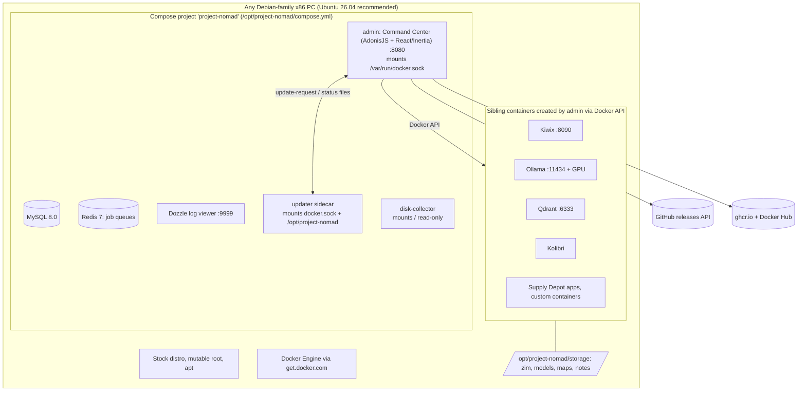

# Project N.O.M.A.D.: Tier B condensed teardown

**Workstream:** W1 (Tier B) · **Tag:** `TD-project-nomad` · **Date:** 2026-11-11 · **Status:** draft, no refuter pass (Tier B does not require one)
**Claims:** `evidence/claims/TD-project-nomad.csv` (C-TD-project-nomad-001…046) · **Sources:** `evidence/sources/TD-project-nomad.md`, saved pages in `evidence/sources/TD-project-nomad/`
**License note:** Project N.O.M.A.D. ("NOMAD") software is **Apache-2.0** [C-TD-project-nomad-002], the same licence as OneMind (D-001), so patterns and even code could legally be reused with attribution. The **Creator Pack video content** is under a separate, non-commercial, draft licence that forbids forks from serving it [C-TD-project-nomad-030]. Never bundle that content.

> ### Explain it like I'm the founder
> NOMAD is a free **"survival computer" app** made by Crosstalk Solutions, a small US networking company. You take an ordinary x86 PC running Ubuntu, paste one command, and it installs Docker plus a web dashboard (the "Command Center"). From the dashboard you download offline Wikipedia, Khan Academy courses, world maps and a local AI chatbot, and then the box works with no internet.
>
> **It is not an operating system.** It has no image of its own, no A/B slots and no OS rollback. It also has no logins: anyone on your Wi-Fi can install or delete apps [C-TD-project-nomad-024, C-TD-project-nomad-026]. It runs on x86 only and sends Raspberry Pi users to a different project [C-TD-project-nomad-012, C-TD-project-nomad-013].
>
> **Even so, it went from zero to about 43,000 GitHub stars in about 16 months** [C-TD-project-nomad-003]. That is the lesson. People want **content + local AI + "it just works offline"**, and they will put up with a plain Docker install to get it.
>
> **For OneMind:** copy the offline-knowledge bundle, the per-app "rename aside → health check → roll back" update, the update window and cool-off settings, the hardware benchmark leaderboard and the "prune old images but keep what you need offline" rule. Do better on everything NOMAD skips: signed releases, OS-level rollback, accounts and parental controls, backups, Arm and Jetson, mesh and TAK, and an AI permission layer.

---

## 1. What was analysed (pinned)

| Component | Release | Date | Commit |
|---|---|---|---|
| project-nomad (Command Center, installer, sidecars) | v1.35.1 | 2026-10-05 [C-TD-project-nomad-001] | `Crosstalk-Solutions/project-nomad@0dbbd21c2f470975e86131c497694c147ca8bc00` |
| same repo, `main` (diff check only) | n/a | 2026-11-08 | `c903da48c97bc02f5cdfeff2ebcde00a82dfec8e`: differs from v1.35.1 only in release notes and one content-category JSON [C-TD-project-nomad-001] |
| Website (install, hardware, support, home) | n/a | 2026-11-11 | saved text + sha256 in `evidence/sources/TD-project-nomad/`; Wayback captures 2026-10-13 to 2026-11-05 |

Permalink prefix **N** = `https://github.com/Crosstalk-Solutions/project-nomad/blob/0dbbd21c2f470975e86131c497694c147ca8bc00/`

**Who builds it:** two maintainers hold 637 of the attributed commits, and the next human contributor has 10 [C-TD-project-nomad-004]. The bus factor is about two, similar to Rugix's single-maintainer risk in 01 §2. The security policy says "a very small team" with no guaranteed response time [C-TD-project-nomad-027].

---

## 2. Architecture



- **Control plane:** one AdonisJS (Node.js) app, the "Command Center". It keeps its state in MySQL and Redis and creates every other app as a **sibling container** through the host Docker socket ("Docker-out-of-Docker") [C-TD-project-nomad-005, C-TD-project-nomad-023].
- **Data:** a single host folder, `/opt/project-nomad/storage`, which the admin hands to every child app. Moving it is a manual job [C-TD-project-nomad-036].
- **No Kubernetes, no multi-node, no cluster:** one box, one Docker daemon.

## 3. Base OS and image build

| Step | What the code does | Citation |
|---|---|---|
| Base OS | **None of its own.** The user installs Ubuntu 26.04 (recommended), 24.04 or Debian 12. Arm, VMs and macOS are unsupported [C-TD-project-nomad-012] | install page (saved) |
| Admin image | Multi-stage `node:22-slim` build; `node ace build`; go-pmtiles pinned by version **and per-arch SHA-256** [C-TD-project-nomad-006] | N `Dockerfile#L1-L70` |
| CI build | Manual `workflow_dispatch`, gated on an authorised-user list; pushes `:X.Y.Z`, `:vX.Y.Z`, optional `:latest`. **No signing, no attestation, no SBOM, no multi-arch `platforms`** [C-TD-project-nomad-007] | N `.github/workflows/build-primary-image.yml#L1-L55` |
| Versioning | semantic-release from `main`, with an `rc` prerelease channel [C-TD-project-nomad-008] | N `.releaserc.json`; `.github/workflows/release.yml#L1-L40` |
| Baked secrets | The Creator Packs entitlement key goes into an image ENV layer from CI, and the code says it is extractable [C-TD-project-nomad-029]. A benchmark HMAC key is a source constant (value not reproduced) [C-TD-project-nomad-028] | N `Dockerfile#L85-L93`; `admin/app/services/benchmark_service.ts#L43-L47` |

**Lesson:** a manually triggered build for a side image can fall out of step with the repo. The sidecar updater image has not been rebuilt since 2026-03-19, so a fix "shipped in v1.34.0" never reached users who pull `:latest` [C-TD-project-nomad-038].

## 4. Install paths

| Path | Status | Evidence |
|---|---|---|
| `curl … install_nomad.sh \| sudo bash` on Debian-family x86 | **The only official path** | [C-TD-project-nomad-009] |
| Hand-edited Docker Compose template | "Advanced users only" | README §Advanced Installation [C-TD-project-nomad-005] |
| Windows via WSL2 | community-supported | [C-TD-project-nomad-012] |
| Pi/Arm, VMs, macOS | not supported; the ARM PR was closed unmerged | [C-TD-project-nomad-012, C-TD-project-nomad-041] |
| Flashable image, USB installer, preinstalled box | **none** | absence at `0dbbd21` |

What the installer does: it checks for Debian, **warns and continues after 10 s on non-x86**, installs Docker from `get.docker.com`, adds NVIDIA's apt repo and the Container Toolkit if it finds an NVIDIA GPU, generates the app key and DB passwords locally, and runs `docker compose up` [C-TD-project-nomad-009, C-TD-project-nomad-011]. It downloads `compose.yml` and the helper scripts **from `refs/heads/main`, not from the release tag, with no checksum** [C-TD-project-nomad-010]. An install made today therefore takes whatever `main` holds at that minute.

## 5. Update and rollback (derived from code)

NOMAD has three update paths and no OS-level update at all. Host OS patching is left to the user's distro.

| Path | Mechanism | Health gate | Rollback | Citation |
|---|---|---|---|---|
| **Core, via UI** | admin writes `update-request`; sidecar `sed`s the tag into `compose.yml`, pulls, then **stop → rm → up** for admin, mysql, redis, dozzle | none beyond "compose up succeeded" | **none**: on error it writes `status=error` and stops, with `compose.yml` already pointing at the new tag | N `install/sidecar-updater/update-watcher.sh#L31-L117`; `admin/app/services/system_update_service.ts#L29-L70` [C-TD-project-nomad-015] |
| **Core, CLI** | `update_nomad.sh`: `compose pull` + `up -d --force-recreate` | none | none | N `install/update_nomad.sh#L119-L131` [C-TD-project-nomad-016] |
| **Core, automatic** | opt-in (off by default); window 02:00–05:00; 72 h cool-off; same major only; strict semver; no prereleases; disk/queue pre-flight; **auto-disables after 3 failures** | pre-flight only | none (relies on the sidecar path) | N `admin/app/services/auto_update_service.ts#L24-L196`, `#L525-L545` [C-TD-project-nomad-017] |
| **Each app** | rename live container to `<name>_old`, create new from inspected config, start | Running after 5 s; the recreate path polls a declared `HEALTHCHECK` for up to 30 s | **yes**: rename `_old` back and start it | N `admin/app/services/docker_service.ts#L1843-L2031`, `#L2286-L2318` [C-TD-project-nomad-019] |

**Trust:** no path checks an image signature or pins a digest. The target is a tag name taken from the GitHub releases feed [C-TD-project-nomad-018].

```mermaid
sequenceDiagram
  participant U as User / scheduler
  participant A as admin (Command Center)
  participant S as updater sidecar
  participant D as Docker daemon
  U->>A: Update (or auto-update in window, past cool-off)
  A->>A: pick same-major semver tag from GitHub releases; pre-flight disk + queues
  A->>S: write /shared/update-request {target_tag}
  S->>S: sed image tag into /opt/project-nomad/compose.yml
  S->>D: compose pull
  alt pull fails
    S-->>A: status=error (compose.yml already rewritten)
  else
    loop admin, mysql, redis, dozzle
      S->>D: stop, rm, up --no-deps
      alt recreate fails
        S-->>A: status=error, service may be down, no rollback
      end
    end
    S->>D: prune only superseded NOMAD images (keep offline app images)
    S-->>A: status=complete
  end
  Note over A,D: App updates differ: rename-aside → start → 5 s / HEALTHCHECK → rollback on failure
```

**Disk hygiene, done thoughtfully:** after a successful core update the sidecar removes only NOMAD's own superseded images. It deliberately does **not** run `docker image prune -a`, because that would delete images of installed-but-stopped apps, and an offline box could not pull them again [C-TD-project-nomad-037]. That rule fits OneMind's offline-first boxes exactly.

## 6. App format ("Supply Depot")

- **No manifest file and no external catalog.** Each app is a row in a MySQL `services` table, seeded from a TypeScript array that is **compiled into the admin image**. A row holds the image, a raw **Docker Engine API `container_config`** (binds, ports, env), `ui_location`, `category` and `depends_on` [C-TD-project-nomad-021]. A new or changed catalog app therefore needs a new NOMAD release.
- v1.35.1 seeds 17 apps: Kiwix, Qdrant, Ollama, CyberChef, FlatNotes, Kolibri, Stirling-PDF, FileBrowser, Calibre-Web, IT-Tools, Excalidraw, **Meshtastic Web, MeshCore Web**, Homebox, Vaultwarden, Jellyfin and its own nomad-translate. Most are pinned by version tag [C-TD-project-nomad-022].
- **Custom apps:** users can run any image, behind a guard that hard-blocks mounts of the Docker socket, `/etc`, `/proc`, `/sys`, `/boot`, `/dev`, `/run` and NOMAD's own tree, and only *warns* on untrusted registries [C-TD-project-nomad-023].
- **Content is the real "app":** ZIM archives, map extracts and curated collections have their own download, update and auto-update rails (`content_auto_update_service.ts`). Paid-for-free "Creator Packs" come through an entitlement service [C-TD-project-nomad-029, C-TD-project-nomad-030].

## 7. Identity and accounts

**None.** The router has no auth middleware (the session middleware is commented out) [C-TD-project-nomad-024]. CSRF protection is switched off [C-TD-project-nomad-025]. Routes that create, update and delete containers are open to anyone who can reach port 8080 [C-TD-project-nomad-026]. The security policy makes "the local network is the trust boundary" a design rule [C-TD-project-nomad-027]. Users asked for logins and admin-only roles more than once (#227, #764, #1238). The request was closed as not planned, and the website points to a community Caddy basic-auth guide instead [C-TD-project-nomad-042].

## 8. AI features

- **Ollama in a container with GPU auto-detection:** NVIDIA through Docker `DeviceRequests` (installer sets up the Container Toolkit), AMD through the `ollama:rocm` image with `/dev/kfd` and `/dev/dri`, otherwise CPU [C-TD-project-nomad-032].
- **RAG chat** over uploaded files and the offline library, using Qdrant. It can use a remote Ollama or any OpenAI-compatible server. A user-editable `NOMAD.md` is injected as the system prompt [C-TD-project-nomad-033]. There is also a retrieval/generation evaluation harness (`admin/commands/eval/`).
- **No MCP server, no agent tools and no AI permission layer** [C-TD-project-nomad-034]. The AI reads documents; it cannot act on the system.

## 9. Backups

**None.** There is no backup or restore feature. The scheduled-backups request (#715) was moved to the community roadmap [C-TD-project-nomad-035]. The update script itself tells users to "back up your data before proceeding" (N `install/update_nomad.sh#L69`), with no tool to do it.

## 10. Security

| Area | What NOMAD does | Citation |
|---|---|---|
| Host access | admin and updater hold the Docker socket (root-equivalent); disk-collector mounts `/` read-only | [C-TD-project-nomad-005, C-TD-project-nomad-044] |
| Auth / CSRF | none / disabled; any LAN device or any web page a LAN user opens could drive the API | [C-TD-project-nomad-024, C-TD-project-nomad-025, C-TD-project-nomad-026] |
| Release integrity | unsigned images, mutable `:latest`, installer from `main` with no checksum | [C-TD-project-nomad-007, C-TD-project-nomad-010, C-TD-project-nomad-018] |
| Past incident | Dozzle shipped with a container shell on an unauthenticated port; now disabled | [C-TD-project-nomad-043] |
| Custom-app guard | real, careful path checks (parse-differential on `:` rejected) | [C-TD-project-nomad-023] |
| Support window | only the latest release gets security fixes | [C-TD-project-nomad-027] |
| Telemetry | "zero built-in telemetry"; connectivity checks reach Cloudflare, GitHub and NOMAD's API | [C-TD-project-nomad-045] |

The CSRF gap matters more than it looks. With no auth and CSRF off, a malicious web page opened by anyone on the LAN can in principle POST to the container-creation routes. The custom-app guard is the only barrier. This is inferred from the code, not tested; the policy puts "attacks delivered through a user's browser" in scope [C-TD-project-nomad-027].

## 11. Hardware

- x86 only. Minimum: 2 GHz dual-core, 4 GB RAM (the stack alone uses under 1 GB), 5 GB disk. "Optimal": Ryzen 7/Core i7, 32 GB, an RTX 3060-class GPU and 250 GB SSD. The AI install is about 25 GB [C-TD-project-nomad-014].
- The hardware guide gives three build tiers ($150–$300, $500–$800, $1,000+), uses affiliate links, and **points Raspberry Pi users to Internet-in-a-Box** [C-TD-project-nomad-013]. One community member runs it unofficially on a Pi 5 4 GB with Debian 13 arm64 [C-TD-project-nomad-041].
- Upstream images set the real hardware floor: `mysql:8.0` crash-looped on a CPU without x86-64-v2, which blocked install and update [C-TD-project-nomad-039].
- A **benchmark with a public leaderboard** ("NOMAD Score") is the hardware recommendation engine [C-TD-project-nomad-013].

## 12. Licence

| Part | Licence | Reuse by OneMind |
|---|---|---|
| Software (all code in repo) | Apache-2.0 [C-TD-project-nomad-002] | allowed, with NOTICE/attribution; still prefer re-implementing patterns to keep one code style |
| Creator Pack content | `nomad-creator-pack-1.0`, draft, personal non-commercial, forks may not serve it [C-TD-project-nomad-030] | **no** |
| Bundled apps (Kiwix, Kolibri, Ollama, …) | each upstream's own | check per app in `evidence/license-matrix.csv` (W12) |

## 13. Business model

The software is free, with "no subscriptions, no paywalls". Funding comes from Ko-fi donations, a merch shop, a referral to the company's paid home-networking support service, and affiliate links in the hardware guide [C-TD-project-nomad-031]. Creator Packs bring creators' video libraries onto the box through an entitlement gate, which is a **content-distribution channel** rather than a revenue line in the code [C-TD-project-nomad-029, C-TD-project-nomad-030]. The marketing compares NOMAD (free) with paid Pi-based "prepper boxes" priced $199–$699 (vendor claim, SECONDARY) [C-TD-project-nomad-046]. This answers the "business model UNVERIFIED" row in `research/competitors/landscape.md` §1.5.

## 14. Claims vs code

| Docs or marketing claim | Code at `0dbbd21` | Verdict |
|---|---|---|
| "Automatic Updates … hands-off … for the core software" (README) | Core path has no rollback; a failed recreate leaves services down [C-TD-project-nomad-015] | **Partly contradicts**: automatic, not safe |
| Auto-update installs "only when pre-flight checks pass", minor/patch only (README) | Same-major, strict semver, cool-off, disk/queue pre-flight [C-TD-project-nomad-017] | Agrees |
| App updates are safe | Rename-aside + health check + rollback since v1.33.0 [C-TD-project-nomad-019, C-TD-project-nomad-020] | Agrees (after #949) |
| "Installation is completely terminal-based … the install script handles everything" | Also pulls scripts from `main` with no checksum [C-TD-project-nomad-010] | Agrees, with a supply-chain caveat |
| "Supports Debian 12" / Debian is fine | Maintainers call Debian 13 "not officially supported" (#661) [C-TD-project-nomad-039] | Agrees (13 excluded) |
| Fix "shipped in v1.34.0" (#858) | Not in the published sidecar `:latest` (#1468) [C-TD-project-nomad-038] | **Contradicts** for the published image (partial evidence) |

## 15. Real-world failure reports and what they teach

| Report | What happened | Lesson for OneMind |
|---|---|---|
| #949 [C-TD-project-nomad-020] | App update stopped the old container and never started the new one; retries failed forever | Every update, even per app, needs keep-old → verify → switch → roll back. OneMind's Market must have this from day one |
| #858 + #1468 [C-TD-project-nomad-037, C-TD-project-nomad-038] | Old images filled a 64 GB SSD; the fix then failed to ship because a side image is built by hand | Disk budget and GC belong in the release contract; build **every** shipped artifact in one automated, signed pipeline |
| #400, #1007 [C-TD-project-nomad-040] | UI updates stalled or failed with no logs; fix was a CLI script or reinstall | Updates need a recovery path that does not depend on the thing being updated (OneMind: A/B slot + rescue ISO) |
| #661 [C-TD-project-nomad-039] | `mysql:8.0` needs x86-64-v2; old CPUs bricked on install/update | Declare a minimum CPU level per image and check it before update (feeds capability detection, W10) |
| #278 [C-TD-project-nomad-043] | Log viewer exposed a container shell with no auth | Never ship an admin tool on an open port; auth is a precondition, not a feature |
| #1238 [C-TD-project-nomad-042] | Households want admin-only controls; closed "not planned" | Multi-user and parental controls (U-1, U-3) are real demand in this segment |

## 16. Strengths and weaknesses

| Strengths | Weaknesses |
|---|---|
| Clear job: offline knowledge + local AI, explained in one sentence | Not an OS: no image, A/B, OS rollback or host patching |
| Very fast growth (≈43k stars, ≈16 months) [C-TD-project-nomad-003] | No auth, CSRF off, Docker socket exposure [C-TD-project-nomad-024, C-TD-project-nomad-025] |
| Excellent content pipeline (ZIM, maps, Khan Academy, translation proxy) | x86 only; Arm PR closed [C-TD-project-nomad-041] |
| Careful per-app rollback and offline-aware image pruning [C-TD-project-nomad-019, C-TD-project-nomad-037] | Unsigned releases, installer from `main` [C-TD-project-nomad-007, C-TD-project-nomad-010] |
| Thoughtful auto-update policy and an offline dry-run simulator [C-TD-project-nomad-017] | No backups [C-TD-project-nomad-035] |
| GPU auto-detect for NVIDIA and AMD [C-TD-project-nomad-032] | Catalog compiled into the binary; no third-party app format [C-TD-project-nomad-021] |
| Benchmark leaderboard drives hardware choice and community | Bus factor ≈ 2; latest-only security fixes [C-TD-project-nomad-004, C-TD-project-nomad-027] |

## 17. What competitors do (constraint-fit)

| Question | Project N.O.M.A.D. | umbrelOS (01, Tier A) | Home Assistant OS (Tier A) | balenaOS (Tier B) | Constraint fit with OneMind |
|---|---|---|---|---|---|
| Base OS | user's Ubuntu/Debian [C-TD-project-nomad-012] | own Debian trixie image [C-W2-043] | own Buildroot image | own Yocto image | NOMAD: **low** (no image to learn from); umbrelOS/HAOS high |
| OS update + rollback | none (core: no rollback) [C-TD-project-nomad-015] | Rugix A/B, commits at daemon start [C-W3-036] | RAUC A/B, commits early [C-W3-025] | hostapp A/B | NOMAD: **none**; OneMind's gate stays stricter than all |
| Per-app update rollback | yes, rename-aside + 5 s/HEALTHCHECK [C-TD-project-nomad-019] | see `umbrelos.md` | see `home-assistant-os.md` | Supervisor strategies | NOMAD: **high**: same single-box app problem as OneMind's Market |
| App format | DB rows compiled into image [C-TD-project-nomad-021] | Compose + manifest | add-on `config.yaml` | Compose subset | NOMAD: **low**: no third-party ecosystem |
| Auth | none [C-TD-project-nomad-024] | household accounts | users + roles | cloud accounts | NOMAD: **fails** U-1/U-3 |
| Hardware | x86 only, GPU-first [C-TD-project-nomad-013] | x86 + Pi 5 | x86, Pi, many boards | Pi, Jetson, x86 | NOMAD: **low** for F-14 (no Pi, no Jetson) |
| Team | ≈2 maintainers [C-TD-project-nomad-004] | small company | foundation + company | company | NOMAD close to OneMind's solo scale: proves a tiny team can win on **content + UX** |

## 18. What OneMind copies and what it does better

| ID | Recommendation | Copy or better | Requirement IDs |
|---|---|---|---|
| REC-NOMAD-01 | Ship an **"Offline Knowledge" bundle** as Market apps: Kiwix + ZIM library manager, Kolibri, offline vector maps (PMTiles), local LLM chat with RAG over the library. Make it one click in Simple mode and a profile for the greenhouse/off-grid node | Copy | U-2, A-1, A-7, M-1, F-13, N-6, AI-8 |
| REC-NOMAD-02 | **Market app updates keep the old version until the new one is healthy**, then roll back automatically (NOMAD's rename-aside pattern, done at Helm/k3s level with readiness probes). Keep this separate from the OS gate, which excludes apps (REC-DEC-07) | Copy | R-1, R-2, A-1, A-5 |
| REC-NOMAD-03 | Offer NOMAD's **update policy knobs** for apps and content: maintenance window, cool-off hours, same-major only, failure back-off that disables auto-update, and a CI **dry-run simulator** of the decision. The security channel keeps the CRA default-on policy from 01 | Copy + adapt | R-1, R-2 |
| REC-NOMAD-04 | **Offline-aware garbage collection:** prune superseded images, but never images of installed-but-stopped apps; set a disk budget per box | Copy | R-2, M-1, P-1 |
| REC-NOMAD-05 | **Signed, digest-pinned everything:** OS bundles, app images and the installer script are fetched by tag with checksums; no `:latest`; every shipped artifact is built by the same automated pipeline (the #1468 lesson) | Better | R-1, R-3, P-7 |
| REC-NOMAD-06 | **Accounts on day one** (household roles, parental controls, admin-only system actions) and CSRF/auth on every mutating API; no admin tool on an open port | Better | U-1, U-3, U-5, AI-4 |
| REC-NOMAD-07 | **Backups built in** (restic per 01) with a restore drill, covering content libraries and model files as an optional, size-aware tier | Better | UX-6, R-2 |
| REC-NOMAD-08 | **Benchmark + public leaderboard** feeding "your box can run this" capability detection and hardware recommendations | Copy | A-8, P-6, H-1, W-3 |
| REC-NOMAD-09 | Market seeds: **Meshtastic Web and MeshCore Web** clients next to OneMind's native mesh layer | Copy | N-6, A-1 |
| REC-NOMAD-10 | Business-model inputs for W16: a creator **content-pack channel** (licensed per pack, never bundled into forks) and hardware affiliate/bundle guides | Adapt | H-1, A-7, M-1 |
| REC-NOMAD-11 | Declare a **minimum CPU level** (e.g. x86-64-v2) per image and check it before install or update | Better | R-2, P-7, A-8 |

## 19. Does NOMAD challenge OneMind's Tier A decisions (01)?

| Tier A decision | Challenge from NOMAD | Verdict |
|---|---|---|
| Own read-only image + RAUC A/B (REC-DEC-05) | NOMAD shows huge adoption with **no image at all** [C-TD-project-nomad-003]. Its failure reports (#400, #949, #1007) are exactly the "update broke it, reinstall" pain an A/B image prevents | **No change.** NOMAD is evidence of demand, not of a safe update model |
| Script install on an existing distro = developer preview only (01 §install, P6) | NOMAD's *only* path is a script install on stock Ubuntu, and it is the fastest-growing product in this teardown set. This is the strongest pressure in this file on a Tier A choice | **Weak challenge, flagged.** Keep "no OS rollback, so not the default", but consider a supported **app-platform mode on Ubuntu/Debian** clearly labelled "apps roll back, the OS does not". Proposed for 26 (P-7, Q for Zeus); not changed here |
| k3s on ≥ 4 GB + SSD, NATS leaf below (REC-DEC-09) | NOMAD uses plain Docker on one box, which is the Compose steelman's case [01 §6.3]. But NOMAD has no multi-node story, and its per-app rollback had to be hand-built on raw Docker API calls [C-TD-project-nomad-019] | **No change.** Supports the Compose *importer* (REC-DEC-10), not Compose as the runtime |
| Debian 13 core | NOMAD tests on Ubuntu 26.04 and calls Debian 13 unsupported [C-TD-project-nomad-012, C-TD-project-nomad-039]. This is a test-matrix choice by a two-person team, not a technical finding | **No change** |
| Pi 5 in the same OS family (F-14) | NOMAD sends Pi users elsewhere because local AI needs more RAM/GPU [C-TD-project-nomad-013] | **Supports** the 4 GB/SSD gate and the leaf tier: the Pi node runs knowledge apps, the GPU node runs AI |
| CRA: security updates on by default | NOMAD's auto-update is off by default [C-TD-project-nomad-017] | **No change.** NOMAD is a US hobby project; OneMind sells hardware into the EU |

**Net:** no Tier A decision is overturned. One item goes to the 01/26 owners: whether "app-platform mode on an existing distro" should be promoted from developer preview to a supported, clearly labelled install path for P-7 bring-your-own-hardware users.

## 20. Gaps and next steps

- The installer was **read, not run**. A disposable-VM install (rule 5) would confirm ports, resource use and the update flow. It was not needed for this Tier B scope.
- The CSRF attack path is inferred from code, not demonstrated.
- The registry date of the sidecar image comes from issue #1468, not from our own registry query [C-TD-project-nomad-038].
- Upstream app licences (Kiwix ZIM content, Kolibri channels, map data) belong in W12's licence check before REC-NOMAD-01 ships.

---

## Glossary

| Term | Meaning |
|---|---|
| **A/B update** | Two copies of the OS; the update goes to the idle copy and the box switches only if it boots healthy |
| **Command Center** | NOMAD's web dashboard and API (the "admin" container) |
| **Compose** | Docker's YAML format for running several containers together |
| **CSRF** | Cross-site request forgery: a web page you visit silently sends a request to another site or device you can reach |
| **Digest pinning** | Referring to a container image by its content hash, so it cannot change under you, unlike a tag such as `:latest` |
| **Docker socket** | The file `/var/run/docker.sock`; whoever holds it controls every container and, in effect, the host |
| **HEALTHCHECK** | A command inside an image that Docker runs to decide whether the container is healthy |
| **HMAC** | A keyed hash used to prove a message came from someone holding the key |
| **Kiwix / ZIM** | Kiwix serves offline copies of websites such as Wikipedia, packed in `.zim` archive files |
| **Kolibri** | An offline learning platform that can host Khan Academy courses |
| **PMTiles** | A single-file format for offline map tiles |
| **RAG** | Retrieval-augmented generation: the AI looks up relevant documents first, then answers using them |
| **Semver** | Semantic versioning, MAJOR.MINOR.PATCH; a major bump signals breaking changes |
| **Sidecar** | A helper container that runs next to the main one to do a single job, here applying updates |
| **x86-64-v2** | A minimum level of x86 CPU features; very old CPUs (e.g. Core 2) do not meet it |
