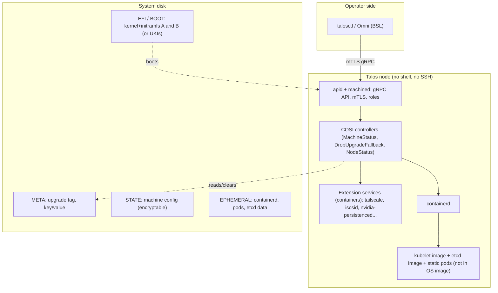

# Talos Linux: Tier B condensed teardown

**Workstream:** W1 (Tier B) · **Tag:** `TD-talos` · **Date:** 2026-11-11 · **Status:** draft
**Claims:** `evidence/claims/TD-talos.csv` (C-TD-talos-001…042) · **Sources:** `evidence/sources/TD-talos.md`
**Builds on:** W2 (`03-base-os.md` rows I/P0-7), W4 (`05-…` S3 "Talos-native"), W18 (`28-…`), DC-23. Those files already rejected Talos as the base because it has no merged Jetson Orin support [C-W2-038, C-W4-064]. This file does not redo that. It reads the code to show *how* Talos works and what OneMind should take from it.
**Licence note:** Talos is MPL-2.0 [C-TD-talos-035], which is file-level copyleft and compatible with an Apache-2.0 product if MPL files stay MPL. Omni (fleet manager) and Image Factory's enterprise folder are BSL 1.1, not open source [C-TD-talos-036, C-TD-talos-010]. Recommendations below are patterns, not code reuse.

> ### Explain it like I'm the founder
> Talos is a Linux built for one job: running Kubernetes. It has **no shell, no SSH and no package manager**. You never log in. You talk to every machine through one secure API, with a command-line tool called `talosctl` [C-TD-talos-028]. The whole OS is a single compressed file loaded into memory at boot [C-TD-talos-007], so nobody can change it while it runs.
>
> Updates keep the old version next to the new one (A/B). If the new version **crashes during boot**, the machine flips back on its own [C-TD-talos-014]. Once the machine reports healthy (clock, network, core services, Kubernetes node ready), the new version becomes permanent [C-TD-talos-015, C-TD-talos-016].
>
> Reading the code shows three things the marketing does not say:
> 1. **The automatic rollback only fires when the boot code returns an error.** In September 2026 a real upgrade left machines stuck in "maintenance mode" without their settings. That counted as "waiting", not as an error, so the owner rolled back by hand [C-TD-talos-020].
> 2. **"Healthy" trusts Kubernetes's own "Ready" flag without checking how old it is** [C-TD-talos-017]. Our lab showed that a flag like this can be left over from the previous boot [C-LAB-debian-rugix-023].
> 3. **Rollback only covers the OS.** A bad upgrade once left files on the data partition that rolling back could not fix [C-TD-talos-021].
>
> **Why it isn't OneMind's base:** official support covers servers and clouds. Single-board computers, including the Raspberry Pi 5, are "community, as-is" [C-TD-talos-005]. Jetson Orin is not merged [C-W2-038]. Free support for each version ends when the next one ships, about every four months [C-TD-talos-003].
>
> **What OneMind takes from it:** the no-shell API with roles, the reproducible image, profile IDs made from a hash of their recipe, the allow-list for OS extensions, and keeping the Kubernetes version separate from the OS version.

---

## 1. What was analysed (pinned)

| Component | Release | Date | Pin |
|---|---|---|---|
| Talos Linux | v1.14.5 (stable; v1.15.0-beta.0 out 2026-11-10) | 2026-10-26 [C-TD-talos-001] | `siderolabs/talos@dad8d3edfe7ca381044d7cad259fdf3030efa700` |
| Kernel / etcd shipped | Linux 6.18.58, etcd 3.7.3 | [C-TD-talos-002] | (built by siderolabs/pkgs; own config [C-W18-045]) |
| System extensions catalog | main | 2026-11-10 | `siderolabs/extensions@8db133ae509f67480f6973f302eab062b8a3b3d6` |
| Image Factory | main | 2026-11-03 | `siderolabs/image-factory@c9c1f3946ddb1efbe8f221639b04dd39a60ba801` |
| Official docs source | main | 2026-11-10 | `siderolabs/docs@9cddec20fd08e34d2228e734a8098a476060701a` |
| Pi overlay | sbc-raspberrypi v0.3.0 | 2026-11-02 | `@9fa9252` [C-TD-talos-006] |
| Omni (licence only) | main | — | `siderolabs/omni@bcbb0eff06a64f1cf03d7fb69f5130574d45cc61` |

Permalink prefix **T** = `https://github.com/siderolabs/talos/blob/dad8d3edfe7ca381044d7cad259fdf3030efa700/`.

---

## 2. Architecture



The OS is `rootfs.sqsh` inside the initramfs, so it is read-only and lives in RAM [C-TD-talos-007]. Everything persistent is on STATE (config) and EPHEMERAL (runtime data) [C-TD-talos-011].

---

## 3. W1 fields

| Field | What Talos does | Evidence |
|---|---|---|
| **Architecture** | Kubernetes-only OS. Its own init and API daemon (machined, apid) run controllers that reconcile a declarative machine config. No systemd, no shell. | [C-TD-talos-028] |
| **Base OS** | Not a distro derivative. Built from source by Sidero (siderolabs/pkgs + tools), with its own kernel config tracking recent stable kernels (6.18.58 in v1.14.5). | [C-TD-talos-002, C-W18-045] |
| **Image build** | Docker BuildKit pipeline. Rootfs gets an SELinux-labelled squashfs, then goes into a sorted, `cpio --reproducible` zstd initramfs with `SOURCE_DATE_EPOCH` timestamps. The **imager** turns one *profile* (overlay → extensions → kernel args → signed UKI) into ISO, disk image, installer image, UKI or PXE parts. **Image Factory** does the same as a service, keyed by a *schematic* whose ID is the sha256 of its YAML. | [C-TD-talos-007, C-TD-talos-008, C-TD-talos-009] |
| **Install paths** | ISO, PXE, raw disk image, cloud images, `installer` container image, VMs (VMware, Hyper-V, KVM, Proxmox, Xen), Docker/QEMU for local dev; SBC images via overlays. A machine boots into *maintenance mode* until it gets a config through the API. | [C-TD-talos-003, C-TD-talos-020] |
| **Update / rollback** | API call with an installer image. Drain, stop, write the new kernel+initramfs (GRUB A/B labels) or a new UKI (sd-boot), set META `Upgrade` tag, reboot. Auto-revert only if the boot sequence *errors*. The commit is the tag removal once Running + Ready. Manual `talosctl rollback`. Upgrades are never automatic; scheduling is left to the user or Omni. | [C-TD-talos-012…019] |
| **App format** | Two layers. (1) **Workloads = Kubernetes** (any manifest/Helm). (2) **System extensions** = OCI images with a `manifest.yaml` (name, version, author, Talos semver constraint), whose files must sit under an allow-list (firmware, modules, `/usr/local`, CRI config, glibc loader…). They are baked in at image build. Host daemons in extensions run as **extension services** (container spec + dependencies on network, time, config). | [C-TD-talos-024, C-TD-talos-025, C-TD-talos-026] |
| **Identity** | Per-cluster PKI; mTLS client certs with roles `os:admin`, `os:operator`, `os:reader`, `os:etcd:backup`, `os:image:verifier`, `os:meta:writer`, `os:impersonator`. Upgrade, rollback and reset need `os:admin`. No user accounts on the node. | [C-TD-talos-019, C-TD-talos-028] |
| **AI features** | Documentation only: `llms.txt`, a Claude-style `skill.md`, and a remote docs MCP server. No on-device AI or agent API. The project **refuses AI-generated contributions**. | [C-TD-talos-033, C-TD-talos-034] |
| **Backups** | etcd snapshot via API (`os:etcd:backup` role) and recovery from snapshot. No backup of host or app data. Omni markets cluster backups. | [C-TD-talos-031, C-TD-talos-028] |
| **Security** | Read-only in-RAM root, no shell, API-only, mTLS. Secure Boot with signed UKIs (separate PCR signer). Disk encryption by static key, node ID, network KMS or TPM ("strong when used with SecureBoot"). SELinux on but **permissive**. FIPS 140-3 only in the paid Enterprise Linux. | [C-TD-talos-008, C-TD-talos-029, C-TD-talos-030, C-TD-talos-039] |
| **Hardware** | amd64 (x86-64-v2+) and arm64. Officially: clouds, bare-metal UEFI/BIOS, hypervisors. SBCs are community-maintained; Pi 5 overlay exists (v0.3.0) but docs list Pi 5 as unofficial; Jetson Nano only, Orin unmerged. NVIDIA dGPU via extensions (595/580). Min 2 GiB control plane, 1 GiB worker. | [C-TD-talos-003…006, C-TD-talos-032, C-W2-038] |
| **Licence** | Talos MPL-2.0; extensions and Image Factory core MPL-2.0; Omni BSL 1.1 (production use needs a commercial licence; MPL on 2030-10-23); Image Factory `enterprise/` BSL 1.1 (MPL on 2030-11-03). | [C-TD-talos-035, C-TD-talos-036, C-TD-talos-010] |
| **Business model** | Open-core. Free community OS. **Talos Enterprise Linux $1,000/node/year, 10-node minimum**, which includes Omni, FIPS, SBOM+VEX, CVE SLAs, indemnity and 24/7 support. Omni Hobby free (10 nodes), Startup $25/node/month, an "Edge" tier with quoted pricing. | [C-TD-talos-037] |
| **Maturity signals** | 16 listed adopters, two of them edge-device users (industrial IoT/ML and energy) [C-TD-talos-040]. CNCF Kubernetes conformance and AI conformance listings [C-W4-073, C-W4-038]; NVIDIA AICR lists Talos [C-W4-037]. Commit concentration: one maintainer wrote 46% of the last year's commits [C-TD-talos-041]. |

---

## 4. Code citations

| # | Area | Citation | What it shows |
|---|---|---|---|
| 1 | **Image build** | T`Dockerfile#L1081-L1122` | Labelled squashfs rootfs → reproducible cpio/zstd initramfs [C-TD-talos-007] |
| 2 | **Image build** | T`pkg/imager/imager.go#L80-L160`, `#L436-L500` | Profile pipeline; UKI signed with Secure Boot and PCR signers [C-TD-talos-008] |
| 3 | Image build (service) | `image-factory@c9c1f39:pkg/schematic/schematic.go#L27-L164` | Schematic fields; ID = sha256 of canonical YAML [C-TD-talos-009] |
| 4 | Partition layout | T`pkg/machinery/constants/constants.go#L157-L196` | EFI, BIOS, META, STATE, BOOT, EPHEMERAL labels [C-TD-talos-011] |
| 5 | **Update** | T`internal/app/machined/pkg/runtime/v1alpha1/v1alpha1_sequencer.go#L440-L485`; `cmd/installer/pkg/install/install.go#L436-L440` | Drain → stop → install; META `Upgrade` = previous label [C-TD-talos-013] |
| 6 | **Rollback (auto)** | T`internal/app/machined/revert.go#L42-L95`; `main.go#L103-L115` | Revert only inside the boot-error handler [C-TD-talos-014] |
| 7 | **Commit / health** | T`internal/app/machined/pkg/controllers/runtime/drop_upgrade_fallback.go#L57-L93`; `machine_status.go#L200-L259` | Tag dropped at Running+Ready; what Ready means [C-TD-talos-015, C-TD-talos-016] |
| 8 | Health detail | T`internal/app/machined/pkg/controllers/k8s/node_status.go#L239-L244` | NodeReady copied from the Node condition, no freshness check [C-TD-talos-017] |
| 9 | Bootloader A/B | T`.../bootloader/grub/boot_label.go#L26-L43`; `grub/revert.go#L23-L67`; `sdboot/sdboot.go#L406-L482` | GRUB label flip; sd-boot UKI fallback [C-TD-talos-018] |
| 10 | Manual rollback + auth | T`internal/app/machined/internal/server/v1alpha1/v1alpha1_server.go#L367-L400`; `internal/app/machined/pkg/system/services/machined.go#L40-L111` | Rollback API; per-method role sets [C-TD-talos-019] |
| 11 | **App format (extensions)** | T`pkg/machinery/extensions/metadata.go#L8-L37`; `validate.go#L61-L170`; `extensions.go#L11-L35` | Manifest schema, version constraint, path allow-list [C-TD-talos-024] |
| 12 | **App format (services)** | T`pkg/machinery/extensions/services/services.go#L26-L105`; `extensions@8db133ae:network/tailscale/tailscale.yaml#L1-L47` | Host daemon as a container with dependencies [C-TD-talos-025] |
| 13 | Identity | T`pkg/machinery/role/role.go#L24-L43` | Role set [C-TD-talos-028] |
| 14 | k8s decoupling | T`pkg/machinery/constants/constants.go#L381-L458` | kubelet/etcd are images, not OS files [C-TD-talos-027] |

### Boot → update → rollback (derived from code)

```mermaid
sequenceDiagram
  participant Op as talosctl (os:admin)
  participant M as machined (old version)
  participant I as installer image
  participant D as Disk (BOOT/EFI, META)
  participant N as machined (new version)
  Op->>M: Upgrade(installer image)
  M->>M: deny new services, cordon+drain, stop pods/services, unmount
  M->>I: run installer
  I->>D: write new kernel+initramfs (label B) or new UKI, default=new, fallback=old
  I->>D: META "Upgrade" = previous label
  M->>M: reboot
  D->>N: boot new default
  alt boot sequence returns an error
    N->>D: revertBootloader: flip default back, delete tag
    N->>N: reboot into old version
  else node reaches Running + Ready (time, network, apid/machined/kubelet[/etcd/trustd], static pods, NodeReady)
    N->>D: DropUpgradeFallback deletes META tag (commit)
  else node hangs or sits in maintenance mode (no error)
    Note over N,D: tag stays, no automatic revert; operator runs talosctl rollback [C-TD-talos-020]
  end
```

GRUB's own `fallback` entry also catches a kernel that fails to load [C-TD-talos-018]. Whether a hardware watchdog turns a hang into an error depends on the optional `WatchdogTimerConfig` [C-TD-talos-042]. Not lab-tested here.

---

## 5. Claims vs code

| Docs claim | Code says | Verdict |
|---|---|---|
| "If an upgrade fails to boot, Talos will roll back" [C-TD-talos-012] | Revert runs only in `handle(err)` when the boot sequence errors [C-TD-talos-014] | **Agree, narrowly.** "Fails to boot" means "errors". A wait state such as maintenance mode is not covered [C-TD-talos-020]. |
| "A-B image scheme … retains the previous Talos kernel and OS image" [C-TD-talos-012] | GRUB keeps BootA/BootB; sd-boot keeps the booted UKI as fallback and deletes older ones [C-TD-talos-018] | **Agree.** A and B hold only the kernel+initramfs, because the OS lives inside the initramfs [C-TD-talos-007]. |
| Rollback is for when "workloads fail" [C-TD-talos-012] | Commit happens at node level (Ready); workloads are not checked [C-TD-talos-016] | **Agree.** Same scope as OneMind's "apps excluded" gate (REC-DEC-07). |
| "Upgrades can be scheduled via your own logic" [C-TD-talos-012] | No timer or auto-update code in machined; Upgrade is an `os:admin` API call [C-TD-talos-019] | **Agree.** No built-in channel, window or auto-security-update (a CRA gap for a consumer device [C-W6-008]). |
| `talosctl rollback` behaves like upgrade | Returns immediately and does not wait for health (open #14061) [C-TD-talos-022] | **Contradicts** user expectation; a duplicate of #7337, which was closed as not planned. |
| "Secure by default" (docs) | SELinux permissive; FIPS only in Enterprise [C-TD-talos-030, C-TD-talos-039] | **Partly.** Strong surface reduction (no shell); MAC not enforcing. |

---

## 6. Failure reports and lessons

| Report | What happened | Lesson for OneMind |
|---|---|---|
| #14260 (v1.14.0, Sep 2026) [C-TD-talos-020] | A kernel config change made USB-attached system disks unseen at boot. The node came up in maintenance mode with no config, did **not** auto-revert, and was rolled back by hand. NVMe nodes were fine. | Treat "booted but not configured/joined" as a failure. Use a boot counter + deadline (REC-DEC-05: 3 tries, watchdog), not "error only". Test every boot medium per SKU (USB SSD is common on Pi/mini PCs). |
| #14000 (v1.13.8, Aug 2026) [C-TD-talos-021] | The upgrade left state on EPHEMERAL that broke Longhorn on all 3 upgraded nodes. OS rollback didn't help; only wiping the partition did. | A/B covers the OS, not the data partition. Keep OneMind's "trial boot against a copy" plus pre-update snapshot (01 §4.2 item 6, REC-DEC-11). Canary one node before a fleet. |
| #14002 (fixed Aug 2026) [C-TD-talos-023] | The sd-boot upgrade could delete the UKI actually running and keep a known-bad one as fallback after a manual menu boot. | Always derive "current slot" from what booted (`LoaderEntrySelected` / RAUC booted slot), never from the stored default. Add this case to the RAUC lab. |
| #14061 (open) [C-TD-talos-022] | Rollback reports success before the node is healthy. | OneMind's rollback in the dashboard must report the outcome, not just "started". |

---

## 7. What competitors do (rollback trigger and fit)

| Product | Update engine | Commit trigger | Kubernetes | Pi 5 / Jetson Orin | Constraint fit with OneMind |
|---|---|---|---|---|---|
| **Talos** | own installer, GRUB/sd-boot A/B | Running + Ready incl. NodeReady (no freshness check) [C-TD-talos-015…017] | always (kubelet image) | community / no [C-TD-talos-005, C-W2-038] | **Low as base** (server-first, no Orin, ~4-month free support); **high as a pattern source** for API, image and extension model |
| HAOS | RAUC + Buildroot | Supervisor start, even if unhealthy [C-TD-home-assistant-os-018, C-W3-025] | no (Docker) | see `home-assistant-os.md` | Medium-high (appliance, consumer); see `home-assistant-os.md` |
| umbrelOS | Rugix | daemon start [C-W3-036] | no (Docker) | see `umbrelos.md` | Medium; see `umbrelos.md` |
| Fedora IoT bootc + greenboot | bootc/ostree | greenboot checks (k3s gate in our lab) [C-W2-054] | optional | weak / no | Medium; the year-2 Industrial profile (REC-DEC-04) |
| **OneMind (01)** | RAUC; NVIDIA A/B on Jetson | fresh post-boot signals, 3 tries, watchdog (REC-DEC-07) | k3s ≥ 4 GB, NATS leaf below | yes (Pi kernel) / yes (L4T) | — |

---

## 8. Strengths and weaknesses

**Strengths:** smallest attack surface of any candidate (no shell, API-only, roles) [C-TD-talos-028]; reproducible image [C-TD-talos-007]; one profile → every artefact, content-addressed schematics [C-TD-talos-008, C-TD-talos-009]; extension allow-list and version constraints [C-TD-talos-024]; Kubernetes version independent from the OS version [C-TD-talos-027]; NVIDIA dGPU, Hailo, RKNN and NPU extensions [C-TD-talos-026]; listed by NVIDIA AICR and AI conformance where k3s is not [C-W4-037, C-W4-038]; transparent pricing [C-TD-talos-037].

**Weaknesses (for OneMind):** no user-facing host (no desktop, no apps outside Kubernetes); SBCs are unsupported community ports [C-TD-talos-005]; no Orin [C-W2-038]; free support per minor ends at the next minor [C-TD-talos-003], so a 10-year device needs $1,000/node/year with a 10-node minimum [C-TD-talos-037]; fleet manager is BSL [C-TD-talos-036]; auto-rollback on errors only [C-TD-talos-014, C-TD-talos-020]; no host/app data backup [C-TD-talos-031]; SELinux permissive [C-TD-talos-030]; no built-in update channels or auto-update; maintainer concentration [C-TD-talos-041].

---

## 9. Constraint-fit summary

| Constraint | Talos | OneMind need | Fit |
|---|---|---|---|
| Hardware targets | Servers, VMs, clouds; SBCs community | Pi 5, mini PC, Jetson, GPU box | **Poor** on Pi/Jetson |
| Kubernetes | Mandatory, every node | k3s on ≥ 4 GB + SSD; NATS leaf below | Partial (no tier below Kubernetes; Omni's no-cluster edge mode is a vendor claim only [C-TD-talos-038]) |
| Robotics / host devices | No shell; host access only via extensions; no CAN, ROS or NATS extension [C-TD-talos-026] | Robot runtime exception, radios, CAN | **Poor** |
| Consumer UX | CLI/API for SREs | One-click, family accounts | **Poor** |
| Lifecycle to 2036 | Paid enterprise only | Long, cheap per-device support | **Poor** for consumer SKUs |
| Licence | MPL-2.0 (Omni BSL) | Apache-2.0 open core | OK for the OS; Omni unusable to ship |

---

## 10. What OneMind copies, and what it does better

| ID | Recommendation | Evidence | Requirement IDs |
|---|---|---|---|
| **REC-TD-talos-01** | **Copy:** an API-first node with role-scoped mTLS (admin / operator / reader / backup), plus a "no interactive shell by default" profile for Industrial and public-safety SKUs. A debug shell stays only as an audited, time-boxed grant. | [C-TD-talos-019, C-TD-talos-028] | AI-4, AI-5, U-4, M-8 |
| **REC-TD-talos-02** | **Copy:** content-addressed profiles. A OneMind profile (greenhouse, TAK node, industrial) is a YAML whose sha256 is its ID, and every artefact (image, installer, RAUC bundle) is built from it. Feeds the P-8 profiles and the release contract (REC-DEC-06). | [C-TD-talos-008, C-TD-talos-009] | P-8, F-14, M-7 |
| **REC-TD-talos-03** | **Copy:** reproducible builds (`SOURCE_DATE_EPOCH`, sorted archives) in the RAUC image pipeline, checked in CI by building twice. | [C-TD-talos-007] | R-3, M-8 |
| **REC-TD-talos-04** | **Copy for DC-16:** OS-level extensions with a manifest carrying a semver compatibility range, a **path allow-list**, rejection of world-writable/special files, and host daemons run as declared containers with dependencies. This is the shape of OneMind's "device/driver adapter" and "OS profile" plugin types. | [C-TD-talos-024, C-TD-talos-025] | A-5, A-6, F-3, F-4 |
| **REC-TD-talos-05** | **Do better:** commit on *fresh* signals, with boot counting and a deadline, so "booted but stuck/unconfigured" rolls back by itself. Talos misses that case and trusts a possibly stale NodeReady. Add #14260 (USB boot disk) and #14002 (booted-slot detection) as test cases for the RAUC spike. | [C-TD-talos-014, C-TD-talos-017, C-TD-talos-020, C-TD-talos-023, C-LAB-debian-rugix-023] | R-1, R-2 |
| **REC-TD-talos-06** | **Do better:** a pre-update snapshot of the data partition and a trial-boot copy. Talos's rollback cannot undo data-partition damage. | [C-TD-talos-021] | R-2, UX-6 |
| **REC-TD-talos-07** | **Do better:** update channels, windows and a default-on security channel (CRA), and a rollback that reports its result. Talos has none of these built in. | [C-TD-talos-012, C-TD-talos-022, C-W6-008] | R-1, M-8 |
| **REC-TD-talos-08** | **Do better:** whole-box backups (restic, app data, k3s datastore), not etcd-only. | [C-TD-talos-031] | R-2, UX-6 |
| **REC-TD-talos-09** | **Keep as an option:** Talos for a customer's *GPU server cluster* where Orin and Pi are not involved. It is AI-conformant and AICR-listed, and Helm-based Market apps run unchanged (REC-DEC-10 portability). Revisit if sbc-jetson Orin PR #23 or pkgs PR #1518 merges [C-W2-038, C-STEEL-jb-017]. | [C-W4-037, C-W4-038, C-TD-talos-026] | N-8, N-9, F-14 |
| **REC-TD-talos-10** | **Don't copy:** the BSL fleet manager or an AI-contribution ban. OneMind's Market depends on third-party (and AI-assisted) contributors (A-5). | [C-TD-talos-034, C-TD-talos-036] | A-5, D-001 |

---

## 11. Does this challenge the Tier A decisions in 01?

| Tier A decision | Talos evidence | Effect |
|---|---|---|
| Debian 13 core, not a Kubernetes-native OS (REC-DEC-01; DC-23) | Pi 5 is still "unofficial, community" in v1.14 docs even though the overlay ships [C-TD-talos-005, C-TD-talos-006]; Orin unmerged [C-W2-038]; ~4-month free support per minor [C-TD-talos-003] | **Upheld.** The G2 hardware fail stands, and the lifecycle cost adds a second reason. |
| **k3s inside the A/B slot** with a datastore copy and a minor-version guard (01 §4.2 item 6, D3 overturned) | Talos does the opposite: kubelet and etcd are images versioned in config, and an OS upgrade does not change Kubernetes [C-TD-talos-027]. This avoids "old OS + newer datastore" by design. | **Challenge (medium).** Not an overturn: k3s is one binary, and 01's guard plus the datastore copy passed the lab. 01 should add a written comparison against "k3s version pinned in config, binary on the data partition (Talos-style)" before the image layout freezes. Flag for DC-12. |
| Fresh-signal health gate, 3 tries, watchdog (REC-DEC-05/07) | The Talos gate is close to OneMind's list but has no freshness check, and only errors trigger a revert [C-TD-talos-016, C-TD-talos-017, C-TD-talos-020] | **Strengthened.** It is a third competitor with the same gap (after HAOS and umbrelOS). |
| k3s on ≥ 4 GB + SSD, NATS leaf below (REC-DEC-09) | Talos needs Kubernetes on every node (worker min 1 GiB) [C-TD-talos-032]. Omni claims containers without Kubernetes at single-node edge sites (vendor page only) [C-TD-talos-038]. | **Neutral.** It supports having a no-Kubernetes edge tier. Not verified in code (Omni is BSL; not read). |
| GPU-server flavour on Ubuntu + RKE2 (REC-DEC-03) | Talos is a third AI-conformant option with official NVIDIA 595/580 extensions [C-TD-talos-003, C-W4-038] | **Alternative noted** (REC-TD-talos-09). It adds an OS family, so it doesn't beat RKE2 on the solo-developer criterion. |
| Disk layout with Secure Boot headroom (REC-DEC-08) | Talos's UKI + PCR-signer + TPM unlock path is a working reference [C-TD-talos-008, C-TD-talos-029] | **Supports** the "UKI/sd-boot" branch of spike X-2R. |

**Open items:** Talos was not run in the lab for this Tier B pass. Two behaviours are read from code but not exercised: the stale-NodeReady case and watchdog-driven revert. Omni's no-Kubernetes edge mode is a vendor claim only, because the Omni source (BSL) was not read. Sidero's team size is not stated here: no primary source was found.

---

## Glossary

- **A/B update:** two copies of the OS; the update goes to the unused one, and the old one stays as a fallback.
- **API-only OS:** you manage the machine only through a network API, never by logging in.
- **BSL (Business Source License):** source you can read, but production use needs a paid licence until a "change date", when it becomes open source.
- **etcd:** the database that stores a Kubernetes cluster's state.
- **Extension (Talos system extension):** an add-on file set (drivers, firmware, small daemons) baked into the OS image at build time.
- **Image Factory:** Sidero's web service that builds a custom Talos image from a schematic.
- **initramfs:** a small archive loaded into memory at boot. In Talos, it contains the whole OS.
- **Maintenance mode:** a Talos state where the node waits for a configuration over the API.
- **META partition:** a tiny partition of key/value flags. Talos stores the "upgrade pending" tag there.
- **mTLS:** both sides of a connection prove their identity with certificates.
- **MPL-2.0:** a "weak copyleft" licence. Changed MPL files must stay open, but they can be combined with Apache-2.0 code.
- **NodeReady:** Kubernetes's flag that a node is healthy. It can be stale right after a reboot.
- **Schematic:** a YAML recipe (extensions, kernel args, overlay) whose hash becomes the image ID.
- **sd-boot / UKI:** a simple UEFI boot manager and a single signed file holding kernel + initramfs + command line. Used for Secure Boot.
- **SELinux permissive:** the security policy logs violations but does not block them.
- **squashfs:** a compressed, read-only filesystem image.
