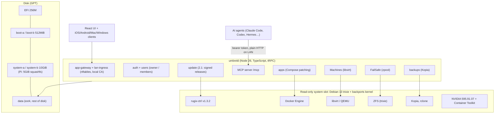

# umbrelOS (Umbrel 2.0): Tier A teardown

**Workstream:** W1 (Tier A) · **Tag:** TD-umbrelos · **Date:** 2026-11-10
**Builds on:** [`research/competitors/umbrel.md`](../../research/competitors/umbrel.md) (UMB), [`research/platform/verify-updates-rollback-backups-security.md`](../../research/platform/verify-updates-rollback-backups-security.md) §2 (VUPD), [`context/03-repo-findings-index.md`](../../context/03-repo-findings-index.md). This report re-reads the code at pinned tags and corrects one phase-1 finding (see §5, row 1).
**Claims:** `evidence/claims/TD-umbrelos.csv` (C-TD-umbrelos-001…058) · **Sources:** `evidence/sources/TD-umbrelos.md`

> ### Explain it like I'm the founder
> umbrelOS is the closest thing on the market to what OneMind wants to be for a household: a box you plug in, open in a browser, install apps on with one click, and now control from an AI agent. Under the hood it is simple. It is **Debian 13 in a read-only "A/B" image** (two copies of the OS; an update goes into the spare copy) built with **Rugix**. One TypeScript program, **umbreld**, does almost everything else: apps (Docker Compose), the login gateway, files, photos, backups (Kopia), RAID (ZFS), virtual machines (libvirt) and an MCP server for AI agents.
>
> Three things matter most for OneMind:
> 1. **Their update security only became strong in the 2.1 *beta* (2026-11-03).** The stable 2.0.1 release still downloads an update script and runs it as root, with Rugix's bundle check switched off. The new signing design (offline root key, hardware-protected signer keys, revocation, anti-downgrade) is excellent, and OneMind should copy the *pattern*. But it is days old in the field, not years.
> 2. **Their "health check" before keeping an update is only "did umbreld start?"** It commits the new OS before any app, the web UI or Docker has proven itself. OneMind's plan (keep the update only after k3s and core pods are healthy) is stricter, and that is a real improvement.
> 3. **The license (PolyForm Noncommercial) forbids selling hardware or support with umbrelOS or a fork.** OneMind can learn from it but must never copy its code.
>
> Umbrel has no Kubernetes, no multi-node, no robotics and no Jetson support. It is a great *single-box household* benchmark and a weak one for robotics.

---

## 0. Glossary

| Term | Meaning here |
|---|---|
| **A/B (dual-slot) update** | Two system partitions. The running one stays untouched while the update writes the other. You reboot into the new one, and if it fails you return to the old one. |
| **Commit** | Telling the bootloader "the slot I booted is now the default". Before a commit, a reboot falls back to the old slot. |
| **Health gate** | The check that must pass before the commit. If the check is weak, a broken update can still be committed. |
| **Rugix / Rugix Bakery / rugix-ctrl** | An Apache-2.0 tool set (silitics): *Bakery* builds images, *Ctrl* installs updates and commits slots on the device. |
| **Bundle hash** | A hash of the update file that `rugix-ctrl` checks while the file streams in, before it writes anything. |
| **Tryboot** | The Raspberry Pi firmware's one-shot "boot this other partition once" flag, used for A/B on the Pi. |
| **umbreld** | Umbrel's main daemon (Node.js/TypeScript, Express + tRPC). |
| **Kopia** | An open-source, encrypted, deduplicating backup tool. |
| **ZFS RAIDZ1 / mirror** | ZFS layouts that survive one failed drive. Umbrel calls this "FailSafe". |
| **MCP** | Model Context Protocol, the standard way AI agents call tools. |
| **Offline root key** | A signing key that lives on a hardware wallet and is never on a networked computer. It signs only the list of approved signer keys. |
| **Secure Enclave** | A key-storage chip in Apple Macs. Keys made there cannot be exported. |
| **PolyForm Noncommercial** | A source-available license that bans commercial use. It is not an open-source license. |

---

## 1. What was analyzed

| Item | Value |
|---|---|
| Stable release | **umbrelOS 2.0.1**, tag `2.0.1` = `a72dac24…` (2026-11-01, "Latest") [C-TD-umbrelos-001, -002] |
| Feature release | **umbrelOS 2.0.0**, tag `9298257b…` (2026-09-22) [C-TD-umbrelos-001] |
| Newest code | **2.1.0-beta.1**, tag `6f357e18…` (2026-11-03, pre-release) [C-TD-umbrelos-002] |
| Default citation SHA | `6f357e18d0a4faccb69d9fa59e3eae9cc3380538`, unless a citation says `a72dac24` (stable 2.0.1) |
| App store | getumbrel/umbrel-apps @ `51aac978…` (2026-11-11) [C-TD-umbrelos-028] |
| Repo size and health | 12,547 stars, 823 forks; GitHub license field NOASSERTION (file is PolyForm NC 1.0.0) [C-TD-umbrelos-056] |
| Method | Shallow clones read on the host; nothing built or executed. Web pages fetched and saved with SHA-256. |

Why two tags: the stable line (2.0.x) and the beta line (2.1) differ in the most important security path, the update client. A teardown pinned only to `master` (as VUPD §2 was) mixes them up.

---

## 2. Architecture (W1 fields)

### 2.1 Overview



| W1 field | Finding | Claims |
|---|---|---|
| **Base OS** | Debian 13 trixie, pinned to snapshot.debian.org dates. amd64/arm64 kernel and firmware come from trixie-backports; ZFS stays on trixie. The Pi image takes its kernel and boot firmware from the Raspberry Pi apt repo. | C-TD-umbrelos-003, -004 |
| **Image build** | A Docker multi-stage build (base image pinned by digest; every binary pinned by SHA-256) produces a root tarball. Rugix Bakery turns it into disk images with fixed UUIDs and hash seeds, aiming for reproducible output. Targets: amd64 GRUB-EFI, generic arm64 EFI, and Pi `rpi-tryboot`. | -003, -005, -006, -009 |
| **Partition layout** | GPT: EFI 256M · boot-a/b 512MiB · system-a/b 10GiB (Pi 128MiB / 5GiB) · data ext4 with a 0.5% reserve. Pi system = squashfs (truly read-only); amd64 system = ext4 without a journal. | -007, -008 |
| **Install paths** | Flashable `.img` (amd64, Pi), an amd64 USB-installer ISO built by a Nix flake, and a VM image. Since 1.0 it **refuses to install on top of Debian/Ubuntu**. Third-party "umbrelOS in Docker" builds exist but cannot update. | -048, -055 |
| **Update/rollback** | Rugix A/B. Stable 2.0.1 runs a server-supplied bash script with `--insecure-skip-bundle-verification`. 2.1-beta verifies a signed manifest and passes `--bundle-hash`. Commit happens when umbreld starts. See §3. | -010…-024 |
| **App format** | `umbrel-app.yml` + `docker-compose.yml` per app; umbreld patches Compose (container names, mounts, GPU). Shared Docker network. Store via a Git repo; community stores are any Git URL. | -026, -027, -028 |
| **Identity** | One owner (permanent) plus members. bcrypt passwords, per-user TOTP. Device management is owner-only, enforced in tRPC middleware. No SSO/OIDC provider, and no parental controls found. | -033, -034, -035 |
| **AI features** | Built-in MCP server (beta). Tokens per agent, but **one shared permission set**; agents act as the owner; tools are registered only when granted; `manageSystem` lets an agent install OS updates and reboot. GPU passthrough for Ollama-type apps. | -036…-040 |
| **Backups** | Kopia to another Umbrel, a NAS or USB. Encrypted, hourly, retention 24h/7d/4w/12m. No cloud target yet ("Umbrel Private Cloud coming soon"). | -030, -031, -032 |
| **Storage** | FailSafe = ZFS RAIDZ1 (SSD) or mirrors (HDD); pools pinned to `compatibility=openzfs-2.3` so rollback can still import them. Not on Pi. | -042, -043, -058 |
| **Security** | Read-only system slot, signed releases (beta), an owner-only management plane, and an app-auth gateway. **No Secure Boot** (unsigned DKMS modules), no disk encryption (LUKS request #2001 still open), Docker-socket ban enforced only by store review. | -025, -029 |
| **Hardware** | Umbrel Home (N150, 16GB) and Umbrel Pro (i3-N300, 16GB, 4× NVMe up to 32TB, 64GB OS storage, 2.5GbE). DIY: any x86-64, Pi 5/4. | -046 |
| **License** | umbrelOS: **PolyForm Noncommercial 1.0.0**. No selling hardware, hosting or support with it or a fork. umbrel-apps: no license file. | -045, -056 |
| **Business model** | Hardware sales (Home $499–949, Pro $699–1,899) plus an "Umbrel Protect" add-on ($39–99); free OS for DIY. | -047 |
| **Machines / VMs** | libvirt `qemu:///system` with a software TPM (swtpm) so Windows 11 guests work; noVNC console in the browser. | -044 |

### 2.2 The pieces OneMind asked about

**Debian trixie build.** This is the strongest engineering in the repo. Every input is pinned: the Debian image digest, snapshot dates for apt and backports, and SHA-256 for Node, Kopia, rclone and yq. The README lists build-reproducibility rules, such as normalising checkout mtimes and removing generated SSH keys and machine IDs [C-TD-umbrelos-003, -005, -025]. This supports ADR-001's "Debian 13 pinned snapshot" choice: a small team ships a reproducible Debian appliance this way today.

**Rugix.** Umbrel uses Rugix for both image building and on-device updates, and migrated older Mender devices onto it (`mender-grub` boot flow) [C-TD-umbrelos-011]. Rugix is Apache-2.0, but one maintainer has 1,161 commits and the next has 4 [C-TD-umbrelos-049]. That is the bus-factor risk in DC-06.

**umbreld.** One process owns the whole control plane. That keeps things simple for a small team, but every subsystem shares one failure domain and one privilege level.

**App gateway.** In 2.0 there is no per-app proxy container. umbreld's `lan-ingress` uses an nftables table (`umbrel_lan_ingress`) to redirect each app's LAN port to a hidden Node listener. That listener checks the Umbrel login cookie (the auth page is on port 2000) and terminates TLS with a **device-local CA** [C-TD-umbrelos-041]. "Automatic HTTPS" therefore means "HTTPS with a certificate your phone does not trust until you install the CA". The MCP docs confirm that agents use plain HTTP for this reason [C-TD-umbrelos-039].

**MCP server.** See §5 (claims vs code) and the AI section in §7.

**Machines/VMs.** libvirt plus swtpm, with VM ports reserved at 40000–49999 (UMB). In 2.1-beta, USB passthrough and LAN-bridged VMs arrive, so a Home Assistant OS guest can see Zigbee sticks. This is a pragmatic way to host appliances an OS cannot run natively.

**FailSafe ZFS.** It is a clever rollback-aware design. Pools are created with `compatibility=openzfs-2.3`, so a newer ZFS in an update never enables features that the older slot could not import after a rollback [C-TD-umbrelos-042, -058]. **OneMind must copy this pattern for any on-disk format the OS owns** (ZFS features, the k3s datastore schema, the etcd version).

**Household accounts.** Introduced in 2.0. Members get a private Home folder (the owner cannot see it in Files), their own Photos library and 2FA, and shared apps and folders. Only the owner manages apps, updates, backups, storage, network and users [C-TD-umbrelos-033, -034]. Shared apps keep their own internal logins. Umbrel does not provide SSO into apps.

**Backups.** See §3.4 and the claims-vs-code table.

**Release signing.** See §3.2.

---

## 3. Update, health check, rollback (derived from code)

### 3.1 Two different update clients in the field

| | **Stable 2.0.1** (`a72dac24`) | **2.1.0-beta.1** (`6f357e18`) |
|---|---|---|
| Find release | `GET api.umbrel.com/latest-release?version&device&platform&channel` | Same server, but it only says *where* the release is |
| What runs | `bash -c <script downloaded from the updateScript URL>` as root [C-TD-umbrelos-010] | A signed `manifest.txt` is verified first; the optional update script is pinned by hash [C-TD-umbrelos-013, -016] |
| Bundle check | `rugix-ctrl update install --reboot set --insecure-skip-bundle-verification` [C-TD-umbrelos-011] | `--bundle-hash <hash from the signed manifest>` [C-TD-umbrelos-017] |
| Anti-downgrade | None in the client | `semver.gt` plus a manifest-hash binding between "check" and "install" [C-TD-umbrelos-016] |
| Trust anchor | TLS to api.umbrel.com, raw.githubusercontent.com and download.umbrel.com | `ROOT_PUBLIC_KEY` built into umbreld [C-TD-umbrelos-013, -018] |

**Consequence (inference from code):** a device on 2.0.1 reaches the signed 2.1 line through the *old* path. The first hop into signed updates is itself an unsigned, TLS-only script. That is unavoidable for any vendor adding signing late. **OneMind must ship signing in its first fielded release** (requirement R-1, R-3).

### 3.2 The 2.1 signing chain (worth copying as a pattern)

- An **offline root key** on a hardware wallet signs only the *approved signing keys list*, as a Bitcoin signed message (secp256k1) [C-TD-umbrelos-013].
- Each **release signer** holds a P-256 key created in their Mac's Secure Enclave, and every signature needs Touch ID. The list sets `Required-Signatures` (M-of-N) and `Revoked-Release: sha256:<manifest>` [C-TD-umbrelos-013].
- Devices fetch the list **daily and before every update** from *two* independent sources (api.umbrel.com and the GitHub raw file), keep only a newer, validly signed list, and save it durably so that rolling back to an older OS cannot forget a revocation [C-TD-umbrelos-014].
- **Root rotation** works through a chain of handovers from the never-changing built-in key [C-TD-umbrelos-018].
- **Known gap, stated in Umbrel's own code:** lists do not expire, so a device that is cut off keeps trusting the newest list it has seen [C-TD-umbrelos-015]. The TUF framework fixes this with timestamp and expiry roles. OneMind should add expiry with a long grace period, because offline sites are a core use case (N-6).
- Rugix pitfall documented in the code: never sign script-payload bundles, because Rugix pipes them to bash *before* it checks the hash [C-TD-umbrelos-017].

### 3.3 Boot → update → rollback sequence (from code)

```mermaid
sequenceDiagram
    autonumber
    actor User
    participant UI as umbreld UI/tRPC
    participant API as api.umbrel.com
    participant DL as download.umbrel.com
    participant RC as rugix-ctrl
    participant BL as Bootloader (GRUB / Pi tryboot)
    participant New as New slot (B)
    participant UD as umbreld on B

    User->>UI: Click "Install now" (never automatic)
    UI->>API: latest-release?version&device&channel
    alt Stable 2.0.1 (a72dac24)
        API-->>UI: {version, updateScript URL}
        UI->>DL: GET update-script
        UI->>UI: bash -c script (root)
        UI->>RC: update install --reboot set --insecure-skip-bundle-verification
    else 2.1.0-beta.1 (6f357e18)
        API-->>UI: release location
        UI->>API: refresh signers list (+ GitHub raw copy)
        UI->>DL: manifest.txt + .sig
        UI->>UI: verify signatures, revocation, semver.gt, manifestHash
        UI->>RC: update install --reboot set --bundle-hash H
    end
    RC->>DL: stream bundle, write inactive slot B
    RC->>BL: set one-shot boot to B
    RC-->>UI: done, reboot
    BL->>New: boot B (one try)
    alt Kernel panics
        New-->>BL: panic=5 reboot
        BL->>BL: one-shot used, so boot A (fallback)
    else Hangs before umbreld starts (no watchdog found)
        Note over New: Device stays hung until someone power-cycles
        User->>BL: power cycle, which boots A (fallback)
    else umbreld process starts
        New->>UD: systemd starts umbreld
        UD->>RC: system commit (FIRST line of start())
        RC->>BL: B is now the default
        UD->>UD: migrations, auth, apps, web server…
        Note over UD: If apps, Docker or the UI fail now, B is already committed.<br/>No automatic rollback; a manual "reboot --spare" is needed
    end
```

Sources: [C-TD-umbrelos-010, -011, -016, -017, -019, -020, -021, -022]. Two steps are **inferences**: "hang, so no automatic recovery" (no watchdog config was found [C-TD-umbrelos-022], and Rugix has no built-in health check [C-TD-umbrelos-021]), and "fail after commit, so no automatic rollback". Issue #2190 is consistent with them: a device was unreachable for over 20 minutes after an OTA until a human rebooted it [C-TD-umbrelos-051].

**What this means for OneMind (DC-12):** Umbrel's health gate is "the control daemon started". It is cheap and avoids false rollbacks, but it does not prove the platform works. ADR-001's "commit only after k3s and the core pods are healthy" is stricter, and OneMind should keep it. It also needs a **hardware watchdog plus a boot-attempt counter**, so that a hang falls back without a human (R-1, R-3, M-6).

### 3.4 Data safety during updates

- The data partition is separate from both slots. If it fails to mount, Rugix boots with in-memory state and umbreld enters **recovery mode** instead of bricking [C-TD-umbrelos-023].
- Pools are pinned to ZFS feature compatibility to survive rollback [C-TD-umbrelos-042].
- **No automatic pre-update backup** was found in the update path (inference from the update code read; Umbrel's support page does not claim one).

---

## 4. Code citations (≥8, at pinned SHAs)

Base: `https://github.com/getumbrel/umbrel/blob/<sha>/`

| # | Area | Permalink | What it shows |
|---|---|---|---|
| 1 | Image build | [umbrel@6f357e18:packages/os/umbrelos.Dockerfile#L1-L45](https://github.com/getumbrel/umbrel/blob/6f357e18d0a4faccb69d9fa59e3eae9cc3380538/packages/os/umbrelos.Dockerfile#L1-L45) | trixie, snapshot dates, pinned NVIDIA/Kopia/rclone/Node |
| 2 | Image build | [umbrel@6f357e18:packages/os/rugix/rugix-bakery.toml#L1-L112](https://github.com/getumbrel/umbrel/blob/6f357e18d0a4faccb69d9fa59e3eae9cc3380538/packages/os/rugix/rugix-bakery.toml#L1-L112) | Rugix targets, fixed UUIDs, squashfs on Pi |
| 3 | Partition layout | [umbrel@6f357e18:packages/os/rugix/recipes/setup-rugix/files/bootstrapping.toml#L1-L15](https://github.com/getumbrel/umbrel/blob/6f357e18d0a4faccb69d9fa59e3eae9cc3380538/packages/os/rugix/recipes/setup-rugix/files/bootstrapping.toml#L1-L15) | A/B boot + system slots, data partition |
| 4 | Update client (stable) | [umbrel@a72dac24:packages/umbreld/source/modules/system/update.ts#L52-L88](https://github.com/getumbrel/umbrel/blob/a72dac249974d1603be9423d3cf6ac1a2d8f65f9/packages/umbreld/source/modules/system/update.ts#L52-L88) | Server-supplied script run with `bash -c` |
| 5 | Update client (stable) | [umbrel@a72dac24:scripts/update-script#L69-L79](https://github.com/getumbrel/umbrel/blob/a72dac249974d1603be9423d3cf6ac1a2d8f65f9/scripts/update-script#L69-L79) | `--insecure-skip-bundle-verification` |
| 6 | Update client (beta) | [umbrel@6f357e18:packages/umbreld/source/modules/update/update.ts#L228-L253](https://github.com/getumbrel/umbrel/blob/6f357e18d0a4faccb69d9fa59e3eae9cc3380538/packages/umbreld/source/modules/update/update.ts#L228-L253) | Manifest-hash binding, anti-downgrade |
| 7 | Update client (beta) | [umbrel@6f357e18:packages/umbreld/source/modules/update/rugix.ts#L14-L29](https://github.com/getumbrel/umbrel/blob/6f357e18d0a4faccb69d9fa59e3eae9cc3380538/packages/umbreld/source/modules/update/rugix.ts#L14-L29) | `--bundle-hash`, script-payload warning |
| 8 | Signing / keys | [umbrel@6f357e18:packages/umbreld/source/modules/update/release-signing.ts#L5-L77](https://github.com/getumbrel/umbrel/blob/6f357e18d0a4faccb69d9fa59e3eae9cc3380538/packages/umbreld/source/modules/update/release-signing.ts#L5-L77) | Root key, signer model, list sources |
| 9 | Signing / keys | [umbrel@6f357e18:packages/umbreld/source/modules/update/signing-keys.ts#L51-L139](https://github.com/getumbrel/umbrel/blob/6f357e18d0a4faccb69d9fa59e3eae9cc3380538/packages/umbreld/source/modules/update/signing-keys.ts#L51-L139) | Daily refresh, newest-only, durable save |
| 10 | Signing / keys | [umbrel@6f357e18:releases/README.md#L22-L28](https://github.com/getumbrel/umbrel/blob/6f357e18d0a4faccb69d9fa59e3eae9cc3380538/releases/README.md#L22-L28) | Revocation, root handover, Secure Enclave signers |
| 11 | Health check | [umbrel@a72dac24:packages/umbreld/source/index.ts#L229-L231](https://github.com/getumbrel/umbrel/blob/a72dac249974d1603be9423d3cf6ac1a2d8f65f9/packages/umbreld/source/index.ts#L229-L231) | Commit is the first act of `start()` |
| 12 | Rollback | [umbrel@a72dac24:packages/umbreld/source/modules/system/system.ts#L524-L534](https://github.com/getumbrel/umbrel/blob/a72dac249974d1603be9423d3cf6ac1a2d8f65f9/packages/umbreld/source/modules/system/system.ts#L524-L534) | `rugix-ctrl system commit` |
| 13 | Recovery | [umbrel@6f357e18:packages/os/rugix/recipes/setup-rugix/files/system.toml#L1-L9](https://github.com/getumbrel/umbrel/blob/6f357e18d0a4faccb69d9fa59e3eae9cc3380538/packages/os/rugix/recipes/setup-rugix/files/system.toml#L1-L9) | Data mount failure leads to recovery mode |
| 14 | App manifest | [umbrel@6f357e18:packages/umbreld/source/modules/apps/schema.ts#L89-L136](https://github.com/getumbrel/umbrel/blob/6f357e18d0a4faccb69d9fa59e3eae9cc3380538/packages/umbreld/source/modules/apps/schema.ts#L89-L136) | `umbrel-app.yml` schema |
| 15 | App runtime | [umbrel@6f357e18:packages/umbreld/source/modules/apps/app.ts#L1298-L1320](https://github.com/getumbrel/umbrel/blob/6f357e18d0a4faccb69d9fa59e3eae9cc3380538/packages/umbreld/source/modules/apps/app.ts#L1298-L1320) | Compose patching, GPU opt-in |
| 16 | Backup | [umbrel@6f357e18:packages/umbreld/source/modules/backups/backups.ts#L275-L338](https://github.com/getumbrel/umbrel/blob/6f357e18d0a4faccb69d9fa59e3eae9cc3380538/packages/umbreld/source/modules/backups/backups.ts#L275-L338) | Destinations, password derivation, Kopia create |
| 17 | Backup | [umbrel@6f357e18:packages/umbreld/source/modules/backups/backups.ts#L620-L630](https://github.com/getumbrel/umbrel/blob/6f357e18d0a4faccb69d9fa59e3eae9cc3380538/packages/umbreld/source/modules/backups/backups.ts#L620-L630) | Retention policy |
| 18 | Auth | [umbrel@6f357e18:packages/umbreld/source/modules/server/trpc/is-authenticated.ts#L40-L59](https://github.com/getumbrel/umbrel/blob/6f357e18d0a4faccb69d9fa59e3eae9cc3380538/packages/umbreld/source/modules/server/trpc/is-authenticated.ts#L40-L59) | Owner-only device management |
| 19 | Auth | [umbrel@6f357e18:packages/umbreld/source/modules/user/user.ts#L12-L40](https://github.com/getumbrel/umbrel/blob/6f357e18d0a4faccb69d9fa59e3eae9cc3380538/packages/umbreld/source/modules/user/user.ts#L12-L40) | Member record, TOTP, Samba secret |
| 20 | AI / MCP | [umbrel@6f357e18:packages/umbreld/source/modules/mcp/mcp.ts#L16-L62](https://github.com/getumbrel/umbrel/blob/6f357e18d0a4faccb69d9fa59e3eae9cc3380538/packages/umbreld/source/modules/mcp/mcp.ts#L16-L62) | Shared permission set, token format |
| 21 | AI / MCP | [umbrel@6f357e18:packages/umbreld/source/modules/mcp/server.ts#L76-L139](https://github.com/getumbrel/umbrel/blob/6f357e18d0a4faccb69d9fa59e3eae9cc3380538/packages/umbreld/source/modules/mcp/server.ts#L76-L139) | Owner identity, grant-gated tools |
| 22 | Gateway | [umbrel@6f357e18:packages/umbreld/source/modules/lan-ingress/lan-ingress.ts#L34-L36](https://github.com/getumbrel/umbrel/blob/6f357e18d0a4faccb69d9fa59e3eae9cc3380538/packages/umbreld/source/modules/lan-ingress/lan-ingress.ts#L34-L36) | nftables ingress, port 2000 |
| 23 | Storage | [umbrel@6f357e18:packages/umbreld/source/modules/hardware/raid.ts#L1461-L1466](https://github.com/getumbrel/umbrel/blob/6f357e18d0a4faccb69d9fa59e3eae9cc3380538/packages/umbreld/source/modules/hardware/raid.ts#L1461-L1466) | `compatibility=openzfs-2.3` |
| 24 | VMs | [umbrel@6f357e18:packages/umbreld/source/modules/machines/libvirt.ts#L43-L50](https://github.com/getumbrel/umbrel/blob/6f357e18d0a4faccb69d9fa59e3eae9cc3380538/packages/umbreld/source/modules/machines/libvirt.ts#L43-L50) | libvirt + swtpm |
| 25 | Store CI | [umbrel-apps@51aac978:.github/workflows/lint-apps.yml#L1-L49](https://github.com/getumbrel/umbrel-apps/blob/51aac978c67c7c9bbe7e0b42f64ff5f3139c8763/.github/workflows/lint-apps.yml#L1-L49) | Safe `pull_request_target` linting |

The code is PolyForm Noncommercial. These citations are for studying patterns only, and **no line of it should be copied into OneMind** (D-001).

---

## 5. Claims vs code

| # | Claim (source) | What the code does | Verdict |
|---|---|---|---|
| 1 | VUPD §2 / context/03: umbrelOS uses "offline root key, Secure Enclave signers, revocation, anti-downgrade" (read from `master`) | True for **2.1.0-beta.1 only**. Stable 2.0.1 runs a downloaded script and installs with `--insecure-skip-bundle-verification`; the signing modules do not exist at tag 2.0.1 [C-TD-umbrelos-010, -011, -012] | **Contradict (for stable)** · corrects phase-1 |
| 2 | 2.0.0 release notes: "Each agent gets its own token and only the access you allow" [C-TD-umbrelos-038] | Tokens are per agent, but permissions are **one shared set for all tokens**. Granting `manageSystem` for one agent grants it to every connected agent. Same at 2.0.0, 2.0.1 and 2.1-beta [C-TD-umbrelos-037] | **Partly contradict** |
| 3 | Support page: "If an update is unsuccessful for any reason, your Umbrel automatically rolls back" [C-TD-umbrelos-024] | Automatic fallback works only if the new slot fails *before umbreld starts* and the device reboots by itself (panic). The commit is the first line of `start()`; there is no watchdog config and no later health check [C-TD-umbrelos-019, -021, -022] | **Partly contradict** ("any reason" is too broad) |
| 4 | 2.0.0 notes: "Automatic HTTPS" | TLS from a **device-local CA** that clients must trust; MCP stays on plain HTTP because agents do not trust it [C-TD-umbrelos-039, -041] | **Agree, with a caveat** |
| 5 | Backup code comment: "Derive 128 bit hex string from password" | `.slice(0, 16)` of a hex digest = 16 hex chars = **64 bits**, saved in the device settings store. Kopia's scrypt still protects the repository, but the box holds a password-equivalent secret [C-TD-umbrelos-031] | **Contradict (comment vs code)** |
| 6 | Support: backups are encrypted and "you won't be able to restore without" the password [C-TD-umbrelos-032] | Kopia repository encrypted with a password-derived key; destinations limited to network and external paths [C-TD-umbrelos-030, -031] | **Agree** |
| 7 | Store rule (SKILL.md, UMB §3): no Docker socket mounts; privileged mode needs justification | Enforced by store lint and review only. No check in umbreld's apps module, so community stores and Portainer bypass it [C-TD-umbrelos-029, -057] | **Agree for the official store; not OS-enforced** |
| 8 | Support: FailSafe "is not a replacement for backups"; not on Pi [C-TD-umbrelos-043] | ZFS pool create code with RAIDZ/mirror/stripe topologies [C-TD-umbrelos-042] | **Agree** |
| 9 | Support: members cannot install or update apps or umbrelOS [C-TD-umbrelos-033] | `isOwner` middleware rejects non-owner principals [C-TD-umbrelos-034] | **Agree** |

---

## 6. Real-world failure reports and what they teach

| # | Report | What happened | Lesson for OneMind | Req IDs |
|---|---|---|---|---|
| 1 | [#2072](https://github.com/getumbrel/umbrel/issues/2072) (2025-11-06, open, 18 comments) | Pi 5 users could not update 1.4.2 → 1.5. The installer expected a dual-slot layout (`BOOT-B`) that the device did not have [C-TD-umbrelos-050] | **Layout migrations are the most dangerous update.** Freeze the partition layout before the first fielded device, with room to grow (Umbrel carries legacy Mender layouts and slot-size variants). Have a pre-flight check that refuses cleanly | R-1, R-3, DC-05 |
| 2 | [#2190](https://github.com/getumbrel/umbrel/issues/2190) (2026-07-10, closed) | After an OTA to 1.7.4 the box had no UI or SSH for 20+ minutes. The maintainer pointed to a 15-minute shutdown timeout; a manual reboot fixed it [C-TD-umbrelos-051] | **Hangs need a watchdog, not a human.** Bound the shutdown and boot time, arm a hardware watchdog during the trial boot, and show update progress on a local display/LED | R-1, R-2, DC-12 |
| 3 | [#2245](https://github.com/getumbrel/umbrel/issues/2245) (2026-09-23, open) | Restoring a 1.x SMB backup on 2.0 hung in onboarding; a Settings restore "finished" with nothing restored [C-TD-umbrelos-052] | **Restore across major versions must be tested in CI** (VM restore drills of an N-1 backup onto N). Restore must fail loudly, never "succeed" empty | DC-11, UX-6 |
| 4 | [#2124](https://github.com/getumbrel/umbrel/issues/2124) (2026-04-27, open, 37 comments) | After 1.7, SSH changes to `/etc` (fstab, packages) reset on reboot. Users saw it as an unannounced breaking change [C-TD-umbrelos-053] | **A read-only root needs a documented, supported extension point** (persistent `/etc` drop-ins, system extensions, user packages in containers) and loud release notes | A-5, DC-16, M-6 |
| 5 | [#2298](https://github.com/getumbrel/umbrel/issues/2298) (2026-11-04, open, single report) | An MCP client on 2.1-beta gets 401 with every token [C-TD-umbrelos-054] | Agent auth must give **diagnosable errors** (which token, expired or revoked, wrong scope) and a "test connection" button | AI-2, AI-4 |
| 6 | [#1955](https://github.com/getumbrel/umbrel/issues/1955) (2024-12-11) | umbrelOS run in a third-party Docker container on Synology could not update [C-TD-umbrelos-055] | **Every install path OneMind supports must have an update path.** Either support "on an existing distro" with its own updater, or block it clearly | P-7 |

---

## 7. AI, identity and backups: deeper notes

**MCP security posture (AI-4, AI-5, U-4).** Good: tools are not even registered unless granted, so the agent cannot discover them. Deletion goes to Trash only, and the agent never overwrites files (UMB §2). Tokens are hashed and individually revocable, with a cap of 20 [C-TD-umbrelos-036, -040]. Weak:
- (a) one permission set shared by all agents [C-TD-umbrelos-037];
- (b) every agent acts **as the owner** [C-TD-umbrelos-039];
- (c) plain HTTP on the LAN carries the bearer token in cleartext [C-TD-umbrelos-039];
- (d) no human-in-the-loop approval for destructive tools such as `install_os_update` or `delete_machine` was found in the tools read (UMB §2 tool list);
- (e) no per-action audit log was found (not searched exhaustively: **UNVERIFIED**).

The support page lists **Hermes Agent** as a supported client [C-TD-umbrelos-039]. That is a direct overlap with the founder's agent (AI-9).

**Identity (U-1, U-3, U-4).** A permanent single owner, members, bcrypt and TOTP. No OIDC/SSO and no parental controls (a grep for "parental", "child" and "kid" found nothing). Apps keep their own logins. A member's Samba password is stored as a plaintext secret [C-TD-umbrelos-035].

**Backups (UX-6, DC-11).** Whole-device Kopia backups, hourly, with a sensible retention policy and an SQLite `quick_check` on the database backup (UMB, backups.ts). No cloud or off-site target (they can only point at another Umbrel or a NAS), no automatic pre-update snapshot, and the password-equivalent secret is stored on the box [C-TD-umbrelos-030…032].

---

## 8. What competitors do (pattern-level, with constraint fit)

OneMind's constraints: solo developer at first (M-6); k3s on every tier (ADR-001); x86 + Pi 5 + Jetson; multi-node; robotics/physical AI moat (M-7); Apache-2.0 open core (D-001); offline/off-grid sites (N-6).

| Pattern | umbrelOS 2.0 | HAOS (context/03) | Olares (context/03) | Constraint fit for OneMind |
|---|---|---|---|---|
| Base OS | Debian 13 snapshot-pinned + backports kernel | Buildroot appliance | Installs on Ubuntu/Debian; no own image | **High** for Umbrel's pattern: same base, same small-team reality; matches ADR-001 D2 |
| A/B tool | Rugix (migrated from Mender) | RAUC | None (no OS rollback) | **Medium.** Rugix fits x86/Pi; Jetson is unproven (DC-07) and the bus factor is 1 (DC-06) |
| Health gate | Commit when umbreld starts | Supervisor/RAUC mark-good after boot (HAOS teardown to confirm) | n/a | **Low.** OneMind needs k3s + core-pod readiness plus a watchdog |
| Release signing | Offline root, M-of-N Secure Enclave signers, revocation, anti-downgrade (beta only) | RAUC keyring with a CA split | n/a | **High** as a pattern. Add list expiry (TUF-style) for offline fleets |
| App format | Compose + `umbrel-app.yml` | Add-on `config.yaml` + Docker | Helm chart + OAC manifest on k3s | **Low** for Compose (OneMind is k3s); **high** for manifest fields (permissions, folderAccess, backupIgnore, implements) |
| Identity | Single owner + members, TOTP | Admin/users | Multi-user per-user namespaces + Authelia/LLDAP | **Medium.** OneMind needs OIDC (Authentik) + roles + parental controls |
| Agent access | Built-in MCP, shared grants, acts as owner | MCP server integration | Lares/Router agent | **Medium.** Copy grant-gated tool registration; do better with per-agent scopes, HITL and audit |
| Storage | ZFS FailSafe pinned for rollback | none native | JuiceFS/MinIO | **High** for the "pin on-disk formats to survive rollback" rule |
| VMs | libvirt + swtpm in the OS | runs *as* a VM | n/a | **Medium.** KubeVirt is the k3s-native analogue; libvirt is simpler on a single node |
| License | PolyForm NC | Apache-2.0 | AGPL-3.0 (+ terms) | Umbrel's code is **unusable**; patterns only |

---

## 9. Strengths and weaknesses

**Strengths**
- Reproducible, pinned Debian builds a small team can maintain [C-TD-umbrelos-003, -005].
- A best-in-class release-signing *design* (offline root, M-of-N hardware signers, two-source revocation, root handover) [C-TD-umbrelos-013…018].
- Rollback-aware storage (ZFS compatibility pin) and a recovery mode when the data mount fails [C-TD-umbrelos-023, -042].
- Consumer polish: one-click apps, household accounts, native clients, Machines, GPU passthrough and MCP built in [C-TD-umbrelos-001, -033, -039].
- A large app catalog (300–400 packages) with safe fork-PR linting [C-TD-umbrelos-028].

**Weaknesses**
- Stable devices still update through an unsigned, root-run script [C-TD-umbrelos-010, -011].
- A weak health gate and no watchdog [C-TD-umbrelos-019, -022].
- No Secure Boot and no disk encryption [C-TD-umbrelos-025].
- MCP grants are shared, agents act as the owner, and the endpoint is plain HTTP [C-TD-umbrelos-037, -039].
- Single node only: no Kubernetes, no clustering, no robotics, no Jetson.
- The noncommercial license prevents any commercial reuse [C-TD-umbrelos-045].

---

## 10. Constraint-fit summary

| Dimension | Umbrel's constraint | OneMind's constraint | Fit |
|---|---|---|---|
| Hardware | x86-64 mini PCs/NAS, Pi 4/5 | x86, Pi 5, **Jetson Orin/Thor**, GPU clusters | Partial (no Jetson) |
| Orchestration | Docker Compose, single node | k3s every tier, multi-node | Low |
| Team | Small startup ($3M seed, 2021: UMB; team size **UNVERIFIED**) | Solo developer at first | **High**: comparable "few people ship an OS" scale |
| Domain | Household cloud/NAS, Bitcoin roots | Household + robotics + IIoT + public safety | Partial |
| License | PolyForm NC (closed commercial) | Apache-2.0 open core | None for code |
| Connectivity | Online by default; Tailscale app for remote | Offline/off-grid first-class | Partial (signers list without expiry suits offline; no off-site backup target) |

**Verdict:** umbrelOS is the **default reference for the single-box image, build and signing layer** (base, Rugix layout, signing chain, rollback-safe storage, household UX), because those constraints match OneMind's. It is **one candidate among others** for apps, identity, AI and anything multi-node or robotic, because those constraints do not match.

---

## 11. What OneMind copies and what it does better

| # | Copy (pattern, not code) | Do better | Req IDs |
|---|---|---|---|
| 1 | Snapshot-pinned Debian 13 build with digest-pinned inputs and reproducibility rules | Add SBOM + SLSA provenance per image; publish build attestations | R-3, RS-1, M-6 |
| 2 | Rugix A/B layout: fixed-size system slots and a separate data partition | **Freeze the layout v1 with headroom** (e.g. 16 GiB slots on x86) before the first ship. Write a tested layout-migration path (lesson #2072) | R-1, R-3, P-7 |
| 3 | Signing chain: offline root → approved signers list → M-of-N signed manifest pinning bundle hashes; revocation by manifest hash; two list sources; root handover | **Ship it in release 1** (no unsigned first hop). Add list **expiry** with an offline grace period. Sign with Sigstore/cosign in CI plus a hardware key for the root. Never sign script payloads | R-1, R-3, U-4, DC-06 |
| 4 | User-initiated updates with stable/beta channels and anti-downgrade | Optional scheduled windows, plus an automatic **pre-update backup and k3s snapshot** | R-1, UX-6 |
| 5 | Commit after boot | **Commit only after k3s Ready + core pods Ready + the dashboard answers**, within a time budget, with a hardware watchdog and boot counter armed during the trial boot | R-1, DC-12, M-6 |
| 6 | Pin on-disk formats so a rollback can still read data (`compatibility=openzfs-2.3`) | Apply the same rule to the k3s datastore, etcd, Longhorn and app DB migrations: no irreversible migration until the new slot is committed | R-1, DC-11, DC-12 |
| 7 | Recovery mode when the data mount fails | Add a local recovery console (QR + LED/HDMI status) for headless boxes | R-2, N-4 |
| 8 | Manifest fields: permissions (GPU), folderAccess, backupIgnore, storage.dataRoot, implements, widgets | Put them in `onemind.app.yaml` alongside Helm, plus NATS subjects, MCP tools, device classes and capability requirements | A-1, A-5, AI-3, N-3 |
| 9 | MCP built into the OS; tools registered only when granted; Trash-only deletes | **Per-agent scopes** (intersection with the acting user's rights), agents act as a *named user* not the owner, TLS on the MCP endpoint, **human approval** for destructive or physical actions, an audit log | AI-2, AI-4, AI-5, U-4 |
| 10 | Owner + members with private homes and shared apps | OIDC SSO into apps (Authentik), roles beyond owner/member, **parental controls**, child devices | U-1, U-3, U-4 |
| 11 | Kopia whole-device backups with retention and a DB integrity check | Off-site (S3/B2/another OneMind box), key escrow options, **N-1 → N restore drills in CI**, and no password-equivalent secret on the box in clear | DC-11, UX-6, M-2 |
| 12 | Machines via libvirt for appliance VMs (HAOS, Windows) | Use KubeVirt on the k3s tiers; keep libvirt only on the Lite profile if Compose-free k3s is too heavy | N-2, DC-10 |
| 13 | Safe fork-PR app linting (`pull_request_target` with trusted tooling) | Signed publishers, quality tiers, an OS-enforced policy (Kyverno/PSA bans hostPath docker.sock and privileged pods) instead of review only | A-6, U-4, DC-16 |
| 14 | Data partition separate from the read-only root | Secure Boot + TPM-sealed LUKS on x86 from the start of the layout (DC-18), even if enabled later | U-4, DC-18 |

**Never copy:** any umbrelOS source (PolyForm NC) or umbrel-apps manifests (no license) [C-TD-umbrelos-045, -056]. An importer for `umbrel-app.yml` is a separate legal question (open question for counsel, see `26-…`).

---

## 12. Open items

- How umbreld handles a failed `rugix-ctrl system commit` beyond logging. It only logs [C-TD-umbrelos-020]; the effect on the next boot was not tested in a VM.
- Whether umbrelOS has an MCP or agent audit log (not found; **UNVERIFIED**).
- Umbrel team size and current funding (UNVERIFIED; UMB has only the 2021 seed).
- Founder-runnable VM test (for `22-…`): boot the umbrelOS amd64 image in QEMU, kill the VM after `rugix-ctrl` writes the slot, then (a) panic the new slot and (b) stop umbreld from starting, and record whether each falls back without a human. Pass if (a) falls back automatically and (b) needs a power cycle, as predicted in §3.3.
