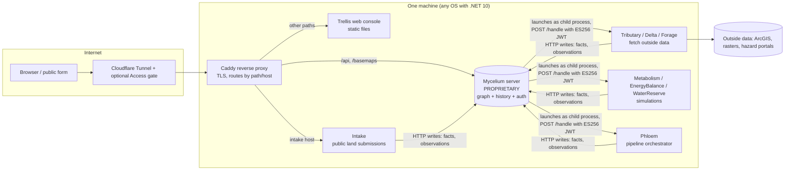
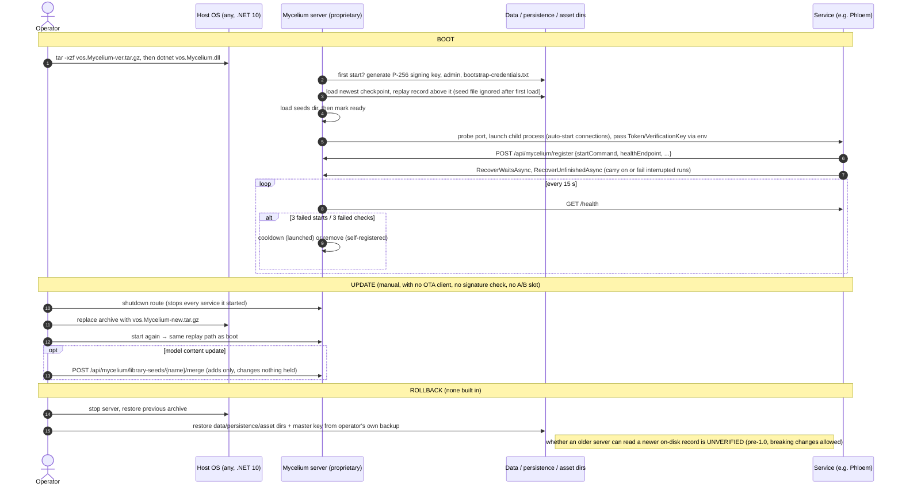

# VillageOS.ai: Tier A teardown

**Workstream:** W1 (Tier A teardown) and W8 F-13 (community-scale resilience) · **Tag:** TD-villageos · **Date:** 2026-11-10
**Builds on:** [`research/competitors/villageos.md`](../../research/competitors/villageos.md) (phase-1 desk research). This file adds the code-level teardown; it does not repeat the phase-1 team and partner checks except where they matter.
**Claims:** `evidence/claims/TD-villageos.csv` (C-TD-villageos-001 … 040) · **Sources:** `evidence/sources/TD-villageos.md`
**Requirements served:** F-13 (primary), F-3, F-4, F-5, F-6, F-7, F-8, F-9, F-11, F-14, N-1, N-6, AI-1, AI-3, AI-5, AI-7, AI-8, A-1, A-2, A-5, M-1, M-2, M-3, M-6, P-8, R-1, R-2, U-4, UX-4, RS-1, RS-2, D-001

> ### Explain it like I'm the founder
> You shared villageos.ai and said *"this is also why I'm going operating systems."* Here is what is actually behind the name.
>
> **VillageOS is not an operating system.** It does not boot a computer, it has no disk image, no update system and no hardware. It is a **server application** (a database plus a web console) that you install on an ordinary computer that already runs an OS. You give it a model of a piece of land or a village: homes, water tanks, solar arrays, farms. It keeps the full history of every value, judges each value against targets ("we need 30 days of drinking water"), and runs small simulation services (water reserve, energy balance). The company calls it "a temporal graph platform" [C-TD-villageos-007].
>
> **The "EdgeAI" part you saw on the website does not exist in public code.** The site promises neighbourhood sensors and decentralised AI that run "without centralized dependencies" [C-TD-villageos-002]. The code shows the opposite: one central server, with every service on that same machine and only reachable from it, and readings arriving over web requests [C-TD-villageos-016, -017, -023].
>
> **So VillageOS is a planning brain that has no body.** OneMind is meant to be the body: the OS on the box in the greenhouse, the pump controller, the mesh radio, the local AI. That is why the verdict below is **host and partner, do not compete on design**. OneMind should run VillageOS-style apps as Market apps and copy a few good ideas (targets, "facts vs readings", design-to-operation loop), while owning the edge layer they lack.

---

## 1. Verdict for F-13: compete, partner or host?

| Option | Verdict | Why (evidence) | Requirement IDs |
|---|---|---|---|
| **Compete** (build a land-design / feasibility / finance platform) | **No.** | VillageOS's real product is pre-construction design, simulation and investor finance [C-TD-villageos-001, -024]. None of OneMind's requirements ask for land development finance. Copying it would add scope and no moat. | M-3, M-6 |
| **Host** (run VillageOS-style planning apps on OneMind) | **Yes, as an optional Market app, after a license check.** | VillageOS's runtime is plain processes that talk HTTP on one machine [C-TD-villageos-034], which a OneMind app can wrap. But the server ("Mycelium") is proprietary [C-TD-villageos-007], so OneMind can host the AGPL client parts only, and needs ReGen's permission to redistribute the server. | A-1, A-2, F-5, D-001 |
| **Partner** (OneMind = the edge OS under their "EdgeAI" stage) | **Yes, as an opportunity, low priority.** | Their own stage 04 needs exactly what OneMind builds: sensors, local AI, offline operation [C-TD-villageos-002, -026]. Their public code has none of it [C-TD-villageos-023]. A bridge that pushes OneMind readings into their HTTP observation API is cheap [C-TD-villageos-022]. Draft any outreach in `evidence/outreach-drafts.md`; do not contact them from this run. | F-5, F-6, AI-7, N-1 |
| **Own the use case** (food, water, energy on OneMind itself) | **Yes. This is the real F-13 answer.** | Community resilience needs an edge runtime that works offline, speaks device protocols and survives power loss. VillageOS proves the demand but doesn't supply that layer. OneMind should ship a **greenhouse / homestead profile** (P-8) with open components such as Home Assistant, OpenEMS and farmOS [C-TD-villageos-037, -038, -040]. | F-13, F-11, P-8, N-6, AI-1 |

**Threat level: low today.** The overlap is in the story told to investors, not in the product. If ReGen ever ships an edge runtime, re-run this teardown (trigger listed in §12).

---

## 2. What was analysed (teardown minimum item 1)

| Item | Value |
|---|---|
| Public repo | `ReGen-Villages/VillageOS-API`, the **only** public repo in the GitHub org [C-TD-villageos-004] |
| Pinned commit | `develop` @ **`0082f5bb6763aca379cb24588b8d7153558a08d9`**, 2026-11-10 23:29:16 UTC (merge of PR #137) [C-TD-villageos-005] |
| Stable branch | `main` @ `6773b0a7`, 2026-11-07 [C-TD-villageos-005] |
| Releases / tags | **None** on GitHub. Releases of the server are tar archives built from the private repo [C-TD-villageos-004, -009] |
| Repo created | 2026-07-01, about four months of public history [C-TD-villageos-004] |
| Maturity | README: "Prerelease … Not production ready", with breaking changes allowed [C-TD-villageos-006] |
| Not public | The server **Mycelium**, its storage layer ("Rings"), its reactive engine ("Hyphae") and the seed tools live in the private `VillageOS` repo; CI actively blocks engine code from the public repo [C-TD-villageos-007, -008] |
| Website | villageos.ai, one static page, last modified 2026-02-17 [C-TD-villageos-001] |
| Short citation form used below | `R@0082f5bb:path#Lx-Ly` = `https://github.com/ReGen-Villages/VillageOS-API/blob/0082f5bb6763aca379cb24588b8d7153558a08d9/path#Lx-Ly` |

**Consequence for this teardown.** Anything about how the server stores data, supervises services or validates tokens is known from the **public docs and the client code at the pinned SHA**, not from server source. Such rows are marked *docs-only* and carry medium confidence. Study was for patterns only: the code is AGPL-3.0 and the server is proprietary, so **nothing here is recommended for copying** (rule 4).

---

## 3. W1 field-by-field

| W1 field | VillageOS (evidence) |
|---|---|
| **Architecture** | One central server (Mycelium) holds a graph of "Things", their relationships and the full history of every value. A React web console (Trellis), a CLI (Taproot) and small HTTP "services" sit around it. The server starts the services as child processes on the same machine [C-TD-villageos-007, -034]. |
| **Base OS** | None of its own. It runs on any host with the .NET 10 runtime. CI builds only on a self-hosted pool of **macOS** agents [C-TD-villageos-009, -019]. |
| **Image build** | No OS image. The only Dockerfiles build the *example* echo services, e.g. a static Go binary on `distroless/static-debian12` [C-TD-villageos-018]. |
| **Install paths** | (1) Unpack `vos.Mycelium-<version>.tar.gz` and run `dotnet vos.Mycelium.dll`; (2) clone both repos side by side and build [C-TD-villageos-009]. No installer, appliance, VM image or container image. |
| **Update / rollback** | No updater. Updating means replacing the archive and restarting. On restart the server loads its newest checkpoint and replays the log [C-TD-villageos-014]. Model content can be merged from a newer seed, but only additively [C-TD-villageos-036]. No rollback mechanism is documented. |
| **App format** | A "service" is any program that speaks the HTTP contract (`/handle`, `/health`, `/shutdown`) [C-TD-villageos-012], registers itself [C-TD-villageos-021], and, if it is a pipeline node, publishes typed ports at `GET /manifest` [C-TD-villageos-020]. The model itself declares which program each connection starts (a "prototype" Thing). |
| **Identity** | Local username/password and API keys. Services get ES256 JWTs minted by the server [C-TD-villageos-010, -011]. Roles: viewer, editor, administrator, service. Every pass names one model [C-TD-villageos-033]. Optional Cloudflare Access email gate in front [C-TD-villageos-016]. |
| **AI features** | None in public code: no model runtime, no LLM, no MCP. The website and podcast describe ML generative design and future "small language models" at the edge [C-TD-villageos-001, -026]. The repo's "simulations" are fixed formulas [C-TD-villageos-024]. |
| **Backups** | Manual. The docs list four things to copy: data dir, persistence dir, asset dir, master key [C-TD-villageos-015]. |
| **Security** | Good application hygiene: all services bind loopback, enforced by a CI test [C-TD-villageos-017]; ES256 pinned to stop algorithm-confusion attacks [C-TD-villageos-011]; secrets kept off the command line; encryption at rest via `VOS_MASTER_KEY` [C-TD-villageos-010]. Nothing at OS level (no Secure Boot, signed updates, read-only root), because there is no OS. |
| **Hardware** | None sold or specified. No ARM build target in CI [C-TD-villageos-019]. |
| **License** | Client side: AGPL-3.0 **or** a paid commercial license, with "Powered by VillageOS" attribution required "regardless of license choice" [C-TD-villageos-025]. Server: proprietary [C-TD-villageos-007]. GitHub's license detector reports NOASSERTION because the LICENSE file adds a copyright line above the AGPL text [C-TD-villageos-004]. |
| **Business model** | Dual licensing plus "blended finance" for landowners, developers, governments and institutional investors [C-TD-villageos-001, -025]. No hardware. |
| **Strengths** | Clear data model (facts vs readings, targets as "ranges", full history); a disciplined contract and test culture (contract tests against a real in-process server, red-first bug fixes); a design-to-operation loop story that appeals to investors and insurers. |
| **Weaknesses** | No edge runtime, no device protocols, single central server, proprietary core, pre-1.0, macOS-only CI, a tiny public footprint (1 star, no outside contributors visible) [C-TD-villageos-004, -006, -019, -023]. |

### Architecture as found in code

Every arrow inside the host is loopback HTTP [C-TD-villageos-016, -017, -034]. There is no arrow to a sensor, radio, PLC or second site: that is the gap.

---

## 4. Code citations at the pinned SHA (teardown minimum item 2)

The brief asks for citations covering image build, partition layout, update client, signing/keys, health check/rollback, app manifest, backup and auth. For an application with no OS, three of those categories are **absent by design**. The table cites the nearest real mechanism and states plainly where none exists.

| # | Category | Citation (`R@0082f5bb:…`) | What it shows | Claim |
|---|---|---|---|---|
| 1 | Image build | [`vos.Service.Go.Echo/Dockerfile#L1-L13`](https://github.com/ReGen-Villages/VillageOS-API/blob/0082f5bb6763aca379cb24588b8d7153558a08d9/vos.Service.Go.Echo/Dockerfile#L1-L13) | Only container build in the repo: an example service on distroless, which needs host networking because the server launches handlers as local daemons. **No OS or appliance image exists.** | 018 |
| 2 | Image build / CI | [`azure-pipelines.yml#L20-L25`](https://github.com/ReGen-Villages/VillageOS-API/blob/0082f5bb6763aca379cb24588b8d7153558a08d9/azure-pipelines.yml#L20-L25) | Builds run only on a self-hosted macOS pool; no Linux, ARM or edge target. | 019 |
| 3 | Image build / supply chain | [`ci/no_engine_in_the_public_repo.py#L23-L27`](https://github.com/ReGen-Villages/VillageOS-API/blob/0082f5bb6763aca379cb24588b8d7153558a08d9/ci/no_engine_in_the_public_repo.py#L23-L27) and [`#L95-L104`](https://github.com/ReGen-Villages/VillageOS-API/blob/0082f5bb6763aca379cb24588b8d7153558a08d9/ci/no_engine_in_the_public_repo.py#L95-L104) | CI fails if proprietary engine namespaces appear in the public repo: the open/closed split is enforced in code. | 008 |
| 4 | Partition layout | [`docs/FIELD_GUIDE.md#L2289-L2301`](https://github.com/ReGen-Villages/VillageOS-API/blob/0082f5bb6763aca379cb24588b8d7153558a08d9/docs/FIELD_GUIDE.md#L2289-L2301) | **No partitions.** The nearest thing is a directory layout: data dir (accounts, signing key), seeds dir, persistence dir (log, checkpoints, history), asset dir. | 015 |
| 5 | Update client | [`docs/FIELD_GUIDE.md#L2097-L2106`](https://github.com/ReGen-Villages/VillageOS-API/blob/0082f5bb6763aca379cb24588b8d7153558a08d9/docs/FIELD_GUIDE.md#L2097-L2106) and [`#L2191-L2194`](https://github.com/ReGen-Villages/VillageOS-API/blob/0082f5bb6763aca379cb24588b8d7153558a08d9/docs/FIELD_GUIDE.md#L2191-L2194) | **No update client.** Install and update is "untar the archive and run it"; on later starts the server replays its record and ignores the seed file. | 009, 014 |
| 6 | Signing / keys | [`vos.Auth.Shared/ServiceTokenValidator.cs#L13-L39`](https://github.com/ReGen-Villages/VillageOS-API/blob/0082f5bb6763aca379cb24588b8d7153558a08d9/vos.Auth.Shared/ServiceTokenValidator.cs#L13-L39) | Service tokens checked against the server's P-256 public key, with ES256 pinned and issuer, audience and lifetime validated. The only signing in the system is token signing; **releases are not signed** (there are no releases). | 011 |
| 7 | Signing / keys (bootstrap) | [`docs/FIELD_GUIDE.md#L2148-L2169`](https://github.com/ReGen-Villages/VillageOS-API/blob/0082f5bb6763aca379cb24588b8d7153558a08d9/docs/FIELD_GUIDE.md#L2148-L2169) | First start generates the signing key pair and admin credentials; `VOS_MASTER_KEY` encrypts them at rest. | 010 |
| 8 | Health check | [`docs/SERVICE_CONTRACT.md#L69-L75`](https://github.com/ReGen-Villages/VillageOS-API/blob/0082f5bb6763aca379cb24588b8d7153558a08d9/docs/SERVICE_CONTRACT.md#L69-L75) | `GET /health` → `200 {"status":"Healthy"}` for every service. | 012 |
| 9 | Health / supervision | [`docs/FIELD_GUIDE.md#L833-L839`](https://github.com/ReGen-Villages/VillageOS-API/blob/0082f5bb6763aca379cb24588b8d7153558a08d9/docs/FIELD_GUIDE.md#L833-L839) | Port probe before launch, 3 failed starts then cooldown, memory ceiling, health every 15 s, removal after 3 failures (docs-only, server code private). | 013 |
| 10 | Rollback / recovery | [`vos.Service.Phloem/Execution/PipelineExecutor.cs#L243-L282`](https://github.com/ReGen-Villages/VillageOS-API/blob/0082f5bb6763aca379cb24588b8d7153558a08d9/vos.Service.Phloem/Execution/PipelineExecutor.cs#L243-L282) | **No system rollback.** The closest code is restart recovery in the orchestrator: unfinished runs are carried on, or failed with a reason when re-calling a service might repeat a side effect. | 035 |
| 11 | App manifest | [`docs/SERVICES.md#L1224-L1228`](https://github.com/ReGen-Villages/VillageOS-API/blob/0082f5bb6763aca379cb24588b8d7153558a08d9/docs/SERVICES.md#L1224-L1228) | A node publishes typed ports at `GET /manifest`; a tool turns the manifest into seed declarations. | 020 |
| 12 | App manifest (registration) | [`docs/SERVICE_CONTRACT.md#L110-L116`](https://github.com/ReGen-Villages/VillageOS-API/blob/0082f5bb6763aca379cb24588b8d7153558a08d9/docs/SERVICE_CONTRACT.md#L110-L116) | Self-registration body: `handlerId, serviceName, endpointUrl, startCommand, stopEndpoint, healthEndpoint`. | 021 |
| 13 | Backup | [`docs/FIELD_GUIDE.md#L2289-L2301`](https://github.com/ReGen-Villages/VillageOS-API/blob/0082f5bb6763aca379cb24588b8d7153558a08d9/docs/FIELD_GUIDE.md#L2289-L2301) | A list of what to copy. No tool, schedule, encryption or restore drill. | 015 |
| 14 | Auth | [`docs/FIELD_GUIDE.md#L277-L292`](https://github.com/ReGen-Villages/VillageOS-API/blob/0082f5bb6763aca379cb24588b8d7153558a08d9/docs/FIELD_GUIDE.md#L277-L292) | Roles add up (viewer, editor, admin), passes are scoped to one model, every change is audited, sign-in throttling. | 033 |
| 15 | Auth / network edge | [`deploy/Caddyfile#L1-L43`](https://github.com/ReGen-Villages/VillageOS-API/blob/0082f5bb6763aca379cb24588b8d7153558a08d9/deploy/Caddyfile#L1-L43) and [`Tests/vos.ContinuousIntegration.Tests/ServicesBindLoopbackTests.cs#L9-L38`](https://github.com/ReGen-Villages/VillageOS-API/blob/0082f5bb6763aca379cb24588b8d7153558a08d9/Tests/vos.ContinuousIntegration.Tests/ServicesBindLoopbackTests.cs#L9-L38) | One proxy faces the network; a CI test proves every service binds loopback. | 016, 017 |
| 16 | Domain logic (F-13) | [`vos.Service.EnergyBalance/Services/EnergyBalanceCalculator.cs#L23-L38`](https://github.com/ReGen-Villages/VillageOS-API/blob/0082f5bb6763aca379cb24588b8d7153558a08d9/vos.Service.EnergyBalance/Services/EnergyBalanceCalculator.cs#L23-L38), [`vos.Service.WaterReserve/Services/WaterReserveCalculator.cs#L24-L36`](https://github.com/ReGen-Villages/VillageOS-API/blob/0082f5bb6763aca379cb24588b8d7153558a08d9/vos.Service.WaterReserve/Services/WaterReserveCalculator.cs#L24-L36) | The energy and water "intelligence" is fixed arithmetic for design studies, not live control. | 024 |

---

## 5. Boot → update → rollback, as the code and docs describe it (teardown minimum item 3)

Derived from the docs at the pinned SHA (server lifecycle; the server code is private) and from Phloem's start-up code (`vos.Service.Phloem/Program.cs#L68-L80` and `PipelineExecutor.cs#L243-L282` at `0082f5bb`). The dashed notes mark what **does not exist**.

**What this means for OneMind.** VillageOS leaves the whole bottom half of the stack (image, update, rollback, backup) to whoever runs the machine. That is precisely OneMind's job: signed A/B image updates with a health-gated commit, and scheduled encrypted backups (ADR-001 under test in `01-FOUNDATION-DECISION.md` and `04-…`). A community running VillageOS-style apps on OneMind would get those for free.

---

## 6. Claims vs code (teardown minimum item 4)

| # | Claim (where) | What the code / repo shows | Verdict |
|---|---|---|---|
| 1 | "An **open-source** consortium" (villageos.ai) [C-TD-villageos-001] | Server, storage and engine are proprietary; CI blocks them from the public repo. Only client tools are AGPL, with a commercial option [C-TD-villageos-007, -008, -025] | **Contradicts** (only partly open) |
| 2 | EdgeAI tunes performance "**without centralized dependencies**" (villageos.ai) [C-TD-villageos-002] | One central server; every service binds loopback on that machine; remote access via a Cloudflare tunnel [C-TD-villageos-016, -017, -034] | **Contradicts** (centralised by design today) |
| 3 | "**Low-power, decentralized** AI systems … intelligent sensing directly within neighborhoods" (villageos.ai) [C-TD-villageos-001] | No AI runtime, no ARM build, macOS-only CI, no sensor/device protocol code [C-TD-villageos-019, -023] | **Contradicts** (no evidence in code) |
| 4 | "Can grow **from one sensor to a whole village**" (Field Guide §2) | An observation write API exists (`RecordObservationAsync`, queued and batched) [C-TD-villageos-022]; PR #12 shows the queue overflowing and dropping readings before a fix [C-TD-villageos-027] | **Partly agrees** (ingest path exists; device side absent; scale unproven) |
| 5 | "**Nothing is ever silently overwritten or lost**" (Field Guide §2) | Docs describe a durable record plus checkpoints [C-TD-villageos-014]; storage code is private. PRs #12 and #28 show readings dropped and outage 404s recorded as real answers until fixed [C-TD-villageos-027, -031] | **Cannot verify** the engine; client side **contradicted then fixed** |
| 6 | "Open-source API … **not there yet**" (founder, 2026-06-11) [C-TD-villageos-026] | Repo created 2026-07-01 [C-TD-villageos-004] | **Agrees** (released after the interview) |
| 7 | Services table labels most services "**Production**" (README) | Same README: prerelease, not production ready, labels are intended scope [C-TD-villageos-006] | **Agrees** (self-disclosed) |
| 8 | "Research, design standards, and **protocols are shared globally**" (villageos.ai) | The only published protocol is the HTTP service contract; no device, mesh or inter-site protocol [C-TD-villageos-012, -023] | **Contradicts** for edge protocols; **agrees** for the service contract |

---

## 7. Real failure reports and what they teach (teardown minimum item 5)

The repo has no GitHub issues; bugs live in Azure DevOps and surface in pull request descriptions [C-TD-villageos-032]. These five are real, dated failures written up by the maintainers.

| # | Failure (source) | What happened | Lesson for OneMind | Req IDs |
|---|---|---|---|---|
| 1 | Readings dropped under load. PR #12, 2026-10-13 [C-TD-villageos-027] | When the server's readings queue was full it refused whole batches (503 + Retry-After); the fetcher logged a warning and **dropped the readings**. | Sensor data needs a buffer with backpressure **on the edge node**, not just a server queue. OneMind's NATS JetStream leaf buffering (context/01) is the right pattern: store locally, forward when the hub accepts. | F-11, N-6, AI-7 |
| 2 | Health check starved. PR #121, 2026-11-06 [C-TD-villageos-028] | A large raster read held Python's GIL; `/health` took up to 4.6 s, long enough for a supervisor to think the service was dead. | Health probes must be cheap and isolated from heavy work. For OneMind's health-gated update commit, probe readiness on a path that heavy jobs can't block, and give probes sensible timeouts. | R-1, F-14 |
| 3 | Work stuck "running" forever after restart. PR #111, 2026-11-04 [C-TD-villageos-029] | After a restart, pipeline runs caught mid-call were never revisited. The fix re-calls a service only if it is marked safe to call again (`mayBeCalledAgain`). | Power loss is normal off-grid. Every OneMind automation that touches the physical world needs an **idempotency flag** in its manifest, and restart recovery that fails safe ("do not re-open the valve twice"). | F-13, F-3, A-5 |
| 4 | A slow server took a service down. PR #140, 2026-11-09 [C-TD-villageos-030] | When the server slowed to about 6 s answers, a client timeout was mistaken for "host is stopping", ending the hourly cleanup and stopping the service. | Treat timeouts as ordinary failures and retry; never let one slow dependency crash a long-running agent. This matters on a Pi under load (F-14). | F-14, R-2 |
| 5 | Outage recorded as fact. PR #28, 2026-10-15 [C-TD-villageos-031] | An upstream hazard portal's restart 404s were stored as "no hazard here" (four outages in 273 s). | Data from outside sources must carry **provenance and freshness**; "unknown" must never be stored as "no". OneMind's AI layer should show where each value came from before an agent acts on it. | AI-1, AI-5 |

**Website signal (supporting, not a code failure).** Phase-1 found the site's contact form served by PHP 7.4.33, which is end-of-life (research/competitors/villageos.md §2). Not re-tested here.

---

## 8. Food, water and energy: what VillageOS actually does

| Domain | What exists in public code | What is missing for real operations |
|---|---|---|
| **Energy** | `EnergyBalance`: yearly solar + other generation vs consumption, net-positive verdict [C-TD-villageos-024] | Inverter/battery/meter integration (Modbus, SunSpec, MQTT), real-time dispatch, load shedding |
| **Water** | `WaterReserve`: days of drinking water from stored volume ÷ residents × per-capita use [C-TD-villageos-024] | Tank level sensors, pump control, leak alarms, offline operation |
| **Food** | Land-cover and raster analysis (`Quadrat`), site data lookups (`Forage`, `Tributary`) | Greenhouse climate control, irrigation, crop records, aquaponics sensors |
| **Cross-cutting** | Targets as "ranges" that flip a Thing's state; full value history; facts vs observations [C-TD-villageos-022] | Alerts to people, local AI, mesh/off-grid links, multi-site sync |

The good ideas are in the right-hand cross-cutting row: **ranges** (a named healthy band per value), **facts vs observations**, and **the same model for design and operation**. OneMind can build those concepts into its capability layer without any VillageOS code.

---

## 9. What competitors do (community-resilience edge stack)

| Product | What it does for food/water/energy | Runs where | License | Constraint fit for OneMind |
|---|---|---|---|---|
| **VillageOS** | Design-time studies, history graph, ranges; no device control [C-TD-villageos-024] | One .NET server; macOS CI [C-TD-villageos-019] | AGPL client + proprietary server [C-TD-villageos-025] | **Low.** No edge, no protocols, proprietary core, pre-1.0. Useful for ideas and as a possible hosted app. |
| **Home Assistant (HAOS)** | Built-in Energy dashboard: grid, solar, battery, per-device [C-TD-villageos-040]; huge device integration library | Pi, x86, its own OS | Not re-verified here; see `home-assistant-os.md` | **High** for single-home/greenhouse control. Already planned as OneMind's IoT engine (W8). |
| **OpenEMS** | Open energy management: batteries, PV, EV, controllers | Edge (Java) + backend + UI | Edge/Backend EPL-2.0, UI AGPL-3.0 [C-TD-villageos-038] | **Medium-high** for community microgrids; EPL-2.0 is weak copyleft and workable for a Market app. Check before bundling. |
| **farmOS** | Farm record keeping (plantings, harvests, inputs, logs) | Web app (Drupal) | GPL-2.0 [C-TD-villageos-037] | **Medium** as a Market app (separate process, no linking). Not an edge controller. |
| **Project N.O.M.A.D.** | Offline knowledge, maps, education for resilience | Single box, offline-first | Apache-2.0 [C-TD-villageos-039] | **High** fit for the "village knowledge" side; same license as OneMind. |
| **OneMind OS (target)** | Combines the above as Market apps on one OS, plus NATS, mesh, local AI with permissions | Pi → GPU cluster (F-14) | Apache-2.0 open core (D-001) | The only one in this table aiming to own the OS, updates, devices and agents together. |

Constraint fit asks: does it run on a Pi-class edge box, work offline, speak device protocols, and have a license OneMind can ship beside Apache-2.0?

---

## 10. Constraint-fit summary (teardown minimum item 6)

| Constraint | VillageOS | OneMind | Match? |
|---|---|---|---|
| Hardware targets | Any .NET host; none specified; no ARM CI | Pi 5, x86, Jetson, GPU clusters | No |
| Kubernetes | No (child processes under one server) | k3s on every tier (ADR-001, under test) | No |
| Robotics / physical control | Named only via consortium partners; no code | Core moat (M-7) | No |
| Offline / mesh | Needs its central server; tunnel for remote access | Native (N-6) | No |
| Team size | Small team, very active (145 numbered pull requests since the repo was created on 2026-07-01) [C-TD-villageos-004, -032]; headcount UNVERIFIED | Solo founder at the start (M-6) | Partly |
| License | AGPL client + proprietary server | Apache-2.0 open core | No (study only; host as separate app at most) |
| Domain | Land development, design, finance | Runtime OS for homes, communities, robots | Adjacent |

**Result:** VillageOS's patterns are **not defaults** for OneMind (rule 2). They are idea sources for the data model and one candidate Market app.

---

## 11. What OneMind copies, and what it does better (teardown minimum item 7)

### Copy (as patterns, written fresh, never code)

| Pattern | Where seen | How OneMind uses it | Req IDs |
|---|---|---|---|
| **Ranges / targets** on any value, flipping state when breached | Field Guide §3 | A "healthy band" field on every capability (tank level, soil moisture, battery %) that feeds the native alert center | UX-4, F-13, AI-1 |
| **Facts vs observations** kept apart | Field Guide §4 [C-TD-villageos-022] | Separate durable config/state from high-rate telemetry (NATS JetStream streams vs KV) and label provenance for AI | AI-1, F-11 |
| **Loopback-only services, proven by a CI test** | `ServicesBindLoopbackTests` [C-TD-villageos-017] | A Market linter rule plus admission policy: apps expose ports only through the OneMind gateway | U-4, A-5 |
| **Pin the JWT algorithm** | `ServiceTokenValidator` [C-TD-villageos-011] | Required in the OneMind app SDK's token checker | U-4 |
| **Typed ports at `/manifest`** | SERVICES.md §16.2 [C-TD-villageos-020] | `onemind.app.yaml` declares typed inputs/outputs so automations and agents can wire apps safely | A-5, AI-3, F-5 |
| **Idempotency flag for restart recovery** | PR #111 [C-TD-villageos-029] | A manifest field (`safe_to_retry`) required for any action that moves hardware | F-3, F-13, AI-5 |
| **Design-to-operation loop** as a story | Field Guide §7; villageos.ai | "Plan your greenhouse, then run it" profile: the same model drives the plan and the live dashboard | F-13, P-8 |
| **Contract tests against the real server in-process** | Field Guide §80 | A OneMind test harness that runs apps against a real k3s/NATS in CI | R-2, F-9 |

### Do better

| Gap in VillageOS | OneMind answer | Req IDs |
|---|---|---|
| No OS, image, update or rollback [C-TD-villageos-009] | Signed A/B image with health-gated commit and user-controlled timing | R-1, F-7 |
| Manual backups [C-TD-villageos-015] | Scheduled, encrypted backups with restore drills, on by default | R-2, M-2 |
| No device protocols [C-TD-villageos-023] | MQTT, Modbus, OPC UA, Zigbee/Matter via Home Assistant, LoRa, Meshtastic as first-class adapters | F-11, AI-7, N-1 |
| Centralised server, tunnel for reach [C-TD-villageos-016] | Every box works alone offline; sites federate over NATS leaf nodes and mesh | N-6, F-6, M-1 |
| No AI runtime [C-TD-villageos-024] | Local models with GPU detection, MCP access with human approvals | AI-1, AI-5, AI-8 |
| Proprietary core [C-TD-villageos-007] | Apache-2.0 core with verifiable, named partners | D-001, F-4 |
| macOS-only CI, no ARM [C-TD-villageos-019] | Multi-arch CI (x86_64 + arm64) from week 1 | F-8, F-14 |

---

## 12. Risks and re-check triggers

| Risk | Likelihood | Impact | Mitigation | Trigger to re-run this teardown |
|---|---|---|---|---|
| Name and story collision ("OS for resilient communities") | Medium | Low-medium | Position OneMind as the runtime that **runs** community apps, not a planner | ReGen markets VillageOS as an OS for devices |
| ReGen ships a real edge runtime | Low | Medium | Track the org's public repos | A new public repo, ARM build, or MQTT/Modbus code appears |
| AGPL/commercial terms block hosting | Medium | Low | Host as a separate app; ask ReGen for the server's redistribution terms (draft only) | Server release license published |
| Partner claims overstate reality | High (phase-1 found most unverifiable) | Low | Due diligence before any co-marketing | n/a |

Re-check by **2027-05-10** for repo state and **2027-11-10** for business and licensing (claims ledger dates).

---

## 13. UNVERIFIED (carried and new)

- Server (Mycelium) internals: storage, supervisor and auth behaviour are known from public docs only; the code is private.
- License terms of the server release archive (`vos.Mycelium-<version>.tar.gz`): not published. Whether OneMind could redistribute it is unknown.
- Whether an older server can read a newer on-disk record (rollback safety).
- Everything in phase-1's UNVERIFIED list still stands: the South Africa, Mexico and Sweden pilots; Khorium, Nurture Robotics (SAMI) and Earth Rover roles; university partners other than the founder's Stanford affiliations; the $94B figure [C-TD-villageos-003]; funding.
- Whether "low-power decentralized" edge hardware exists anywhere outside marketing.

*Not legal advice:* the AGPL and attribution analysis above is a technical reading for planning; confirm with counsel before bundling.

---

## 14. Glossary

| Term | Plain meaning |
|---|---|
| **Temporal graph** | A database that stores things and the links between them, and remembers every past value, so you can ask "what was true last spring?" |
| **Mycelium / Trellis / Taproot** | VillageOS's server / web console / command-line tool |
| **Service (VillageOS)** | A small program the server starts and calls over HTTP to do one job, such as a water simulation |
| **Fact vs Observation** | A fact is a lasting statement ("this parcel is 24 ha"); an observation is a reading at a moment ("tank held 2,412 m³ at 14:29") |
| **Range** | A healthy band or target for a value; leaving it changes the thing's state |
| **Seed** | The file a model is first loaded from |
| **JWT / ES256** | A signed token proving who a caller is; ES256 is one specific signature algorithm using the P-256 elliptic curve |
| **Loopback** | The "this machine only" network address (localhost); a service bound there can't be reached from outside |
| **AGPL-3.0** | A strong copyleft license: if you run modified code as a network service you must offer users its source |
| **Dual license** | The same code offered under a free copyleft license or a paid license without those obligations |
| **A/B update** | Two copies of the OS; you update the spare one and switch, and switch back if it fails |
| **Health-gated commit** | Only keep a new update once health checks pass; otherwise roll back automatically |
| **Idempotent** | Safe to do twice with the same result, important when a restart may repeat an action |
| **Edge** | Computers on site (in the greenhouse, on the robot), as opposed to a distant cloud server |

## 15. Sources

See `evidence/sources/TD-villageos.md` for the full list with access dates and hashes. Key primary sources: the VillageOS-API repo at `0082f5bb` (S2), GitHub metadata (S3), PRs #12, #121, #111, #140 and #28 (S4–S8), villageos.ai (S1). The founder interview (S9) is SECONDARY.
