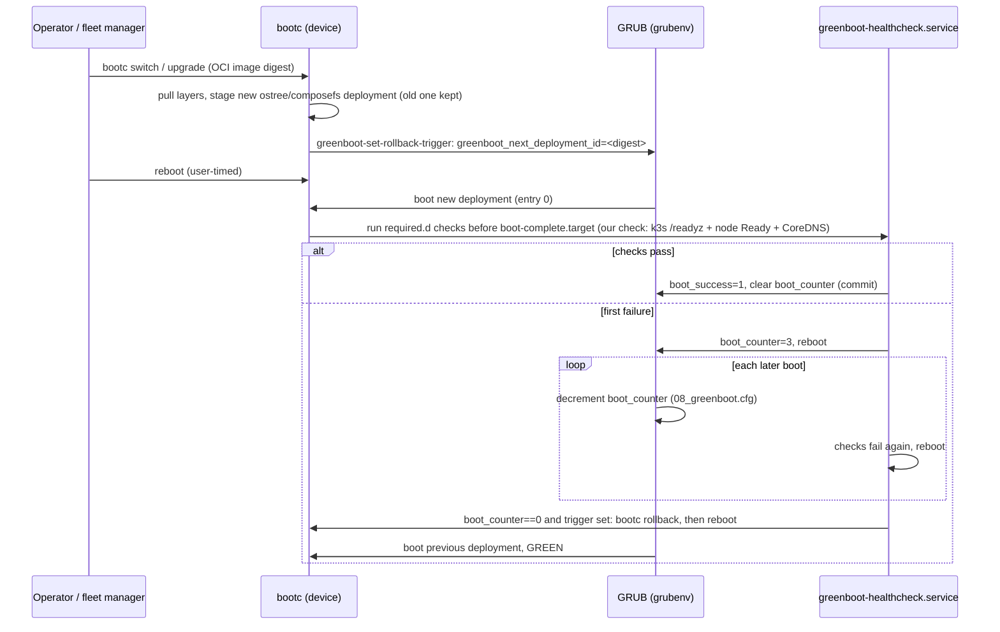

# 03 · Base OS: which Linux should OneMind OS be built on? (W2, Tier A)

**Workstream:** W2 (P0) · **Date:** 2026-11-10 · **Status:** Tier A draft, ready for refuters · **Scorecard:** frozen weights v1.0 ([`evidence/scorecard-weights.md`](evidence/scorecard-weights.md))
**Claims:** [`evidence/claims/W2.csv`](evidence/claims/W2.csv) (C-W2-001…056) · **Sources and archive:** [`evidence/sources/W2.md`](evidence/sources/W2.md), saved text plus sha256 in `evidence/sources/W2-archive/` · **Lab:** [`evidence/lab/w2-fedora-bootc-greenboot/`](evidence/lab/w2-fedora-bootc-greenboot/) · **Question statuses:** [`evidence/qbank/W2.md`](evidence/qbank/W2.md)
**Decision-critical questions answered here:** DC-01 (Fedora IoT/bootc, F-12), DC-03 (cost to 2036), DC-17 (one OS from Pi to cluster), DC-19 (Pi 5 on Debian), DC-20 (distro vs Buildroot/Yocto), DC-23 (Talos/Kairos)
**Requirements served:** RS-1, RS-2, RS-4, R-1, R-3, M-6, M-7, M-8, N-1, N-2, N-7, N-8, H-1, H-3, P-5, P-7, P-8, F-1, F-2, F-7, F-11, F-12, F-14, D-001

> ### Explain it like I'm the founder
> The base OS is the "ground floor" every OneMind box stands on: the Linux userland, the kernel, how security fixes arrive, and which chips it runs on. We put 12 candidates through the same contest (gates first, then a 0–100 score with frozen weights, one source per score).
> - **What won on evidence:** an **Ubuntu 26.04 LTS-based OneMind image** (our own read-only A/B image, not Ubuntu Core/snaps). It scored **62/100** and won in all 14 "shake the weights" runs. The reason is simple: it is the **only family that runs the same userland on a Pi 5, an x86 GPU box, a Jetson (NVIDIA's JetPack *is* Ubuntu) and a DGX**, it is **ROS 2 Tier 1**, and NVIDIA's GPU Operator officially supports it with k3s [C-W2-026, C-W2-028].
> - **ADR-001's Debian 13 + Rugix** scored **56**, tied with the **Red Hat bootc family** (CentOS Stream / AlmaLinux / RHEL image mode), also 56. Debian lost points because its free support ends in 2030, the paid extension (Freexian ELTS) is quote-only and its contract forbids passing the fixes to third parties such as your customers [C-W2-004], and NVIDIA doesn't validate Debian. (Umbrel carries its own patch just to keep the NVIDIA driver building [C-W2-045].)
> - **Your Fedora IoT question:** Fedora IoT **as the one base: no**, not today. It has a 13-month life per release with no "stay one behind" option, bootc images don't yet boot on a Raspberry Pi, and no shipping product was found (score 48). **But the Fedora → CentOS → RHEL bootc lineage is genuinely excellent** for industrial customers. In our VM lab, Fedora IoT 45 bootc + greenboot did exactly what ADR-001 wants: it only accepted the update after k3s was healthy, and rolled back a broken update on its own (see §9.4). **So: make bootc the Industrial/Enterprise profile, and keep Fedora IoT as our upstream canary.**
> - **Two conditions** sit on the Ubuntu winner, and they are yours to decide (26-OPEN-QUESTIONS): (1) Canonical's policy says a *modified* Ubuntu must be approved by Canonical, or rebuilt without their trademarks [C-W2-050]; (2) Ubuntu Pro for Devices has no public price [C-W2-006]. If Canonical says no or prices too high, Debian 13 + Rugix (ADR-001) is the fallback, and it ties with bootc.

---

## 1. The answer (P0 conclusions, each standalone)

| # | Conclusion | Evidence |
|---|---|---|
| **P0-1** | On the frozen scorecard, **Ubuntu 26.04 LTS (+Ubuntu Pro) as the base of OneMind's own A/B image, with JetPack (Ubuntu) on Jetson** ranks first (62.0). Next come RHEL-family bootc (56.0), Debian 13 + Rugix (56.0), Yocto+RAUC (51.0), Fedora IoT/bootc (48.0), Buildroot+RAUC (46.0) and Ubuntu Core (46.0). The winner is **robust**: it is the same in all 14 ±5 weight runs, and its smallest margin is 3.9. | §4, §5 · C-W2-005, 026, 028, 009 |
| **P0-2** | **Fedora IoT should not be OneMind's single base today.** Its releases live about 13 months (F45 EOL 2027-12-08), it has no hold-back tree ("We don't have the resources for that"), its bootc images don't boot on Raspberry Pi (issue #82 open, fix PR open), Raspberry Pi 5 is not in its reference platforms, and no shipping product on it was found. | C-W2-015, 016, 018, 019 |
| **P0-3** | **The Red Hat bootc lineage (Fedora → CentOS Stream 10 → AlmaLinux 10 / RHEL 10 image mode) ties ADR-001's Debian 13 + Rugix (56 vs 56)** and has the strongest IIoT evidence: IEC 62443-4-2 SL-C 2 for RHEL 9.6 and MicroShift 4.21, and Red Hat Device Edge GA on Jetson Orin. It should be OneMind's **Industrial/Enterprise profile**, with Fedora IoT bootc as the upstream canary. | C-W2-041, 042, 012, 013 |
| **P0-4** | **greenboot + bootc already implements ADR-001's "commit only when k3s is healthy" rule.** In our lab, a Fedora IoT 45 bootc image gated on k3s readiness booted GREEN. A deliberately broken update was rolled back automatically (result in §9.4). | C-W2-022, 052, 054 |
| **P0-5** | **Debian 13's 2030–2035 extension does not cover a OneMind fleet as-is.** Freexian ELTS is quote-only and rises each half-year. It covers only the customer's own package list, amd64 by default, and the kernel only as a backport, with no backports or external packages (so not the Raspberry Pi kernel). Its contract says the updates are for the client's "own use only" and may not be shared with any third party. | C-W2-002, 003, 004 |
| **P0-6** | **No candidate reaches 2036-12-31 on a single free release.** Every path needs at least one in-place major rebase or a paid extension. So the update system's ability to **rebase a fielded device without reflashing** (DC-05, W3) matters as much as the distro choice. | C-W2-001, 005, 008, 010, 013, 015 |
| **P0-7** | **Talos and Kairos fail the hardware gate.** Talos has no Jetson Orin support (overlay PR #23 unmerged). Kairos has no Raspberry Pi 5 model. | C-W2-038, 039 |
| **P0-8** | **Only one family passes "one OS from Pi to GPU cluster" (G5) without a flavor split: Ubuntu.** Debian, bootc, Buildroot and Yocto all need a separate Jetson flavor or BSP layer. The measured k3s idle footprint (about 1.1 GiB used on a 4 GiB node) leaves room on a 4–8 GB Pi 5-class node. | C-W2-053, 026, 028 |

**Effect on ADR-001 D2 (W2's view; the final call is `01-FOUNDATION-DECISION.md`):** *changed, conditionally.* The evidence favours moving the core image from Debian 13 to **Ubuntu 26.04 LTS** (one family with the Jetson flavor), **if** Canonical permits redistribution of a modified OneMind image on acceptable terms (Q-W2-1) **and** Pro for Devices pricing is bounded (Q168). If either fails, ADR-001's Debian 13 + Rugix stands, tied with RHEL-family bootc, and the tie is broken by DC-05 (rebase without reflash) and DC-07 (one update framework). **In every branch, add a bootc Industrial profile** (F-11, F-12).

---

## 2. Glossary (read once)

| Term | Meaning |
|---|---|
| **Base OS / userland** | The distro's packages (libc, systemd, tools) that OneMind's image is built from. |
| **LTS / ESM / ELTS** | Long-term support. ESM = Canonical's paid Expanded Security Maintenance (Ubuntu Pro). ELTS = Freexian's paid Extended LTS for Debian. |
| **Rebase** | Moving a running device to a new major OS release (Debian 13→14, RHEL 10→11) in place, without reflashing. |
| **A/B image** | Two OS slots. The update writes the idle slot; if the new slot fails, the device boots the old one. |
| **bootc / image mode** | The OS shipped as an OCI (Docker-style) container image and applied atomically on the device. Red Hat calls it "image mode". |
| **greenboot** | Fedora/RHEL health-check runner. If required checks fail after an update, it reboots and then rolls back automatically. |
| **composefs** | A read-only, content-verified root filesystem that bootc uses by default on Fedora 42+. |
| **BSP** | Board support package: the vendor kernel, firmware and drivers for a board (NVIDIA L4T for Jetson, Raspberry Pi's kernel). |
| **JetPack / L4T** | NVIDIA's Jetson software: Jetson Linux (L4T) is an Ubuntu-based BSP plus CUDA and friends. |
| **Flavor split** | Building separate image variants per hardware family (for example, Debian core + Ubuntu-based Jetson flavor). |
| **CIP SLTS** | Civil Infrastructure Platform's super-long-term kernels (about 10 years), for industrial devices. |
| **GPU Operator** | NVIDIA's Kubernetes operator that installs and manages GPU drivers and plugins on validated OSes. |
| **ROS 2 Tier 1** | Open Robotics builds, tests and packages ROS 2 for that OS; Tier 3 means "build it yourself". |
| **Gate / anchor** | Scorecard terms: a gate is pass/fail; an anchor is the written meaning of a 0–5 score. |

---

## 3. Gates (must-pass) for every S1 candidate

PASS / CONDITIONAL (met with a named, costed mitigation) / FAIL (not met, or not shown: an unproven gate counts as FAIL). Gate definitions: scorecard §2.

| Candidate (complete stack) | G1 License | G2 x86 + Pi 5 + Jetson Orin | G3 Support to 2036 at a stated cost | G4 IoT/IIoT, no blocker | G5 One OS Pi → cluster | Ranked? |
|---|---|---|---|---|---|---|
| **A. Debian 13 + Rugix A/B (+ L4T Ubuntu Jetson flavor)**: ADR-001 | CONDITIONAL: Rugix MIT/Apache [C-W2-048]; Jetson flavor needs the NVIDIA L4T EULA step (license-matrix owner) | CONDITIONAL: Pi 5 only through Raspberry Pi's own kernel repo, as Umbrel does [C-W2-044]; Jetson through a separate Ubuntu flavor | CONDITIONAL: LTS to 2030-06-30, ELTS to 2035-06-30 quote-only and not shareable with customers [C-W2-001, 004]; needs a rebase to Debian 14/15 by 2035 | CONDITIONAL: PREEMPT_RT packages ship in trixie [C-W2-033]; FDO and a 62443 path must be added (W8) | CONDITIONAL: large end is the same Debian; Jetson needs a different family [C-W2-028] | yes |
| **B. Fedora IoT / fedora-bootc** | PASS: bootc MIT/Apache, greenboot BSD-3 [C-W2-024, 022] | CONDITIONAL: Pi 5 not a reference platform and the Pi bootc image doesn't boot [C-W2-016, 018]; Orin listed but untested [C-W2-016] | CONDITIONAL: about 13 months per release [C-W2-015], so it stays current only by rebasing every 6–12 months; the mitigation is the same Containerfile on CentOS Stream/Alma (candidate C) | CONDITIONAL: greenboot and FDO ship in the image [C-W2-021]; no `kernel-rt` in Fedora (prior-verified, deep dive S33) | CONDITIONAL: Jetson path is community only | yes |
| **C. RHEL-family bootc: CentOS Stream 10 → AlmaLinux 10 (free) / RHEL 10 image mode (paid); Red Hat Device Edge on Jetson Orin** | CONDITIONAL: AlmaLinux free; RHEL/RHDE redistribution in sold boxes needs a Red Hat agreement (price not public) [C-W2-041] | CONDITIONAL: x86 (x86-64-v3 floor [C-W2-011]) and Orin (RHDE GA [C-W2-041]) PASS; **Pi 5 has no RHEL path**, so it needs a Fedora flavor (see B) | CONDITIONAL: AlmaLinux 10 security support to 2035-05-31 [C-W2-013]; RHEL ten years plus ELCP [C-W2-010]; rebase to 11 needed for 2036 | PASS: IEC 62443-4-2 SL-C 2 on RHEL 9.6 / MicroShift 4.21 [C-W2-042]; FDO and RT add-on (prior-verified, deep dive §5.2, §7) | CONDITIONAL: Pi end needs the Fedora flavor; large end RHEL/OpenShift | yes |
| **D. Ubuntu 26.04 LTS (+Pro) + own A/B image (Rugix/RAUC) + JetPack Ubuntu on Jetson** | CONDITIONAL: **Canonical requires approval for redistribution of modified Ubuntu, or trademark removal and recompiled binaries** [C-W2-050]; plus the Jetson EULA | PASS: x86; Pi 5 ("Yes, certified" for Ubuntu 26.04 LTS [C-W2-057]; Core 24 added it [C-W2-009]); Jetson (JetPack is Ubuntu, prior-verified context/03 §1.5) | CONDITIONAL: standard support to May 2031, Pro to May 2036, Legacy to 2041 [C-W2-005]; **Pro for Devices price unpublished** [C-W2-006] | CONDITIONAL: RT kernel via Pro (prior VUD, re-check); FDO not shipped | **PASS**: one family Pi → Jetson → x86 GPU with GPU Operator on K3s [C-W2-026] | yes |
| **E. Ubuntu Core 24/26** | PASS: snapd GPL-3.0 [C-W2-049] (GPLv3 Installation Information on locked boxes: W6) | CONDITIONAL: Pi 5 since Core 24 [C-W2-009]; Jetson support not verified | CONDITIONAL: Core 26 to May 2036, Legacy May 2041 [C-W2-008]; price unpublished [C-W2-006] | CONDITIONAL | CONDITIONAL: host services must be snaps, a second packaging format next to OneMind's k3s apps | yes |
| **F. Buildroot + RAUC (the HAOS pattern)** | PASS: RAUC LGPL-2.1 [C-W2-049] | CONDITIONAL: x86 and Pi 5 as HAOS does [C-W2-047]; no Jetson BSP in Buildroot, so a separate flavor | CONDITIONAL: Buildroot LTS 3 years (2025.02 to 2028-03) [C-W2-035]; beyond that OneMind patches everything itself | CONDITIONAL | CONDITIONAL | yes |
| **G. Yocto/OE + RAUC (meta-tegra, meta-raspberrypi)** | PASS: meta-tegra MIT, RAUC LGPL [C-W2-049] | CONDITIONAL: BSP layers exist (meta-tegra) but Pi 5 layer status not re-verified here | CONDITIONAL: Wrynose LTS to 2030-04 [C-W2-034]; then self or vendor | CONDITIONAL | CONDITIONAL | yes |
| **H. CIP Core / Debian via Isar** | PASS (Debian packages) | **FAIL (unproven)**: CIP reference-hardware list blocked by a bot wall; no Pi 5/Jetson evidence [C-W2-032] | CONDITIONAL: CIP 6.12 kernel to mid-2035 [C-W2-032] | likely strongest (W8 owns) | n/a | no; kept as the **kernel route** for industrial boards (W18) |
| **I. Talos Linux** | PASS (MPL-2.0; Omni BSL) [C-W2-049] | **FAIL**: Jetson Nano only; Orin is unmerged PR #23 [C-W2-038] | — | — | — | no |
| **J. Kairos** | PASS (Apache-2.0) [C-W2-049] | **FAIL**: no Pi 5 model [C-W2-039] | — | — | — | no |
| **K. SUSE Linux Micro 6.2** | PASS | unproven (Pi 5 not shown) | **FAIL (unproven)**: general support ends 2029-11-30 [C-W2-037]; the extension price was not shown | — | — | no |
| **L. balenaOS** | PASS (Apache-2.0, prior-verified) | **PASS**: raspberrypi5, Orin Nano/AGX, Thor, generic-amd64 device types [C-W2-040] | FAIL (unproven): no published OS support period found | — | **FAIL**: app platform is balenaEngine/compose with balenaCloud, not k3s | no; the reference for "one update system on all three boards" |
| NixOS 26.05 | PASS (MIT) | not assessed | **FAIL**: about 7 months per release [C-W2-051] | — | — | no |
| Alpine 3.24 | PASS | FAIL: no Jetson path shown | **FAIL**: main repo about 2 years (to 2028-06-01) [C-W2-036] | — | — | no |

**CONDITIONAL mitigations carried into `20-PLAN-180-DAYS.md` and `23-RISK-REGISTER.md`:**

| Candidate · gate | Mitigation | Cost / owner |
|---|---|---|
| D · G1 | Ask Canonical for written permission to redistribute the OneMind image (likely through a Pro for Devices / partner agreement), or ship the image only as "OneMind" with Ubuntu trademarks removed **and** test whether the policy's binary-recompile clause applies once package licences are taken into account. **Counsel review required.** | Founder plus counsel, before the first sale; legal fees unknown |
| D · G3 | Get a Pro for Devices quote at 1k/10k units. Bound until then: Ubuntu Pro list prices are per machine per year [C-W2-007]; 26.04 is free until May 2031. | Founder; quote |
| A · G3 | Either (a) an ELTS agreement that allows redistribution to customer devices, or (b) a rebase to Debian 14 then 15 inside the A/B system before 2030 (needs DC-05 proof). The Pi kernel must come from Raspberry Pi Ltd's own repo for the whole period. | W3 spike; founder for the ELTS quote |
| A, B, C, F, G · G2/G5 | A Jetson flavor on JetPack (Ubuntu) or RHDE, with the same k3s/app contract on top. Two userlands to patch. | Ongoing ops cost (C5) |
| B/C · G2 (Pi 5) | Wait for bootupd PR #935 and issue #82 to close, then founder-hardware test `22-…` W2-HW-3. | Founder hardware |

---

## 4. Scorecard (frozen weights; one claim per cell; format per scorecard §7)

Score = Σ(weight × score)/5. "doc-only" = documentation evidence, hardware not on hand. "pending-lab" = a lab anchor not yet met.

| Candidate | G1 | G2 | G3 | G4 | G5 | C1 Longevity (20) | C2 HW & robotics (20) | C3 Security & update (15) | C4 Proven (15) | C5 Solo ops (10) | C6 Cost & licence (10) | C7 Ecosystem (10) | **Total** | **Rank** |
|---|---|---|---|---|---|---|---|---|---|---|---|---|---|---|
| **D. Ubuntu 26.04 + own A/B + JetPack** | COND [C-W2-050] | PASS [C-W2-057] | COND [C-W2-006] | COND [C-W18-060, C-STEEL-ubu-007] | PASS [C-W2-026] | **3** free to 2031, Pro to 2036 at list-price-bounded cost [C-W2-005] | **3** x86 + Pi 5 + Jetson same family; GPU Operator on K3s; ROS Tier 1; 4 needs "one update framework on all three", unproven (DC-07) [C-W2-026, 028] | **3** atomic signed A/B with health-gated commit (Rugix supports apt systems "such as Debian or Ubuntu"; RAUC is distro-agnostic), doc-only, pending-lab (W3) [C-W2-058] | **3** Ubuntu-based shipping products: JetPack and DGX OS (prior-verified context/03 §1.5; re-open pending) [C-W2-028] | **3** one apt userland; Jetson flashing still uses NVIDIA tools [C-W2-043 pattern] | **2** Pro years 2031–36 at an unpublished per-device price [C-W2-006] | **5** default target for NVIDIA (GPU Operator K3s column) and ROS 2 Tier 1; open packaging [C-W2-026, 028] | **62.0** | **2 (tie, rev. 3)** |
| **C. RHEL-family bootc (+RHDE on Orin)** | COND [C-W2-041] | COND [C-W2-041] | COND [C-W2-013] | PASS [C-W2-042] | COND [C-SCORE-025, C-W2-041] | **3** Alma 10 to 2035 free; RHEL ten years + ELCP; RHEL price not public [C-W2-013, 010] | **3** (rev. 3; was 1) x86 and Orin official; Pi 5 has a documented path through AlmaLinux's *experimental* bootc RPi images, tested on Pi 5 (doc-only); NVIDIA CUDA `rhel10` repo and Container Toolkit `dnf` path; `kernel-rt` in AlmaLinux 10 [C-W2-041, C-SCORE-025, C-SCORE-030, C-SCORE-031, C-SCORE-029] | **3** bootc atomic + greenboot auto-rollback gated on k3s, **shown in our lab** [C-W2-052, 054] | **3** RHCOS/OpenShift and RHDE ship on the ostree/bootc lineage [C-W2-025, 041] | **4** one Containerfile toolchain, lab image built in minutes [C-W2-056] | **3** free (Alma) with paid support optional [C-W2-013] | **4** NVIDIA validates RHEL 10 (K8s/RKE2); ROS 2 Tier 2; Red Hat partner programs [C-W2-026, 028] | **64.0** (rev. 3; was 56.0) | **1 (tie, rev. 3)** |
| **A. Debian 13 + Rugix (+L4T flavor)**: ADR-001 | COND [C-W2-048] | COND [C-W2-044] | COND [C-W2-004] | COND [C-W2-033] | COND [C-W7-007] | **2** free to 2030; ELTS unbounded quote; rebase path undocumented (DC-05) [C-W2-001, 003] | **3** x86 + Pi 5 (Pi kernel) + Jetson flavor; NVIDIA not validated; ROS 2 Tier 3; RT packages [C-W2-026, 033, 044] | **3** Rugix A/B, integrator-defined commit; doc-only, pending-lab (W3) [C-W2-046] | **3** umbrelOS is a constraint-matched appliance on exactly this stack [C-W2-043] | **3** Dockerfile + Rugix Bakery is declarative, but two flavors plus a carried NVIDIA DKMS patch [C-W2-045] | **3** free to 2030; paid ELTS after [C-W2-001] | **3** large community; vendors publish containers but don't certify Debian [C-W2-026] | **56.0** | 3 |
| **G. Yocto + RAUC** | PASS [C-W2-049] | COND [C-W3-052, C-SCORE-022] | COND [C-W2-034] | COND [C-W18-005] | COND [C-W7-007] | **2** LTS to 2030-04 [C-W2-034] | **3** BSP layers for all three; RT available; one framework possible (DC-07) [C-W2-049] | **3** RAUC signed A/B (W3) [C-W2-049] | **2** balenaOS is Yocto A/B [C-W2-040] | **2** specialist knowledge (layers) [C-W18-050] | **4** free, permissive/LGPL [C-W2-049] | **2** few robotics/AI vendors target Yocto images [C-W7-007, C-W3-052] | **51.0** | 6 |
| **B. Fedora IoT / fedora-bootc** | PASS [C-W2-024] | COND [C-W2-018] | COND [C-W2-015] | COND [C-W2-021] | COND [C-W2-016] | **3** free, kept current by a documented in-place upgrade path, rebase every ≤13 months [C-W2-015, 024] | **2** (rev. 3; was 1) x86 + Pi 5B from Fedora 45 per the Fedora ARM lead (SECONDARY; no sound, no USB boot, CM5 WIP); Orin listed but untested; no GPU Operator; no `kernel-rt` in Fedora [C-SCORE-027, C-W2-016, C-W2-028] | **3** same mechanism as C, lab-shown [C-W2-052, 054] | **1** no shipping product on the Fedora IoT edition found [C-W2-019] | **4** Containerfile toolchain [C-W2-056] | **4** free [C-W2-024] | **2** big Fedora community but robotics vendors don't target it [C-W2-028] | **52.0** (rev. 3; was 48.0) | 4 (tie) |
| **F. Buildroot + RAUC (HAOS)** | PASS [C-W2-049] | COND [C-W2-047] | COND [C-W2-035] | COND [C-W18-005] | COND [C-W2-047] | **1** Buildroot LTS to 2028-03; beyond that self-maintained [C-W2-035] | **2** x86 + Pi 5; no Jetson, no NVIDIA, no ROS [C-W2-047] | **3** RAUC verity bundles, rollback (HAOS) [C-W2-047] | **3** HAOS: constraint-matched appliance [C-W2-047] | **2** forked Buildroot, per-board kernel configs [C-W2-047] | **4** free [C-W2-049] | **2** no robotics/AI package ecosystem [C-W4-044, C-W2-047] | **46.0** | 7 |
| **E. Ubuntu Core 24/26** | PASS [C-W2-049] | COND [C-W2-009] | COND [C-W2-008] | COND [C-W18-060] | COND [C-W2-006] | **3** Core 26 to 2036, Legacy 2041, single vendor [C-W2-008] | **2** x86 + Pi 5; Jetson unverified [C-W2-009] | **4** transactional snaps with rollback, FDE + Secure Boot documented [C-W2-006] | **2** (rev. 3; was 0) ctrlX OS ships on ctrlX CORE and ctrlX DRIVE; Bosch Rexroth selected Ubuntu Core for it (Canonical, 2020) and Canonical services ctrlX OS (Bosch; partial) [C-SCORE-023, C-SCORE-024] | **2** snapcraft + brand store tooling [C-W2-006] | **2** price unpublished; dedicated store from $3,000 [C-W2-006] | **3** snap ecosystem [C-SCORE-023] | **52.0** (rev. 3; was 46.0) | 4 (tie) |
| H. CIP Core / Isar | not assessed (moot: G2 FAIL) | FAIL [C-W2-032] | COND [C-W2-032] | — | — | — | — | — | — | — | — | — | not ranked | — |
| I. Talos | PASS [C-TD-talos-035] | FAIL [C-W2-038] | — | — | — | — | — | — | — | — | — | — | not ranked | — |
| J. Kairos | PASS [C-W2-049] | FAIL [C-W2-039] | — | — | — | — | — | — | — | — | — | — | not ranked | — |
| K. SUSE SL Micro | not assessed (moot: G3 FAIL) | FAIL (unproven = FAIL, weights §2) | FAIL [C-W2-037] | — | — | — | — | — | — | — | — | — | not ranked | — |
| L. balenaOS | PASS [C-TD-balenaos-003] | PASS [C-W2-040] | FAIL (unproven = FAIL) [C-TD-balenaos-040] | — | FAIL [C-TD-balenaos-031] | — | — | — | — | — | — | — | not ranked | — |

**pending-lab / doc-only cells:** A-C3 and D-C3 (Rugix/RAUC power-cut and forced rollback: W3 lab); all C2 cells (Pi 5 and Jetson are doc-only; founder hardware); C-C5 and B-C5 (rebuild time measured in a VM; the "<2 h/month" dry run is not done). D-C4 relies on prior-verified facts that must be re-opened before `01-…` cites them.

**Anchor notes a refuter should check.** (1) **Rev. 3 (2026-11-11, `evidence/scorecard-rev3.md`):** C-C2 moved 1 → 3. The AlmaLinux bootc RPi images, tested on Pi 5 [C-SCORE-025], now give Pi 5 a ledgered documented path. RHDE covers Orin [C-W2-041], NVIDIA publishes `rhel10` CUDA and `dnf` toolkit packages [C-SCORE-030, C-SCORE-031], and AlmaLinux 10 ships `kernel-rt` [C-SCORE-029]. That meets every clause of anchor 3, scored doc-only under weights §5 rule 5. The Pi 5 route is labelled *experimental* and its firmware updates are manual; if a refuter discounts it, C2 = 2 and C = 60.0. (2) D-C2 = 3, not 4, only because "one update framework across all three boards" is unproven. If W3 proves Rugix or RAUC on Jetson, D-C2 = 4 and D = 66.0. (3) Rev. 3 also moved B-C2 1 → 2 (Fedora 45 on Pi 5B, SECONDARY [C-SCORE-027]) and E-C4 0 → 2 (ctrlX OS [C-SCORE-023, C-SCORE-024]), and cited every remaining cell.

---

## 5. Sensitivity analysis (mandatory)

Each weight ±5, the others rescaled to keep 100 (scorecard §6). **Rev. 3** (2026-11-11): recomputed after the C-C2, B-C2 and E-C4 re-scores. The original W2 table (D winning 14/14) is superseded; the full history is in `evidence/scorecard-rev3.md` §3.

| Perturbation | Winner | Score | Runner-up | Margin | Third |
|---|---|---|---|---|---|
| C1 +5 | C | 63.8 | D | 1.9 | A 55.0 |
| C1 −5 | C | 64.2 | D | 2.1 | A 57.0 |
| C2 +5 | C | 63.8 | D | 1.9 | A 56.2 |
| C2 −5 | C | 64.2 | D | 2.1 | A 55.8 |
| C3 +5 | C | 63.8 | D | 1.9 | A 56.2 |
| C3 −5 | C | 64.2 | D | 2.1 | A 55.8 |
| C4 +5 | C | 63.8 | D | 1.9 | A 56.2 |
| C4 −5 | C | 64.2 | D | 2.1 | A 55.8 |
| C5 +5 | C | 64.9 | D | 3.0 | A 56.2 |
| C5 −5 | C | 63.1 | D | 1.0 | A 55.8 |
| C6 +5 | C | 63.8 | D | 3.0 | A 56.2 |
| C6 −5 | C | 64.2 | D | 1.0 | A 55.8 |
| C7 +5 | C | 64.9 | D | 0.8 | A 56.2 |
| C7 −5 | C | 63.1 | D | 3.2 | A 55.8 |

**Verdict (rev. 3): C leads on raw score in 14/14 runs, but C and D are inside the 3-point tie band in 11 of 14.** Under the frozen protocol that is a **tie between C (RHEL-family bootc) and D (Ubuntu 26.04)**, settled by decision-critical evidence, not by raw order. With 01's corrected A-C1 = 3, A scores 60.0 and sits 4.0 behind C. If C-C2 is discounted to 2, the pre-rev. 3 order returns (D 62.0, C 60.0, A 60.0). The script is in `evidence/scorecard-rev3.md` §10. The original W2 script was `evidence/lab/w2-fedora-bootc-greenboot/score.py`.

**What flips it (cell sensitivity, more informative than weight sensitivity here):** *(written for the pre-rev. 3 card. The current flip conditions are in `evidence/scorecard-rev3.md` §3.4: C-C2 is the swing cell.)*
- **D drops out entirely if G1 or G3 turns to FAIL**, meaning Canonical refuses redistribution or prices Pro for Devices beyond what H-1 margins allow. Then **A and C tie at 56.0**. Per the scorecard, a tie is settled by decision-critical evidence: DC-05 (Rugix rebase without reflash) favours whichever stack proves it; bootc rebases by design [C-W2-024].
- If W3 proves Rugix rebase (A-C1 → 3), A = 60.0, still under D but within 3 points: a tie, decided by Q-W2-1.
- If D-C6 falls to 1 (Pro for Devices over $50/device/year), D = 60.0: a tie with A at 60 only if A-C1 also rises.
- **Gates relaxed:** Talos (G2 relaxed) and Kairos (G2 relaxed) would still need Pi 5 and Orin evidence to score C2 ≥ 2. Not computed further; both fail on the founder's core boards.

---

## 6. Lifecycle to 2036 and the cost model (DC-03, Q1, Q168, Q213)

### 6.1 Published support ends (primary sources, accessed 2026-11-10)

| Base | Free support ends | Paid extension ends | Reaches 2036-12-31 on one release? | Claim |
|---|---|---|---|---|
| Debian 13 | 2028-08-09 (security team); 2030-06-30 (LTS) | 2035-06-30 (Freexian ELTS, quote-only) | No: rebase to 14 needed | C-W2-001, 003 |
| Ubuntu 24.04 LTS | 2029 standard (prior-verified) | May 2034 (Pro); May 2039 (Legacy) | No (Legacy covers it, at a price) | C-W2-005 |
| **Ubuntu 26.04 LTS** | May 2031 | **May 2036 (Pro); May 2041 (Legacy)** | Only with Legacy | C-W2-005 |
| Ubuntu Core 24 / 26 | n/a (Core security maintenance is the product) | Jun 2034 / **May 2036**; Legacy Jun 2039 / May 2041 | Core 26 + Legacy | C-W2-008 |
| RHEL 10 | (subscription) | ten years (about 2035) + ELCP / Long-Life | No (Long-Life add-on) | C-W2-010 |
| AlmaLinux 10 | 2035-05-31 (security) | none (community) | No: rebase to 11 | C-W2-013 |
| CentOS Stream 10 | 2030-05-31 | none | No | C-W2-014 |
| Fedora 45 | 2027-12-08 | none | No: rebase every 6–12 months | C-W2-015 |
| SUSE Linux Micro 6.2 | (subscription) 2029-11-30 | not shown | No | C-W2-037 |
| Yocto Wrynose | 2030-04 | commercial vendors (not verified) | No | C-W2-034 |
| Buildroot 2025.02 | 2028-03 | none | No | C-W2-035 |
| Alpine 3.24 | 2028-06-01 | none | No | C-W2-036 |
| NixOS 26.05 | 2026-12-31 (SECONDARY) | none | No | C-W2-051 |
| **Kernel:** kernel.org 6.12 / CIP 6.12-cip | Dec 2028 (projected) / mid-2035 | — | — | C-W2-031, 032 |
| **Hardware:** Pi 5 production / Jetson Orin modules | Pi 5 to at least Jan 2036 / Orin to Jan 2032; T5000 to Aug 2035 | — | — | C-W2-029, 030 |

**Read-across (P0-6):** a box sold in late 2027 with a 7–10 year support promise lives to about 2035–2037. **Every** base needs either one rebase (Debian 13→14/15, Alma 10→11, Ubuntu 26.04→28.04) or a paid tail (Ubuntu Pro/Legacy, RHEL ELCP). The Jetson Orin module itself ends in January 2032 [C-W2-030], so Robotics-tier boxes face a hardware end before any OS end.

### 6.2 Cost per device per year (bounded, not quoted)

| Stack | 2027–2031 | 2031–2036 | What is known | What blocks a number |
|---|---|---|---|---|
| A. Debian 13 → 14/15 + Rugix | $0 | $0 if rebased to Debian 14/15 in the field; otherwise ELTS (fleet quote, rises each half-year, needs a redistribution agreement) | ELTS is priced per package list, not per device [C-W2-003] | ELTS quote; legal terms [C-W2-004] |
| D. Ubuntu 26.04 + Pro | $0 (standard to May 2031) | Pro for Devices (one-time or annual) | Pro is one-time or annual for up to 10 years; IoT services listed at $3k–$25k+ [C-W2-006] | Pro for Devices price (Q168) |
| C. AlmaLinux 10 bootc | $0 | $0 to 2035-05-31, then rebase | community, no SLA [C-W2-013] | — |
| C'. RHEL 10 / RHDE | subscription | subscription + ELCP | not public; "contact your Red Hat representative" [C-W2-041] | Red Hat quote |
| E. Ubuntu Core 26 | as D | as D | as D | as D |

At **1k and 10k units**, the honest answer is that three of the four leading paths depend on a vendor quote that isn't public (Freexian, Canonical, Red Hat). The **free** paths to 2036 are: (i) Debian rebases, and (ii) AlmaLinux 10 → 11 via `bootc switch`. Both rest on rebase-in-place working (DC-05). Outreach drafts for the three quotes belong in `evidence/outreach-drafts.md` (W16).

---

## 7. Debian 13 + Rugix (ADR-001) stress-tested

**What holds up:**
- **Umbrel proves the stack in a shipping consumer appliance.** It defines the OS rootfs in a Dockerfile `FROM debian:trixie-<snapshot>`, with base image and apt pinned to snapshot dates [C-W2-043], and turns it into A/B images with Rugix Bakery: `generic-grub-efi` on amd64/arm64, `rpi-tryboot` on Pi 4/5 [C-W2-046]. This is a strong, constraint-matched precedent (C4 = 3).
- **Licence fit is the cleanest** (no vendor policy on modified redistribution; Rugix MIT/Apache [C-W2-048]). PREEMPT_RT kernels ship in trixie for amd64 and arm64 [C-W2-033].

**What breaks or weakens:**
1. **The paid tail is not usable by a hardware vendor as-is.** Freexian's service order says ELTS packages and data are for the client's "own use only" and must not be shared with "any third-party organization or individual". It also excludes backports and external packages [C-W2-004]. A OneMind fleet ships updates to customers' devices, so ELTS needs a bespoke agreement. Even then, it would not cover the Raspberry Pi kernel (from Raspberry Pi's repo [C-W2-044]) or a trixie-backports kernel.
2. **The kernel line ends early upstream.** Debian 13 ships 6.12. kernel.org's 6.12 LTS is projected to end in December 2028 [C-W2-031], so Debian LTS (to 2030) and ELTS (to 2035) carry it themselves, and ELTS "supports the Linux kernel only with a backport of a newer kernel version" [C-W2-002]. CIP's 6.12-cip to mid-2035 [C-W2-032] is the industrial alternative (W18).
3. **NVIDIA friction is real, from code.** At umbrel@a72dac2, umbrelOS builds Debian's own `nvidia-open` 550.163.01 via DKMS **plus a carried patch**, because that driver "doesn't build against trixie kernels from 6.12.100" [C-W2-045]. This **corrects context/03 §1.3**, which says Umbrel pins NVIDIA's 595.91.07 from the debian13 repo; the current code does not. The GPU Operator lists no Debian [C-W2-026].
4. **Two userlands.** The Jetson flavor is Ubuntu-based anyway (JetPack), so OneMind patches Debian and Ubuntu (C5 = 3, G5 CONDITIONAL).
5. **Rebase without reflash is unproven** for Rugix (W3's DC-05). Until it is, C1 stays at 2.

---

## 8. Ubuntu 26.04 LTS: why it scores highest, and the catch

**Why it wins on evidence:**
- **One family across the whole hardware line.** x86, Pi 5 (Ubuntu 26.04 LTS "certified" on Pi 5 [C-W2-057]; Core 24 added Pi 5 [C-W2-009]), Jetson (JetPack 7 = Ubuntu 24.04, prior-verified) and DGX (DGX OS is Ubuntu, prior-verified). That is G5 PASS and directly serves F-14 and N-2.
- **NVIDIA validates it with k3s.** The GPU Operator's K3s column lists only Ubuntu 22.04/24.04/26.04 [C-W2-026]. Debian and Fedora are absent. RHEL is listed for upstream Kubernetes and RKE2 only.
- **ROS 2 Lyrical is Tier 1 on Ubuntu 26.04** (amd64 and arm64) to 2031. RHEL 10 is Tier 2 amd64-only, and Debian Trixie is Tier 3 [C-W2-028]. That serves M-7, N-7 and F-2.
- **Support reaches May 2036 on one release** with Pro, and 2041 with Legacy [C-W2-005].

**The catch (why D2 changes only conditionally):**
1. **Canonical's IPRights Policy** (15 July 2015, s.3): modified Ubuntu may be redistributed only if "approved, certified or provided by Canonical", otherwise "you must remove and replace the Trademarks and will need to recompile the source code to create your own binaries" [C-W2-050]. A OneMind image *is* modified Ubuntu. Before relying on D, get counsel's reading and/or a Canonical agreement. This is new open question **Q-W2-1** (blocked: founder-decision).
2. **Pro for Devices has no public price** [C-W2-006]. That is what C6 = 2 reflects.
3. **Not Ubuntu Core.** OneMind's app platform is k3s + Helm. Ubuntu Core would add snaps as a second packaging system (candidate E scores 46). The recommendation is classic Ubuntu packages in OneMind's own A/B image, the way Umbrel does it with Debian. (Snap dependency details in classic Ubuntu minimal images are prior-verified in context/03 §1.1; the image recipe must exclude snapd.)

---

## 9. Fedora IoT and the Red Hat edge lineage at full Tier A depth (F-12, DC-01, Q288)

### 9.1 Facts checked today (all primary)

| Topic | Finding | Claim |
|---|---|---|
| Release life | Fedora 45 EOL **2027-12-08**; F44 EOL 2027-06-02 (Bodhi). Settles the two-week conflict in the deep dive. | C-W2-015 |
| Hold-back tree | Issue #123: "We don't have the resources for that" (Fedora IoT lead, 2025-10-15); the requester's example was the NVIDIA driver lag. | C-W2-019 |
| Hardware | Docs: aarch64 + x86_64, "only actively support UEFI", tested with 1 GB RAM; reference list has Pi 4 and Jetson Orin, **not Pi 5**. | C-W2-016 |
| Pi + bootc | "Using bootc with Fedora IoT currently requires that you have already provisioned a device with Fedora IoT". Issue #82 "Bootc image does not boot on rpi" **open**; bootupd PR #935 **open**; per-device ARM image spike #141 open. | C-W2-017, 018, 020 |
| bootc base image | `quay.io/fedora/fedora-iot:45` exists (version 45.20261110.0, built the day of this research); package set includes greenboot and greenboot-default-health-checks. | C-W2-021 |
| greenboot (code) | Required checks run before `boot-complete.target`. On failure, the **first** failure sets `boot_counter = GREENBOOT_MAX_BOOT_ATTEMPTS` (default 3) and reboots. Each failed boot decrements the counter (GRUB script). At 0, with the `greenboot_next_deployment_id` trigger set, it runs `bootc rollback` and reboots. **Rollback depends on GRUB** (grubenv). | C-W2-022, 023 |
| bootc stability | "The CLI and API are considered stable. We will ensure that every existing system can be upgraded in place seamlessly across any future changes." MIT/Apache-2.0. | C-W2-024 |
| Lineage lifecycle | CentOS Stream 10 ends 2030-05-31; AlmaLinux 10 to 2035-05-31; RHEL ten years + ELCP; image mode GA 2025-05-20 for RHEL 9.6/10, in all subscriptions. | C-W2-014, 013, 010, 012 |
| Hardware floor | RHEL 10 needs x86-64-v3 (AVX2-class). | C-W2-011 |
| Jetson | Red Hat Device Edge available on Orin Nano/NX/AGX, aligned with RHEL 9.8, as a pre-built bootable container with MicroShift and Edge Manager. | C-W2-041 |
| IIoT | IEC 62443-4-2 SL-C 2 (TÜV Rheinland) for RHEL 9.6, OpenShift 4.20, MicroShift 4.21. | C-W2-042 |
| NVIDIA (x86) | GPU Operator lists RHEL 10.0–10.2 for Kubernetes and RKE2, **not** for K3s; Fedora not listed. | C-W2-026 |
| ROS 2 | RHEL 10 Tier 2 amd64 only; Fedora not in the table. | C-W2-028 |

Prior-verified from `research/platform/fedora-iot-and-redhat-edge-deep-dive.md` and **not re-opened by W2** (re-check before quoting): the RHEL 10.2 Go FDO implementation, Fedora having no `kernel-rt`, the RHEL image-mode third-party kmod chapter, the Fedora `fedora-bootc-nvidia` PoC with "no plans" to continue, and the 2025 edition-status proposal (withdrawn).

### 9.2 The code path (boot → update → health gate → rollback), derived from greenboot-rs@6efc3c1 and our lab

Code anchors: `src/main.rs` health_check (failure branch sets the counter, then rolls back); `src/lib/handler.rs#L151-L186` (calls `bootc rollback` or `rpm-ostree rollback`); `grub2/08_greenboot.cfg#L1-L22` (counter decrement and `default=1` fallback); `usr/lib/systemd/system/greenboot-healthcheck.service` (`Before=boot-complete.target`) [C-W2-022, 023].

### 9.3 Claims vs code

| Claim (docs, ADR or prior research) | What the code or lab shows | Verdict |
|---|---|---|
| ADR-001: "commit the slot only after k3s and core pods are healthy" is OneMind's own improvement (Q288) | greenboot already does it. A `required.d` script is the gate (our 25-line k3s check); commit = `boot_success=1` [C-W2-022, 052] | **Contradicts** the "we must build it" framing |
| greenboot README: "reboots... rollback to previous deployment if rebooting hasn't solved the problem" | Failure branch: set counter → reboot ×N → `bootc rollback` [C-W2-022] | **Agrees** (lab: §9.4) |
| Prior deep dive: "greenboot is not part of bootc; automated health rollback is greenboot" | Rollback is greenboot calling bootc; it needs GRUB variables [C-W2-023] | **Agrees, with a limit:** Pi or U-Boot setups without GRUB don't get it |
| Fedora IoT docs: "rolling releases" with "monthly snapshots" | Per-release trees with about 13-month life; no oldstable [C-W2-015, 019] | **Contradicts** the rolling-release wording |
| Fedora IoT reference platforms include Jetson Orin | Open issue #118 says the list overstates testing (prior-verified); not re-checked | Weakened |
| bootc README: in-place upgrades guaranteed | Lab: `bootc switch` between images worked; a cross-major rebase (F45 → CentOS Stream 10) was **not** tested | Agrees (scope limited) |

### 9.4 VM lab result (pre-registered: `evidence/lab/w2-fedora-bootc-greenboot/README.md`)

**Set-up:** disposable Lima VM (Fedora 45 aarch64, no host mounts). Nested QEMU/KVM device booted from a `bootc-image-builder` qcow2. Image `FROM quay.io/fedora/fedora-iot:45` + k3s v1.37.2+k3s1 (sha256-verified) + k3s-selinux + a greenboot `required.d` k3s readiness check. The "bad" image is the same with k3s's ExecStart replaced by `/usr/bin/false`. Versions and digests: `versions.txt`.

| Hypothesis | Result | Claim |
|---|---|---|
| H1: image boots GREEN, k3s Ready | **PASS.** Fedora Linux 45 (IoT Edition), kernel 7.3.3, **composefs read-only root, SELinux Enforcing**, k3s `--selinux` Ready; greenboot check passed after 25 s; `boot_success=1` | C-W2-052 |
| H2: forced bad update rolls back with zero manual commands | **Automation PASS; time target FAIL.** After `bootc switch` to the broken image and one manual reboot, greenboot failed the k3s check and set `boot_counter=3`. GRUB counted 2 → 1 → 0 over the next boots. On the fourth failed boot greenboot logged "Rollback successful" (`bootc rollback`), and the next boot logged "FALLBACK BOOT DETECTED… rolled back" and passed GREEN on the good digest. **0 manual commands after the first reboot.** Total **1,926 s (~32 min)**: 4 failed boots × ~7 min, dominated by our own 300 s check timeout and the default `GREENBOOT_MAX_BOOT_ATTEMPTS=3`. That fails the pre-registered 15-minute target. A shorter timeout or `MAX_BOOT_ATTEMPTS=1` should cut it (INFERRED, not tested). | C-W2-054 |
| H3: power cut during staging leaves the old deployment | **PASS (1 trial each).** (a) kill -9 of QEMU while pulling a 729 MB update: booted the good image, nothing staged, GREEN. (b) kill 2 s into the shutdown after `ostree-finalize-staged` started: booted the good image, staged update discarded, GREEN | C-W2-055 |
| Not tested | **Rollback across a k3s minor version** (DC-12): both images had the same k3s. This remains the main open risk for any "k3s inside the OS image" design (W3/W4) | — |
| H4: k3s idle footprint | **Recorded:** on a 4 GiB aarch64 node after 5 min idle (k3s with default pods: CoreDNS, local-path, metrics-server, Traefik), `free` used = **1,097 MiB**, k3s-server RSS 674 MiB, containerd 176 MiB, k3s cgroup 1.69 GiB including page cache | C-W2-053 |
| Build effort | Containerfile build + `bootc-image-builder` qcow2: about 1–2 minutes each in the lab VM on Apple Silicon (aarch64 native); 1.2 GB qcow2 | C-W2-056 |

What it does **not** show: Raspberry Pi 5 or Jetson behaviour (bug #82 is a firmware/partition-layout problem that QEMU can't reproduce), eMMC/SD wear, or real-time latency. Founder-hardware tests W2-HW-1…4 are in §13.

### 9.5 Steelman: "Fedora IoT / bootc should be OneMind's base" (written to argue *for* it)

1. **It is the only lineage where ADR-001's hardest promise is already shipped code.** The health-gated commit, automatic rollback, a read-only verified root (composefs) and SELinux enforcing with k3s all worked in our lab on the first build [C-W2-052]. Debian + Rugix needs OneMind to write and maintain that integration; Rugix "does not mark boots good or bad by itself" (prior-verified context/03 §1.2).
2. **The OS becomes an OCI image.** The same registry, digests, signing (cosign/sigstore), SBOM attestations and GitOps that OneMind already runs for apps (context/01: Argo CD, GHCR) then cover the OS too. Umbrel already defines its OS in a Dockerfile [C-W2-043]; bootc removes the step that converts it into block images.
3. **A real ten-year path with two exits.** The same Containerfile retargets from `fedora-iot` to CentOS Stream 10, AlmaLinux 10 (free, to 2035) or RHEL 10 image mode (paid, certified) [C-W2-013, 012]. bootc's maintainers commit to in-place upgrades across future changes [C-W2-024]. No other candidate offers a free *and* a vendor-backed long tail on one artifact format.
4. **Industrial credibility that matters for F-11:** IEC 62443-4-2 SL-C 2 on RHEL 9.6 and MicroShift 4.21 [C-W2-042], FDO zero-touch onboarding in the image, TPM/clevis/IMA/usbguard (prior-verified deep dive §3.1), and an RT kernel add-on.
5. **Vendor-backed Jetson.** Red Hat Device Edge on Orin is GA [C-W2-041], which Debian cannot match.
6. **NVIDIA validates RHEL**, which Debian lacks [C-W2-026].
7. **The weaknesses are fixable and time-boxed.** Pi bootc boot is one open bootupd PR (#935) away [C-W2-018], and the Fedora IoT working group already opened per-device ARM images (#141) [C-W2-020].

**Response (why it is not the single base today):** points 1–6 are true, and they are why C ties A at 56. They don't overcome three evidence gaps for a consumer and robotics line. (a) **Pi 5**, the entry tier (N-2, F-14), has no supported Fedora IoT or bootc path today [C-W2-016, 018]. (b) **ROS 2 and NVIDIA-with-k3s** are not first-class on the lineage [C-W2-026, 028]. (c) **The free long-life member (CentOS Stream) ends in 2030**, and AlmaLinux is a community rebuild without an SLA [C-W2-014, 013]. The steelman wins the Industrial profile outright.

### 9.6 Verdict on the founder's question (DC-01 flip condition)

The DC-01 flip condition ("bootc/Fedora IoT passes G2 and G3 and outscores Debian + Rugix by ≥3 points robustly") is **not met**: C ties A, and B scores below A. Per DC-01, "a weaker result adds it as a supported profile or track". **Recommendation W2-R3/W2-R4 below.** What would make bootc **the** base, all by about Fedora 46 (April–May 2027): issue #82 closed and a clean Pi 5 bootc image passing W2-HW-3; NVIDIA GPU Operator listing RHEL with K3s, or OneMind standardising on RKE2 for GPU nodes; a ROS 2 arm64 binary path (or ROS fully containerized, as planned); and a written AlmaLinux/RHEL long-tail cost.

---

## 10. One base or two? (DC-17, Q334, G5)

- **Measured small end:** k3s idle ≈ 1.1 GiB used on a 4 GiB node [C-W2-053]. That leaves about 2.7 GiB on 4 GB and about 6.7 GiB on 8 GB for OneMind's platform and apps. The full-stack budget (gateway, IdP, NATS, a small model) is W4/W9's to measure (Q98).
- **Large end:** GPU Operator + k3s is validated only on Ubuntu [C-W2-026], and the GPU Operator does not support Jetson at all [C-W2-027], and Isaac Sim hosts are Ubuntu x86 (prior-verified context/03 §1.5).
- **Therefore:** with Ubuntu as the core, Edge (Pi 5) → Lite → Pro (RTX) → Robotics (Jetson/JetPack) → Omni/Cluster (DGX/RTX) is **one userland family, one app platform and one update system** (if DC-07 holds). With Debian or bootc as the core, the Jetson tier is a second family (still the same k3s apps and management plane, so G5 is CONDITIONAL, not FAIL).
- **Competitors at "same product at every scale":** balena does it with one Yocto-based OS and one update system across Pi 5, Orin, Thor and amd64 [C-W2-040], but with its own container engine, not Kubernetes. Red Hat does it with RHDE (MicroShift) → OpenShift [C-W2-041], but without Pi 5. Olares does it with k3s on a host distro, without an OS image (prior-verified context/03 §1.3).

---

## 11. Distro base vs build-from-source appliance (DC-20, Q3, Q15)

| Aspect | Distro image (Ubuntu/Debian/bootc) | Buildroot (HAOS) | Yocto (balena, most embedded) |
|---|---|---|---|
| Who patches CVEs | the distro (free until EOL) | OneMind, after each 3-year LTS [C-W2-035] | OneMind or a vendor, after each 4-year LTS [C-W2-034] |
| Board reach | Pi 5 via the vendor kernel; Jetson via JetPack | x86 + Pi (HAOS has 14 board defconfigs) [C-W2-047] | widest (meta-tegra, meta-raspberrypi) [C-W2-049] |
| What HAOS shows | — | forks Buildroot (2024.02.x-haos), keeps its own kernel config fragments per kernel series, pins a Raspberry Pi kernel commit [C-W2-047] | — |
| NVIDIA / ROS | vendor-supported (Ubuntu) | none | NVIDIA's Yocto support via meta-tegra (prior-verified: JetPack 7.2 adds Yocto) |
| Solo-developer fit (C5) | 3–4 | 2 | 2 |

**Answer:** for a sole developer (M-6) who needs NVIDIA and ROS (M-7), a distro base beats Buildroot and Yocto now (scores 56–62 vs 46–51). Keep **Yocto + meta-tegra** as the documented fallback if JetPack's Ubuntu userland ever fails G1 for the Jetson flavor (DC-09, W7).

---

## 12. What competitors do (constraint-fit column required)

| Product | Base / image / update (from code) | Team | Kubernetes? | Robotics? | Constraint fit with OneMind | Lesson for the base |
|---|---|---|---|---|---|---|
| **umbrelOS 2.0.1** | Debian trixie in a Dockerfile, snapshot-pinned; Rugix Bakery A/B; Pi via Raspberry Pi's kernel repo; Debian NVIDIA 550 DKMS + patch [C-W2-043, 044, 045, 046] | small company | No (Compose) | No | **High** for Lite/Edge appliance and Pi 5; **low** for NVIDIA/robotics | Copy the *pattern* (OS defined as a container build, snapshot pinning). Note the NVIDIA patch cost. PolyForm-NC: never copy code. |
| **Home Assistant OS** | Buildroot fork + RAUC; own kernel configs; pinned Pi kernel commit [C-W2-047] | funded team | No | No | **Medium**: appliance UX matches; the from-source cost needs a team | A from-source OS is maintainable only with dedicated people (C5 = 2). |
| **Olares** | installer on Ubuntu/Debian; k3s; no OS A/B (prior-verified context/03 §1.3) | funded team | Yes (k3s) | No | **Medium**: k3s matches; no image or rollback | Supports Ubuntu *and* Debian hosts, a hint that apps-on-k3s neutralise the base. |
| **Red Hat Device Edge** | RHEL 9.8 bootc image + MicroShift + Edge Manager on Orin [C-W2-041]; 62443-4-2 [C-W2-042] | vendor | Yes (MicroShift) | Yes (named use cases) | **High** for Industrial; **none** for Pi 5 / consumer | Basis of the Industrial profile. |
| **balenaOS** | Yocto A/B; one OS across Pi 5, Orin, Thor, amd64 [C-W2-040] | vendor | No (balenaEngine) | Some | **Medium**: board coverage is the benchmark; app platform differs | Proof that one update system across Pi 5 and Jetson is feasible (DC-07). |
| **Talos** | API-only immutable OS + k8s; Pi 5 overlay; Jetson Nano only [C-W2-038] | vendor | Yes | No | **Low** (no Orin; host-level radios and CAN awkward) | Its "one signed artifact" idea is matched by bootc + greenboot. |
| **Kairos** | any distro → immutable; Orin/Thor/DGX Spark models; no Pi 5 [C-W2-039] | vendor (CNCF Sandbox) | Yes | Some | **Low** for Pi 5 | Reference for Jetson images and Trusted Boot (W3, W6). |
| **NVIDIA JetPack / DGX OS** | Ubuntu-based (prior-verified) | vendor | via GPU Operator | Yes | **High** for Robotics/Omni | The reason Ubuntu passes G5. |

---

## 13. Recommendations (with requirement IDs) and founder-runnable tests

| ID | Recommendation | Serves |
|---|---|---|
| **W2-R1** | **Core image family = Ubuntu 26.04 LTS, built as OneMind's own read-only A/B image (classic packages, no snaps), with the Jetson flavor on JetPack's Ubuntu.** Conditional on Q-W2-1 (Canonical redistribution) and Q168 (Pro for Devices price) being resolved acceptably before the first box sale. | F-14, N-2, M-7, N-7, N-8, F-2, H-3, P-5, R-3, RS-4 |
| **W2-R2** | **Fallback, if W2-R1's conditions fail:** keep ADR-001's Debian 13 + Rugix. Settle its tie with RHEL-family bootc on DC-05 (rebase without reflash) and DC-07 (one update framework). Do not plan on Freexian ELTS unless a redistribution-permitting agreement is signed [C-W2-004]. | R-3, H-1, D-001, M-6 |
| **W2-R3** | **Add a bootc Industrial/Enterprise profile**: one Containerfile that builds on CentOS Stream 10 / AlmaLinux 10 (free) and RHEL 10 image mode (paid, 62443 path), with greenboot gating on k3s; Red Hat Device Edge for enterprise Jetson Orin buyers. Same OneMind app contract (k3s, `onemind.app.yaml`, NATS leaf). | F-11, F-12, P-8, M-4, AI-7, R-1 |
| **W2-R4** | **Fedora IoT bootc = upstream canary and community edition**, built in CI from the same Containerfile; no 10-year promise. Revisit "bootc as THE base" after Fedora 46 against §9.6's conditions. | F-12, F-1 |
| **W2-R5** | **Copy greenboot's model into whatever update stack wins:** required/wanted check folders, a bounded retry counter, a rollback trigger tied to the staged image digest, and a k3s readiness check, all as code in the image. | R-1, AI-4 |
| **W2-R6** | **Plan for one in-place major rebase per device lifetime** (and test it in CI from day one). No base reaches 2036 on one release. | R-3, M-8, F-1 |
| **W2-R7** | Reject Talos, Kairos, SL Micro, NixOS and Alpine as the base. Keep CIP 6.12-cip as the kernel option for industrial boards (W18). | RS-4, F-7 |

**Founder-runnable tests (to `22-HARDWARE-LAB-TEST-PLAN.md`):**

| ID | Test | Pass / fail |
|---|---|---|
| W2-HW-1 | Pi 5 (8/16 GB): Ubuntu 26.04 server image + k3s; measure `free -m` after 5 min idle; reboot ×20; power-cut ×10 | pass: k3s Ready after every boot; used RAM < 1.5 GiB |
| W2-HW-2 | Pi 5: Debian trixie + Raspberry Pi kernel (Umbrel recipe) + k3s; same measurements | same |
| W2-HW-3 | Pi 5: Fedora IoT 45 raw image, then `bootc switch` to the lab Containerfile rebuilt for aarch64; repeat the lab H2 on hardware | pass: auto rollback without console |
| W2-HW-4 | Jetson Orin Nano: JetPack (Ubuntu) + k3s + device plugin, CUDA sample in a pod; note L4T release | pass: GPU pod runs; L4T version recorded |
| W2-HW-5 | Dell 5540 / Beelink U55: `ld.so --help` shows "x86-64-v3 (supported)" (RHEL 10 floor [C-W2-011]) | pass: v3 supported, else exclude from the RHEL profile |

---

## 14. Risks and flip conditions (to `23-RISK-REGISTER.md`)

| Risk | Likelihood | Impact | Trigger to watch | Mitigation |
|---|---|---|---|---|
| Canonical won't approve modified-image redistribution on acceptable terms | medium | high (W2-R1 falls) | Canonical reply / counsel opinion | W2-R2 fallback (Debian), already engineered in parallel |
| Pro for Devices price makes Robotics/Omni margins fail | medium | medium | quote | Stay on free Ubuntu to 2031, decide later; or Debian/Alma |
| Rebase in place fails on the chosen A/B tool | medium | high | W3 DC-05 spike | bootc (rebase by design) for long-lived classes |
| Jetson Orin module EOL Jan 2032 strands Robotics SKUs | high (certain date) | medium | NVIDIA lifecycle page [C-W2-030] | Plan Thor/T5000 successors; promise support periods per SKU |
| Fedora IoT edition shrinks or is demoted | medium | low (canary only) | Fedora IoT WG decisions, #141 | Industrial profile uses CentOS/Alma/RHEL, not Fedora |
| NVIDIA driver breaks on the chosen base | medium on Debian/Fedora, low on Ubuntu/RHEL | high | Debian bug #1143204-class events [C-W2-045] | Prefer NVIDIA-validated bases for GPU tiers |

---

## 15. What W2 could not do (honest gaps)

- **No vendor quotes** (Freexian, Canonical, Red Hat): rule 5 forbids contact. Q168 is blocked: paywalled. Outreach drafts are W16's.
- **CIP wiki** is behind a Cloudflare challenge; not bypassed (rule 5). Its reference-hardware list is UNVERIFIED.
- **No Pi 5 or Jetson hardware:** all C2 cells are doc-only.
- **The license matrix** (G1 rows with SPDX from pinned LICENSE files, NVIDIA EULAs) is another workstream's file. C-W2-049 is GitHub API metadata only.
- Prior-verified facts from `context/03` and the Fedora deep dive used in D-C4, §9.1 (last paragraph) and §10 must be re-opened before `01-…` cites them.

Sources: [`evidence/sources/W2.md`](evidence/sources/W2.md). Claims: [`evidence/claims/W2.csv`](evidence/claims/W2.csv).
