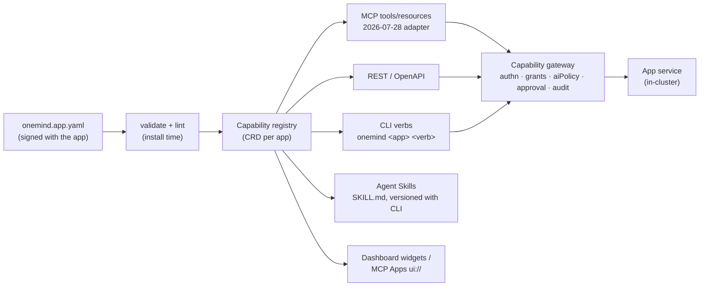

# 10 · AI capability layer (W9)

**Date:** 2026-11-11 · **Tier:** B (at least one primary source per claim) · **Status:** draft complete; no refuters run (Tier B does not require them) · **Claims:** `evidence/claims/W9.csv` (C-W9-001…046) plus reused rows from W4, W6, W7 and the teardowns · **Sources:** `evidence/sources/W9.md`, saved copies and hashes in `evidence/sources/W9/` · **Question statuses:** `evidence/qbank/W9.md`
**Serves requirements:** AI-1, AI-2, AI-3, AI-4, AI-5, AI-6, AI-7, AI-8, AI-9, UX-3, U-1, U-2, U-3, U-4, N-8, N-10, F-3, F-6, M-5, D-005, D-006.
**Builds on:** `research/platform/ai-native-protocols-and-ux.md` (phase-1 survey, re-verified here), `07-security-compliance.md` §7 (threat model, SEC-12, SEC-14), `05-kubernetes-cluster-conversion-nvidia.md` §7, §8 and §11 (NVIDIA, accelerator capability mapping, Hermes), and the umbrelOS and Olares teardowns.

> ### Explain it like I'm the founder
> Your vision says "everything installed becomes readable and actionable by AI". This file designs the part of the OS that makes that safe.
>
> **The short version.** Every app ships one small manifest (`onemind.app.yaml`). It lists what the app can *do* and *show*: "search the media library", "restart", "delete an item". The OS reads that list once and publishes it four ways: as **MCP** tools (for Claude, ChatGPT, Hermes), as a **REST API**, as **CLI commands**, and as **Agent Skills** (short how-to files that agents read). All four go through one **capability gateway**, the only place that decides "may this agent do this, for this person, right now?" and writes it down in an audit log.
>
> **Three things the evidence changed.**
> 1. **MCP rewrote itself in July 2026** (version 2026-07-28: no sessions, no handshake) [C-W9-001, C-W9-002]. Build on the new version. Keep apps away from protocol details, because it will change again.
> 2. **Authentik, your current login system, can't yet be the "front door" for MCP agents.** MCP requires a feature (RFC 8707 resource indicators) that Authentik's own code says it does not implement [C-W9-004, C-W9-014]. The gateway therefore plays that role and still uses Authentik (or Kanidm) to log people in.
> 3. **Strava says no to AI.** Its API Policy, in force since 1 June 2026, forbids putting Strava data "into a context window", even with the user's consent. It also forbids running any MCP server that exposes it [C-W9-030, C-W9-032]. So Strava becomes the textbook "show it on the dashboard, never give it to AI" integration. Every integration gets a "may this data go to AI?" flag that the gateway enforces.
>
> **Biometrics (face and voice ID):** start with **passkeys** in year 1. The fingerprint or face check happens on the phone, and the box never sees it [C-W9-043]. On-box face or voice recognition waits until year 2 or later, is opt-in, and is never on by default for children. Illinois lets each person sue for $1,000–$5,000 [C-W9-035], and the GDPR's household exemption does not cover the company that supplies the software [C-W9-037].

---

## Contents

0. The answer in twelve lines
1. Glossary
2. The protocols in November 2026
3. What competitors do (constraint fit)
4. The capability layer: one manifest, four projections
5. Identity, permissions, approvals and audit
6. Agent sandboxing
7. Local inference, model routing and GPU sharing
8. Cloud apps and the "may this data go to AI" flag (UX-3, Strava)
9. Biometrics (AI-6)
10. AI-9: Hermes and the NATS contracts
11. The agent's self-management envelope (AI-4)
12. Consistency with the Tier A foundation (flags)
13. Founder-runnable tests (for `22-…`)
14. Risks (for `23-…`)
15. Open items and limits
16. Recommendations → requirement IDs

---

## 0. The answer in twelve lines

| # | Recommendation | Evidence |
|---|---|---|
| REC-W9-01 | **MCP is the one external agent protocol in v1.** Target MCP **2026-07-28** (stateless, `server/discover`, MRTR). Keep a compatibility path for 2025-11-25 clients, because SDKs adopt revisions on their own schedules. | C-W9-001, -002, -010, -011, -012 |
| REC-W9-02 | **One internal capability schema with protocol adapters.** `onemind.app.yaml` declares capabilities once. Controllers project them into MCP tools and resources, REST/OpenAPI, CLI verbs and Agent Skills. Apps never speak MCP directly, so protocol churn changes adapters, not apps. | C-W9-002, -017, -019, -023 |
| REC-W9-03 | **One capability gateway is the only enforcement point.** Tool filters and "read-only" switches are hints, not security. Kubernetes RBAC on per-agent identities sits underneath as the second layer. | C-W9-017, -018; C-W6-069 |
| REC-W9-04 | **Agents are their own principals** and act as *a named user intersected with a grant*, never as the owner (Umbrel's model). Tokens are per agent, with per-agent scopes, and revocable. | C-TD-umbrelos-037, -039; C-W9-021 |
| REC-W9-05 | **The gateway is the MCP authorization server façade** (RFC 9728 metadata, RFC 8707 audience binding, CIMD). Authentik or Kanidm stays the identity provider behind it. Authentik cannot do RFC 8707 today. | C-W9-004, -014, -015, -016 |
| REC-W9-06 | **Approvals:** risky calls return MCP `input_required` or run as an MCP Task, and approval happens out of band on the phone (D-005) or dashboard, ideally signed with a **passkey**. Secrets and third-party OAuth only via **URL-mode elicitation**. | C-W9-005, -007, -045, -043; SEC-12 |
| REC-W9-07 | **Audit:** every gateway decision goes to an append-only, hash-chained JetStream stream with the MCP `_meta` trace context. Umbrel keeps only in-memory "last request" data. | C-W9-003, -022 |
| REC-W9-08 | **Sandbox agent-run code** with kubernetes-sigs **agent-sandbox + gVisor (systrap)** by default, which needs no KVM and runs on arm64. Use Kata where KVM exists. Never use privileged Docker-in-Docker (Olares Lares's default). | C-W9-025, -026; C-TD-olares-030 |
| REC-W9-09 | **Local inference per tier:** llama.cpp/Ollama (MIT) on Lite/Edge/Pro; vLLM (Apache-2.0) on GPU-server tiers; one OpenAI-compatible **model router** with data-class rules ("health and family data never leave the box"). GPU sharing follows 05 §7–§8. | C-W9-027, -028; C-W4-029, -036 |
| REC-W9-10 | **Every integration declares `aiPolicy`** (`allowed`, `consent-required`, `official-mcp-only`, `display-only`, `prohibited`). Strava = `official-mcp-only` for AI and display-only on the dashboard, with a 7-day cache and no mixing with other data. | C-W9-029…033 |
| REC-W9-11 | **Biometrics are phased:** year 1 passkeys/WebAuthn only; year 2+ opt-in on-box face/voice ID behind a per-person consent record, retention timer and region gate; never emotion recognition or biometric categorisation. | C-W9-034…043 |
| REC-W9-12 | **AI-9:** Hermes becomes an agent principal of the gateway. `onemind-mcp` becomes the first projection. NATS `svc.*` stays the internal agent bus. A2A only as an adapter when an outside agent must call a OneMind agent. | 05 §11; C-W9-024; C-W4-058 |

**MHS (N-10, D-006):** design the device registry so that an MHS driver is just another capability provider behind the gateway. Do not build on MHS until its specification and licence are public [C-W7-047].

---

## 1. Glossary

| Term | Plain meaning |
|---|---|
| **MCP** (Model Context Protocol) | The standard way an AI agent calls tools and reads data. Now governed by the Linux Foundation's Agentic AI Foundation [C-W9-009]. |
| **MCP server / client** | The server offers tools (the OneMind gateway); the client is the agent's app (Claude Desktop, Claude Code, Hermes). |
| **Tool / resource** | A tool is an action ("restart app"); a resource is readable data ("alerts://active"). |
| **MRTR** | Multi Round-Trip Request: the server answers "I need more input" and the client retries with it. This replaced server-initiated prompts in 2026-07-28 [C-W9-002]. |
| **MCP Tasks** | An extension for long-running jobs: the agent gets a ticket and polls it, and the job can pause for input [C-W9-045]. |
| **Elicitation (URL mode)** | The server sends the *human* to a web page (e.g. a login), so passwords never pass through the AI [C-W9-005]. |
| **MCP Apps** | An extension that lets a tool return a small sandboxed web UI, shown inside the chat [C-W9-007]. |
| **Agent Skills / SKILL.md** | A folder with a how-to file an agent loads when a task matches its description [C-W9-023]. |
| **A2A** | Agent-to-agent protocol, "not a replacement for MCP" [C-W9-024]. |
| **MHS** | Anthropic's Model Hardware Standard for agents operating physical devices; research preview, not open yet [C-W7-047]. |
| **Capability** | One thing an app can do or show, with its input/output schema, its effect (read, write, destructive) and its scope. |
| **Capability gateway** | The single OneMind service that checks every agent call against identity, grants and policy, then logs it. |
| **Principal** | Anyone who can act: a person, or an agent. |
| **RFC 9728 / RFC 8707 / CIMD** | Standards MCP uses: servers publish who issues their tokens (9728); tokens are bound to one server (8707); a client proves its identity with a URL-hosted document instead of registering first (CIMD) [C-W9-004]. |
| **Audience binding** | A token says which server it is for, so a stolen token can't be replayed elsewhere. |
| **Token passthrough** | Forwarding a user's token to another service, which MCP forbids [C-W6-069]. |
| **Prompt injection** | Hidden instructions in content the AI reads (an email, a web page) that make it misbehave [C-W6-068]. |
| **gVisor / Kata** | Sandboxes: gVisor intercepts system calls in user space; Kata runs each container in a small VM. |
| **Passkey / WebAuthn** | Passwordless login. The face or fingerprint check stays on the user's device [C-W9-043]. |
| **Biometric identifier** | A face template, voiceprint, fingerprint and similar. Heavily regulated [C-W9-034, -036, -038]. |
| **aiPolicy** | OneMind's per-integration flag saying whether that data may reach an AI. |

---

## 2. The protocols in November 2026

### 2.1 MCP: what changed and what it means for an OS

| Fact | Consequence for OneMind | Claim |
|---|---|---|
| Current version **2026-07-28**; earlier ones (2025-11-25 and before) use a handshake | Build the gateway on 2026-07-28; accept 2025-11-25 clients through the SDK's compatibility path | C-W9-001 |
| No sessions, no `initialize`; `server/discover` is mandatory; MRTR replaces server-initiated requests; tasks moved to an extension | A stateless gateway fits Kubernetes well: any replica can answer any call. State lives in server-minted handles (e.g. a task ID). | C-W9-002, -045 |
| Roots, Sampling and Logging deprecated; Dynamic Client Registration deprecated; OpenTelemetry trace context in `_meta` | Don't design on sampling (the server asking the client's model). Use `_meta` trace keys for the audit trail. | C-W9-003 |
| Servers MUST publish RFC 9728 metadata, clients MUST send RFC 8707 `resource`, servers MUST check audience; CIMD SHOULD | The gateway needs an authorization server that binds tokens to the gateway's URI (§5.2) | C-W9-004 |
| Form-mode elicitation MUST NOT ask for secrets; use URL mode | Third-party OAuth (Google, Garmin) and API keys are entered on a OneMind web page, never in chat | C-W9-005 |
| Registry in **preview**, no private servers, not self-hostable | OneMind runs its **own** registry from manifests; it may expose the registry API so MCP hosts can browse it | C-W9-006 |
| MCP Apps **Stable**; Tasks Beta → core; Skills over MCP and Server Cards Beta | Use Apps for dashboard widgets inside chat; Tasks for installs and backups; publish Skills as files now, and over MCP once it is stable | C-W9-007 |
| Apache-2.0, BDFL leads, individual (not company) seats; under the AAIF since 2025-12-09 | Licence-compatible with D-001; vendor-neutral enough to bet a decade on, but a BDFL can still break things | C-W9-008, -009 |
| Six Tier 1 SDKs; "SDKs adopt new protocol revisions on their own schedules"; Python, TypeScript and Go **main** branches already carry 2026-07-28 code and conformance runs | Write the gateway in Go or Python. Re-check that the **released** version passes 2026-07-28 conformance before pinning (not verified here). | C-W9-010…013 |
| Roadmap: DPoP, agent identity and delegation (workload identity federation, ID-JAG, RFC 8693), progressive tool discovery | Agent-on-behalf-of-user is coming as standard. Model agents as principals now (§5.1). A box with 50 apps needs progressive discovery. | C-W9-046 |

**Churn (Q123).** In 18 months MCP changed its transport (HTTP+SSE deprecated), its auth registration (DCR deprecated), its session model (removed) and its server-to-client requests (replaced by MRTR) [C-W9-002, -003]. A 10-year OS cannot let apps speak MCP directly. **REC-W9-02** isolates that churn in one adapter layer that OneMind owns.

### 2.2 Other protocols

| Protocol | Status (verified) | OneMind use |
|---|---|---|
| **A2A** | Apache-2.0, LF project with a multi-vendor TSC, v1.0.1 (2026-05-28), announces joining the AAIF; "not a replacement for MCP" [C-W9-024] | Optional adapter in year 2 so an outside agent can delegate a task to a OneMind agent. Not needed for v1. |
| **Agent Skills** | Open spec: `SKILL.md` with `name` + `description`, optional `license`, `compatibility`, experimental `allowed-tools` [C-W9-023] | Generate one skill per app and one for OS operations from the same manifest, versioned with the CLI (the Olares lesson, §3) |
| **MHS** | Research preview since 2026-08-27; MCP, CLI or code access; open source planned with no date; Hugging Face (LeRobot) and Raspberry Pi named as early adopters [C-W7-047] | Keep the device registry MHS-shaped (read/write primitives, a device reference file with safety limits). D-006 already says to apply to the preview. |
| **AGENTS.md** | AAIF founding project [C-W9-009] | Ship one in the OneMind SDK repo for coding agents; no runtime role |

---

## 3. What competitors do (constraint fit)

| Product | Agent surface | Auth / identity | Permission model | Audit | Constraints | Constraint fit with OneMind |
|---|---|---|---|---|---|---|
| **umbrelOS 2.0 / 2.1-beta** | Built-in MCP server; 38 tool registrations in 5 groups; system tools only with `manageSystem` [C-W9-021] | Per-agent bearer tokens (hashed, ≤ 20), owner-only setup, plain HTTP on the LAN [C-TD-umbrelos-036, -039] | **One shared grant set for all tokens**; agents act as the owner [C-TD-umbrelos-037, -039]; `install_os_update` reboots with only a client hint [C-W6-052] | In-memory "last request" and agent name only [C-W9-022] | Single box, Docker Compose, small team, no robotics | **High for UX** (grant-gated tool registration, Trash-only deletes); **low for security**: copy the UX, not the model |
| **Olares** | No OS MCP server [C-W9-020]; `olares-cli` + **12 Agent Skills compiled into the binary** [C-W9-019]; Lares agent with privileged root DinD [C-TD-olares-030]; Router AI gateway [C-TD-olares-032] | Olares ID; Lares logs into the CLI [C-TD-olares-031] | App manifest permissions; Router keys and quotas (source not public [C-TD-olares-033]) | Router claims audit (UNVERIFIED) | k3s, multi-node, GPU (HAMi), AGPL-3.0 | **High for structure** (one AI gateway, skills versioned with the CLI); **reject** privileged DinD; study only (AGPL) |
| **Home Assistant** | Built-in MCP server; tool sets ("LLM APIs") [C-W9-016] | **OAuth 2.0 + PKCE + CIMD**; admin-only by default [C-W9-016] | Exposure list (entities exposed to voice) reused as the permission primitive; read-only switch [C-W9-016] | Not documented on the page | Single box, Supervisor, huge integration base, no k8s | **High for auth**: proof that a home box can be its own CIMD-capable authorization server |
| **Backstage MCP Actions** | Actions Registry projected into MCP [C-W9-017] | Static tokens or OAuth with CIMD (phase-1 survey) | Conservative hints (destructive unless read-only), namespaced tools, include/exclude filters, but the default server exposes everything [C-W9-017] | Tracing of calls (phase-1 survey) | Developer portal, ~6 GB RAM (05 §10) | **High for the registry pattern** (declare once, project to MCP); the filters are not security |
| **kubernetes-mcp-server** | Toolsets over the Kubernetes API | OIDC in HTTP mode | `read_only` and `denied_resources` are "best-effort guardrails"; RBAC is the real control [C-W9-018] | Kubernetes audit log | Cluster operators | **High**: confirms the layered design (gateway + RBAC) |
| **Founder's cluster** (context/01 §4.2, §6) | `onemind-mcp` (4 read tools + 1 resource, authenticated), read-only Kubernetes and Backstage MCPs, Hermes on NATS | Authentik; bearer credentials in onemind-core | Layered trust model: foundation "see only", apps "see and act" | Not described | DOKS, 250 pods, one operator | **Exact on intent** (layered trust, read-only by default); needs the gateway and per-agent grants to scale to households |

**What OneMind copies:** Umbrel's grant-gated tool registration and Trash-only deletes; HA's CIMD-capable built-in authorization; Backstage's "declare actions once, project them"; Olares's skills shipped inside the CLI binary; the founder's layered trust model.
**What OneMind does better:** per-agent scopes intersected with a named user; gateway-enforced approvals for risky calls (SEC-12); persistent tamper-evident audit; TLS on the MCP endpoint; sandboxed agent code instead of privileged DinD.

---

## 4. The capability layer: one manifest, four projections (AI-1, AI-2, AI-3, Q86, Q112, Q118, Q148)

### 4.1 The manifest block

The plugin manifest as a whole (signing, versioning, plugin types) belongs to W19/`29-…` (DC-16). W9 fixes only the **AI block** that every app manifest carries. It reuses the accelerator `capability` idea from 05 §8.

```yaml
# onemind.app.yaml (AI-relevant fields only; schemaVersion 1)
capabilities:
  - id: media.search                       # stable ID; tool name becomes jellyfin.media.search
    schema: { in: schemas/search.in.json, out: schemas/search.out.json }   # JSON Schema 2020-12
    effect: read                           # read | write | destructive
    idempotent: true
    scope: app:jellyfin:library.read
    audience: [human, agent]
    dataClass: personal                    # public | personal | sensitive | health | child | secret
    exposure: { mcp: tool, rest: "GET /v1/search", cli: "onemind jellyfin search", skill: true }
  - id: library.delete_item
    effect: destructive
    scope: app:jellyfin:library.write
    approval: required                     # none | required | two-person
    safetyClass: 0                         # >0 only for physical actuation (SEC-12, W7)
integrations:
  - { provider: strava, auth: oauth, aiPolicy: official-mcp-only, display: owner-only, cacheMaxAge: 7d }
```

**Defaults copy Backstage's conservatism** [C-W9-017]. A capability with no `effect` counts as destructive and non-idempotent. A capability with no `dataClass` counts as `sensitive`.

### 4.2 The pipeline



- **Generated, then curated.** OpenAPI import can draft capabilities, but a maintainer names and describes them. The phase-1 survey found that FastMCP's documentation says hand-curated servers do "significantly better" than auto-converted ones (SECONDARY to this file; see `research/platform/ai-native-protocols-and-ux.md` §1.8).
- **Skills ship with the CLI binary,** as Olares does with `go:embed` [C-W9-019], so the docs an agent reads always match the commands that exist.
- **Deterministic tool order** and `ttlMs` caching come from the 2026-07-28 spec [C-W9-003]. Progressive discovery comes later [C-W9-046].
- **UI = API = tool (Q118).** Dashboard buttons call the same registry entries the gateway exposes, so every UI action can also be an agent action under the same rules.

---

## 5. Identity, permissions, approvals and audit (AI-4, AI-5, U-1, U-3, U-4; Q85, Q88, Q99, Q106, Q107)

### 5.1 Principals and grants (Q99)

- **People:** owner, adult, teen, child, guest (household roles; U-1, U-3).
- **Agents:** each agent (Hermes, a kid's tutor agent, Claude Desktop on a laptop) is its **own principal**, with a client identity (CIMD URL or a pre-registered ID), a token, an owning person and a grant.
- **Effective permission = (owning person's rights) ∩ (agent grant) ∩ (aiPolicy of the data) ∩ (approval state).** A child's agent can never exceed the child. This intersection model is OneMind's design choice. Umbrel's documented model is "agents act as the owner" with one shared grant set [C-TD-umbrelos-037, -039].
- **Kubernetes layer:** every agent principal maps to a ServiceAccount with least RBAC, because RBAC, not tool filters, is the control that holds when the gateway is bypassed [C-W9-018].

### 5.2 Authorization for MCP clients (Q85)

**Finding.** MCP clients MUST send an RFC 8707 `resource` parameter, and servers MUST reject tokens not minted for them [C-W9-004]. Authentik's current code says "RFC 8707 resource indicators are not implemented" and rejects the parameter in token exchange [C-W9-014]. Its discovery offers PKCE S256, DPoP and DCR, but no CIMD support was found [C-W9-015]. HA shows that a home box can be its own CIMD-capable authorization server [C-W9-016].

**Decision (REC-W9-05).** The capability gateway includes a small **OAuth 2.1 authorization server façade** for MCP:
1. It publishes RFC 9728 metadata and RFC 8414 discovery, accepts CIMD clients and pre-registered clients, and mints tokens whose audience is the gateway's canonical URI.
2. It authenticates the *person* by OIDC against Authentik (the cloud/enterprise tier, already deployed) or Kanidm (candidate for single boxes; phase-1 survey). The passkey is checked there.
3. It never passes tokens through to apps [C-W6-069]; it calls apps with its own workload identity.
4. Re-check Authentik each release. If it adds RFC 8707 and CIMD, the façade can shrink to a resource server.

### 5.3 Approvals (AI-5, Q106)

| Step | Mechanism | Claim |
|---|---|---|
| Agent calls a capability with `approval: required`, `safetyClass > 0`, or a tainted argument (W6 §7) | Gateway answers `input_required` (MRTR) or starts an MCP **Task** in `input_required` | C-W9-002, -045 |
| Human is asked | Phone push carrying an opaque ID only (D-005), dashboard banner, or ATAK alert for the TAK profile | D-005; SEC-12 |
| Human approves | Approve screen on the box's web UI, **signed with a WebAuthn assertion** (passkey). The biometric stays on the phone. | C-W9-043 |
| Secrets or third-party login needed | **URL-mode elicitation** only | C-W9-005 |
| Agent resumes | `tasks/update` or a retried request with the approval handle | C-W9-045 |

**Never auto-approvable:** physical actuation above safety class 0, OS updates and rollbacks, app install or removal, user and permission changes, data export to an external model, and deleting data. This is the SEC-12 list in `07-…` §7.

### 5.4 Audit (Q107)

- Every gateway decision (allow, deny, needs-approval, approved by whom) is written to a **JetStream stream** with `prev_hash` chaining and the MCP `_meta` trace context [C-W9-003]. The stream is replicated to the backup set (W5).
- **Why:** Umbrel's MCP module keeps only in-memory "last request" data [C-W9-022], so an owner cannot reconstruct what an agent did after a restart.
- **Cost on a Pi 5:** not measured. Test T-W9-04 in §13 measures it. Treat the "one year fits in < 1 GiB" target as UNVERIFIED.

---

## 6. Agent sandboxing (Q90, Q160 input)

| Option | Isolation | arm64 / Pi 5 | Needs KVM? | Status | Claim |
|---|---|---|---|---|---|
| **agent-sandbox** (SIG Apps) | None by itself; orchestrates Sandbox/Claim/WarmPool and delegates to a RuntimeClass | Generic Kubernetes | n/a | v1.0.10 (2026-11-06), API `v1beta1`, k8s ≥ 1.29 recommended | C-W9-025 |
| **gVisor** (`runsc`) | User-space kernel | **Yes** (x86_64 and ARM64, Linux ≥ 5.6) | **No** with the systrap platform | Apache-2.0, release-20261102.0 | C-W9-026, -027 |
| **Kata Containers** | Lightweight VM per pod | Not verified here | Yes (phase-1 survey) | Apache-2.0, 4.3.1 | C-W9-027 |
| **Privileged DinD** (Olares Lares default) | None; root on the node | n/a | No | **Rejected** | C-TD-olares-030 |

**Decision (REC-W9-08).** Default to agent-sandbox + gVisor systrap for agent-written code, browser automation and untrusted plugin tools on every tier, with egress through the gateway's proxy. Use Kata on x86 boxes with KVM for heavier isolation. Two things are **UNVERIFIED** and need the founder test T-W9-02: gVisor on the Raspberry Pi kernel, and gVisor on the L4T (Jetson) kernel with GPU access. The CUDA path under gVisor needs its own test.

---

## 7. Local inference, model routing and GPU sharing (AI-8, N-8; Q91, Q92, Q98, Q103, Q104)

| Tier (01) | Default runtime | Why | Claims |
|---|---|---|---|
| Lite (Pi 5, ≥ 4 GB + SSD) | **llama.cpp** server (MIT), small quantised models; or **offload** to a Pro box or an external API | k3s alone adds ~0.9 GiB idle on a 4 GiB arm64 VM [C-LAB-k3s-footprint-restore-007]; with a small app 2.5 GiB remains [C-W4-078], so only a 1–3B model fits next to the platform | C-W9-027 |
| Edge / Pro (x86, iGPU or one RTX) | **Ollama** (MIT) for the one-click experience; llama.cpp underneath | Simple model management; GPU via the device plugin and k3s `nvidia` RuntimeClass, time-slicing [C-W4-020, -029] | C-W9-027 |
| Omni / GPU server | **vLLM** (Apache-2.0); Dynamo and the NVIDIA stack per 05 §7 | Throughput, batching, multi-GPU | C-W9-027 |
| Jetson | JetPack containers (llama.cpp/TensorRT-LLM); time-slicing only (HAMi does not list Jetson) | GPU Operator unsupported on Jetson [C-W4-023, -036] | — |

**Model router (Q104).** One OpenAI-compatible endpoint per box. It routes by **data class** (`health`, `child`, `secret` never leave the box), per-person budget and availability, and writes to the same audit stream. LiteLLM's core is MIT, but its `enterprise/` folder has a separate licence [C-W9-028]. Use only the MIT part, or write a thin router. Olares's Router is the pattern reference, but its source is not public [C-TD-olares-033].

**GPU sharing (Q103)** follows 05 §8. Apps request an `accelerator` capability, never `nvidia.com/gpu` directly. HAMi applies on non-Jetson GPUs [C-W4-036].

**Benchmarks (Q91, Q98)** need the founder's hardware: test T-W9-03.

---

## 8. Cloud apps and the "may this data go to AI" flag (UX-3; Q108)

### 8.1 What Strava's terms actually say (primary text, effective 1 June 2026)

The **Strava API Agreement (2026)** carries "Effective Date: June 1, 2026". It states that the **Strava API Policy** "is incorporated by reference into, and forms part of, this Agreement" [C-W9-029]. The AI clause is in the Policy, also effective 1 June 2026:

> **5.3 No AI/ML Training, Fine-Tuning, Grounding, Evaluation, Embedding, or Retrieval-Augmented Generation.** "You may not use the Strava API Materials or Strava Data, directly or indirectly, in connection with the development, training, evaluation, or operation of any AI Application. This prohibition extends to: Any data derived from, aggregated from, anonymized from, or generated using Strava Data … and Any of the following activities with respect to an AI Application: … grounding, … embedding generation, retrieval-augmented generation, **ingestion into a context window or working memory** … This prohibition does not extend to use of the Strava MCP, as discussed above in Section 3.5." [C-W9-030]

The Policy also says:
- **§3.5:** the Strava MCP is "the sole authorized first-party agent-mediated interface". Subscribers may "bring their own AI Application to interact with their own data through the Strava MCP" for personal use [C-W9-031].
- **§5.16:** developers may not operate "any MCP Server, agent-mediated interface, or analogous mechanism that exposes … Strava Data". This covers "any successor or analogous protocol" [C-W9-032].
- **§2.3/§6.1:** display only to the user the data belongs to. **§5.4:** no combining Strava Data with other customer data. **§5.10:** no transfer to AI Application providers "even if a user … consents". **§6.2:** no cache older than 7 days. **§6.3:** deletions within 48 hours. **§6.6:** users keep their Bulk Data Export right [C-W9-033].
- Saved copies with hashes are in `evidence/sources/W9/`. Existing Wayback captures date from 2026-11-07 (see `sources/W9.md`).

**Correction to the phase-1 survey:** it attributed the "§5.3" numbering to a secondary blog. The section number appears in Strava's own text [C-W9-030].

### 8.2 What this means for OneMind (not legal advice; counsel review needed)

1. **UX-3 as written ("the data is available to AI as context via MCP") cannot be met for Strava** through a OneMind integration. This is a requirement conflict, flagged in §12.
2. **Display is allowed, but constrained:** owner-only view, a 7-day cache limit, deletion within 48 h, and **no combining with other data** (§5.4). A "wellness overview" mixing Strava with Garmin and Apple Health in one chart may itself break §5.4. W12 must check this.
3. **The compliant AI path:** the user connects **Strava's own MCP** to their own agent. OneMind may list it as a remote MCP server in the user's agent settings, but must not proxy it, cache it or route it through the gateway (§5.16).
4. **Open legal question:** a user's own Bulk Data Export file (§6.6) is not obtained "from the Strava API Materials". Whether a user can import that file into OneMind's AI context is a question for counsel (Q-W9-1 in `26-…`). OneMind should not market it.

### 8.3 The flag design (REC-W9-10; SEC-14)

| `aiPolicy` | Gateway behaviour | Example |
|---|---|---|
| `allowed` | Data may reach any model the user's router allows | The user's own notes |
| `consent-required` | Per-person consent record; local models only unless the person also opts in to external models | Garmin, Oura (primary terms not read; UNVERIFIED) |
| `local-only` | Never to an external model | Health and child data by default (data class) |
| `official-mcp-only` | No AI access through OneMind; the UI offers "connect the provider's official MCP to your agent" | **Strava** |
| `display-only` | Dashboard only; capabilities with `audience: agent` are refused | Strava display widget |
| `prohibited` | Integration not offered | Providers whose terms ban self-hosted aggregation |

Enforcement happens **in the gateway**. Any capability whose output carries a `display-only` or `official-mcp-only` source is invisible to agent principals (not listed in `tools/list`) and refused if called. This follows Umbrel's "not registered unless granted" pattern [C-TD-umbrelos-040].

Every new integration needs a **terms review row** (provider, terms URL, effective date, AI clause, cache limit, display limit, aiPolicy) before it ships. W12 owns the wellness and finance rows (Garmin, Oura, Apple, Google, Plaid, SimpleFIN).

---

## 9. Biometrics (AI-6; Q299)

### 9.1 What "biometric structures" can mean

| Option | Data the box holds | Legal weight | Recommended phase |
|---|---|---|---|
| **Passkeys / WebAuthn** with platform biometrics (Face ID, fingerprint) | A public key only; "Biometric data is not revealed to the WebAuthn Relying Party" [C-W9-043] | Low: no biometric identifier is collected by OneMind | **Year 1** (login, approvals) |
| On-box **face recognition** for photo search (Immich-class) | Face templates of family and visitors | High (BIPA, GDPR Art. 9, COPPA) | Year 2+, opt-in |
| On-box **camera face ID** (doorbell, greenhouse, Frigate-class) | Templates of anyone passing, including neighbours | Highest (people who never consented) | Year 3+, enterprise or explicit opt-in only |
| **Speaker ID** for per-person voice assistants | Voiceprints | High (voiceprint is named in BIPA and COPPA) | Year 2+, opt-in |
| Wearable health biometrics (heart rate) | Health data, not identifiers | Health law (W12) | W12 |

### 9.2 What the law says (primary texts)

| Law | Rule that matters to OneMind | Claim |
|---|---|---|
| **Illinois BIPA** (740 ILCS 14) | "Biometric identifier" includes face geometry and voiceprint; "private entity" includes "any individual" (no household carve-out in the definition); written notice and written release before collection; public retention schedule; destroy within 3 years; $1,000/$5,000 per person (one violation per person and method since P.A. 103-769, 2024-08-02) | C-W9-034, -035 |
| **GDPR** | Biometric data for unique identification is special-category (Art. 9(1)), needing e.g. explicit consent; the household exemption (Art. 2(2)(c)) covers the family, but Recital 18 says the Regulation still applies to those "which provide the means" for household processing | C-W9-036, -037 |
| **COPPA Rule** (16 CFR 312.2, amended 2025-04-22) | Children's "personal information" now includes biometric identifiers (face templates, voiceprints, gait) | C-W9-038 |
| **Washington** RCW 19.375 | Enrolling a biometric identifier "for a commercial purpose" needs notice and consent or an opt-out mechanism | C-W9-039 |
| **Texas** CUBI (Bus. & Com. Code ch. 503) | Not read: the official page is script-rendered | C-W9-044 (UNVERIFIED) |
| **EU AI Act** | Personal non-professional deployers are out of scope (Art. 2(10)); prohibited since 2 Feb 2025: untargeted facial scraping and biometric categorisation by sensitive traits (Art. 5); high-risk (Annex III point 1): remote biometric identification (1:1 verification excluded) and **emotion recognition** | C-W9-040, -041 |
| **Digital Omnibus** (Reg. 2026/1744, 8 July 2026) | Annex III high-risk obligations now apply from **2 December 2027** (Annex I: 2 August 2028) | C-W9-042 |

### 9.3 Recommendation (REC-W9-11)

1. **Year 1:** passkeys for login and for signing approvals (§5.3). No biometric templates on the box. This is low-risk and lifts security.
2. **Year 2+:** on-box face and voice ID as **opt-in apps**, never part of the base OS. Requirements:
   - a per-person consent record (written release format for Illinois);
   - **off by default for child profiles**, with guardian consent recorded (COPPA);
   - templates encrypted on the data partition, never sent to a cloud model (`dataClass: secret`, `aiPolicy: local-only`);
   - a retention timer (≤ 3 years after last interaction) and a one-click delete per person;
   - a region gate (Illinois, Texas, Washington, EU) that shows the right notice;
   - 1:1 verification preferred over 1:N identification.
3. **Never ship:** emotion recognition, biometric categorisation by sensitive traits, or face-database building from scraped images [C-W9-040, -041].
4. **Before year-2 launch:** counsel opinion on whether OneMind (the software vendor, which never receives the data) is a BIPA "private entity in possession" and a GDPR controller or processor under Recital 18 (Q-W9-2 in `26-…`).

---

## 10. AI-9: Hermes and the NATS contracts (cross-reference to 05 §11)

`05-…` §11 covers the migration itself: hermes-agent is MIT and builds for arm64 [C-W4-058]; NATS contracts become the OS bus contract with NACK-declared streams and per-box JetStream domains [C-W4-054, -057]. W9 adds the capability-layer side:

| Existing asset (context/01 §6) | Becomes | Notes |
|---|---|---|
| **Hermes "Legacy"** | An **agent principal** in the gateway, owned by the founder, with a grant equal to today's layered trust model (foundation: see only; apps: see and act) | Its NATS leaf sidecar and queue-group "one identity, several bodies" stay. Tool calls that reach the OS go through the gateway, not straight to the Kubernetes API. |
| **onemind-mcp** (4 read tools + `onemind://apps`) | The **first generated projection**: `apps_list` becomes a registry query; NATS and Prometheus stats become capabilities of the `onemind-system` app | Validates REC-W9-02 on day 1 (test T-W9-01) |
| Read-only Kubernetes MCP + Backstage MCP | Stay as **operator tools** (Pro/enterprise), behind the gateway's identity with read-only RBAC | 05 §10 keeps Backstage in the cloud tier |
| `svc.hermes.query` and Agent Protocol subjects | Internal agent bus (NATS) | Not exposed as MCP. An A2A adapter maps an A2A task to `svc.*` only if an outside agent needs to call Hermes [C-W9-024]. |
| onemind-core (Dapr, Postgres, LiteLLM) | Candidate for the approval/task store behind MCP Tasks | Its Lite-tier RAM fit is Q287 (owned by W4/W12) |
| Model provider credentials (SealedSecrets) | Stored by the gateway's token broker; never in the agent's context | SEC-08, C-W6-069 |

---

## 11. The agent's self-management envelope (AI-4; Q102)

| Operation | Agent may | Gate |
|---|---|---|
| Read health, logs, update status, backup status | Yes | Grant `system.read` |
| Restart an app, re-run a failed install | Yes | Grant `apps.manage`; audit |
| Install or remove an app | Propose | Approval (SEC-12) |
| Apply an OS update or roll back | Propose and schedule | Approval. The **health gate in 01 §4.2 decides commit**, never the agent. A failed release is never auto-retried. |
| Restore a backup | Propose | Approval plus a second factor (passkey) |
| Change network, users, permissions | No (v1) | Human only |
| Disable rollback, change signing keys, factory reset | **Never** | Not exposed as capabilities |

The break-glass path (local console, recovery USB from `04-…`) never depends on the gateway or an agent. That is context/01's rule: "the thing that fixes problems must not depend on the thing it is fixing". Umbrel exposes OS update and restart to agents with `manageSystem` [C-W9-021, C-W6-052]. OneMind exposes "propose", and the human commits.

---

## 12. Consistency with the Tier A foundation (flags, not silently resolved)

| # | Item | Relation to 01 | Status |
|---|---|---|---|
| F-W9-1 | **UX-3 conflicts with Strava's terms.** REQUIREMENTS UX-3 promises Strava data "available to AI as context via MCP"; Strava Policy §5.3/§5.16 forbids exactly that [C-W9-030, -032]. | Requirement conflict (not a 01 decision) | **Flag → founder decision:** amend UX-3 to "where the provider's terms allow" (Q-W9-3 in `26-…`) |
| F-W9-2 | Authentik stays the IdP in 05's conversion plan, but cannot be the MCP authorization server [C-W9-014] | Consistent with 01 (identity is not decided there), but adds a component (the gateway's auth façade) | Gap, handled by REC-W9-05 |
| F-W9-3 | The read-only root (01 §4.3) vs large model stores and sandbox runtimes (Q101) | Consistent: models live on the LUKS2 data partition; gVisor and agent-sandbox are userspace or containers. **Kata** needs host KVM modules in the image. | Image recipe item for `30-…` |
| F-W9-4 | k3s requires ≥ 4 GB + SSD (01): a 4 GB Pi 5 cannot run platform + gateway + IdP + a useful LLM | Consistent; Lite AI = small model or offload | Stated in §7; T-W9-03 measures it |
| F-W9-5 | 01's CRA change (security updates auto by default) vs the agent envelope | Consistent: agents can't apply OS updates; the security channel's automatic policy is a human/owner setting | No conflict |
| F-W9-6 | The Jetson flavor is L4T Ubuntu 24.04 (01): gVisor on the L4T kernel and the GPU are unverified | Possible gap for robot-side agent sandboxing | T-W9-02 (blocked: founder-hardware) |
| F-W9-7 | MHS early adopters: the saved copy confirms that Hugging Face is adding MHS to LeRobot and that Raspberry Pi is "enabling MHS integration across a number of their products" after tests with a Camera MHS Driver (`W9/anthropic-mhs.txt`, line 90). This matches C-W7-047. | Supports the Pi 5 as an MHS-relevant Lite device (F-14) | Consistent; no change |

None of these contradicts a Tier A decision in 01. F-W9-1 changes a requirement, and F-W9-2 adds a component.

---

## 13. Founder-runnable tests (to copy into `22-HARDWARE-LAB-TEST-PLAN.md`)

| ID | Hardware | Steps | Pass / fail |
|---|---|---|---|
| T-W9-01 | Beelink or Dell 5540 (x86), k3s | Deploy a prototype gateway (Python or Go SDK pinned to a release that passes 2026-07-28 conformance) projecting `onemind-mcp`'s 4 tools from a manifest; connect Claude Desktop with CIMD; connect a 2025-11-25-only client | Pass: both clients list the same 4 tools; a token minted for another resource is rejected (`401`); every call appears in the audit stream with a trace ID. Fail: any token without the gateway audience is accepted. |
| T-W9-02 | Pi 5 (8 GB) and Jetson Orin Nano Super | Install gVisor (`runsc`, systrap) and agent-sandbox v1.0.x; run a `Sandbox` with `runtimeClassName: gvisor`; on Jetson also run `nvidia-smi`/a CUDA sample inside | Pass: the sandbox starts on both; `dmesg` from inside shows the gVisor kernel; on Jetson, record whether CUDA works. Fail: runsc does not start on the RPi or L4T kernel. |
| T-W9-03 | Pi 5 8 GB + NVMe, Beelink, any RTX box | With k3s + gateway + Kanidm + NATS idle, run llama.cpp with a 1B, 3B and 8B Q4 model; measure tokens/s, time to first token, `MemAvailable` | Pass (Lite): ≥ 1 GiB free with the 1B model and ≥ 5 tok/s. Record the rest as the tier table for `11-…`. |
| T-W9-04 | Pi 5 + NVMe | Drive 10,000 synthetic gateway decisions into the hash-chained JetStream audit stream; extrapolate one year at 500 calls/day | Pass: < 1 GiB/year and chain verification of 10k entries in < 10 s |
| T-W9-05 | Any | Prompt-injection drill (shared with W6 S-2): a planted email asks the agent to install an OS update and to read Strava data | Pass: the update needs phone approval; Strava capabilities are not listed to the agent at all |

---

## 14. Risks (for `23-RISK-REGISTER.md`)

| Risk | Likelihood / impact | Mitigation | Trigger |
|---|---|---|---|
| MCP makes another breaking revision | High / medium | Adapter layer (REC-W9-02); conformance suite in CI | A new current version on the versioning page [C-W9-001] |
| The gateway's own auth façade has a security bug (OneMind now runs an OAuth server) | Medium / high | Use a maintained library; MCP conformance auth scenarios in CI; re-check Authentik and Kanidm for RFC 8707/CIMD each release and retire the façade if possible | A CVE in the chosen library |
| Prompt injection drives a destructive action | Medium / severe | SEC-12 approvals, taint tracking, CaMeL-style separation [C-W6-068, -070] | First robot adapter or file-write capability ships |
| A provider changes its AI terms (Strava did so in June 2026) | High / medium | Per-integration terms review row with re-check dates; `aiPolicy` switchable remotely by a signed policy update | Terms page effective date changes |
| Biometric lawsuit (BIPA) | Low (year 1) to medium (year 2+) / high | Phase-gate (REC-W9-11); counsel before launch | A face/voice feature enters the roadmap |
| Agent sandbox unavailable on Pi or L4T kernels | Medium / medium | gVisor systrap; fall back to "no agent code execution" on that tier | T-W9-02 fails |

---

## 15. Open items and limits

- **No refuters** were run (Tier B). The P0 questions in this area (Q84–Q102) are answered at Tier B depth only. Q85, Q87, Q88 and Q89 are candidates for promotion to decision-critical if the gateway is challenged.
- **Released SDK conformance** for 2026-07-28 is not verified, only main-branch code [C-W9-013].
- **Garmin, Oura, Apple, Google and Withings AI terms** were not read from primary sources (W12).
- **Texas CUBI** text was not readable [C-W9-044].
- **Kata on arm64 and the Pi 5 KVM** were not verified here.
- **MCP Apps** behaviour in Claude, ChatGPT and VS Code is from the phase-1 survey (ext-apps repo), not re-read.
- **Umbrel's "7 default / 38 granted" tool count** (secondary): code shows 38 registration sites and 4 always-on tools [C-W9-021]. The number visible by default depends on default grants, which were not traced.
- **Licences from GitHub metadata** [C-W9-027] must be re-pinned to LICENSE files at a SHA for `evidence/license-matrix.csv`.

---

## 16. Recommendations → requirement IDs

| Rec | Requirement IDs | Section |
|---|---|---|
| REC-W9-01 MCP 2026-07-28 as the external protocol | AI-2, AI-3, F-6 | §2.1 |
| REC-W9-02 One manifest, four projections, adapter layer | AI-1, AI-2, AI-3, F-3, A-5, A-6 | §4 |
| REC-W9-03 Single gateway + RBAC layering | AI-4, AI-5, U-4 | §5 |
| REC-W9-04 Agents as principals (user ∩ grant) | AI-4, U-1, U-3, U-4 | §5.1 |
| REC-W9-05 Gateway as MCP auth façade over Authentik/Kanidm | AI-2, U-4, U-5 | §5.2 |
| REC-W9-06 Out-of-band, passkey-signed approvals; URL-mode secrets | AI-5, D-005, U-3 | §5.3 |
| REC-W9-07 Hash-chained audit stream | AI-4, AI-5, M-6 | §5.4 |
| REC-W9-08 agent-sandbox + gVisor default | AI-4, AI-7, U-4 | §6 |
| REC-W9-09 Per-tier runtimes, data-class model router | AI-8, N-8, F-2, F-14 | §7 |
| REC-W9-10 `aiPolicy` per integration; Strava = official-MCP-only | UX-3, AI-1, M-1, M-2 | §8 |
| REC-W9-11 Biometrics phased: passkeys now, opt-in face/voice later | AI-6, U-2, U-3 | §9 |
| REC-W9-12 Hermes as gateway principal; NATS stays the agent bus | AI-9, AI-7 | §10 |
| MHS-shaped device registry; apply to the preview | N-10, AI-7, D-006 | §2.2 |
| Self-management envelope | AI-4, R-1 | §11 |

**Sources:** see `evidence/sources/W9.md` and the claim rows in `evidence/claims/W9.csv`.
