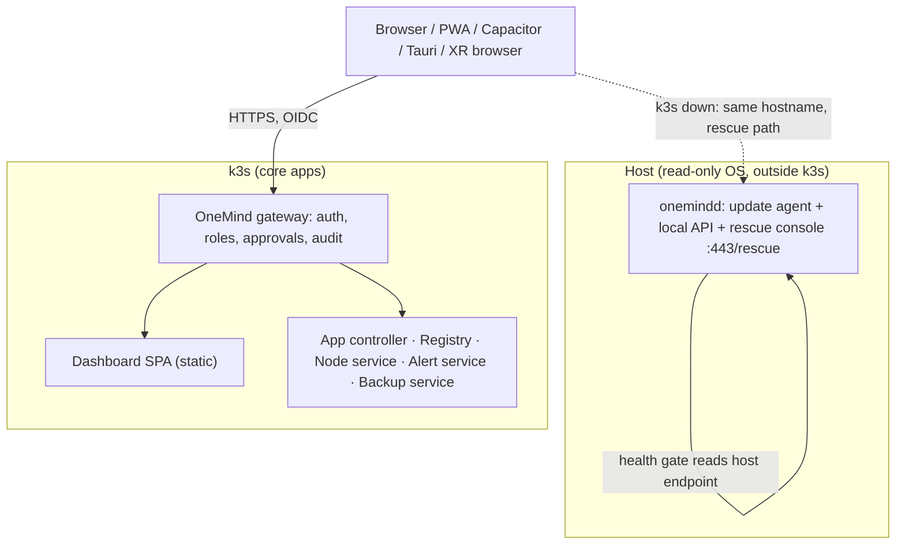
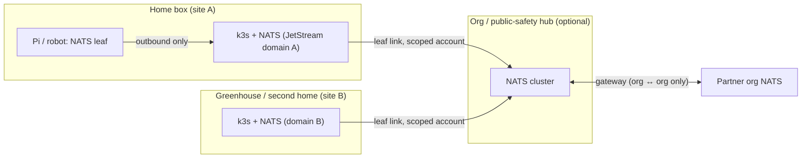

# 12 · Dashboard, clients and XR (W11)

**Workstream:** W11 (Tier B: at least one primary source per claim) · **Tag:** W11 · **Date:** 2026-11-11
**Claims:** `evidence/claims/W11.csv` (C-W11-001…064), plus reused Tier A rows cited by their own IDs · **Sources:** `evidence/sources/W11.md`, archived text in `evidence/sources/W11/` · **Question statuses:** `evidence/qbank/W11.md`
**Builds on:** [`docs/DASHBOARD.md`](../docs/DASHBOARD.md) (design v0.1), [`01-FOUNDATION-DECISION.md`](01-FOUNDATION-DECISION.md) §8 (L0–L5 layers), the umbrelOS, Olares and HAOS teardowns in `02-competitors/`, and [`research/platform/ai-native-protocols-and-ux.md`](../research/platform/ai-native-protocols-and-ux.md).
**Covers mission items:** screen-by-screen benchmark, Simple vs Pro, the alert center (D-005), **UX-8 Windows and macOS clients**, iOS/Android, PWA, the Omarchy desktop edition, WebXR / Android XR / visionOS, multi-machine view, mirroring, infrastructure map, QR onboarding, and **P-4 SDK and Federation surfaces**.

> ### Explain it like I'm the founder
> The dashboard is the part of OneMind people actually touch, so it has to be simple for your family and deep for you, without becoming two products.
>
> **What we found in the competitors' code:**
> - **Umbrel** is a polished single web page (React) that opens each app in a **new browser tab** on its own port. Its notifications are just text lines on the box, with **no phone push** [C-W11-003, C-W11-004].
> - **Olares** looks like a desktop in the browser and opens apps **inside windows** (iframes), each on its own web address. Its phone app LarePass is **one web codebase wrapped for iPhone, Android and desktop** [C-W11-009, C-W11-011].
> - **Home Assistant** writes **separate native apps** for iPhone and Android. Its phone alerts go through **Google's push service, unencrypted**. It also tried a global "Advanced mode" switch and is **now removing it** because it confused people [C-W11-015, C-W11-016, C-W11-019].
>
> **What we recommend:**
> 1. **One web app is the dashboard everywhere.** It installs as an app (PWA) and is wrapped for iPhone, Android, Mac and Windows only to add what the web can't do: push alerts, QR scanning, Face ID, and opening the box from the Mac menu bar.
> 2. **No global "Pro mode" switch.** Pro screens appear because of your *role* (owner or operator), and extra detail sits one click deeper on each screen. That is Home Assistant's lesson.
> 3. **A small rescue screen lives outside Kubernetes**, inside the OS update agent. If k3s breaks, you can still open the box and roll back.
> 4. **Alerts travel on NATS, your existing bus.** On iPhone, Apple only learns that "something happened", never what (D-005). One catch: **Apple only accepts pushes signed with OneMind's own developer key**, so OneMind has to run a tiny content-free relay. That conflicts a little with "no OneMind cloud yet" (M-1), and you need to decide it.
> 5. **XR is web-first.** Android XR's Chrome supports AR and hand tracking in WebXR. Vision Pro's Safari supports VR only. Native XR apps come later.
> 6. **The Omarchy desktop should be a OneMind *client and plugin set* for Omarchy, not a second OneMind OS.** Omarchy shipped 32 releases in a year on rolling Arch [C-W11-048], which would double your security workload.

---

## 0. Glossary

| Term | Meaning here |
|---|---|
| **Front door / shell** | The first screen and the frame around everything else: home grid, app launcher, settings, alerts. |
| **SPA** | Single-page application: one web app that redraws itself instead of loading new pages. |
| **PWA** | Progressive Web App: a website the browser can install like an app, with an icon, offline cache and (when allowed) push alerts. |
| **Secure context** | A page served over HTTPS (or from `localhost`). Browsers give some features only to secure pages: install, push, passkeys, WebXR [C-W11-031]. |
| **Push service** | The vendor server that wakes a phone or browser: Apple's **APNs**, Google's **FCM**, or a self-hosted **UnifiedPush** distributor such as ntfy [C-W11-029, C-W11-030]. |
| **Notification service extension** | A tiny part of an iPhone app that runs when a push arrives. It can fetch or decrypt the real content before the alert shows [C-W11-025]. |
| **Capacitor / Tauri / Electron** | Tools that wrap one web UI as native apps. **Capacitor** targets iOS and Android; **Tauri** targets desktop (and, since 2.0, mobile) with a small Rust core; **Electron** ships a whole Chromium per app [C-W11-035, C-W11-037]. |
| **WebXR** | The W3C browser API for VR and AR headsets [C-W11-043]. |
| **Status reducer** | Code that turns many low-level Kubernetes states (pods, volumes, image pulls) into one plain state per app: *Running*, *Starting*, *Needs attention*, *Stopped*. |
| **onemindd** | OneMind's host update agent from the foundation decision (01 §8, L3). Here it also hosts the rescue console. |
| **Leaf node / gateway (NATS)** | Two ways to link NATS servers. A **leaf** dials *out* to a hub and needs no open ports. A **gateway** joins whole clusters into a super-cluster [C-W11-054, C-W11-055]. |
| **Federation** (P-4) | Several OneMind boxes, sites or organisations acting together while each stays sovereign. |

---

## 1. Recommendations at a glance

| ID | Recommendation | Requirements | Evidence |
|---|---|---|---|
| **REC-W11-01** | **One web shell.** A React + TypeScript SPA served by the OneMind gateway is the only dashboard implementation. Every client (browser, PWA, mobile, desktop, XR panel) loads it. | P-1, P-2, UX-1, UX-8, F-14, D-003 | C-W11-001, C-W11-011, C-W11-015 |
| **REC-W11-02** | **A language-neutral API contract** (OpenAPI/JSON Schema over HTTPS plus a WebSocket/NATS event stream), not tRPC, because the same contract feeds the CLI, MCP, the SDK and third-party clients. | P-4, AI-2, AI-3 | C-W11-002 (tRPC is TS-only by design; reasoning) |
| **REC-W11-03** | **Apps open in a new tab or window by default, on a per-app subdomain** behind the gateway's login. Embedding in an iframe is opt-in per app, as in Olares. Never one port per app. | P-1, UX-1, U-1 | C-W11-003, C-W11-009, C-W11-010 |
| **REC-W11-04** | **The rescue console runs in onemindd on the host, outside k3s.** It shows health, logs and update/rollback, and works when k3s is down. The full dashboard runs in k3s as a core app. | R-1, R-2, P-1 | C-W11-006, 01 §2 health gate |
| **REC-W11-05** | **No global Pro toggle.** Pro views are *role-gated* (owner/operator); detail is progressive per screen; a status reducer hides Kubernetes terms from household roles. | P-1, P-2, UX-1, F-14 | C-W11-019 |
| **REC-W11-06** | **The customizable home grid** is built natively with importers for Homepage `services.yaml`, Homarr and Dashy configs. Homarr's Apache-2.0 integration code may be *reused with attribution* after per-file review; Homepage (GPL) and Glance (AGPL) are study-only. | UX-2, UX-3, D-001 | C-W11-021, C-W11-022 |
| **REC-W11-07** | **The alert center** sits on NATS `evt.*` subjects plus Alertmanager. Delivery: in-app (all), Web Push (encrypted), UnifiedPush/ntfy (Android, Linux), APNs ping-then-fetch (iOS, D-005), Matrix/Telegram, and TAK CoT for field users. | UX-4, D-005, N-7, R-2 | C-W11-016, C-W11-018, C-W11-023…030 |
| **REC-W11-08** | **The iOS push relay**: a stateless OneMind relay holds the APNs key and forwards only an opaque ID. It is open source and self-hostable by anyone with their own Apple developer account. **Founder decision** against M-1. | D-005, M-1, M-2, UX-4 | C-W11-024, C-W11-027 |
| **REC-W11-09** | **Native shells:** Capacitor for iOS/Android, with a OneMind UnifiedPush plugin on Android so FCM is optional; Tauri 2 for macOS/Windows/Linux (tray/menu bar, deep links, LAN discovery). One repo, one UI. | UX-5, UX-8, D-005 | C-W11-011, C-W11-035…037 |
| **REC-W11-10** | **Mac integration** (the "open the box from a Mac" ask): Bonjour discovery, SMB shares with `vfs_fruit`, an opt-in Time Machine target, menu-bar app, and a deep link to the dashboard. | UX-8 | C-W11-041, C-W11-042 |
| **REC-W11-11** | **HTTPS on the LAN by default**, in three tiers: (a) a per-box local CA, installed through the phone app's profile flow; (b) Tailscale certificates when remote access is on (warn that names become public); (c) an optional owned-domain DNS-01 certificate later. | P-1, UX-8, UX-9, U-5, M-2 | C-W11-031, C-W11-032, C-W11-033, C-TD-umbrelos-041 |
| **REC-W11-12** | **Remote access = Tailscale/Headscale first** (already the founder's pattern), no OneMind relay required. A paid SNI relay (the Nabu Casa model) is a year-2+ business option. | U-5, M-1, F-6 | C-W11-034, C-W4-060 |
| **REC-W11-13** | **The Omarchy edition is a client + plugin pack** for stock Omarchy (`omarchy-onemind` shell plugin, agent skills, pairing). It is not an Arch-based OneMind image. A OneMind *node* desktop, if wanted, is a later bootc/Fedora Atomic profile. | UX-10, F-14, D-002 | C-W11-047…051 |
| **REC-W11-14** | **XR: web-first.** The dashboard works as a 2D panel in every headset browser. A WebXR "spatial ops" view (3D infra map, robot camera) comes in year 2; native Android XR/visionOS apps only for teleop when latency demands it. | UX-9, M-7 | C-W11-043…046 |
| **REC-W11-15** | **The Nodes app is the multi-machine view**, fed by NATS presence plus the k8s API plus Tailscale. **Mirroring** is defined as four separate features, built in this order: config clone → app/data replication → warm standby → screen mirroring. | UX-6, UX-7 | C-W11-054…057 |
| **REC-W11-16** | **QR onboarding** in two directions: the box shows a short-lived join QR (bootstrap token TTL ≤ 1 h); devices with their own QR (Matter `MT:`, FDO, DPP) are scanned by the phone app. | N-4, F-3 | C-W11-052, C-W11-053, C-W8-006, C-W8-044 |
| **REC-W11-17** | **The SDK surface** is `onemind` CLI + `onemind.app.yaml` schema + typed client libraries generated from the OpenAPI contract + a widget SDK + a local dev loop (k3d) + docs served over MCP. | P-4, A-5, A-6 | C-W11-021, C-W11-050, C-TD-olares-028 |
| **REC-W11-18** | **The Federation surface** has three planes: a **bus** plane (NATS leaf for box→site; gateways only between sites/orgs), an **identity** plane (OIDC trust between boxes; no shared accounts), and a **catalog** plane (each box publishes signed node/app inventory). The UI shows federated boxes in Nodes, read-only by default. | P-4, UX-6, N-5, F-6, AI-9 | C-W11-054, C-W11-055, C-W4-054 |
| **REC-W11-19** | **Accessibility target: WCAG 2.2 AA** from the first screen (meets Section 508's WCAG 2.0 AA floor), with a public conformance report before any public-sector sale. | M-4, U-2 | C-W11-060…062 |
| **REC-W11-20** | **GUI and agent are equal front doors.** Every dashboard action is a gateway capability that an agent can call under the same approval rules. Neither is the fallback. | AI-1, AI-4, AI-5, P-2 | C-W6-068, C-TD-umbrelos-037 |

---

## 2. Consistency with the Tier A foundation (flags, not silent fixes)

| # | Conflict | Where | What W11 does |
|---|---|---|---|
| F-1 | `docs/DASHBOARD.md` §4 says the Update Service drives "OS image (**Rugix** A/B)". The foundation decision moved the lead engine to **RAUC** (01 §2, D3). | docs/DASHBOARD.md | This file assumes **RAUC** behind one OneMind release contract. The Update screen is engine-neutral. `docs/` is not edited (house rule); flagged for the next docs pass. |
| F-2 | **D-005 vs M-1.** Instant iOS alerts need APNs, and APNs only accepts pushes signed with the app developer's key [C-W11-027]. So a OneMind-operated relay is unavoidable for the OneMind iOS app. M-1 says a OneMind-operated cloud comes "later, not now". | D-005, M-1 | REC-W11-08 keeps the relay **content-free, stateless and open source**, and the fallback without it is "poll when the app opens". **blocked: founder-decision** (Q-W11-1). |
| F-3 | **D-005's "Android, desktop and web fully self-hosted"** is only partly true for the **web**. Browser Web Push always goes through the *browser vendor's* push service (RFC 8030 "push service"); RFC 8291 encryption keeps the content unreadable to it [C-W11-029]. | D-005 | Treat browser push as "**vendor-carried, end-to-end encrypted**", like iOS. Fully self-hosted delivery is in-app (open tab), UnifiedPush/ntfy on Android and Linux, and desktop shells that hold their own connection. |
| F-4 | **UX-10 (Omarchy edition) vs D-002 / 01** (one image pipeline, Debian core). An Arch rolling image would be a second base distro outside the RAUC/Debian pipeline. | UX-10 | REC-W11-13: client and plugin pack, not an image. **blocked: founder-decision** (Q-W11-2) if Zeus wants a OneMind-branded Arch image anyway. |
| F-5 | The **health gate** (01) requires "local OneMind API answers" before commit. If the dashboard API lives only in k3s, the gate and the rescue path both depend on k3s. | 01 §2, Q248 | REC-W11-04: the minimal local API and rescue console are part of **onemindd on the host**, so the gate checks a host endpoint, not a pod. This strengthens 01; it does not change it. |
| F-6 | **CRA auto-updates by default** (01 Decision 2, [C-W6-008]) vs DASHBOARD.md's "Update → Update now" flow. | 01, DASHBOARD.md | The Update screen gets three states: *security updates install automatically in your window* (default), *postpone up to N days*, *opt out (warning)*. Feature updates stay manual. |

No W11 finding contradicts the Tier A choices of base OS, update engine, k3s threshold or backup method.

---

## 3. Screen-by-screen benchmark

**Pins:** umbrelOS **2.1.0-beta.1** (`6f357e18`, pre-release; the UI code is the same lineage Umbrel ships) · Olares **main `e7fe1c96`** (critic gap #19 applies: not the 1.12.7 tag) · Home Assistant frontend **20261028.5** (`5b1ecdb0`), Core **2026.11.1** · CasaOS-UI **v0.4.25** · Homarr **v2.12.0** · Synology DSM 7.4 (docs only, no code).
Cells marked **(UNVERIFIED)** come from earlier phase-1 research or general product knowledge and were not re-checked against a primary source in this pass.

| Screen | umbrelOS | Olares | Home Assistant | CasaOS / ZimaOS | Homarr | Synology DSM | OneMind takes |
|---|---|---|---|---|---|---|---|
| **Stack** | React 19, Vite, Tailwind 4, Radix, tRPC 11 [C-W11-001] | Vue 3 + Quasar (LarePass/web app) [C-W11-011] | Lit 3 web components + WebSocket API, Workbox SW [C-W11-013] | Vue 2.7 + Buefy; Vue 2 reached end of life on 2023-12-31 [C-W11-020, C-W11-064] | Next.js 16 + tRPC 11 [C-W11-021] | Proprietary web desktop (UNVERIFIED) | React + TS SPA (REC-W11-01) |
| **API to backend** | tRPC over WebSocket, HTTP fallback with Bearer [C-W11-002] | REST per service behind Envoy sidecars [C-W11-010] | WebSocket message API (`home-assistant-js-websocket`) [C-W11-013] | REST (axios) [C-W11-020] | tRPC [C-W11-021] | REST "webapi" (UNVERIFIED) | OpenAPI + event stream (REC-W11-02) |
| **Home** | Desktop-like grid, wallpaper, max **3 widgets** [C-W11-005] | Browser "desktop" with windows [C-W11-009] | Fully custom dashboards (cards, sections) | App grid + system widgets (UNVERIFIED) | Boards with drag-and-drop widgets, ~50 integrations [C-W11-021] | Web desktop + widgets (UNVERIFIED) | Editable grid, no hard widget cap, per-user layouts |
| **App launch** | New tab at `host:port` [C-W11-003] | iframe window (default) or new tab, per-app subdomain [C-W11-009, C-W11-010] | Panels inside the frontend; add-ons via ingress iframe | New tab (UNVERIFIED) | Links/iframes per tile | Windows inside desktop (UNVERIFIED) | New tab/window on a per-app subdomain; iframe opt-in (REC-W11-03) |
| **App store** | App Store + community stores | Market (Helm + OlaresManifest), linter [C-TD-olares-028] | Apps (add-ons) store + HACS | App store (compose) | n/a | Package Center | Market (W12) + "runs on your box?" badge (W10) |
| **Alerts** | Text notifications per account, live via event bus; **no phone push** [C-W11-004] | FCM push via LarePass (Capacitor FCM) [C-W11-011] | Repairs (severity, fixable, learn-more) [C-W11-018] + Companion push via FCM, unencrypted, 500/day [C-W11-016] or LAN Local Push [C-W11-017] | Notifications (UNVERIFIED) | Notification integrations (ntfy, Gotify) [C-W11-021] | Notification center + mobile push (UNVERIFIED) | Native Alert Center on NATS (§6) |
| **Users** | Owner + members; app sharing gates widgets [C-W11-005] | Per-user Olares ID, own namespace (OLA) | Users + admin flag; global Advanced toggle **being removed** [C-W11-019] | Single admin (UNVERIFIED) | Users/groups | Users/groups, ACLs | Owner/Adult/Teen/Child/Guest + operator (W13) |
| **System / Pro** | Settings only (update, backups, storage, MCP, terminal) | Settings + **Control Hub** (k8s-level) | Settings → System (logs, hardware, backups) | Settings | Settings | Control Panel + Resource Monitor | Settings (all) + Control Hub (operator role) |
| **Multi-node** | None | Limited (multi-node Olares One) | None | None | Monitors other servers via integrations | Two-box HA only [C-W11-057] | **Nodes app** (§9) |
| **Onboarding** | Create account → storage (external/RAID) → restore [C-W11-007] | Activate with LarePass (Olares ID, keys) [C-TD-olares-020] | Create user → location → analytics opt-in → integrations, or restore backup [C-W11-014] | Account (UNVERIFIED) | Onboarding package | Web Assistant (UNVERIFIED) | §10: account → restore-or-new → profile → pair phone (QR) |
| **Native clients** | iOS/Android apps (linked for Photos backup) [C-W11-008] | LarePass: one codebase → iOS, Android (Capacitor), desktop (Electron) [C-W11-011] | Native Swift iOS and Kotlin Android apps [C-W11-015] | ZimaOS client (UNVERIFIED) | PWA | DS-series mobile apps, Drive client (UNVERIFIED) | Capacitor + Tauri shells over the one SPA (REC-W11-09) |

**What the table teaches:**
1. **The new-tab vs iframe split is real, and both work.** Umbrel's port-per-app launch is simple but leaks ports and certificates per app. Olares's subdomain-per-app keeps one login and one certificate wildcard, and makes iframes safe to embed [C-W11-003, C-W11-010].
2. **Nobody ships a real alert center.** Umbrel's notifications are string lists [C-W11-004]. HA has the best *model* (repairs with severity and "fixable") [C-W11-018], but its phone delivery is unencrypted through Google [C-W11-016].
3. **The one-codebase client is proven.** LarePass ships iOS, Android and desktop from one Vue codebase [C-W11-011]. HA's two native apps need a separate team per platform [C-W11-015], which a solo founder cannot staff.

---

## 4. Front-door architecture (Q246, Q248)

### 4.1 Where the dashboard runs

- **Why outside k3s for the rescue path:** umbreld runs as a host systemd service with `Restart=always` [C-W11-006], and HAOS's Supervisor sits outside Core. Both can still show a screen when apps are broken. If OneMind's only UI were a pod, a broken k3s would mean a dark screen with no repair path. The rescue console shows OS slot, last update, k3s status, logs, "roll back to previous slot" and "download support bundle". It needs no k3s.
- **Why the main dashboard can live in k3s:** it is just another core app with a health check, and the foundation's health gate already refuses to commit an OS update unless core pods are Ready since this boot [C-LAB-debian-rugix-023]. The rescue console is the safety net.

### 4.2 API shape

Umbrel and Homarr both use **tRPC** [C-W11-002, C-W11-021], which is excellent for a single TypeScript team. OneMind has a different constraint: the same operations must also be reachable from the CLI, MCP tools, third-party apps and possibly non-TS clients (P-4, AI-2). Therefore:
- **Contract:** OpenAPI 3.1 for request/response, JSON Schema for `onemind.app.yaml` and events.
- **Live updates:** one WebSocket per client that relays permitted NATS subjects, filtered by the gateway (the client never connects to NATS directly).
- **Generated clients:** TypeScript for the SPA, Go/Python/Swift/Kotlin as needed. The MCP server and CLI are generated from the same operation list, so "every app is AI context" (AI-1) cannot drift from the UI.

---

## 5. Simple vs Pro (Q247)

**Evidence:** Home Assistant ran a global "Advanced mode" toggle for years and is removing it. Its own contributors call it "a single binary switch that gates a collection of unrelated features" and tell authors to group extra options in sections instead [C-W11-019].

**Design:**
| Layer | Household roles (Adult/Teen/Child/Guest) | Operator role (Owner, admins) |
|---|---|---|
| Navigation | Home, Apps, Files, Alerts (theirs), Family | + Nodes, Control Hub, AI & Agents audit, Settings → System |
| App state | Reducer output only: *Running · Starting · Updating · Needs attention · Stopped* | Same state, plus "Details" with pods, events, volumes, image pulls |
| Errors | "Photos can't start: the disk is full. [Free space] [Ask AI]" | Plus the raw k8s event and a log link |
| Language | Plain words; no "pod", "PVC", "namespace" | Kubernetes terms allowed |

**The status reducer** is a small, tested function per failure class: `ImagePullBackOff` → "Can't download the update (no internet?)", `Pending` + insufficient memory → "Not enough memory on this box", PVC `Pending` → "Storage not ready", node `NotReady` → "Box X is offline". Q247 asked whether k8s can be hidden. **Partial answer:** the mechanism is clear and Olares's status mapping is the pattern, but leakage under injected failures must be measured (test T-W11-02, §14).

---

## 6. The native alert center (UX-4, D-005, Q272)

### 6.1 Model

- **Event source:** every service publishes `evt.{domain}.{entity}.{event}` on NATS (the founder's locked grammar, context/01). Prometheus **Alertmanager** (Apache-2.0, v0.35.0) [C-W11-023] turns metric rules into events on the same bus.
- **Alert record** (copying HA's repairs model [C-W11-018]): `id, severity (critical|error|warning|info), source, owner/audience (user, role, household), title, body, fixable, fix_action (gateway capability), learn_more_url, created, acked_by, resolved`.
- **Routing:** per-user rules by severity, quiet hours and channel. Children get only their own alerts. Infrastructure alerts go to operator roles.
- **"AI investigate"** is a gateway capability with read-only scope by default. Any *fix* needs human approval (01 REC-DEC-13, [C-W6-068]).

### 6.2 Delivery per platform

| Channel | Who carries it | Content visible to carrier? | Self-hosted? | Source |
|---|---|---|---|---|
| In-app (open dashboard/tab) | The box | n/a | **Yes** | — |
| **iOS app (D-005)** | APNs via a OneMind relay: payload = opaque alert ID + `mutable-content:1`; the notification service extension fetches the real alert from the box within about 30 s | **No** (Apple sees only that a push arrived) | Relay needed (F-2) | C-W11-025, C-W11-026, C-W11-027, C-W11-024 |
| iOS app on home Wi-Fi | Direct WebSocket from the box (HA "Local Push" pattern) | No | Yes, but iOS allows it only on configured SSIDs | C-W11-017 |
| Android app | UnifiedPush distributor (ntfy on the box, or the user's choice); FCM only as a fallback | No (ntfy topic on the box) | **Yes** | C-W11-030, C-W11-037 |
| Browser / PWA (incl. iOS 16.4+ Home Screen apps) | Browser vendor's push service, RFC 8291-encrypted | No (encrypted) | Vendor-carried (F-3) | C-W11-028, C-W11-029 |
| macOS / Windows / Linux shells | Tauri app holding its own connection (Linux: UnifiedPush) | No | **Yes** | C-W11-030, C-W11-035 |
| Matrix / Telegram | Already used by the founder's cluster (context/01) | Matrix: no if E2EE; Telegram: yes | Matrix yes | context/01 |
| TAK (field teams) | CoT alert via the NATS bridge | No | Yes | 09 (W8) |
| Satellite-constrained phones | Android opt-in for satellite data; FCM `bandwidth_constrained_ok` | — | — | C-W8-051 |

**Why not copy Home Assistant's phone push:** HA's notifications pass through Firebase **unencrypted**, with a 500/day cap [C-W11-016]. That breaks M-2 for anything sensitive (camera, health, child location).

**Why the relay is safe enough:** ntfy already ships this exact pattern. A self-hosted server sends the upstream only a message ID and a hash of the topic, and the phone fetches the content from the user's own server [C-W11-024]. OneMind's relay should accept only `{device_token, opaque_id}`, keep no logs beyond rate-limit counters, and be published as Apache-2.0 so a company can run its own relay with its own Apple developer account.

### 6.3 Payload budget

APNs caps payloads at 4 KB [C-W11-026]. The ping carries a random 128-bit alert ID and a box ID only, so it stays far below the cap and reveals nothing.

---

## 7. Clients: web, iOS, Android, macOS, Windows, Linux (UX-5, UX-8, Q262, Q279, Q322)

### 7.1 Options compared

| Option | Proven by | Push | Desktop (Win/Mac) | Solo-dev fit | Verdict |
|---|---|---|---|---|---|
| PWA only | HA frontend has a service worker [C-W11-013] | Web Push, iOS only from the Home Screen [C-W11-028] | Installable | Highest | **Base layer**, not enough alone (no QR camera flow on iOS home screen apps, no Bonjour, weak background) |
| Native per platform (Swift + Kotlin + …) | HA Companion [C-W11-015] | Full | Separate apps | **Low** (3–4 codebases) | Reject for now |
| **Capacitor (mobile) + Electron (desktop) over one Vue/web UI** | **Olares LarePass** [C-W11-011] | APNs + FCM [C-W11-037] | Electron | Good | Proven; Electron is heavy |
| **Capacitor (mobile) + Tauri 2 (desktop) over one React UI** | Tauri 2 stable since 2024-10 [C-W11-035] | Mobile via Capacitor; desktop via own socket | Tauri (small) | Good | **Recommended** (REC-W11-09) |
| Tauri 2 everywhere (incl. mobile) | Tauri docs | No remote push in the notification plugin [C-W11-036] | Yes | Medium | Re-evaluate when Tauri mobile push matures; note a v3 alpha already exists [C-W11-036] |
| Flutter / React Native / KMP | — | Plugins | Partial | Medium | Second UI codebase; rejected because the dashboard is already web |

**Android caveat:** Capacitor's push plugin requires Firebase on Android [C-W11-037]. D-005 wants self-hosted delivery, so OneMind needs a small Kotlin plugin around the UnifiedPush connector. FCM stays an optional fallback for users who already have Google services.

### 7.2 Windows and macOS clients (UX-8)

| Need | macOS | Windows | How |
|---|---|---|---|
| Find the box | Bonjour/mDNS (native) | Typed address or tailnet name; mDNS support **UNVERIFIED** (test T-W11-04) | Tauri app scans the LAN and the tailnet |
| Open dashboard | Menu-bar app → default browser or embedded webview | Tray app → same | Tauri tray API |
| Files | Finder SMB with `vfs_fruit` (Apple SMB extensions) [C-W11-041] | Explorer SMB | Samba on the box, per-user shares |
| Backup the computer | **Time Machine over SMB** (AFP is unsupported from macOS 27) [C-W11-042] | Windows File History to SMB (UNVERIFIED) | Opt-in share with `fruit:time machine` and a size cap [C-W11-041] |
| Alerts | Native notifications from the tray app | Same | Own connection to the box (§6.2) |
| AI access from the desktop | MCP client config to the box's gateway | Same | `onemind login` writes a scoped token (W9) |
| Remote | Tailscale client | Tailscale client | §8.2 |

Releases: signed and notarized on macOS, code-signed MSI/MSIX on Windows. **Signing certificates are a business cost** (W16).

### 7.3 App store policies (Q279)

- **Do not put a VPN in the OneMind app.** Apple allows VPN apps only from developers enrolled as an organization, with strict data rules [C-W11-038]. Google Play needs a VpnService declaration (remote access is an allowed category) [C-W11-040]. Use the Tailscale app for the tunnel instead, so the OneMind app never needs these entitlements.
- **Avoid being judged a "repackaged website".** Guideline 4.2 rejects apps that are only a website wrapper [C-W11-039]. The iOS app must add native value: push with the service extension, QR pairing with the camera, Face ID unlock, the Photos backup source, and Shortcuts actions.
- **Remote-desktop rule 4.2.7** applies only if OneMind ever streams a VM screen (umbrelOS Machines-style) to iOS. Then the host must be user-owned and on the LAN [C-W11-039]. Flag for the Machines feature.
- **Sovereign channels:** F-Droid/Accrescent for Android, and direct downloads for desktop. TestFlight is for beta testing, not general distribution (UNVERIFIED in this pass).

---

## 8. HTTPS, secure contexts and remote access

### 8.1 Why HTTPS on the LAN is not optional (Q253)

PWA install, service workers, push, passkeys (WebAuthn), WebXR, geolocation and Web Bluetooth all require a secure context [C-W11-031]. P-1's "open a browser at a local address" therefore means HTTPS, or UX-9 (XR), passkeys (AI-6) and PWA push all fail.

| Approach | Used by | Pros | Cons | OneMind |
|---|---|---|---|---|
| Plain HTTP on `name.local` | umbrelOS LAN default | Zero setup | No secure-context features | Only for first-boot setup |
| **Per-box local CA** that clients trust | umbrelOS 2.x [C-TD-umbrelos-041], StartOS [C-W11-033] | Fully offline, sovereign | Users must install a CA profile (hard on iOS) | **Default**; the phone app installs the profile during QR pairing |
| Tailscale certificates | Tailscale | Real Let's Encrypt cert, no CA install | **Machine names land in public CT logs** [C-W11-032] | When remote access is on; default machine names must be non-identifying |
| Owned domain + DNS-01 (per-user subdomain) | Olares [C-W11-010] | Works everywhere | Needs a OneMind DNS service (cloud, M-1) | Year 2+ optional service |

### 8.2 Remote access (Q263)

| Product | Mechanism | Business model | Constraint fit |
|---|---|---|---|
| Home Assistant | Nabu Casa SniTun: end-to-end TLS through an SNI relay [C-W11-034] | Paid subscription (funds the project) | **High as a later revenue line**; GPL-3.0 code is study-only |
| Olares | Cloudflare Tunnel or FRP, per-app domains [C-W11-012] | Olares-operated services | Medium: depends on its cloud |
| umbrelOS | Tailscale app from the store (phase-1, UNVERIFIED here) | None | High |
| Founder's cluster | Tailscale operator + tailnet ingress [C-W4-062] | — | **Already proven by Zeus** |
| OneMind | **Tailscale client, or Headscale on the box** for a single-tailnet household [C-W4-060]; the relay stays optional | Later: paid relay/DNS | REC-W11-12 |

---

## 9. Multi-machine view, mirroring and infrastructure map (UX-6, UX-7, Q271, Q300)

### 9.1 The Nodes app

- **Data sources:** NATS presence/heartbeat subjects (`tel.{node}.sys.*`), the k8s API for platform nodes, the Tailscale/Headscale node list, and capability labels from NFD (W10).
- **Below the k3s threshold** (Pi < 4 GB, sensors, robots on leaf NATS: 01 §2): they still appear as nodes, because presence comes from NATS, not Kubernetes.
- **Proven patterns:** Proxmox lets any node's web UI manage the whole cluster [C-W11-056]. OneMind does the same: any platform node's dashboard shows all nodes in its site.
- **What not to copy:** Proxmox needs < 5 ms latency and 3 votes for quorum [C-W11-056]. OneMind's cross-site view must never depend on quorum. Sites are independent and federated (§11).

### 9.2 "Mirror" means four different things (Q300)

| Meaning | Proven by | Feasible on 1–2 home boxes? | Plan |
|---|---|---|---|
| **Config clone** to a new box | Backup → restore onto new hardware (W5) | Yes | Year 1: "Set up from another OneMind box" in onboarding |
| **App/data replication** box→box | restic copy / ZFS send (W5) | Yes | Year 1: scheduled replication target = another OneMind box |
| **Warm standby / failover** | Synology SHA: identical pair, real-time sync, heartbeat < 1 ms [C-W11-057]; Proxmox HA needs 3 votes [C-W11-056] | Only with strict pairing; two nodes cannot hold quorum alone | Year 2–3: needs 3 k3s servers (etcd) or a witness |
| **Screen/session mirroring** between clients | — | Yes (UI state sync) | Optional, low priority |

**Recommendation:** ship the first two as "Mirror" in year 1 and label the third "High availability" (Pro/Cluster edition). That matches what users mean in most cases and keeps the promise honest.

### 9.3 Infrastructure map (UX-7)

A generated graph: sites → nodes → apps → exposed services → devices (robots, sensors, TAK clients), drawn from the same inventory as Nodes. NetBox (Apache-2.0, actively released [C-W11-058]) is the reference data model for enterprise users, and an export to NetBox is a cheap integration. Backstage needs ≥ 6 GB RAM [C-W4-059], so it is not the map's data source on a box (consistent with W4's Backstage decision).

---

## 10. Onboarding and QR (N-4, Q257)

### 10.1 First boot (OneMind spec, from the competitors' sequences)

1. **Connect** (screen on the box or `onemind.local` over plain HTTP, setup only).
2. **Create owner** (local OIDC; passkey offered once HTTPS is up).
3. **New or restore** (HA and Umbrel both put "restore" in onboarding [C-W11-007, C-W11-014]).
4. **Choose profile** (P-8: Home, Greenhouse, TAK node, Robotics, Industrial). One image, profile applied as app bundles (W8 profile decision).
5. **Pair the phone by QR** → installs the CA profile, registers push, and adds the box to the app.
6. **Security updates on** (CRA default, F-6 in §2).

Umbrel's sequence is account → storage → restore [C-W11-007]; Olares requires LarePass activation first [C-TD-olares-020]. OneMind keeps the phone **optional**: the box works fully from a browser.
**Time to "install an app"** was not measured (no hardware run in this pass): test T-W11-01.

### 10.2 QR onboarding of nodes and robots

| Direction | What the QR holds | Security rule | Source |
|---|---|---|---|
| **Box shows QR → new node scans** (Pi, mini PC, Jetson joining) | Box URL + CA fingerprint + one-time join token | Token TTL ≤ 1 h, single use; k3s supports expiring bootstrap tokens (default 24 h) [C-W11-053] | REC-W11-16 |
| **Phone scans device QR** (Matter, FDO, Wi-Fi DPP) | Device identity + setup secret, e.g. Matter `MT:` payload with vendor/product ID, discriminator and PIN [C-W11-052]; DPP is in Debian's wpa_supplicant [C-W8-006]; FDO via go-fdo [C-W8-044] | The phone hands it to the box over the gateway; never stored in plain text | REC-W11-16 |
| **Robot / sensor below k3s** | Leaf NATS credentials (`.creds`, scoped account) [C-W11-054] | Per-device account, revocable | 01 §2 leaf tier |

---

## 11. P-4 surfaces: SDK and Federation

P-4 lists seven surfaces: Core, Dashboard, Desktop, SDK, Mobile, OS Image, Federation. This file owns SDK and Federation, plus the Dashboard, Desktop and Mobile surfaces above.

### 11.1 SDK (Q280)

| Piece | What | Lesson from |
|---|---|---|
| `onemind` CLI | `app init/validate/dev/publish`, `plugin init/validate/publish`, `node join`, `login` | Omarchy's `plugin validate` runs the same checks as load time [C-W11-050]; the Olares OAC linter [C-TD-olares-028] |
| Schemas | `onemind.app.yaml`, widget manifest, event schemas (JSON Schema, versioned) | Omarchy's `manifest.json` (`schemaVersion`, `id`, `kinds`, `entryPoints`) [C-W11-050] |
| Client libraries | Generated from the OpenAPI contract (TS, Python, Go) | REC-W11-02 |
| Widget SDK | Sandboxed iframe widget + a data contract; widget calls go through the gateway with the user's grants | Homarr's `custom-widgets` package [C-W11-021]; Umbrel's per-app widget sharing rule [C-W11-005] |
| Local dev loop | k3d cluster + a mock gateway on the Mac (W18 toolchain) | 28-… Mac path |
| Docs for agents | Docs served over MCP and `llms.txt` | Q276 (W13) |
| Reserved namespaces | `onemind.*` ids reserved for first-party | Omarchy reserves `omarchy.` [C-W11-050] |

**Security lesson:** Omarchy states plainly that third-party plugins run as unsandboxed code with the user's rights [C-W11-050]. That is acceptable on a personal laptop, not on a box that drives robots. OneMind widgets run in sandboxed iframes, and anything with device access is a Market app under the gateway (W19 owns the full plugin model; DC-16).

### 11.2 Federation

| Plane | Mechanism | Why |
|---|---|---|
| **Bus** | Box → hub via **leaf nodes** (outbound only, scoped account) [C-W11-054]; **gateways** only between independent organisations' clusters (interest-only forwarding) [C-W11-055] | Matches the founder's cluster doctrine and the 01 leaf tier [C-W4-054]; a site never depends on another site |
| **Identity** | Each box is its own OIDC issuer; federation = trusting another issuer for named groups, with no shared user database | Sovereignty (M-2); works offline |
| **Catalog** | Each box publishes a signed inventory (nodes, apps, capabilities) on `svc.inventory.*`; peers display it read-only | Powers the multi-site Nodes view and the map |
| **Actions** | Cross-box actions are gateway capabilities with approval (same as AI actions) | One permission model (REC-W11-20) |
| **TAK** | TAK federation stays TAK Server's own feature (W8) | Don't reinvent |

---

## 12. Omarchy desktop edition (UX-10, Q284, Q40)

**Facts:** Omarchy is MIT-licensed and calls itself "agentic", with an agents panel that already lists Hermes [C-W11-047]. It shipped 72 releases since July 2025, 32 in the last year [C-W11-048]. Its stable channel holds Arch packages one month behind upstream [C-W11-049]. Its plugins are git repos with a manifest, a reserved namespace and a validator, and run unsandboxed [C-W11-050]. Rolling-yet-atomic desktops do exist: Bazzite builds a Fedora Kinoite image from a Containerfile with `bootc container lint` [C-W11-051].

| Option | Support load | CRA / signing | Fits D-002 "one pipeline"? | Verdict |
|---|---|---|---|---|
| A. OneMind-branded Arch/Omarchy image | High (rolling Arch, ~monthly releases) | OneMind becomes the manufacturer of a rolling distro | **No** (second base) | Reject (F-4) |
| **B. OneMind client + plugin pack for stock Omarchy** | Low: a Tauri app + an `omarchy-onemind` shell plugin + agent skills + pairing | Omarchy stays upstream's product | Yes (client only) | **Recommend** |
| C. OneMind desktop node on bootc (Fedora Atomic/Bazzite style) | Medium | Same image tech as the year-2 Industrial profile | Partly | Year 2+, only if a "desktop that is also a node" is demanded |

**What option B contains:** a top-bar widget showing box health and alerts; the OneMind agent skill so Omarchy's agents can call the box's MCP gateway with scoped tokens; and `onemind pair` (QR or code). This needs **no** change to the box OS.

---

## 13. XR (UX-9, Q283)

| Platform | WebXR status | What works for OneMind | Source |
|---|---|---|---|
| W3C WebXR | Candidate Recommendation Draft, 2026-11-09 | Stable core API | C-W11-043 |
| **Android XR (Chrome)** | Device API, AR, hand input (default), hit test, anchors, depth, light estimation; per-domain permissions | 2D dashboard panel + immersive AR "spatial ops" | C-W11-044 |
| **visionOS 2 (Safari)** | Immersive VR sessions; AR not covered by Apple's session | 2D dashboard panel; VR-only immersive views | C-W11-045 |
| Galaxy XR hardware | First Android XR headset, launched 2025-10 at about $1,799 | Test device for Android XR | C-W11-046 (SECONDARY) |
| Meta Quest Browser | WebXR supported (not re-verified in this pass) | 2D panel + VR | UNVERIFIED |

**Plan:**
1. **Day one:** the SPA is responsive and HTTPS-served, so it works as a 2D window in every headset browser. This needs the LAN HTTPS work in §8 and nothing else.
2. **Year 2:** a WebXR "spatial ops" route (three.js) with a 3D infrastructure map, a TAK map layer, and robot camera streams over WebRTC. Android XR first because it supports AR and hand input [C-W11-044].
3. **Year 3+:** native Android XR or visionOS apps only for low-latency teleop, behind the gateway's approval rules (physical actuation needs a human).

---

## 14. Robotics front door (link to W7/W19)

The robot card (fleet view, telemetry, camera, "drive with approval") should embed **Lichtblick**, the MPL-2.0 fork of Foxglove Studio code [C-W11-059]. MPL-2.0 is file-level copyleft: OneMind can embed it unchanged and keep its own code Apache-2.0, but changed Lichtblick files stay MPL-2.0 (W16 license matrix to confirm). Q274 itself is owned by W7.

---

## 15. Accessibility (Q277)

- **Target WCAG 2.2 AA** (W3C Recommendation, 2024-12-12) [C-W11-060]. It is a superset of the WCAG 2.0 AA that US Section 508 requires for software and content [C-W11-061]. EU public-sector buyers use EN 301 549 (V3.2.1 published 2021; clause text not read here, PRIMARY-METADATA) [C-W11-062].
- Use an accessible component layer (Radix primitives, as Umbrel does [C-W11-001]) and run axe in CI on every screen.
- Competitor audit scores were **not measured** in this pass (test T-W11-05).

---

## 16. Agent-first or GUI-first? (Q278)

**Answer: both, with one contract** (REC-W11-20). The evidence is about *safety*, not usage: prompt injection has no fool-proof prevention [C-W6-068], and umbrelOS's MCP grants are shared by every agent token [C-TD-umbrelos-037]. So every GUI action is defined once as a gateway capability with roles, approvals and audit. The GUI and agents then call the same thing. Usage data (HA Assist adoption, Umbrel MCP uptake) was not obtained: **partial**.

---

## 17. What competitors do (constraint fit)

| Product | Constraints (team, hardware, k8s, robotics) | Dashboard/client pattern | Constraint fit with OneMind | OneMind copies | OneMind does better |
|---|---|---|---|---|---|
| umbrelOS 2.x | Funded small team; x86 + Pi; Docker, no k8s; no robotics | React SPA, tRPC, new-tab apps, string notifications, host daemon [C-W11-001…006] | **High** for household UX; low for multi-node | Polish, onboarding with restore, host daemon for recovery | Real alert center, per-app subdomains, multi-node |
| Olares | Funded team; x86 + NVIDIA; k3s; no robotics | Web desktop with iframe windows, per-app subdomains, one-codebase LarePass [C-W11-009…012] | **High** (k3s, multi-user) | Subdomain-per-app, one-codebase clients, Control Hub idea | Phone optional (not required for activation), self-hosted push |
| Home Assistant | Large community, Open Home Foundation; appliance + any hardware; Docker Supervisor; IoT not robots | Lit frontend, native apps, repairs, FCM push, removing Advanced mode [C-W11-013…019] | **Medium-high** (household + devices) | Repairs model, Local Push, restore-in-onboarding, removing global toggles | Encrypted push (D-005), one client codebase |
| CasaOS / ZimaOS | IceWhale hardware vendor; x86 + ARM; Docker | Vue 2 app grid on an end-of-life framework [C-W11-020, C-W11-064] | Low (stack is end-of-life) | Simplicity of the grid | Everything else |
| Homarr | Community; any host; not an OS | Next.js boards, ~50 integrations, Apache-2.0 [C-W11-021] | **High for UX-2 widgets** | Widget catalog ideas; integration code reuse (Apache-2.0) | Integrated with apps, alerts and AI grants |
| Synology DSM | Large vendor; own hardware; proprietary | Web desktop, mobile apps, two-box HA [C-W11-057] | Medium (HA concept only) | "Mirror" honesty: identical pair + heartbeat for HA | Open, federated, no identical-hardware lock |
| Proxmox VE | Company + community; x86 servers; VMs | Multi-master datacenter UI [C-W11-056] | Medium (operator view) | "Any node shows the whole cluster" | No quorum dependency across sites |
| Omarchy | DHH/37signals; laptops; Arch rolling | Agentic desktop, shell plugins [C-W11-047…050] | **Low as a base**, high as a client target | Plugin manifest + validator + reserved namespace | Sandboxed widgets on boxes that drive hardware |

---

## 18. Founder-runnable tests (for `22-HARDWARE-LAB-TEST-PLAN.md`)

| ID | Test | Pass / fail |
|---|---|---|
| T-W11-01 | Time first boot → first app installed on umbrelOS (VM) and the OneMind prototype on the Beelink | OneMind ≤ Umbrel + 2 min; ≤ 6 user steps |
| T-W11-02 | Inject full disk, image pull failure, OOM, node offline; screenshot household and operator views | No k8s term in household view; each failure has a plain message and an action |
| T-W11-03 | iOS push: relay sends `{opaque_id}`; the extension fetches over the LAN and over Tailscale | Alert shown with full text in ≤ 5 s; the relay log contains no content |
| T-W11-04 | Windows 11 + macOS: Tauri app discovers the box on the LAN; SMB and Time Machine to `vfs_fruit` share | Discovery ≤ 10 s on both; a Time Machine backup completes |
| T-W11-05 | axe-core audit of OneMind, Umbrel, HA and Olares home/settings screens | OneMind: 0 serious/critical violations |
| T-W11-06 | Galaxy XR or Quest: open the dashboard over local-CA HTTPS and Tailscale HTTPS; run a WebXR sample | 2D panel works; immersive session starts only over HTTPS |
| T-W11-07 | k3s stopped: open `/rescue`, roll back the slot | Rescue page loads in ≤ 3 s; rollback works without k3s |
| T-W11-08 | QR join: Pi scans the box QR; reuse the token after 1 h | First join works; reuse is refused |

---

## 19. Open questions for Zeus (to add to `26-…`)

| ID | Question | Options | Recommendation |
|---|---|---|---|
| Q-W11-1 | Run a minimal OneMind APNs relay now (F-2)? | (a) yes, content-free, open source; (b) no, iOS polls when opened; (c) use ntfy.sh as upstream (third party) | **(a)**, because D-005 already chose APNs and the relay carries no content |
| Q-W11-2 | Omarchy: client and plugin pack, or a OneMind Arch image (F-4)? | (a) pack; (b) image; (c) bootc desktop node later | **(a)** now, (c) only if demanded |
| Q-W11-3 | Default remote access: Tailscale's hosted control plane or Headscale on the box? | (a) Tailscale; (b) Headscale; (c) user's choice at setup | **(c)**, defaulting to Headscale on Pro boxes and Tailscale for the simplest setup |
| Q-W11-4 | Is "Mirror" (UX-6) config clone + replication, or true failover? | §9.2 | Clone + replication in year 1 |

---

## 20. Requirement traceability (this file)

| Requirement | Where answered | Status |
|---|---|---|
| P-1, P-2, UX-1 | §3, §4, §5 · REC-W11-01…05 | Designed; T-W11-01/02 pending |
| **P-4** (SDK, Federation, Dashboard, Desktop, Mobile) | §11, §7, §12 · REC-W11-17, -18, -09, -13 | Designed |
| UX-2, UX-3 | §3, REC-W11-06 | Designed (Strava/AI flag is W9) |
| UX-4, **D-005** | §6 · REC-W11-07, -08 | Designed; F-2/F-3 flagged |
| UX-5 | §7 | Designed |
| UX-6, UX-7 | §9 · REC-W11-15 | Designed; failover deferred |
| **UX-8** (iPhone, Android, **Mac, Windows**, Linux, web) | §7.1–7.3 · REC-W11-09, -10 | Designed; T-W11-04 pending |
| UX-9 | §13 · REC-W11-14 | Designed; T-W11-06 pending |
| UX-10 | §12 · REC-W11-13 | Founder decision (Q-W11-2) |
| U-1, U-3, U-5 | §5, §8.2 · REC-W11-12 | Roles here; child devices are W13/W14 |
| N-4, F-3 | §10 · REC-W11-16 | Designed; T-W11-08 pending |
| M-1, M-2 | §6, §8 | Tension flagged (F-2) |
| AI-1, AI-4, AI-5 | §4.2, §16 · REC-W11-20 | Designed (W9 owns the permission model) |
| F-6, N-5 | §8.2, §11.2 | Designed |
| F-14 | §1, §5, §9.1 (leaf nodes appear in the same UI) | Designed |
| M-4 | §15 · REC-W11-19 | Target set |
| R-1, R-2 | §4.1 rescue console · REC-W11-04 | Designed; T-W11-07 pending |

---

## 21. Limits of this pass

- **No hardware or VM UI runs** in this pass: first-boot timings, failure screenshots, push latency and XR tests are founder-runnable (§18).
- **Synology, ZimaOS and Quest** cells are partly UNVERIFIED (no source code; vendor pages blocked or not re-fetched).
- Olares is pinned to `main`, not the 1.12.7 tag (same gap as critic #19). umbrelOS UI is pinned to 2.1.0-beta.1.
- Competitor licences: umbrelOS (PolyForm-NC), Olares/LarePass (AGPL/GPL), Homepage (GPL), Glance (AGPL) and SniTun (GPL) were read for **patterns only**. Nothing here recommends copying their code (D-001).
