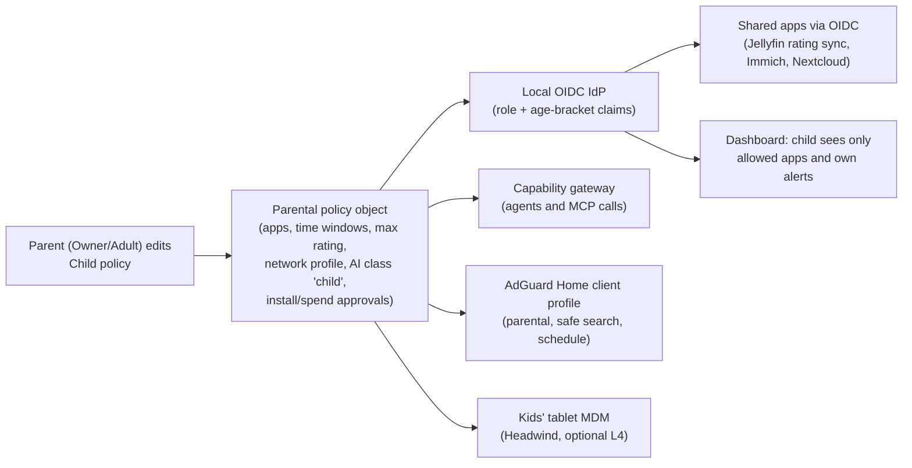

# 14 · Family, education, community and website (W13)

**Workstream:** W13 (Tier C) · **Tag:** `W13` · **Date:** 2026-11-11 · **Status:** draft, no refuter pass (Tier C does not require one)
**Claims:** `evidence/claims/W13.csv` (C-W13-001…051), plus reused rows from W6, W9, W16 and the teardowns · **Sources:** `evidence/sources/W13.md`, saved extracts in `evidence/sources/W13/` · **Question statuses:** `evidence/qbank/W13.md`
**Serves requirements:** U-1, U-2, U-3, U-4, U-5, W-1, W-2, W-3, W-4, W-5, W-6, W-7, W-8, W-9, A-5, A-6, R-2, M-1, M-2, M-4, AI-1, D-001, D-006 (full trace in §12)
**Consistency with 01:** nothing here changes the foundation decision. It uses 01's layer map: identity is a local OIDC provider in L3 that works offline, every module is a Market app (D-003), and the Market and its signed index come from 13 and 29.

> ### Explain it like I'm the founder
> **Family.** Every person in the house gets an account with a role: Owner, Adult, Teen, Child or Guest. A child's account decides which apps they see, when they can use them, which ratings of films they can watch, and that their data never goes to an outside AI. That part is fully in your control, because it lives on your box. Jellyfin already does this well for media, and we copy its model [C-W13-001, C-W13-002]. Umbrel and Olares have no parental controls at all.
>
> **The child's own phone or tablet is the hard part.** Apple and Google decide what any outside app may lock down. OneMind can't take over a child's iPhone without Apple's permission (a special entitlement) or a reset into a managed device [C-W13-004, C-W13-008]. So we offer a ladder: (1) the child signs into OneMind in a browser or app and only sees their apps; (2) the box filters the child's internet through its own DNS filter, even away from home over the private network [C-W13-003]; (3) we walk the parent through Apple Screen Time or Google Family Link; (4) for a dedicated kids' tablet, you scan a QR code after a reset and OneMind manages it fully, using an Apache-2.0 open-source MDM [C-W13-008, C-W13-010].
>
> **New laws now target operating systems directly.** California's AB 1043 makes an "operating system provider" ask for a birth date at account setup from 1 Jan 2027 and pass an age range to apps [C-W13-012]. A 2026 amendment seems to exempt OSes under open licences like Apache-2.0, but whether that covers a company selling boxes is unclear [C-W13-014]. systemd (part of Debian) already added a birth-date field for this [C-W13-015]. **Our design collects a birth date for child profiles anyway, so we build the age signal in from the start.** It is cheap, and it protects the box business.
>
> **Education.** Children's learning stays on the box and offline: Kiwix (offline Wikipedia, 13 GB to 119 GB) and Kolibri (courses; runs on a Pi) [C-W13-020, C-W13-022]. Circle.so is for **adults** who want to learn to build boxes. Keep the course source files in your own Git repository, because Circle's export gives members, posts and comments, but not lessons or media [C-W13-025].
>
> **Website.** Copy what the competitors converged on: a static site for the blog and docs, **Shopify** for the cart, and **Discourse** for the forum. Six of seven competitors use Discourse, and four sell hardware through Shopify [C-W13-051]. Plugins and apps get pages on the website with an **"Open in OneMind"** button. The website never sees your box: your browser remembers the box address, the same trick Home Assistant uses [C-W13-043].

---

## 0. Recommendations

| ID | Recommendation | Requirement IDs | Key evidence | Confidence |
|---|---|---|---|---|
| **REC-W13-01** | Household roles **Owner / Adult / Teen / Child / Guest** (same names as 10 §5.1 and 12 §5), carried as OIDC group claims from the box's local identity provider. Child profiles store a **birth date** (needed for role promotion and for age laws). | U-1, U-3, U-4 | C-TD-umbrelos-033, C-TD-olares-036, C-W13-012, C-W13-015 | High |
| **REC-W13-02** | **Shared multi-tenant apps by default**: an app that has its own user model (Jellyfin, Immich, Nextcloud) runs once and gets the role via OIDC. **Per-user instances** only for single-user apps, and only on Pro and up (RAM). The manifest declares `multiUser: native \| perUserInstance \| ownerOnly`. | U-1, N-2, F-14 | C-TD-olares-036; 13 §5.1 manifest | Medium (RAM not measured, T-W13-1) |
| **REC-W13-03** | One **parental policy object** per child, modelled on Jellyfin: allowed apps, time windows, maximum content rating, network filter profile, AI data class `child` (local-only, 10 §7–8) and spending/installs need approval. The capability gateway enforces it for agents too. | U-3, AI-5, M-2 | C-W13-001, C-W13-002, C-W9-038 | High |
| **REC-W13-04** | **Child-device ladder** (§2): L1 browser/PWA + child login → L2 per-device DNS filtering via the AdGuard Home client API + the tailnet → L3 guided Apple Screen Time / Google Family Link setup → L4 a fully managed **kids' tablet** (Android device owner via Headwind MDM, QR after factory reset). A native iOS Screen Time app is **year 2+** (needs Apple's entitlement). | U-3, U-5, N-4 | C-W13-003, C-W13-004, C-W13-007, C-W13-008, C-W13-010 | Medium |
| **REC-W13-05** | Ship an **age-bracket signal** from day one: birth date at account setup for any user under 18, and a read-only `GET /v1/me/age-bracket` (under 13 / 13–15 / 16–17 / 18+) for Market apps, plus the same field in the systemd user record on the image. Counsel to confirm whether boxes and the Market are covered (AB 1043/1856, Texas SB 2420). | U-3, D-001, R-3 | C-W13-012…016 | Medium (law in flux) |
| **REC-W13-06** | **No child data in OneMind's cloud**: the website, Circle, Shopify, support desk and the optional relay never ask for or hold a child's data. Courses and the forum are 18+. COPPA duties then stay with the household's own box (W6 §8.4). | U-3, M-2 | C-W6-035, C-W13-017, C-W13-018 | High |
| **REC-W13-07** | An **"Offline Library" bundle** of Market apps: Kiwix-serve + a ZIM manager and Kolibri, with content packs sized per tier (§3). Child profiles see Library and Kolibri by default. Same as REC-NOMAD-01, now with sizes. | U-2, M-1, A-7, F-13 | C-W13-019…023, C-TD-project-nomad-022 | High |
| **REC-W13-08** | **Education:** keep Circle for paid adult cohorts in years 0–1 (founder's choice, W-2), with **course source in Git** so Circle is a delivery channel, not the system of record. Re-decide at 500 paying learners or if Circle's export stays without lessons. | W-2, M-1, D-001 | C-W13-025, C-W16-046 | Medium (founder decision) |
| **REC-W13-09** | **Website stack:** Astro + Starlight (MIT) in Git for site, blog and docs; **Shopify** (Basic → Grow) for the hardware cart; **Discourse** for the forum (hosted Pro first, self-host later); privacy-respecting analytics (Umami, MIT); downloads from signed release artifacts with a checksum page. **No headless CMS** at first; add Payload (MIT) only when non-developers edit content. Avoid Directus (source-available MSCL). | W-1, W-3, W-4, W-7, W-9 | C-W13-031…041, C-W13-051 | High |
| **REC-W13-10** | **Plugin/app pages on the website (W-8)** generated from the same signed Market index (29 REC-W19-12), each with an **"Open in OneMind"** button built the My Home Assistant way: a static redirect page; the box URL is kept only in the visitor's browser; the box shows the permission screen and installs only after on-box consent. Also an `onemind://` link for clients and an offline `.ompkg` download. | W-8, A-5, A-6, M-2 | C-W13-043…046 | High |
| **REC-W13-11** | **Support:** a one-click **redacted support bundle** in the OS on day one (HA diagnostics pattern: each app's manifest lists what to redact). Desk: Discourse support category + a hosted desk (Zoho Desk fits W-5/W-6) until volume justifies self-hosting FreeScout or Zammad (both AGPL, run as unmodified separate services). | R-2, W-5, W-6 | C-W13-042, C-W13-047 | Medium |
| **REC-W13-12** | **Agent-readable docs:** publish `/llms.txt` and `.md` copies of every docs page, version docs per OS release, and ship the same docs inside the image as offline help, served to agents through the capability gateway's docs tool. | W-3, AI-1, R-2 | C-W13-049, C-W13-026 | High |
| **REC-W13-13** | **Community metrics** opt-in only, with the HA model (nothing sent until the owner turns on "base"; separate toggles for usage and diagnostics). Track stars, forum and Discord members, opt-in active installs, Market installs per app and docs search misses. | M-2, A-6, R-2 | C-W13-048, C-W13-050 | High |
| **REC-W13-14** | **Forms (W-5):** use Zoho Forms as the founder asked, with the data centre chosen on purpose at signup (EU for EU buyers if needed), never for child data. Exit path: Formbricks (AGPL core) self-hosted. | W-5, M-2 | C-W13-028, C-W13-041 | Medium |
| **REC-W13-15** | **Affiliate links (W-4):** every affiliate link carries a clear, visible disclosure next to it, as the FTC Endorsement Guides require. | W-4 | C-W13-030 | High |

---

## 1. Family accounts, roles and parental controls (U-1, U-3, U-4; Q252, Q261)

### 1.1 What competitors do

| Product | Multi-user model | Parental controls | Constraints | Constraint fit with OneMind | What OneMind takes |
|---|---|---|---|---|---|
| **umbrelOS 2.0** | One permanent owner + members; members get a private Home folder, Photos and 2FA; only the owner manages apps, updates, backups, users [C-TD-umbrelos-033, C-TD-umbrelos-034] | None found (teardown) | Single box, Docker, small team | **High** for household UX; **none** for children | Owner-only device management; private home folder per member |
| **Olares** | Per-user namespace; Authelia (default deny) + LLDAP; owner signs dangerous operations [C-TD-olares-036] | None found | k8s, 8 GB floor, funded team | **Medium**: same k8s family, but per-user namespaces cost RAM that Pi/Lite boxes lack | Default-deny auth policy; owner-signed dangerous ops |
| **Home Assistant** | Users with an admin flag (12 §5) | None beyond admin/non-admin | Appliance, Docker | **Low** for families | Nothing specific |
| **Jellyfin** (an app, not an OS) | Per-user policy object | Max parental rating and sub-rating, allowed/blocked tags, blocked unrated items, allowed folders and devices, remote-access switch, session cap [C-W13-001]; weekly time windows per user [C-W13-002] | GPL-2.0 media server [C-W12-133] | **High**: this is the requirement's named model | The **shape** of the policy object (REC-W13-03), not code |
| **AdGuard Home** (an app) | Per-client settings | Parental filter, safe search, safe browsing, blocked services with a schedule, per-client upstreams; a client is an IP, CIDR, MAC or **ClientID** [C-W13-003] | GPL-3.0 [C-W12-121], runs on a Pi | **High**: the network layer for L2 (§2) | Drive it through its HTTP API from the parental policy |
| **Apple Screen Time / Family Sharing** | Family group with guardians | Full device controls, but third-party apps need the Family Controls entitlement and guardian approval on the child's device [C-W13-004, C-W13-005] | Apple's platform, Apple's rules | **Low** to replace, **high** to guide | Guided setup (L3); a native app later |
| **Google Family Link / Android Enterprise** | Supervised Google accounts; enterprise device owner | Device owner needs a new or factory-reset device [C-W13-008]; new custom DPC registrations with Play's EMM API are closed [C-W13-007] | Google's platform | **Medium**: device-owner mode works for a dedicated kids' tablet | QR provisioning of a kids' tablet (L4) |
| **Synology DSM** | Users and groups with app privileges | UNVERIFIED (not opened in this pass) | NAS vendor | — | — |

**What this teaches:** no self-hosted OS competitor ships parental controls. The proven parts sit in **apps** (Jellyfin for content, AdGuard Home for networks) and in the **phone platforms**. OneMind's job is to **unify** them behind one policy per child, not to invent a new filter.

### 1.2 Design



- **Roles** (REC-W13-01): Owner (one, permanent, as in Umbrel), Adult, Teen, Child, Guest. Infrastructure screens stay operator-only (12 §5).
- **Per-user vs shared apps** (REC-W13-02, the Q252 decision). Per-user instances multiply memory on a Pi, and Olares pays for its per-user model with an 8 GB floor (05 §1, C-W4-042). The default is therefore **one instance, many users through OIDC**. The manifest field `multiUser` tells the Market which mode an app supports. A `perUserInstance` app shows "needs a Pro box for more than one person" on Lite.
- **Mapping the policy into apps:** a small adapter per app pushes the child's limits into the app's own policy (for Jellyfin: `MaxParentalRating`, `AccessSchedules`, `EnabledFolders` [C-W13-001, C-W13-002]). Apps without an adapter are either visible to the child or not; nothing in between.
- **AI:** a child's agent can never exceed the child (10 §5.1), child data is class `child` and stays local (10 §7–8). Face templates and voiceprints count as children's personal information under COPPA [C-W9-038], so biometrics stay off for child profiles.

---

## 2. Putting OneMind on a child's device (U-3)

The requirement says "adding the OS or app to a child's device to access particular apps". The evidence shows a ladder: each rung adds control and also friction.

| Level | What the parent does | What OneMind can enforce | What it **cannot** enforce | Evidence |
|---|---|---|---|---|
| **L1 · Child login** (any device) | Install the OneMind app or PWA, sign in as the child (QR from the parent's dashboard) | Which OneMind apps and data the child sees; time windows inside OneMind apps; AI limits | Anything outside OneMind (browser, games, other apps) | §1.2 |
| **L2 · Network filter** | The box gives the device a per-child **DNS identity**: a ClientID in an encrypted-DNS address, used at home and, through the tailnet, away from home | Category filtering, safe search, blocked services with a bedtime schedule, per child [C-W13-003] | A child who removes the DNS profile or VPN on an unmanaged device (analysis, not tested: T-W13-3) | C-W13-003 |
| **L3 · Platform controls, guided** | OneMind walks the parent through Apple Screen Time or Google Family Link, then L2 | Everything the platform offers, managed in the platform's app | OneMind does not see or change those settings | C-W13-004, C-W13-005 |
| **L4 · Managed kids' tablet** | Factory-reset an Android tablet, scan a OneMind QR code at the welcome screen | Full device-owner policy: allowed apps, kiosk mode, DNS, updates. Headwind MDM is Apache-2.0 and self-hostable [C-W13-010] | iPhones/iPads (Apple MDM needs Apple's push certificate and supervision; NanoMDM is MIT [C-W13-011] but the Apple side is UNVERIFIED here) | C-W13-008, C-W13-010 |
| **Later · Native iOS controls** | Install a OneMind iOS app that uses Screen Time APIs | Restrictions set from the OneMind dashboard, guardian-approved on the child's device | Requires Apple to grant the Family Controls entitlement before App Store release [C-W13-004] | C-W13-004…006 |

**Why L4 uses device-owner mode and not Google's EMM programme:** Google has closed new registrations of custom DPCs with its Play EMM API [C-W13-007]. Device-owner provisioning by QR code on a reset device remains a documented path [C-W13-008]. Headwind MDM does exactly that on its own server. This links to N-4: the same **scan-a-QR-to-onboard** flow used for robots onboards a kids' tablet. Run the end-to-end test (T-W13-2) before promising it on a box. Whether Play-protected devices accept a non-Play DPC after the policy change is **UNVERIFIED**.

**Link to W14:** a "OneMind kids' tablet" is the simplest form of the OneMind end-user device (EUD) that W14 discusses. It starts as an Android tablet in device-owner mode, not a custom ROM.

### 2.1 Laws that now reach the OS itself

| Law | What it requires | Status (2026-11-11) | What it means for OneMind | Evidence |
|---|---|---|---|---|
| **California AB 1043** (Digital Age Assurance Act) | OS provider: ask birth date/age at account setup; send apps an age-bracket signal (under 13, 13–15, 16–17, 18+); minimal data | Chaptered 2025-10-13; operative **2027-01-01**; older devices by 2027-07-01; up to $2,500 / $7,500 per affected child | If covered, the box's account setup and an app-facing signal API are needed: REC-W13-05 | C-W13-012 (secondary; leginfo blocked) |
| **California AB 1856** | Excludes OSes distributed under a licence allowing copy, redistribution and modification | **Signed 2026-09-10** [C-W13-013]; text details secondary | OneMind's image is Apache-2.0 (D-001), so likely exempt as a distribution. **Open:** whether a company selling a box with the OS preinstalled is still covered, and whether the Market is a "covered application store" | C-W13-013, C-W13-014 |
| **Texas SB 2420** (App Store Accountability Act) | App stores: age verification, parental consent, age ratings | Injunction **stayed** by the Fifth Circuit on 2026-06-04, so enforceable during appeal | Only if the Market counts as an app store under Texas's definition: counsel question | C-W13-016 |
| **COPPA** (amended) | Operators collecting children's data: notices, verifiable consent, **separate consent for third-party disclosure**, written security programme | Effective 2025-06-23; compliance by **2026-04-22** | Applies to OneMind's own online services only if they collect child data. REC-W13-06 keeps them out | C-W13-017, C-W13-018, C-W6-035, C-W6-036 |
| **GDPR Art. 8** | Parental consent below 16 (13–16 by state) for online services | In force | Same as COPPA: keep child data on the household's box | C-W6-037 |
| UK Age Appropriate Design Code; EU DSA minors guidance; Utah/Louisiana app-store laws; Colorado SB26-051 | Various | **Not opened** in this pass (UNVERIFIED) | Counsel review before EU/UK box sales | — |

**Upstream already moved:** systemd merged a `birthDate` field in user records, settable only by administrators, citing AB 1043, Colorado and Brazil [C-W13-015]. On a Debian 13 base this is the natural place to store the date on the image. The platform side has signals too: Apple's Declared Age Range [C-W13-006] and Google's Play Age Signals (limited to apps updated by Google Play; no ads or analytics) [C-W13-009]. The OneMind phone apps should read those signals and must not use them for anything else.

---

## 3. Kids' education and offline knowledge (U-2; Q268)

| Project | What it gives | Size / hardware | Licence | Update model | Fit for OneMind |
|---|---|---|---|---|---|
| **Kiwix** (kiwix-serve + ZIM files) | Offline Wikipedia, Gutenberg, PhET, Khan videos, Stack Exchange | Wikipedia EN: mini 13 GB, no-pictures 49 GB, full 119 GB; Gutenberg 206 GB; PhET 104 MB [C-W13-022] | GPL-3.0 [C-W13-021]; content under each source's licence (Wikipedia CC BY-SA) | New ZIM files every few months; replace the file | **High**: one container plus data volumes; any tier |
| **Kolibri** | Courses and exercises (Khan Academy and others), classes, learner progress, works offline | 1 GB RAM on Linux; a Pi works as a server for under 30 computers; Android 8+ app [C-W13-020] | MIT [C-W13-019]; v0.19.5 (2026-07-13) | Channels imported from Kolibri Studio or a USB/peer device | **High**: the "school" app for child profiles |
| **Internet-in-a-Box** | Bundles Kiwix, Kolibri, maps and more on a Pi | Pi-oriented | GPL-2.0; last release 2025-01-01 [C-W13-023] | Ansible install on a distro | **Medium**: a pattern; OneMind already has the platform |
| **Project N.O.M.A.D.** | Command Center installing Kiwix, Kolibri, Ollama and 14 more | x86 only, 4 GB minimum [C-TD-project-nomad-014, C-TD-project-nomad-022] | Apache-2.0 (software) | Per-app container updates | **High** as the competitor to beat (02-competitors/project-nomad.md) |
| **Moodle** | Full LMS for schools | Heavier PHP stack | GPL-3.0 [C-W13-024] | Upgrades with migrations | **Low** for homes; an optional Market app for co-ops/schools |
| **Frappe LMS** | Courses and cohorts | Frappe stack | AGPL-3.0 [C-W13-024] | — | Candidate if OneMind later self-hosts its paid courses (§4) |
| RACHEL, Khan Academy Lite | Offline education bundles | — | Not opened (UNVERIFIED) | — | — |

**Content packs per tier (REC-W13-07):**

| Tier (11) | Disk budget for the library | Suggested default pack |
|---|---|---|
| Edge / Lite (Pi 5, 64–256 GB SSD) | ~20 GB | Wikipedia mini (13 GB) + PhET + a few Kolibri channels |
| Pro (1–2 TB) | ~100 GB | Wikipedia without pictures (49 GB) + Kolibri Khan Academy channels |
| Omni / homestead library | 400 GB+ | Wikipedia full (119 GB) + Gutenberg (206 GB) + Khan ZIM (168 GB) |

The newest English Khan Academy ZIM on the mirror is from **2023-03** [C-W13-022]. For current Khan content, prefer Kolibri channels. Pack the libraries as **data artifacts**, separate from app images, so the backup tier can skip them (they can be downloaded again). This matches NOMAD's lesson of keeping big content out of the update path (02-competitors/project-nomad.md).

---

## 4. The education business and the community platform (W-2; Q320)

| Option | Strength | Lock-in and sovereignty | Cost | Evidence |
|---|---|---|---|---|
| **Circle.so** (founder's choice) | Courses, cohorts, events, paywalls, community in one place | Hosted. The export is admin-only, **on request**, as CSV for members, spaces, posts, comments and events, **without uploaded media**; course lessons are not listed [C-W13-025] | $89 / $199 (API + MCP) / $419 a month [C-W16-046] | C-W13-025, C-W16-046 |
| **Discourse** | The forum every competitor uses; open source | Self-hostable, GPL-2.0, full database export | Hosted Pro $100/mo, Business $500/mo, or self-host free [C-W13-027] | C-W13-027, C-W13-051 |
| **Frappe LMS** | Open-source courses and cohorts | Self-host; AGPL-3.0 | Server cost only | C-W13-024 |
| **Moodle** | Mature LMS | Self-host; GPL-3.0 | Server cost; heavier to run | C-W13-024 |

**Recommendation (REC-W13-08):** keep Circle for **paid adult courses** at the start, because speed matters and the founder chose it (W-2). Two guards:
1. **Course source lives in Git** (Markdown + video files in OneMind's storage). Circle displays it, but the export does not give it back [C-W13-025].
2. **Public knowledge does not live in Circle.** Docs and the open forum are on OneMind-owned surfaces (Starlight docs, Discourse), so search engines, agents and the community can reach them. Circle's own help centre publishes `llms.txt` [C-W13-026]; OneMind's docs must be at least as agent-readable.

**Does Circle contradict the brand?** Partly. A sovereignty brand that holds paying customers' learning in a US SaaS needs a stated exit. The exit is Frappe LMS or Discourse plus a static course site, re-decided at 500 paying learners. **`blocked: founder-decision`** (listed for 26).

---

## 5. Website stack (W-1, W-3, W-4, W-5, W-6, W-7, W-9; Q269)

### 5.1 What competitors' websites run on (fingerprinted 2026-11-11)

| Company | Main site | Docs | Store | Forum | Support | Analytics | Constraints | Constraint fit |
|---|---|---|---|---|---|---|---|---|
| **Umbrel** | Next.js on Vercel [C-W13-031] | (no docs subdomain answered) | **Shopify** + Intercom | **Discourse** | Intercom chat on store | Plausible/Umami markers | Small team, sells boxes | **High**: same business shape |
| **Home Assistant / OHF / Nabu Casa** | Jekyll on Netlify; Nabu Casa on Astro [C-W13-032] | Astro (developers → contributors site) | **Shopify** (OHF store) | **Discourse** | **Zendesk** (Nabu Casa) | Plausible | Funded team, huge community | **High** for docs + forum + privacy analytics |
| **Olares** | Vercel [C-W13-033] | **VitePress** | **Shopify** + Klaviyo | **Discourse** + Discord | — | Google Tag Manager | Funded team, sells Olares One | **Medium** (heavy marketing tooling) |
| **Start9** | **Ghost** [C-W13-034] | nginx (engine not identified) | Ghost-served store page | **Discourse** | — | — | Small team, sells servers | **High** for simplicity |
| **ZimaSpace** | Nuxt [C-W13-035] | Hexo | **Shopify** with an **affiliate programme** | **Discourse** + Discord | — | — | Hardware vendor | **High** for cart + affiliates (W-4) |
| **Framework** | Own app on Heroku [C-W13-036] | HubSpot knowledge base | own app | **Discourse** | HubSpot | — | Mid-size hardware company | Low (custom commerce) |
| **System76** | BigCommerce + HubSpot [C-W13-037] | **Astro Starlight** on S3 | BigCommerce | — | Starlight docs | — | Mid-size hardware company | **Medium**: proves Starlight for hardware support docs |
| PINE64 · N.O.M.A.D. | Hugo · Next.js/Vercel [C-W13-038] | Hugo | — | — | — | — | Community / small | Medium |

**What they converged on** [C-W13-051]: **Discourse** for the forum (6 of 7), **Shopify** for hardware (4 of 6 sellers), docs in a **static generator kept in Git** (VitePress, Starlight, Jekyll, Hexo, Hugo), and the main site on a JavaScript framework at a CDN host. None of them runs a headless CMS that we could detect.

### 5.2 OneMind's stack (REC-W13-09)

| Need | Choice | Why | Licence / cost | Exit path |
|---|---|---|---|---|
| Site, blog, news, partners (W-1) | **Astro + Starlight**, Markdown in Git, static hosting | Same family as Nabu Casa and System76; one repo for site + docs; agents can edit Markdown | MIT [C-W13-039] | Any static host |
| Docs (W-3) | Starlight, versioned per OS release; `llms.txt` + `.md` copies (§8) | System76 support uses it [C-W13-037] | MIT | Any Markdown SSG |
| OS downloads (W-3) | Signed images from the release pipeline (01, 04); download page lists sha256 and signature; mirrors via object storage | Release signing is a 01 decision; the page only shows it | — | — |
| Cart and hardware sales (W-4) | **Shopify** Basic ($29/mo yearly) → Grow when volume justifies; Shopify Payments to avoid the 2%/1% third-party fee [C-W13-029] | 4 of 6 competitor sellers; handles tax, shipping and fraud for a solo founder | Hosted | Medusa (MIT core, EE excluded) or Saleor (BSD-3) [C-W13-041, C-W13-039] |
| Affiliate links (W-4) | Clearly labelled links on hardware guides | Required disclosure [C-W13-030]; Zima and NOMAD use affiliates [C-W13-035, C-TD-project-nomad-013] | — | — |
| Forms (W-5) | **Zoho Forms**, data centre chosen deliberately at signup [C-W13-028] | Founder's request | Hosted | Formbricks (AGPL core) [C-W13-041] |
| Support desk (W-6) | Discourse support category + Zoho Desk at first (§7) | One vendor with Forms | Hosted | FreeScout or Zammad (AGPL) [C-W13-042] |
| Headless CMS (W-7) | **None at first.** Payload (MIT) if non-developers need an editor | Competitors don't use one; Git + Markdown is cheaper and agent-friendly | MIT [C-W13-039] | — |
| Forum and community (W-1) | **Discourse** hosted Pro ($100/mo) → self-host on OneMind's own cluster | Universal among competitors | GPL-2.0, run unmodified [C-W13-027] | Full export |
| Analytics | **Umami** (MIT), self-hosted | Privacy-respecting; no cookie banner needed in most setups (not legal advice) | MIT [C-W13-039] | Plausible (AGPL) |

**Avoid:** Directus for anything OneMind redistributes, because its licence excludes "Competing Use" until each version turns GPL after four years [C-W13-040]. With Strapi, Medusa, Chatwoot and Formbricks, stay out of the `ee/` or enterprise folders [C-W13-041].

**Solo-founder monthly cost at launch (planning range, prices from the cited pages):** Shopify $29–39, Discourse $0–100, Circle $89–199, Zoho Forms/Desk (not priced here), static hosting $0–20 → roughly **$120–360 a month** before payment fees. Treat it as a range, not a quote.

---

## 6. Plugins and apps on the website (W-8)

| Ecosystem | Web catalog | How "install" works from the web | Who confirms | Constraint fit | Evidence |
|---|---|---|---|---|---|
| **Home Assistant (My links)** | No web add-on store; a static redirect site | The site remembers the user's instance URL **in the browser only** and sends them to `<instance>/_my_redirect/<key>`, e.g. open the app store or start adding an integration; old keys keep working through `legacy.json` | The user, inside their own instance | **High**: self-hosted boxes at unknown addresses | C-W13-043 |
| **Obsidian** | obsidian.md / community.obsidian.md pages with install counts | `obsidian://show-plugin?id=<id>` opens the desktop app | The user in the app | **High** for clients | C-W13-044 |
| **Flathub** | flathub.org app pages | `flatpak+https` link or a `.flatpakref` file that "does not install it" by itself | The user's software manager | **High** for offline/explicit installs | C-W13-045 |
| **Umbrel** | apps.umbrel.com gallery | No install link to the box; "Get it on umbrelOS" goes to marketing | — | Low (a gap to beat) | C-W13-046 |
| **Olares** | market.olares.com web catalog | Not traced in this pass | — | — | site fetch only |

**OneMind design (REC-W13-10):**

```mermaid
sequenceDiagram
  actor U as Visitor
  participant W as onemind website (static)
  participant B as Visitor's browser storage
  participant X as OneMind box
  U->>W: Opens app page, clicks "Open in OneMind"
  W->>B: Read saved box URL (ask once if missing)
  W->>X: Redirect to https://<box>/_onemind/open?app=<id>&version=<v>
  X->>X: Verify app in signed Market index (29)
  X->>U: Show permissions, size, tier fit; ask Owner/Adult to confirm
  U->>X: Confirm (a Child gets "ask a parent")
  X->>X: Install via Market controller
```

- The website **never learns** the box's address. That keeps M-2, and it is the HA pattern [C-W13-043].
- Pages are **generated from the signed Market index** (29 REC-W19-12), so the website can't list something the box would refuse.
- **Offline:** each page also offers the signed `.ompkg` bundle for USB installs (29 §10), like Flathub's `.flatpakref` [C-W13-045].
- A Child account that follows such a link gets "ask a parent" (REC-W13-03). The redirect must be a GET with no side effects; the install needs a confirmed POST on the box.

---

## 7. Support and diagnostics (R-2, W-6; Q270)

| Pattern | Who | Evidence | OneMind |
|---|---|---|---|
| Redacted diagnostics download per integration/device; a shared redaction helper | Home Assistant | C-W13-047 | `onemind support bundle`: OS + k3s + per-app sections; each manifest declares `diagnostics.redact` keys; the default redacts tokens, passwords, keys, addresses, names and child data. The user sees the bundle before sending |
| Zendesk help centre for a paid cloud service | Nabu Casa | C-W13-032 | Hosted desk at first |
| Intercom chat on the store | Umbrel | C-W13-031 | Not needed at launch |
| HubSpot knowledge base | Framework | C-W13-036 | Starlight docs instead |
| Community forum as first-line support | All (Discourse) | C-W13-051 | A Discourse "Help" category with a template that asks for the bundle ID |

**Self-hosted desk later:** FreeScout or Zammad (both AGPL-3.0 [C-W13-042]), run unmodified as separate services. That keeps AGPL duties simple. Chatwoot's core is MIT if live chat is needed [C-W13-041]. Remote support sessions are not designed here: they need the gateway's approval flow (10 §5), and are **year 2+**.

---

## 8. Documentation that people and agents can read (W-3; Q276)

- **One source, three outputs:** Starlight builds the website docs; the same Markdown is packed into the OS image as offline help; and the gateway exposes a `docs.search`/`docs.read` tool to agents (AI-1).
- **llms.txt v2:** an `/llms.txt` with an H1, a summary and link sections, plus a `.md` copy of every page at the same URL [C-W13-049]. Circle already does this for its help centre [C-W13-026].
- **Versioning:** one docs version per OS release line (the A/B channel in 04), with "latest" as the default and the version shown on the box linking to its own docs.
- **Competitor pattern:** HA moved its developer docs to an Astro site [C-W13-032]; Olares uses VitePress [C-W13-033]; System76 uses Starlight [C-W13-037]. Each keeps docs in Git.

---

## 9. Community growth and privacy-respecting metrics (A-6; Q275)

| Project | GitHub stars (2026-11-11) | Note | Evidence |
|---|---|---|---|
| Home Assistant core | 92,150 | 13 years; Discourse forum; opt-in analytics | C-W13-050, C-W13-048 |
| Omarchy | 46,756 | Created 2025-06-01: fastest recent growth among references | C-W13-050 |
| Project N.O.M.A.D. | 43,161 | Created 2025-06-24; content + local AI offline | C-W13-050, C-TD-project-nomad-003 |
| CasaOS | 37,622 | Discourse + Discord (Zima) | C-W13-050 |
| Umbrel | 12,547 | Discourse + Discord | C-W13-050 |
| Olares | 5,357 | Discourse + Discord | C-W13-050 |

**What the numbers suggest (inference, not measured causation):** the two fastest-growing references (Omarchy, NOMAD) launched with a **clear single promise and a creator audience** (DHH's and Crosstalk Solutions' channels). For OneMind, education content (W-2) is the growth engine, which supports REC-W16 "education as acquisition".

**Metrics (REC-W13-13):** copy HA's switch: nothing leaves the box until onboarding is done and the owner turns on "base"; usage, statistics and diagnostics have their own toggles [C-W13-048]. Public metrics: stars, forum and Discord members, Market installs per app (counted at the download mirror, not on boxes), docs search misses, support-bundle categories. **Never** collect child-profile counts or ages.

**Not researched (partial):** Reddit/Discord member histories, founder retrospectives, ambassador programmes.

---

## 10. Founder-runnable tests (for `22-HARDWARE-LAB-TEST-PLAN.md`)

| ID | Test | Pass criteria | Decision consequence |
|---|---|---|---|
| **T-W13-1** | On the Beelink (k3s), run Jellyfin + Immich + Nextcloud once with 3 OIDC users, then as 3 per-user instances; record RSS | Shared ≤ 1.5× single-user RAM; per-user ≥ 2.5× (expected) | Confirms REC-W13-02; if shared apps leak data between users, mark them `ownerOnly` |
| **T-W13-2** | Factory-reset an Android tablet; provision Headwind MDM as device owner by QR; apply a kiosk + DNS policy | Provisioning succeeds without Google EMM registration; the child can't remove the policy without a reset | Go/no-go for L4 "kids' tablet" |
| **T-W13-3** | Child phone (unmanaged) with encrypted DNS using a per-child ClientID, at home and over the tailnet; try to bypass | Filtering works on both paths; record which bypasses work (remove profile, change DNS, other VPN) | Sets honest wording for L2 in the UI |
| **T-W13-4** | On a Pi 5 (8 GB), run kiwix-serve with Wikipedia mini + Kolibri with one Khan channel; 5 concurrent clients | Page loads < 2 s; RAM < 2 GB for both | Confirms the Edge/Lite library pack |
| **T-W13-5** | "Open in OneMind" prototype: static page → box redirect → consent screen | No box address leaves the browser (check the network log); a Child account gets "ask a parent" | Ships W-8 |

---

## 11. Glossary

| Term | Plain meaning |
|---|---|
| **OIDC** | OpenID Connect: the standard login handshake. One login service tells apps who you are and which groups (roles) you have |
| **Multi-tenant app** | One running copy of an app that keeps each user's data apart |
| **Per-user instance** | A separate copy of an app for each person: simple isolation, more memory |
| **Parental policy object** | One record per child holding all the limits; every enforcement point reads from it |
| **DNS filtering** | Blocking websites by refusing to look up their names; works for every app on the device |
| **ClientID** | A per-device label inside an encrypted-DNS address, so the box knows which child is asking even away from home |
| **MDM** | Mobile device management: a server that sets policies on phones and tablets |
| **Device owner** | Android's full-control management mode, set up only on a new or reset device |
| **Entitlement (Apple)** | A permission Apple must grant an app before it can use a sensitive API |
| **Age-bracket signal** | A minimal answer such as "13–15" that an OS gives apps instead of a birth date |
| **ZIM** | Kiwix's file format: a whole website packed into one compressed file |
| **Static site generator** | A tool that turns Markdown into plain web pages (Astro, Hugo, VitePress) |
| **Headless CMS** | A content database with an editing UI and an API, but no website of its own |
| **llms.txt** | A Markdown index at a site's root that tells AI agents what's there and where |
| **Deep link** | A link that opens a specific screen in an app or on a box |

---

## 12. Requirement trace

| Requirement | Where answered | Recommendation |
|---|---|---|
| U-1 | §1 | REC-W13-01, -02 |
| U-2 | §3 | REC-W13-07 |
| U-3 | §1, §2 | REC-W13-03, -04, -05, -06 |
| U-4 | §1.2 | REC-W13-01 |
| U-5 | §2 (L2 over the tailnet) | REC-W13-04 |
| W-1 | §5 | REC-W13-09 |
| W-2 | §4 | REC-W13-08 |
| W-3 | §5, §8 | REC-W13-09, -12 |
| W-4 | §5 | REC-W13-09, -15 |
| W-5 | §5 | REC-W13-14 |
| W-6 | §7 | REC-W13-11 |
| W-7 | §5 | REC-W13-09 |
| W-8 | §6 | REC-W13-10 |
| W-9 | §5.1 | REC-W13-09 |
| A-5, A-6 | §6, §9 | REC-W13-10, -13 |
| R-2 | §7, §8 | REC-W13-11, -12 |
| M-1, M-2 | §2, §4, §6, §9 | REC-W13-06, -08, -10, -13 |
| AI-1 | §8 | REC-W13-12 |
| D-001 | §2.1 (Apache-2.0 and AB 1856) | REC-W13-05 |
| D-006 | §5 (a working website is an Inception prerequisite, 17) | REC-W13-09 |

---

## 13. Founder decisions and open questions (for `26-…`)

1. **Circle vs self-hosted education** (Q320, `blocked: founder-decision`). Recommendation: Circle for paid adult cohorts now, course source in Git, re-decide at 500 learners.
2. **Kids' tablet as a product** (L4): sell a pre-provisioned Android tablet with a box, or document BYO only? Recommendation: document BYO first, after T-W13-2.
3. **Counsel review** (outreach draft for W16/W6): is a company selling boxes with an Apache-2.0 OS an "operating system provider" under AB 1043 as amended by AB 1856, and is the OneMind Market a "covered application store" (California) or "app store" (Texas SB 2420)? Until answered, build REC-W13-05 anyway.
4. **Forum hosting:** Discourse hosted ($100/mo) or self-hosted on the founder's cluster from day one? Recommendation: hosted for 6 months, then self-host when the cluster conversion (05) is done.

---

## 14. Limits of this pass

- Tier C: no refuters. Laws are summarised, not legal advice. AB 1043/1856 official text could not be opened (leginfo bot wall), so their details are **secondary** (C-W13-012, C-W13-014).
- Not opened: UK AADC, EU DSA minors guidance, Utah/Louisiana/Colorado laws, Synology DSM roles, RACHEL, Khan Academy Lite, Apple MDM/APNs requirements, Zoho Forms/Desk pricing and DPA, Medusa/Saleor hosting cost, EU VAT handling for the cart.
- Nothing was measured on hardware; T-W13-1…5 cover that.
- Website fingerprints are a single-day observation of public pages; stacks change (re-check by 2027-11-11).
