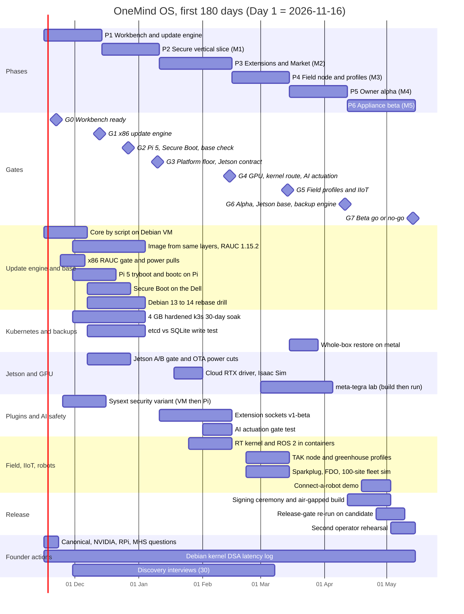

# 20 · The first 180 days: six phases, eight go/no-go gates

**Owner:** PLAN180 · **Date:** 2026-11-11 · **Window:** Day 1 = Monday **2026-11-16** (the hardware order deadline in 11 §10.1 and 22 §2.3) → Day 180 = Friday **2027-05-14** (26 weeks) · **Status:** plan complete; nothing in it has started
**Read with:** [`01-FOUNDATION-DECISION.md`](01-FOUNDATION-DECISION.md) (what is decided and what can still flip it), [`22-HARDWARE-LAB-TEST-PLAN.md`](22-HARDWARE-LAB-TEST-PLAN.md) (every test's commands and pass/fail), [`26-OPEN-QUESTIONS-FOR-ZEUS.md`](26-OPEN-QUESTIONS-FOR-ZEUS.md) (the Z-decisions this plan dates), [`27-LEARNING-PATH.md`](27-LEARNING-PATH.md) (study modules re-mapped to these weeks in §2.4), [`context/02-prior-planning.md`](../context/02-prior-planning.md) §16–§18 (Blueprint milestones M0–M6 and acceptance tests A01–A24)
**Claims:** IDs resolve in `evidence/claims/*.csv`. This file's new rows are `C-PLAN180-001…005`, re-checks on 2026-11-11 of the facts the gates start from (sources in [`evidence/sources/PLAN180.md`](evidence/sources/PLAN180.md)). Hour figures are **planning assumptions**, labelled as such; they are not evidence.
**Serves requirements:** M-6, M-7, M-8, R-1, R-2, R-3, P-1, P-4, P-5, P-7, P-8, P-9, N-1, N-2, N-3, N-4, N-6, N-7, N-8, N-9, A-1, A-5, A-6, A-8, AI-1, AI-2, AI-3, AI-4, AI-5, AI-7, AI-8, AI-9, U-1, U-4, U-5, UX-1, UX-4, UX-6, H-1, H-3, F-2, F-3, F-6, F-7, F-8, F-9, F-11, F-12, F-14, D-001, D-002, D-004, D-006, RS-6

> ### Explain it like I'm the founder
> The research decided *what* to build on: your own read-only Debian 13 image, two copies of the OS with automatic rollback (RAUC), k3s on every real box, restic backups. But two of those choices won only on a tie-break, and nearly everything was proven **inside virtual machines on a Mac**, never on a real Pi, Jetson or PC. So the first 180 days do two jobs at once:
> 1. **Build the product in thin slices**, in the order the Blueprint already chose (a secure "vertical slice" first, then plugins, then offline field use, then an owner can install it alone, then a signed appliance image).
> 2. **Prove the foundation on real metal early**, so that if something is wrong you find out in **week 4–8**, when switching costs days, not in month 6, when it costs the product.
>
> The plan has **six phases of about four weeks** and **eight gates**. A gate is a date where you look at test results and follow a rule written *in advance*: "if this passes, carry on; if it fails, take branch X". The branches are real alternatives the research already evaluated: **Mender** if RAUC fails on your hardware, **Rugix's** Pi path if RAUC's Pi path fails, **Ubuntu** if Canonical says yes, **bootc** if it works on a real Pi 5, **Yocto meta-tegra** for Jetson if it matches NVIDIA's own image. Writing the branch down first stops you from rationalising a bad result at 2 a.m.
> It assumes **about 45 hours a week from you**, with AI coding agents (the second ultracode session) writing most of the code under your review. If you fall behind, §8 says exactly what to drop first, and what you must never drop (the update, power-cut, restore and AI-safety tests). Day 180 ends with a **go/no-go on a public beta**: a certified-hardware list and flashable images for an x86 mini PC and a Pi 5 profile, not your own boxes yet.

---

## Contents

1. [The plan on one page (and the Gantt chart)](#1-the-plan-on-one-page)
2. [Assumptions: capacity, hardware, decisions, learning](#2-assumptions)
3. [The six phases](#3-the-six-phases)
4. [Go/no-go gates and standing re-open triggers](#4-gonogo-gates)
5. [Every lab test from 22, scheduled, with its decision consequence](#5-every-lab-test-scheduled)
6. [Blueprint acceptance tests A01–A24: where each runs and must pass](#6-blueprint-acceptance-tests-a01a24)
7. [Weeks 1–2, day by day](#7-weeks-12-day-by-day)
8. [Capacity tracking and the cut list](#8-capacity-tracking-and-the-cut-list)
9. [What competitors did in their first months (constraint fit)](#9-what-competitors-did-in-their-first-months)
10. [Recommendations → requirement IDs](#10-recommendations--requirement-ids)
11. [Glossary](#11-glossary)
12. [Limits, assumptions and items for other owners](#12-limits-assumptions-and-items-for-other-owners)

---

## 1. The plan on one page

| Phase | Weeks · dates | Goal (one line) | Blueprint milestone | Ends with gate |
|---|---|---|---|---|
| **P1** Workbench + update engine on metal | 1–4 · 2026-11-16 → 12-13 | Mac workbench, CI, Core by script on a Debian VM, the first RAUC image from the same layers, and the x86 update tests on real hardware | M0 Reconcile | **G0** (wk 1), **G1** x86 update engine (wk 4) |
| **P2** Secure vertical slice on the image | 5–8 · 12-14 → 2027-01-10 | Identity, agent identity, capability gateway, action ledger, one read and one bounded action, clean restore; Pi 5, Secure Boot and Jetson update proofs | M1 Secure vertical slice | **G2** Pi 5 + Secure Boot + base check (wk 6), **G3** platform floor + Jetson contract (wk 8) |
| **P3** Extensions and the Market contract | 9–13 · 01-11 → 02-14 | Signed packages, the ten extension sockets (v1-beta), four reference adapters, GPU and kernel-route decisions, robot runtime profile | M2 Repeatable extensions | **G4** GPU flavor, kernel route, AI actuation (wk 13) |
| **P4** Disconnected field node + first profiles | 14–17 · 02-15 → 03-14 | Offline capture and sync, NATS leaf buffering, the `tak-node` and `greenhouse` profiles on Pi 5, one cluster across Pi/x86/Orin, IIoT pull-forward tests | M3 Disconnected client | **G5** field profiles + IIoT (wk 17) |
| **P5** Independent owner alpha | 18–21 · 03-15 → 04-11 | Installer ISO, onboarding, QR join, backups and whole-box restore on metal, capability detection, first Market seed set; Jetson base lab | M4 Independent owner alpha | **G6** alpha + Jetson base + backup engine (wk 21) |
| **P6** Managed appliance beta | 22–26 · 04-12 → 05-14 | Signed release pipeline with offline root, air-gapped rebuild, every release-gate test re-run on the release candidate, a second operator succeeds unaided, "connect a robot" demo | M5 Managed appliance | **G7** beta go/no-go (Day 180) |

**Blueprint M6 (multi-site / federation) is not in the 180 days.** Its precursors run (NATS leaf outage, 100-site fleet simulation), and A13 is deferred to year 1 (§6). This follows the Blueprint's own rule: "M5 and M6 are gated follow-ons. If M1 or recovery fails, cut breadth" (context/02 §16).

**Why six phases take M4 to week 21, when the Blueprint's 30/60/90 plan aimed at M4 by day 90:** the Blueprint plan did not include the OS image, A/B updates, Secure Boot layout, Pi 5, Jetson or GPU work; ADR-001 and 01 add all of them, and the bank's own critique says earlier plans were too big for one engineer (Q292). This plan keeps the Blueprint's order and moves its dates; it does not drop its gates.

---

## 2. Assumptions

### 2.1 Capacity (brief §6 item d)

**Assumption (rule 8; no founder input was possible):** Zeus works on OneMind OS about **45 hours a week**, alone, with AI coding agents. The second ultracode session ([F-9]; its brief is `30-…`) writes most code; Zeus reviews it, runs every hardware test, and makes every decision. Agents cannot touch hardware, the live cluster or vendors, so those hours are fixed.

| Category | Hours/week | What it covers | Why this size |
|---|---|---|---|
| Build and review | 24 | Writing and reviewing code, CI, image recipes, adapters, dashboard | The remainder after the fixed lines |
| Hardware lab | 8 | The 22 tests in §5, recording results (22 §2.5) | §5 sums to about 205 attended hours over 26 weeks (estimate below) |
| Learning | 4 | 27's modules L0–L11, re-mapped in §2.4 | 27's own assumption [27 §1] |
| Business, legal, CRA | 5 | Outreach, counsel, Inception, interviews, CRA groundwork | lifecycle-cost A-15/A-16 put CRA at about 120 h/year plus 160 h one-time (assumptions, not quotes) [lifecycle-cost-2036 §4] |
| Live cluster and existing ops | 4 | Keeping the current DOKS cluster, Hermes and NATS running; read-only checks; RR-04's ingress-nginx exposure | The cluster is live today (context/01, reported state) |
| **Total** | **45** | | |

**Calendar:** weeks 6 and 7 (2026-12-21 → 2027-01-03) are planned at **half capacity** (about 22 h). Thursday of week 2 is a buffer day. Total ≈ 24 × 45 + 2 × 22.5 ≈ **1,125 hours**, of which ≈ 600 build, ≈ 205 lab.

| Phase | Weeks | Planned hours (all categories) | Of which lab (estimate) | Lab-heavy items |
|---|---|---|---|---|
| P1 | 1–4 | 180 | 30 | X86-00/01/02, PI5-01, VM-01/05/08, CLU-01…12 |
| P2 | 5–8 | 135 (holidays) | 40 | X86-03/04/06/07, PI5-02/06/07/12, JET-01/02, VM-03/04 |
| P3 | 9–13 | 225 | 40 | GPU-01/02/03, X86-12/13, PI5-08/09, JET-04, VM-10/18 |
| P4 | 14–17 | 180 | 35 | PI5-10, PI5-13a–d, VM-15/16/17, EUD-00…08 |
| P5 | 18–21 | 180 | 30 | X86-14, PI5-05, JET-06/07, X86-16, PI5-13f–i |
| P6 | 22–26 | 225 | 30 | Release-gate re-run, VM-14, PI5-13j, PI5-11, JET-05 |

Lab estimates use 22's stated times where it gives them (for example LT-X86-01 about 1 h, LT-X86-02 about 1.5 h, LT-X86-03 about 2 h, LT-PI5-01 about 3 h, LT-JET-01 about 1 day, LT-GPU-01 half a day); the rest are this file's estimates. Soak and write tests (LT-PI5-03, LT-PI5-04, LT-BIZ-05) run unattended and count only their daily reading.

**Without agent help** (if the second ultracode session does not run): build capacity drops by roughly half in this file's judgement. Then the cut list (§8) applies from G3, and the beta at G7 narrows to the x86 Lite image only.

### 2.2 Hardware arrival (D-004, REC-LABPLAN-06)

| Item | Ordered | Assumed in hand | First test |
|---|---|---|---|
| Mac (Apple silicon), Dell Latitude 5540, Beelink U55 | owned | Day 1 | LT-X86-00, LT-VM-09 |
| Spare USB 3 SSD (≥ 64 GB), microSD, USB-C/AC power meter | Day 1 | week 2 | LT-X86-01 |
| Raspberry Pi 5 **8 GB** + M.2 NVMe HAT + SSD + 27 W PSU | Day 1 | week 3 | LT-PI5-01 |
| Raspberry Pi 5 **4 GB** (+ NVMe) for the floor test | Day 1 | week 3 | LT-PI5-03 (otherwise `mem=4G`, 22 §15) |
| Jetson Orin Nano Super dev kit (dev use only [C-W10-027]) | Day 1 | week 4 | LT-JET-03, LT-JET-01 |
| Switched outlet + USB serial console (power-pull rig, REC-LABPLAN-03) | week 4 | week 6 | PP-10 unattended from P3 |
| USB depth camera (RealSense UVC) + USB-CAN adapter | week 6 | week 9 | LT-PI5-09 |
| SO-101-class arm or TurtleBot 4 (robot demo) | week 14 | week 18 | LT-PI5-13j |
| Cloud RTX instance (hourly, own Debian image, no founder credentials) | week 10 | week 10 | LT-GPU-01/02/03 |

**Why order on Day 1:** the Jetson kit price has already risen once by about 60% [C-W10-025, C-W10-026] and memory prices were forecast to roughly double in early 2026 [C-W10-037]; Pi and Jetson tests sit on the G2/G3 critical path. A late Jetson moves G3's Jetson half, not the whole gate (§4).

### 2.3 Founder decisions, dated

Each Z-item from 26 gets a "decide by" week, set by the first gate that needs it. A decision not made by its date is taken as **the recommendation in 26**, recorded as such (rule 8 logic, applied to the plan).

| Week | Decision (26) | Needed for |
|---|---|---|
| 1 | **Z-01** send the Canonical/counsel questions (LT-BIZ-01) · **Z-14 / Z-24** confirm "platform first inside an image-first plan" | S1 re-open path; P1 build order |
| 4 (G1) | **Z-03** RAUC vs Mender vs Rugix (provisional RAUC until then) · **Z-22** third-party host plugins in release 1 (from LT-VM-01) | Image recipe; extension sockets |
| 6 (G2) | **Z-18** x86 boot route (`efi` + signed UKIs, or GRUB fallback) | First Secure-Boot-ready image |
| 8 (G3) | **Z-04** signing-key custody and ceremony · **Z-07** k3s floor · **Z-23** k3s roles on robots and field kits | Release pipeline (P6); node profiles |
| 13 (G4) | **Z-17** robotics GPU boxes Debian or Ubuntu · **Z-19** Secure Boot key model and kernel · **Z-21** plugin contracts and review staffing | GPU flavor; kernel route; Market rules |
| 17 (G5) | **Z-02** security updates on by default (CRA) · **Z-10 / Z-27** fund the bootc Industrial profile · **Z-12** default TAK server · **Z-20** fleet server | Alpha update UX; year-1 roadmap |
| 21 (G6) | **Z-16** Jetson base (L4T or meta-tegra) · **Z-13** what "mirror" means · **Z-06** support period per SKU (draft) | Robotics beta; backup UX; CRA |
| 26 (G7) | **Z-05** CRA route (counsel opinion due 2027-Q2, after the window) · **Z-09** GPU-server flavor (only after Z-01) · **Z-15** fusing policy (rule for the window: **never fuse** a Pi or Jetson) | Year-1 plan in 21 |

Out of the window by design: **Z-08** RKE2 timing and **Z-25** FIPS (only on a buyer's request), **Z-11** certification route, **Z-26** desktop plugins.

### 2.4 Learning, re-mapped to these weeks

27 left its week numbers provisional until this file existed [27 §2]. The mapping below keeps each module just ahead of the week its build step starts.

| 27 module | Weeks here | Lands before |
|---|---|---|
| L0 Mac workbench | 1 | LT-VM-09, G0 |
| L1 Boot chain + systemd · L2 Disks, partitions | 1–3 | Image recipe (P1) |
| L5 A/B updates with RAUC ★ | 2–5 | G1, G2 |
| L3 Kernel config · L4 Image builds | 3–7 | Rebase drill, kernel contract |
| L6 k3s on a read-only root | 5–9 | G3 |
| L8 Security: signing to Secure Boot | 5–12 | G2 (Secure Boot), P6 ceremony |
| L7 NATS at the edge | 10–14 | P4 |
| L9 Real time · L10 ROS 2 | 10–13 | G4 robot runtime |
| L11 Jetson | 4 and 16–21 | LT-JET-01, G6 |

---

## 3. The six phases

Each phase lists its **goal**, **deliverables** (D-Pn.x), the **lab tests** run in it (full schedule in §5), the **Blueprint acceptance tests** it advances (status meaning in §6), and the **requirement IDs** it serves.

### P1 · Weeks 1–4 · Workbench, reconcile, and the update engine on metal

**Goal:** by week 4 the founder can build, from one source, both a script install on a Debian 13 VM and a RAUC A/B image, and the x86 update tests have run on a real PC.

| ID | Deliverable | Basis |
|---|---|---|
| D-P1.1 | Mac workbench: Lima `onemind-dev` VM (Debian 13), `/dev/kvm` check (nested virtualisation needs M3+ and macOS 15+ [C-W18-054]); a monorepo with lint, gitleaks and multi-arch buildx in CI | 28 §9.3, F-8 |
| D-P1.2 | **M0 reconcile:** contract inventory mapping the Blueprint contracts and the live cluster's services (context/01; LT-CLU-01…12) onto OneMind's layers L0–L5 (01 §8), one authority per concern; Hermes/NATS migration inventory (AI-9) | context/02 §16 M0, 01 REC-DEC-15 |
| D-P1.3 | **Core by script** on a plain Debian 13 VM: k3s pinned to the lab release v1.37.2+k3s1 [C-PLAN180-005] with the hardened config (REC-DEC-22), Gateway API + Traefik [C-W4-016], a local OneMind API health endpoint (the gate needs it), dashboard skeleton. This is the developer loop and the preview channel | 28 §8 step 1, Z-14 |
| D-P1.4 | **Image from the same layers (from week 3):** Dockerfile rootfs on a snapshot-pinned Debian, two CI legs `FROM debian:trixie` and `FROM ubuntu:26.04` (REC-DEC-17); **OneMind's own RAUC built from v1.15.2** at 4fb7c798 [C-PLAN180-001] (Debian's 1.13 cannot install on kernels ≥ 6.19 [C-LAB-ubuntu-2604-leg-010]); the 01 §4.3 disk layout with LUKS2 data from first boot (REC-DEC-08); the fresh-signal gate with the read-only-root bind-mounts and pre-install trial marker (REC-DEC-07, -23) | 01 §4.2–4.3 |
| D-P1.5 | Every passed emulated lab becomes a **CI job** on every image change: rauc-1152, ubuntu-2604-leg, mender, k3s-footprint-restore, secureboot-rauc, w19-sysext (REC-LABPLAN-02, the HAOS/umbrelOS pattern [C-LABPLAN-001…003]) | 22 §11 |
| D-P1.6 | Lab bench: spare USB SSD per x86 box (the Dell's own disk and Omarchy pilot stay untouched, 22 §15), result template and redaction rules (22 §2.5), a pre-push grep for home paths, private IPs, tailnet hostnames and e-mail addresses | 22 §2, critic N1/N2/N13 |
| D-P1.7 | Founder actions: send LT-BIZ-01 questions, apply to NVIDIA Inception (LT-BIZ-03, D-006), start the Debian kernel DSA log (LT-BIZ-05), brief a trademark attorney (LT-BIZ-02) | 26 Z-01, D-006 |

- **Lab tests:** LT-X86-00, LT-VM-09, LT-CLU-01…12, LT-VM-08, LT-VM-05, LT-VM-01, LT-VM-07, LT-VM-12, LT-X86-01, LT-X86-02, (LT-X86-08 only if LT-X86-01 fails), LT-PI5-01 (week 3–4), LT-PI5-03 starts, LT-PI5-13e starts, LT-JET-03.
- **Blueprint tests advanced:** A18 (interrupted update recovers: x86 on metal), A17 (k3s SQLite restore on a fresh VM, from LT-VM-12), A01 (CI builds and boots from the published recipe only; partial).
- **Requirements:** R-1, R-3, M-6, F-8, F-14, P-7, P-9, N-9, RS-4, D-002, D-004, AI-9.

### P2 · Weeks 5–8 · Secure vertical slice on the image (M1)

**Goal:** the Blueprint's day-30 gate, on the image instead of a laptop: human sign-in, a separate agent identity, one permitted and one denied capability, a durable request record, Core usable with AI stopped, a clean restore (context/02 §17). In parallel, the Pi 5, Secure Boot and Jetson update proofs.

| ID | Deliverable | Basis |
|---|---|---|
| D-P2.1 | Human identity (on-box IdP; the choice is fixed in `30-…`) with MFA; a **separate agent identity**; the **capability gateway** with one permitted and one denied capability; denial fixtures | A02, U-4, AI-5 |
| D-P2.2 | **Action ledger:** idempotency keys, `outcome_unknown` with no unsafe redispatch, human approval for actuation, OS updates, installs and exports (REC-DEC-13) | A07, A08, AI-4, AI-5 |
| D-P2.3 | One **read connector** (Home Assistant state) and one **bounded action** (an HA test light) through the gateway; Core still works with the model and agent harness stopped | A03, AI-7 |
| D-P2.4 | **Backups v0:** restic with three keys, k3s SQLite online `.backup` + token inside restic, a verified restore onto a fresh VM (REC-DEC-11, -28) | A17, R-2, UX-6 |
| D-P2.5 | Secure-Boot-ready image per the G2 decision (Z-18): `efi` backend + one signed UKI per slot, or the GRUB fallback; db-key enrolment procedure written for every x86 box (REC-DEC-20, -21, -36) | DC-18 |
| D-P2.6 | **Jetson flavor v0:** Orin flashed A/B from the factory (`ROOTFS_AB=1`), k3s **agent** + device plugin + GFD, start of the NVIDIA-backend wrapper (04 estimates 2–3 weeks) with a OneMind-owned payload verifier (REC-DEC-18, -35) | DC-07, M-7 |
| D-P2.7 | Live-cluster follow-ups (founder ops line): plan the phase-0 ingress-nginx → Gateway API + Traefik move for the DOKS cluster if LT-CLU-03 confirms public exposure (RR-04, 05 §9) | P-9 |

- **Lab tests:** LT-X86-03, -04, -05 (record "not applicable" on the Dell), -06 (QEMU, then Dell), -07 (Dell as reference), -10, -11; LT-PI5-02, -06, -07, -12; LT-VM-03, -04, -06; LT-PI5-04; LT-PI5-03 completes; LT-JET-01, -02.
- **Blueprint tests advanced:** A02, A03, A07, A08 (pass on the slice), A17 (fresh VM), A19 (no credentials in bundle or logs; partial).
- **Requirements:** U-4, AI-4, AI-5, AI-7, R-2, UX-6, M-2, M-7, N-2, F-14, P-9.

### P3 · Weeks 9–13 · Extensions and the Market contract (M2)

**Goal:** a signed package can be installed, disabled and updated without editing Core; a bad package is refused (M2 exit, context/02 §16). Plus the three hardware-acceleration decisions that depend on rented or bought hardware.

| ID | Deliverable | Basis |
|---|---|---|
| D-P3.1 | `onemind.app.yaml` signed manifest + trust store with an **expiring revocation list** (E9), the **Market controller** (E1) installing Helm-based apps, `onemind plugin init|validate|publish` skeleton | 29, REC-DEC-24 |
| D-P3.2 | The ten extension sockets E1–E10 at **v1-beta**, with the enforcement 01 makes part of the decision: signed-only extension policy, no directory extensions, quarantine before merge, per-vendor driver packs, `module.sig_enforce=1` (REC-DEC-24, -40) | DC-16, A-5, A-6 |
| D-P3.3 | Four **reference adapters at read scope**: Knowledge, Home Assistant, TAK, Legacy/Hermes, with a capability matrix (Blueprint days 41–50) | AI-2, AI-3, AI-9 |
| D-P3.4 | Grants never widen on a plugin update; revocation rejects online calls within 60 s; knowledge export opens in a plain editor; a stale physical command is refused | A05, A06, A16, A12 |
| D-P3.5 | GPU: NVIDIA modules **built and signed per image in CI**; the kernel contract checked in CI (REC-DEC-12, -19, -37) | DC-13, N-8 |
| D-P3.6 | `robot-runtime` namespace class (signed apps only get hostIPC/hostNetwork/`SYS_NICE`), the `robot-rt` image profile with its 12 h acceptance test (REC-DEC-29, -36; W7-R9) | M-7, N-7 |
| D-P3.7 | CRA groundwork: brief counsel (Z-05); request a notified-body pre-assessment quote, the parallel track 01 starts in 2027-Q1 (REC-DEC-39); CRA reporting under Art. 14 already applies from 2026-09-11 [C-W6-001], so draft the vulnerability-handling process now even though no product is on the EU market yet | M-8, R-3 |

- **Lab tests:** LT-VM-02, -10, -13, -18; LT-X86-08 (as P if not run at G1), -09, -12, -13; LT-PI5-08, -09, -13k, -13l; LT-JET-04; LT-GPU-01, -02, -03.
- **Blueprint tests advanced:** A04, A05, A06, A12, A16 (pass), A22 (payload and schema limits; partial).
- **Requirements:** A-1, A-5, A-6, AI-2, AI-3, AI-5, AI-8, N-7, N-8, F-2, F-3, F-5, F-7, M-7, M-8, R-3.

### P4 · Weeks 14–17 · Disconnected field node and the first profiles (M3)

**Goal:** a Pi 5 runs a field profile that keeps working through a WAN outage and loses no accepted capture (M3 exit), and OneMind is one OS from Pi to x86 to Orin (F-14).

| ID | Deliverable | Basis |
|---|---|---|
| D-P4.1 | Local store, queue and cursors; conflict UI; web client as a PWA first (REC-W15-06) | A09, A10, UX-8 |
| D-P4.2 | NATS leaf on the Pi with buffering and a visible drop policy; WAN-down operation of identity, DNS, Core, HA and TAK | A11, A14, N-6 |
| D-P4.3 | Profiles (E8, P-8): **`tak-node`** and **`greenhouse`** on Pi 5, their acceptance runs gated by RAUC (09 §8.2–8.3 still say Rugix; under REC-DEC-05 they run on RAUC) | P-8, F-13 |
| D-P4.4 | TAK adapter write path: stable UIDs, stale-time rendering, denied injection | A15 |
| D-P4.5 | One k3s cluster of Pi 5 + Beelink + Orin with the same Helm set; cross-arch portable restore | F-14, A21 |
| D-P4.6 | IIoT pull-forward (Z-27, REC-DEC-27): Sparkplug TCK against NATS and Mosquitto, go-fdo onboarding on Debian **and** EL10 bootc, 100 simulated sites | F-11, F-12, N-6 |
| D-P4.7 | Offline USB update with a wrong clock; delta update over a 64 kbit/s lossy link | R-1, N-6 |

- **Lab tests:** LT-PI5-10, -13a, -13b, -13c, -13d; LT-X86-15; LT-VM-11, -15, -16, -17; LT-EUD-00…08.
- **Blueprint tests advanced:** A09, A10, A11, A14, A15, A21 (pass); A13 (precursor only).
- **Requirements:** N-1, N-6, P-8, F-11, F-12, F-13, F-14, UX-8, R-1, AI-9.

### P5 · Weeks 18–21 · Independent owner alpha (M4)

**Goal:** someone other than Zeus can install OneMind from the published image on a clean x86 box, onboard, back up, export and restore (M4 exit). The Jetson base and the backup engine get their deciding tests.

| ID | Deliverable | Basis |
|---|---|---|
| D-P5.1 | Install paths per 01 §4.4: USB installer ISO for x86 (also the rescue disk), Pi 5 flash image, VM image; first-boot onboarding; QR join for a second node (N-4); household accounts, basic (U-1) | P-7, P-1, N-4 |
| D-P5.2 | Backups v1: schedule, pre-update snapshot, automatic verified restores, **whole-box restore onto new hardware**; owner isolation between two instances; secret isolation between plugins; resource limits; lost-device revocation and re-enrolment | A17, A19, A20, A22, A23 |
| D-P5.3 | Capability detection (NFD + OneMind probe) behind "this box can or can't run it" (N-3, A-8); local AI tier on Lite with a 1B model (AI-8) | N-3, A-8, AI-8 |
| D-P5.4 | First Market seed set with the licence linter (13; licence matrix rows per app, critic N5) | A-1, D-001 |
| D-P5.5 | Household vs operator dashboard views; native alert centre v0 (UX-4); rescue page that works without k3s | UX-1, UX-4 |
| D-P5.6 | Jetson base lab: meta-tegra + linux-yocto 6.18 vs L4T (and Canonical's image as a third arm), Mender on stock L4T (REC-DEC-18, -26, -35) | DC-09, Z-16 |

- **Lab tests:** LT-X86-14, -16a…f; LT-PI5-05, -13f, -13g, -13h, -13i; LT-VM-19; LT-JET-06, -07, -08; LT-EUD-09…12.
- **Blueprint tests advanced:** A01 (clean host, published bundle only), A17 (on metal), A19, A20, A22, A23 (pass).
- **Requirements:** P-1, P-7, N-3, N-4, A-1, A-8, AI-8, U-1, U-3, U-4, UX-1, UX-4, UX-6, R-2, M-7, F-2.

### P6 · Weeks 22–26 · Managed appliance beta (M5) and the second operator

**Goal:** a signed, reproducible image passes offline first boot, signed update, failed-boot recovery and data restore on each beta hardware profile (M5 exit), and a second operator succeeds unaided (A24).

| ID | Deliverable | Basis |
|---|---|---|
| D-P6.1 | Release pipeline: **offline root key ceremony** (Z-04), 2-of-3 signers, manifest expiry with offline grace, anti-downgrade for signed kernels, SBOM + Debian tracker states as VEX (REC-DEC-21, -41) | R-1, R-3, M-8 |
| D-P6.2 | **Air-gapped rebuild** from local mirrors, signed with the offline key, installed from USB (LT-VM-14, a release blocker) | REC-W15-11, M-2 |
| D-P6.3 | **Release-gate re-run on the release candidate**, not on lab images: LT-X86-01/02/03/04, LT-PI5-01, LT-VM-01/04, and LT-JET-01 if the Robotics beta ships (REC-DEC-34) | R-1, A18 |
| D-P6.4 | Second-operator rehearsal on a clean host (A24) and A01 re-run by that person | A01, A24 |
| D-P6.5 | **"Connect a robot" demo:** an SO-101-class arm via an MHS-shaped adapter, offline `.ompkg`, motion blocked until safety settings are confirmed (LT-PI5-13j; 08 §13 weeks 13–20, moved here for capacity) | F-3, N-4, AI-5, N-10 |
| D-P6.6 | Year-1 inputs for `21-…`: LT-BIZ-05 readout (K1 vs K2), per-SKU support periods (Z-06), CRA technical-documentation start, the beta's certified-hardware list (year 1 sells no own boxes: Q292, 11) | R-3, H-1, F-7 |

- **Lab tests:** LT-VM-14; LT-X86-05 (on an ODM candidate if available); LT-PI5-11, -13j; LT-JET-05; LT-EUD-13, -14; the release-gate re-runs above; LT-BIZ-05 readout.
- **Blueprint tests advanced:** A18, A24 (pass), A01 (pass by a second person).
- **Requirements:** R-1, R-3, M-2, M-8, F-3, F-7, H-1, H-3, N-4, N-10, P-5.

---

## 4. Go/no-go gates

**Rules for every gate.** (1) The pass/fail criteria are 22's, written before the run; a gate never changes them. (2) "Go" and "no-go" branches are the alternatives 01 already evaluated; no new option is invented at a gate. (3) A failed test is re-run once only if a lab-setup fault is shown in its log. (4) The result, the branch taken and the hours it costs are written into `evidence/lab/founder-hardware/` (REC-LABPLAN-04) and, if a decision moves, into 01's change log by its owner.

| Gate | When | Inputs (tests and decisions) | **GO** → | **NO-GO** → (the real alternative) | Cost of the no-go branch (estimate) |
|---|---|---|---|---|---|
| **G0** Workbench ready | end wk 1 (2026-11-22) | LT-X86-00, LT-VM-09, hardware ordered, LT-CLU checks done | Plan as written | No `/dev/kvm` (M1/M2 Mac) → all VM labs run in CI on native runners, slower loop [C-W18-054]; Dell lacks a custom-key Secure Boot mode or TPM → LT-X86-03…07 move to the first ODM candidate and G2 loses its Secure Boot half | 0–15 h |
| **G1** x86 update engine | end wk 4 (2026-12-13) | **LT-X86-01**, **LT-X86-02**, LT-VM-05 (Mender 3-try), **LT-VM-01** (sysext security variant), LT-VM-07/08 | **RAUC confirmed** for x86 (Z-03); host extensions on the data partition allowed under the signed-only policy (Z-22) | **RAUC fails on metal** → run LT-X86-08 (Mender) in week 5; if Mender passes, **S2 flips to Mender** (01 §3.2) and the image recipe swaps engines on the engine-neutral layout; if both fail, the fault is the layout or firmware: stop P2 image work and fix before anything else. **LT-VM-01 fails** → extensions only inside the RAUC bundle, no runtime host plugins in release 1 (01 §4.8, Z-22 = no). LT-VM-05 passes → RAUC loses its "boot tries" tie-break row; the count drops to 4–3, still RAUC (01 §3.2) | Mender switch about 1–2 weeks; sysext fallback about 1 week |
| **G2** Pi 5, Secure Boot, base check | end wk 6 (2026-12-27) | **LT-PI5-01** (RAUC + tryboot), **LT-X86-03/04** (Secure Boot + power pulls), **LT-PI5-02** (bootc on a real Pi 5), LT-X86-11, LT-PI5-12, LT-X86-10, LT-PI5-06; Z-01 status | Pi 5 tier "proven"; x86 Secure Boot route = `efi` + signed UKIs (Z-18); Debian stays the base | **LT-PI5-01 bricks or corrupts `autoboot.txt`** → Pi 5 moves to **Rugix's proven tryboot integration** or HAOS's single-partition variant [C-W3-029] (01 §6.7); REC-DEC-32 (re-offer an abandoned trial) is needed either way. **LT-X86-03/04 fail** → DC-18 re-opens; ship the first image on the **GRUB fallback** route with the same layout (REC-DEC-20). **LT-PI5-02 passes AND greenboot-rs #219 is fixed AND a Pi commit path needs no manual sync** → **re-open S1 toward bootc** (01 §3.1.5); at Day 1 #219 is still open [C-PLAN180-002] and the bootupd ESP-payload PR is unmerged [C-PLAN180-003], so a re-open is unlikely by week 6 | Rugix-on-Pi branch about 2 weeks; GRUB fallback about 3–5 days; an S1 re-open costs a re-plan of P3–P6 (weeks) |
| **G3** Platform floor, Jetson contract, rebase cost | end wk 8 (2027-01-10) | **LT-PI5-03** (30-day 4 GB soak), **LT-PI5-04** (etcd vs SQLite), **LT-VM-04** (cross-minor rollback), **LT-VM-03** (Debian 13 → 14 rebase, founder-hours), **LT-JET-01/02** | 4 GB Pi 5 is a platform node (Z-07); hub/Pro/Omni servers start on embedded etcd (REC-DEC-38); one release contract covers Jetson | **Soak fails** (< 2.0 GiB free or > 5 GB/day) → platform-node floor rises to **8 GB**, 4 GB boards become NATS leaves (REC-DEC-09/22). **etcd > 2× SQLite or > 5 GB/day** → SQLite everywhere. **Cross-minor rollback corrupts the datastore** → DC-12 flips: version-bound restore drill becomes mandatory before every k3s minor (REC-DEC-28). **Rebase > 4–6 founder-weeks** → weakens Debian (not a flip alone; 01 §3.1.5). **Jetson gate cannot block the commit or needs a USB reflash** → DC-07 flip condition: Robotics beta leaves the 180-day release, REC-DEC-35 items become blockers | Floor change: docs and SKU list only; Robotics beta removal frees about 60 h |
| **G4** GPU flavor, kernel route, robot runtime, AI actuation | end wk 13 (2027-02-14) | **LT-GPU-01/02**, **LT-X86-12**, **LT-VM-10**, LT-X86-13, **LT-PI5-08/09**, LT-JET-04, **LT-VM-18**, LT-PI5-13l | Pro GPU stays Debian; kernel stays K1 for launch; robot-rt profile includes the boards that passed | **GPU fails on Debian, passes on Ubuntu 24.04** → Pro/Omni GPU tier gets the **Ubuntu flavor** (REC-DEC-19; Z-17), still gated on Z-01. **Isaac Sim fails on Debian** (expected: NVIDIA lists Ubuntu and Windows hosts [C-REF-DC-robotics-013]) → robotics-simulation boxes use the Ubuntu GPU flavor. **LT-X86-12 refuses the signed module on a stock kernel** (expected [C-DEC-008]) → confirms **K2-hybrid** for the Secure Boot release (REC-DEC-25; Z-19); **LT-VM-10 ≥ 1 h per kernel bump** → K2 cost estimate rises, Secure Boot release moves later. **Container ROS fails on Debian but works on Ubuntu 24.04** → DC-15 flips for that tier. **LT-PI5-08 > 250 µs** → build a bcm2712 RT kernel in CI or drop Pi 5 from robot-rt; MCU for loops under ~1 ms either way. **LT-VM-18 fails** → **AI actuation and every `actuate` plugin are blocked from release** until it passes | Ubuntu GPU flavor about 2 weeks (after Z-01); K2 adds about 1 h/week recurring |
| **G5** Field profiles and IIoT | end wk 17 (2027-03-14) | **LT-PI5-13a/b/c**, **LT-PI5-10**, **LT-VM-15/16/17**, LT-VM-11, LT-X86-15, LT-EUD-01…08 | `tak-node` and `greenhouse` enter the alpha; NATS is the Sparkplug broker; FDO onboarding on Debian | **A profile fails** → it leaves the alpha, stays a lab profile. **Sparkplug TCK fails on NATS** → Mosquitto in the IIoT profile. **FDO blocked on Debian but works on EL10 bootc** → DC-02 (F-11) re-opens and the **EL10 bootc steelman gains**; Z-10 (fund the bootc Industrial profile) moves into year 1 instead of year 2. **Fleet sim not linear** → DC-02 G4(e) re-opens. **One-cluster test fails at platform level** → F-14 re-opens (DC-17). GrapheneOS + ATAK unexplained failure → stock Pixel/Samsung for ATAK, GrapheneOS for non-TAK users (22 §8.1) | Industrial re-plan affects 21, not this window |
| **G6** Alpha, Jetson base, backup engine | end wk 21 (2027-04-11) | **LT-X86-14** (whole-box restore), **LT-PI5-05** (restic vs Kopia), **LT-JET-06** (meta-tegra), LT-JET-07, A01/A17/A19/A20/A22/A23 results; Z-01 answer if received | Alpha opens to a second operator; restic stays; Jetson decision recorded (Z-16) | **Restore fails or RTO > 4 h** → restore design changes before any beta; alpha slips. **restic OOM or > 1 GB while Kopia stays under** → **S4 flips to Kopia** (steelman 75 vs 71). **meta-tegra passes** (CUDA/TensorRT within 10% of L4T, camera, NVENC, A/B gate) → **meta-tegra becomes the Jetson target**, no Canonical dependency for Jetson; **fails** → L4T Ubuntu stays and **Z-01 becomes critical** for the Robotics beta. LT-JET-07 passes and meta-tegra wins → one S2 flip condition toward Mender is met (01 §3.2: also needs a free delta path) | Kopia switch about 1 week; meta-tegra adoption is a year-1 build line |
| **G7** Beta go/no-go | Day 180 (2027-05-14) | Every **G-level test re-run on the release candidate** (D-P6.3), **LT-VM-14**, A18 and A24 on the candidate, A01 by a second person, hygiene scan clean | **Public beta:** x86 Lite image + Pi 5 Edge profile images on a certified-hardware list (26 B-4 order); Robotics beta on Orin only if G3 and G6 passed | Any release-gate test fails on the candidate → **no beta**; fix, re-run, re-gate (the Blueprint's rule: "Do not weaken safety to hit a date", context/02 §17). LT-VM-14 needs the internet at any step → release blocker. A24 fails → beta becomes a guided pilot with named users | Slip measured in weeks; no scope trade is allowed on these items |

### 4.1 Standing re-open triggers (watched every week, not dated)

These can fire at any time. Each is 01's pre-registered trigger; this plan only names who watches and when.

| Trigger (from 01) | Status at Day 1 | Watch | If it fires |
|---|---|---|---|
| **S1 → Ubuntu:** Canonical grants written redistribution permission (Z-01) **plus** either Pro for Devices priced within H-1 margins **or** `linux-nvidia-tegra` 7.0 in the 26.04 updates pocket running CUDA on Orin/Thor; LP #2170238 fixed (01 §3.1.5) | No answer (questions not yet sent); LP #2170238 still New [C-PLAN180-004] | Weekly inbox check from week 2; LP bug monthly | The Ubuntu CI leg (D-P1.4) becomes the shipping leg; re-run LT-X86-10 and LT-PI5-06 on it; re-plan the next phase, not the current one |
| **S1 → bootc:** LT-PI5-02 passes **and** greenboot-rs #219 fixed **and** a Pi commit path without manual sync (01 §3.1.5) | #219 open, main HEAD unchanged since 2026-11-02 [C-PLAN180-002] | Monthly check of greenboot-rs releases | Re-score C·C2 and re-run the S1 tie-break (DEC owner); no build change inside the window |
| **S2 → Mender:** LT-VM-05 (F3) passes **and** LT-JET-07 (E3) passes **and** (Jetson moves to meta-tegra **or** a free delta path is measured on the LT-VM-11 link) (01 §3.2) | None met | At G1, G6 | Engine swap on the engine-neutral layout, scheduled as a year-1 migration with an engine-migration artifact (REC-DEC-34) |
| **RAUC "track latest within 30 days"** (REC-DEC-31) | v1.15.2 is newest [C-PLAN180-001] | Monthly `git ls-remote` | Rebuild OneMind RAUC, run the CI battery, ship within 30 days |
| **S5 K1 → K2:** LT-BIZ-05 median Debian kernel DSA lag > 7 days or a "high" CVE > 14 days | Log starts week 1 | Readout at week 26 | K2-hybrid for x86/arm64 in year 1 (REC-DEC-25) |
| **GPU modules:** > 1 release-blocking NVIDIA module failure in 6 months (REC-DEC-37) | No GPU yet | From G4 | GPU tiers move to the Ubuntu flavor after Z-01 |
| **RR-04:** any new ingress-nginx CVE, or public exposure found by LT-CLU-03 (23) | Reported live (context/01) | LT-CLU-03 monthly | Phase-0 Gateway API + Traefik move on the live cluster jumps ahead of OneMind P-work that week |

---

## 5. Every lab test scheduled

Brief §6 item (c). Every ID in 22 appears exactly once below (sub-rows such as LT-X86-16a…f and LT-PI5-13a…l are listed individually). "Week" is the planned run; "Gate" is where its result is read. Levels: **G** gate, **P** parameter, **V** validate (22 §2.2). Consequences are 22's, shortened; 22 holds the commands and full pass/fail.

### 5.1 x86 (Dell Latitude 5540, Beelink U55)

| ID | Lvl | Week | Gate | Depends on | Decision consequence if it fails (pass = plan holds) |
|---|---|---|---|---|---|
| LT-X86-00 | G | 1 | G0 | live USB | Re-plan x86 rows; no decision flips |
| LT-X86-01 | G | 2 | G1 | X86-00, VM-08 | S2 toward Mender if X86-08 passes |
| LT-X86-02 | G | 2–3 | G1 | X86-01 | Corrupt grubenv/ESP → S2 flip or layout change |
| LT-X86-03 | G | 4–5 | G2 | X86-00 (TPM, custom keys), firmware key backup | DC-18 re-opens; GRUB fallback route |
| LT-X86-04 | G | 5 | G2 | X86-03 | Same as X86-03 |
| LT-X86-05 | P | 5 (Dell: record n/a); repeat on first ODM box | G2 / year 1 | X86-03 | Microsoft third-party UEFI CA stays in db (Z-19) |
| LT-X86-06 | G | 5 (QEMU), 7 (Dell) | G3 | X86-03 image | REC-DEC-21/36 unmet → Secure Boot release blocked |
| LT-X86-07 | P | 7 (Dell reference); ODM candidates year 1 | G3 / year 1 | X86-03 | Reject that firmware/ODM |
| LT-X86-08 | P (G if X86-01 fails) | 5 if X86-01 failed, else 9 | G1 / G4 | X86-00 | With VM-05: can Mender meet the 3-try rule (Z-03) |
| LT-X86-09 | P | 10 | G4 | X86-00 | Rugix stops being the documented alternative |
| LT-X86-10 | P | 5 | G2 | X86-01 | A Debian/Ubuntu difference adds an S1 tie-break row |
| LT-X86-11 | P | 6 | G2 | X86-00 | H4 failing confirms greenboot #219 on hardware (holds S1 off bootc) |
| LT-X86-12 | G | 9 | G4 | X86-03 image, `module.sig_enforce=1` | Expected refusal confirms K2-hybrid (REC-DEC-25) |
| LT-X86-13 | P | 11 | G4 | RT kernel package, k3s + 10 pods | Investigate SMIs/firmware; sets robot-rt default |
| LT-X86-14 | G | 19 | G6 | prototype with 10 apps, restic repos | Restore design changes before M4; S4 C3 < 5 |
| LT-X86-15 | P | 16 | G5 | signed USB bundle | Fix 04 §8 (signing-time / expiry rule) |
| LT-X86-16a | V | 20 | G6 | MCP gateway prototype | Fix before the AI connector ships |
| LT-X86-16b | V | 21 | G6 | Jellyfin/Immich/Nextcloud | Per-user vs shared instance default |
| LT-X86-16c | V | 21 | G6 | umbrelOS VM, alpha image | Onboarding time target (≤ Umbrel + 2 min) |
| LT-X86-16d | V | 20 | G6 | dashboard views | Plain-language failure messages |
| LT-X86-16e | V | 20 | G6 | rescue page | Rollback without k3s must work before beta |
| LT-X86-16f | V | 22 | G7 | OSINT module | OSINT module Omni-only if > 2 GiB |

### 5.2 Raspberry Pi 5

| ID | Lvl | Week | Gate | Depends on | Decision consequence if it fails |
|---|---|---|---|---|---|
| LT-PI5-01 | G | 3–4 | G2 | Pi 5 8 GB + NVMe, VM-08 | Pi 5 tier "designed, not proven"; Rugix tryboot or HAOS variant |
| LT-PI5-02 | G | 5 | G2 | spare SSD/card | Pass + #219 fixed + Pi commit path → re-open S1 toward bootc |
| LT-PI5-03 | G | 3 → 7 (30-day soak) | G3 | Pi 5 4 GB + NVMe | Platform-node floor 8 GB |
| LT-PI5-04 | G | 4–7 (72 h ×2 per box) | G3 | Pi 5 8 GB, then Beelink | SQLite stays the default everywhere |
| LT-PI5-05 | P | 19 | G6 | 4 GB Pi + 5 apps, ~200 GB | S4 flips to Kopia |
| LT-PI5-06 | P | 6 | G2 | both images | A difference adds an S1 tie-break row |
| LT-PI5-07 | P | 5 | G2 | microSD | Sets per-tier gate deadline; confirms "no SD for platform nodes" |
| LT-PI5-08 | G (robot-rt) | 11–12 (12 h) | G4 | RT build | bcm2712 RT kernel in CI or no Pi 5 in robot-rt |
| LT-PI5-09 | G | 12 | G4 | camera + USB-CAN | DC-15 flips for that tier |
| LT-PI5-10 | G | 14 | G5 | PI5-03, JET-02 | Manifest fix per app, or F-14 re-opens (DC-17) |
| LT-PI5-11 | P | 22 | G7 | test key, **never OTP** | Raise upstream; consider a U-Boot flow |
| LT-PI5-12 | G | 5 | G2 | VM-01, PI5-01 disk | As VM-01: extensions only inside the bundle |
| LT-PI5-13a | P | 14 | G5 | NATS leaf | Fix buffering before `tak-node`/`greenhouse` |
| LT-PI5-13b | P | 15–16 | G5 | Pi 5 8 GB (16 GB if bought), ATAK/iTAK clients | `tak-node` stays a lab profile |
| LT-PI5-13c | P | 16–17 | G5 | sensors/HA | `greenhouse` stays a lab profile |
| LT-PI5-13d | V | 17 | G5 | Thread border router | HAOS-in-VM route not offered |
| LT-PI5-13e | P | 3–8 (as devices arrive) | G3 | power meter | Watts table for 11 |
| LT-PI5-13f | V | 20 | G6 | NFD v0.20.1 | Capability verdict table fixed before alpha |
| LT-PI5-13g | V | 20 | G6 | gVisor, llama.cpp | Lite local-AI tier or none |
| LT-PI5-13h | V | 21 | G6 | kiwix, Kolibri | Education set Pro-only if over budget |
| LT-PI5-13i | V | 19 | G6 | second Pi | QR join token rules fixed before alpha |
| LT-PI5-13j | V | 23–24 | G7 | robot (SO-101/TurtleBot 4) | "Connect a robot" demo slips to year 1 |
| LT-PI5-13k | P | 9 | G4 | Argo CD Core, Flux | On-box GitOps default |
| LT-PI5-13l | P | 12 | G4 | mainline 6.18.y | K2 on Pi not viable (DC-21) |

### 5.3 Jetson Orin Nano Super

| ID | Lvl | Week | Gate | Depends on | Decision consequence if it fails |
|---|---|---|---|---|---|
| LT-JET-03 | P | 4 | G3 | Mac, Dell booted Ubuntu from USB | Whether a separate Linux host is needed (SDK Manager has no macOS host [C-W18-021]) |
| LT-JET-01 | G | 5–6 | G3 | JET-03 | DC-07 flip condition; Robotics beta leaves the window |
| LT-JET-02 | G | 6 | G3 | JET-01 step 1 | Jetson k3s story re-opens (DC-09) |
| LT-JET-04 | P | 12 | G4 | `nvidia-l4t-rt-kernel` | Jetson not offered for robot-rt |
| LT-JET-06 | G | 16–18 build (cloud), 19–20 run | G6 | build VM, Orin | L4T stays; Z-01 critical |
| LT-JET-07 | P | 20 | G6 | stock L4T | S2 Jetson row stays neutral |
| LT-JET-08 | V | 20 | G6 | gVisor | Record whether CUDA works in a sandbox (Q90) |
| LT-JET-05 | P | 22 | G7 | NVIDIA SecureBoot `--test`, **no fuses** | Jetson flavor stays unfused |

### 5.4 Mac + VMs + CI

| ID | Lvl | Week | Gate | Decision consequence if it fails |
|---|---|---|---|---|
| LT-VM-09 | P | 1 | G0 | Builds only in CI |
| LT-VM-08 | P | 2 | G1 | Fix before LT-PI5-01 |
| LT-VM-05 | G | 2 | G1 | (Pass) RAUC loses its boot-tries row |
| LT-VM-01 | G | 2 | G1 | Extensions only inside the RAUC bundle |
| LT-VM-07 | P | 3 | G1 | F-U1 passing means C-LAB-ubuntu-2604-leg-004 is wrong |
| LT-VM-12 | P | 3 | G1 | Recovery kit must carry token + stable node name |
| LT-VM-06 | P | 5 | G2 | Note the mender-convert difference in 04 |
| LT-VM-04 | G | 5 | G3 | DC-12 flip; restore drill per k3s minor (pair v1.36.6 → v1.37.2 [C-PLAN180-005]) |
| LT-VM-03 | G | 5–8 (then Pi/x86 in P3) | G3 | DC-05 flips; > 4–6 founder-weeks weakens Debian |
| LT-VM-02 | P | 9 | G4 | Per-vendor packs + depmod-at-merge rule |
| LT-VM-13 | P | 9 (then in CI) | G4 | Re-read DC-20 if Buildroot SBOM IDs fall ≥ 50% below Debian's |
| LT-VM-10 | G | 9–12 (4 weekly bumps) | G4 | K2 cost rises; Secure Boot release later |
| LT-VM-18 | G (AI actuation) | 12–13 | G4 | Block AI actuation and `actuate` plugins |
| LT-VM-11 | P | 15 | G5 | Fix 04 Q5 (timeouts) |
| LT-VM-15 | G | 15 | G5 | Mosquitto is the IIoT broker |
| LT-VM-16 | G | 15–16 | G5 | DC-02 re-opens; EL10 steelman gains |
| LT-VM-17 | G | 16–17 | G5 | DC-02 G4(e) re-opens |
| LT-VM-19 | V | 20 | G6 | Importer stays "assistive"; fix linter before public listing |
| LT-VM-14 | G | 24 | G7 | **Release blocker** |

### 5.5 Cloud RTX GPU

| ID | Lvl | Week | Gate | Decision consequence if it fails |
|---|---|---|---|---|
| LT-GPU-01 | G | 10–11 | G4 | Pro/Omni GPU tier on the Ubuntu flavor (REC-DEC-19) |
| LT-GPU-02 | G | 11 | G4 | Robotics-simulation boxes on the Ubuntu flavor (expected) |
| LT-GPU-03 | V | 11 (same rental) | G4 | Tier table in 11 left as documentation estimates |

### 5.6 Phones, tablets, XR, desktop clients

| ID | Lvl | Week | Gate | Decision consequence |
|---|---|---|---|---|
| LT-EUD-00 | V | 14 | G5 | Phone/tablet inventory and GrapheneOS install (22 §8.1; carrier-unlocked Pixel needed); no install → the EUD rows test stock Android only |
| LT-EUD-01…05 | V | 15 | G5 | Pass on Pixel → GrapheneOS is the recommended EUD (REC-W14-01); unexplained fail → stock Pixel/Samsung for ATAK |
| LT-EUD-06, -07 | V | 16 | G5 | "Prefer TAK Server when a VPN is on" kept; Play-only plugins listed |
| LT-EUD-08 | V | 16 | G5 | S24 Ultra values recorded; **never unlock** |
| LT-EUD-09, -10 | V | 20 | G6 | Go/no-go for the "kids' tablet" (U-3); L2 filtering wording |
| LT-EUD-11 | V | 21 | G6 | D-005 push relay design confirmed or fixed |
| LT-EUD-12 | V | 21 | G6 | Desktop client (UX-8) discovery and Time Machine |
| LT-EUD-13 | V | 22 | G7 | XR panel over HTTPS only (UX-9) |
| LT-EUD-14 | V | 22 | G7 | "Open in OneMind" privacy rule (W-8) |

### 5.7 Live cluster (read-only) and founder actions

| ID | Lvl | Week | Gate | Feeds / consequence |
|---|---|---|---|---|
| LT-CLU-01…08, -11 | P/G | 1 (about 3 h; rules in 22 §9.1) | G0 | M0 reconcile, DOKS conversion phase 0, Hermes/NATS migration (AI-9), cost baseline |
| LT-CLU-03 | G | 1, then monthly | standing | RR-04 trigger (§4.1) |
| LT-CLU-09, -10, -12 | V | 2 | G0 | Fleet-ops readiness, feed licences, infrastructure-map export |
| LT-BIZ-01 | — | 1 | standing (S1) | Z-01 answer can re-open S1 toward Ubuntu |
| LT-BIZ-02 | — | 2–3 | G7 | Trademark opinion before any public beta branding |
| LT-BIZ-03 | — | 1 | G3 | Inception (D-006) |
| LT-BIZ-04 | — | 3–16 (≈ 2 interviews/week); pre-order test after the window | G5 / year 1 | Segment for the first SKU (26 B-4) |
| LT-BIZ-05 | — | 1 → 26 | G7 | S5 trigger K1 → K2 |

**Not scheduled, by 22's own scope:** Pi 5 OTP secure boot combined with tryboot and an EEPROM update in the same release (needs a dedicated Pi and irreversible steps; 22 §15); drones (year 2+); radio certification.

---

## 6. Blueprint acceptance tests A01–A24

All 24 are "unexecuted" in the Blueprint (context/02 §18). "First run" is where a partial version starts; "Must pass by" is the gate at which a failure blocks progress. Status targets at Day 180: **pass**, **partial** (a named part passes), **deferred** (with the reason).

| Test | What it checks (context/02 §18) | First run | Must pass by | Linked lab tests | Day-180 target | Requirement IDs |
|---|---|---|---|---|---|---|
| A01 Independent install | Clean host, published bundle only, no founder credentials | P1 (CI) | G7 (second person) | LT-VM-14, LT-X86-16c | pass | P-7, P-1, M-6 |
| A02 Human/agent isolation | Forged actor header and over-scoped request denied | P2 | G3 | LT-VM-18 | pass | U-4, AI-5 |
| A03 AI independence | Core works with model and harness stopped | P2 | G3 | — | pass | AI-4, M-2 |
| A04 Signed extension | Tampered, wrong digest, unknown signer, bad schema, stale trust handled | P1 (LT-VM-01) | G4 | LT-VM-01, LT-PI5-12, LT-VM-02 | pass | A-5, A-6, U-4 |
| A05 Permission escalation | Plugin update does not widen grants | P3 | G4 | LT-VM-18 | pass | AI-5, F-5 |
| A06 Revocation | Online calls rejected ≤ 60 s, queued work rechecked, offline window documented | P3 | G4 | LT-VM-18 (adapter revoke) | pass | AI-5, U-4 |
| A07 Idempotency | No duplicate effect | P2 | G3 | — | pass | AI-4 |
| A08 Ambiguous timeout | `outcome_unknown`, no unsafe redispatch | P2 | G3 | — | pass | AI-4, AI-7 |
| A09 Offline capture | 72 h with restart and replay, nothing lost or duplicated | P4 | G5 | LT-PI5-13a | pass | N-6, M-1 |
| A10 Conflicts | Overlap preserved, no silent overwrite | P4 | G5 | — | pass | UX-6 |
| A11 WAN-down home | 24 h outage: identity, DNS, Core, HA, TAK work after restart | P4 | G5 | LT-PI5-13b, -13c | pass | N-6, M-1, U-5 |
| A12 Expired control | Stale queued physical command rejected | P3 | G4 | LT-PI5-13c (setpoint), LT-VM-18 | pass | AI-5, AI-7, M-7 |
| A13 Site partition | Local authority continues, old writer fenced | P4 (precursor) | — | LT-PI5-13a, LT-VM-17 | **deferred** to year 1 with M6 (federation is outside the window; §1) | N-6, P-4 |
| A14 Durable bus | Buffer catches up, drop policy visible | P4 | G5 | LT-PI5-13a | pass | N-6, AI-9 |
| A15 TAK correctness | Stable UID, stale-time, no loop, denied injection | P4 | G5 | LT-PI5-13b, LT-EUD-06 | pass | N-6, P-8 |
| A16 Knowledge portability | Plain-editor export; traversal/symlink escape denied | P3 | G4 | — | pass | M-2 |
| A17 Restore | Clean host recovers keys, identity, data, config within targets | P1 (VM) | G6 (metal) | LT-VM-12, LT-X86-14, LT-PI5-10 | pass | R-2, UX-6, M-2 |
| A18 Upgrade failure | Interrupted update recovers; incompatible DB rollback blocked | P1 | G7 (on candidate) | LT-X86-01/02/04, LT-PI5-01, LT-VM-04, LT-JET-01 | pass | R-1, R-3 |
| A19 Secret handling | No credentials in bundle/logs/export; plugins can't read each other's secrets | P2 | G6 | LT-VM-14 (SBOM/bundle scan) | pass | U-4, M-2 |
| A20 Owner isolation | Two instances can't read or invoke each other | P5 | G6 | — | pass | U-1, U-4 |
| A21 Degraded upstream | One app outage isolated; freshness reported | P4 | G5 | LT-X86-16d | pass | UX-4 |
| A22 Resource limits | Payload, schema, XML, CPU/memory, disk-full bounded | P3 | G6 | LT-X86-16d (disk full) | pass | R-2, U-4 |
| A23 Device lifecycle | Lost device revoked, re-enrolment, local recovery without cloud | P5 | G6 | LT-PI5-13i, LT-VM-16 | pass | N-4, U-4 |
| A24 Second operator | Install, use, export, restore unaided | P6 | G7 | all of the above | pass (or the beta becomes a guided pilot, §4 G7) | M-6, P-1 |

---

## 7. Weeks 1–2, day by day

Brief §6 item (e). Day 1 = Monday 2026-11-16. Hours are planning targets (§2.1). Weekends are rest days; the plan does not count on them.

### Week 1 (2026-11-16 → 11-22): workbench, inventory, reconcile

| Day | Date | Work (≈ 9 h/day) | Done when |
|---|---|---|---|
| D1 Mon | 11-16 | **Order the hardware** (§2.2 list; 22 §2.3 deadline). Apply to NVIDIA Inception (LT-BIZ-03; draft in `docs/applications/`). Create the Lima `onemind-dev` VM (27 L0) and run **LT-VM-09**. Read 01 §1 and 22 §1 | Orders placed; `/dev/kvm` result recorded |
| D2 Tue | 11-17 | **LT-X86-00** on the Dell and the Beelink from a Debian 13 live USB (30 min each): TPM, Secure Boot custom-key mode, CPU level, watchdog driver. **LT-CLU-01…06** read-only (22 §9.1 rules first: context check, no Secret data, `--format` on doctl). Start the **LT-BIZ-05** DSA log | Inventory table; six cluster summaries (counts and yes/no only) |
| D3 Wed | 11-18 | **LT-CLU-07, -08, -11** (AI layer, NATS contract, cost). Start **D-P1.2 M0 reconcile**: list every Blueprint contract and live service, map each to L0–L5 (01 §8), name one owner per concern. Confirm **Z-14/Z-24** in writing (platform first inside an image-first plan). **Send LT-BIZ-01** (Canonical/counsel, NVIDIA, Raspberry Pi, MHS; drafts in `evidence/outreach-drafts.md` and `outreach-drafts-W16.md`; Zeus sends, the research never contacts vendors) | Reconcile draft v0; questions sent |
| D4 Thu | 11-19 | **D-P1.1** monorepo: lint, gitleaks, buildx `linux/amd64,linux/arm64`. **D-P1.4** start: rootfs Dockerfile with two legs `FROM debian:trixie` and `FROM ubuntu:26.04`, apt pinned to a snapshot date | Both legs build in CI |
| D5 Fri | 11-20 | CI job: **OneMind RAUC from the v1.15.2 tag** (4fb7c798) [C-PLAN180-001]. Port the `rauc-1152` QEMU battery to a CI job (REC-LABPLAN-02). **G0 review** (§4): which box carries Secure Boot (Dell if X86-00 shows custom keys and TPM 2.0), whether VM labs run locally or in CI | G0 recorded; RAUC package artifact in CI |

### Week 2 (2026-11-23 → 11-29): first metal, first gate evidence

| Day | Date | Work | Done when |
|---|---|---|---|
| D8 Mon | 11-23 | **LT-VM-08** (aarch64 UEFI RAUC + k3s gate in QEMU; fix before the Pi arrives). **D-P1.3** Core by script on a Debian 13 VM: k3s v1.37.2+k3s1 with the hardened config, Traefik + Gateway API, health endpoint | aarch64 verdicts match x86; `kubectl get nodes` Ready in the script install |
| D9 Tue | 11-24 | **LT-X86-01** on the chosen box from the spare USB SSD (about 1 h), then **LT-X86-02** (10 power pulls, about 1.5 h). Start **LT-VM-05** (Mender 3-try) running in the background | Results written with the 22 §2.5 template |
| D10 Wed | 11-25 | **LT-VM-01** (sysext security variant: unsigned image, plain directory and tampered image must all be refused after reboot and slot switch). **LT-CLU-09, -10, -12**. Port the mender and ubuntu-2604 batteries to CI | LT-VM-01 verdict; three more cluster summaries |
| D11 Thu | 11-26 | **Buffer day** (half capacity planned): finish anything that slipped; **LT-VM-12** in the background; run the pre-push hygiene grep | Nothing open from D8–D10 |
| D12 Fri | 11-27 | **D-P1.4** image recipe: the 01 §4.3 layout (1 GiB ESP, A/B slots, recovery, LUKS2 data from first boot); first CI-built x86 image boots in QEMU and passes the gate. **Week-2 checkpoint:** read LT-X86-01/02, LT-VM-05, LT-VM-01 against G1's table; if LT-X86-01 failed, book **LT-X86-08** for week 3 | Provisional G1 reading written; Pi workbench microSD prepared for LT-PI5-01 (22 §4) |

**What the founder should have at the end of week 2:** hardware ordered or delivered, the inventory and cluster summaries, one image recipe that builds two bases, OneMind's own RAUC package, and real-hardware results for the two tests that most threaten the update decision (LT-X86-01/02). If any of that is missing, read §8 before starting week 3.

---

## 8. Capacity tracking and the cut list

**Tracking rule.** At each gate, compare done deliverables with this file's list. **Cut** when either (a) a gate slips by more than one week, or (b) less than 80% of a phase's deliverables are done at its end. Cut from the top of the list, one item at a time, until the next gate's date holds. Record every cut in the phase notes so 21 can pick it up in year 1.

| Order | Cut this first | Saves (estimate) | Consequence | Condition |
|---|---|---|---|---|
| 1 | Tier B "validate" tests not tied to a gate: LT-X86-16a…f, LT-EUD-09…14, LT-JET-08, LT-GPU-03, LT-PI5-13d, -13g, -13h, LT-VM-19 | 30 h | Dashboard, family and AI-tier features ship on documentation estimates; re-run in year-1 Q3 | — |
| 2 | Desktop (Tauri) client and XR access (UX-8 desktop part, UX-9, UX-10) | 40 h | Web/PWA only in the beta | — |
| 3 | LT-VM-17 at 1k devices (keep the 100-site run), LT-BIZ-04 pre-order test | 10 h | Fleet scale extrapolated, not measured at 1k | — |
| 4 | Runner-up hardware tests whose decision is settled: LT-X86-09 (Rugix), LT-X86-11 (if LT-PI5-02 failed), LT-VM-06, LT-JET-07 | 12 h | Runner-ups stay "lab-passed in QEMU" | Only after G2 is decided |
| 5 | Industrial pull-forward (Z-27): LT-VM-15, LT-VM-16 | 25 h | DC-02 stays answered by documentation; the EL10 bootc steelman stays untested; moves to the year-2 Industrial profile | — |
| 6 | Real-time: LT-PI5-08, LT-JET-04, LT-X86-13 and the `robot-rt` profile | 30 h | No robot-rt profile in the beta; MCU for control loops (REC-DEC-29 holds either way) | — |
| 7 | "Connect a robot" demo (D-P6.5, LT-PI5-13j) | 35 h | F-3's showcase slips to year-1 Q3; the adapter interface (E4/E6) still ships | Painful: F-3 is the north star; cut only behind item 6 |
| 8 | Robotics beta on Orin (Jetson out of the G7 release; Jetson tests continue as research) | 60 h | Robotics edition is year 1 | Automatic if G3's Jetson half fails |
| 9 | LT-JET-06 meta-tegra lab | 40 h | Jetson base decision (Z-16) moves to year 1 | **Only if Z-01 is answered favourably.** If Canonical refuses or has not answered by week 16, meta-tegra is the only route that frees Jetson from the Canonical question, and it **cannot** be cut |

**Never cut** (each protects users from bricked or unsafe devices, or is a stated release blocker): LT-X86-01, -02, -03, -04, -06; LT-PI5-01 (for any Pi SKU); LT-VM-01; LT-VM-04; LT-JET-01 (for any Jetson SKU); LT-X86-14 and A17; A18; LT-VM-14; LT-VM-18 (or AI actuation stays blocked); A24 (or the beta becomes a guided pilot); the pre-push hygiene scan. This follows the Blueprint's rule: "Do not weaken safety to hit a date" (context/02 §17).

**If more than three weeks behind at G4:** narrow the G7 beta to the x86 Lite image only, keep the Pi 5 profiles as a developer preview, and move the Robotics beta to year 1. That keeps the single most-proven path (x86 + RAUC + k3s, 26 B-4 option a) on schedule.

---

## 9. What competitors did in their first months

Rule 2: a competitor pattern is the default only where its constraints match OneMind's.

### 9.1 What they shipped first

| Product | What shipped first | What came next, and when | Constraints | Constraint fit for this plan |
|---|---|---|---|---|
| **Home Assistant** | The platform (HA Core repo 2013-09-17) | HassOS image 0.1 on 2018-04-17, about 4.5 years later [C-W18-062] | Large volunteer community; Buildroot + RAUC; Docker, no k3s | **Medium.** Proves "platform first" grows a community, but OneMind's P0 promises (A/B rollback, health gate) live in the image, so it cannot wait years. This plan keeps the platform loop first (P1 script install) and the image from week 3 |
| **umbrelOS** | A Pi image first (2020-02-25), then the platform installable on Linux (2020-07-06) [C-W18-063] | Debian + Rugix A/B, OTA major rebase Debian 12 → 13 later [C-W3-039] | Small team; Debian; Pi and x86; Docker | **High** (closest constraints). An image gave a working product on one board on day one; this plan's G7 beta is "an image on a certified list", the same shape |
| **CasaOS → ZimaOS** | Script installer on existing Linux (2021-09-26) | ZimaOS image for their own hardware two years later (2023-09-26) [C-W18-064] | Hardware vendor; Docker | **Medium.** Script-first is fast, but there is no OS rollback until the image; 01 sunsets host-modifying scripts after image GA (REC-DEC-30) |
| **Olares** | Script installer on Ubuntu/Debian (2024-04-29); no OS image [C-W18-064] | — | k3s; no OS A/B | **Low** for the plan: no image means none of P1's update gates exist; matches only the k3s layer |
| **Start9** | StartOS image from the start (2020-11-13) [C-W18-064] | — | Small team; own appliance | **Medium-high:** image-first appliance, but not k3s or robotics |

### 9.2 How they prove an update path before release

| Product | Practice | Constraint fit |
|---|---|---|
| **Home Assistant OS** | QEMU/OVMF boots of the x86 image with labgrid in GitHub Actions on every change, including an OS update and a boot of the other slot [C-LABPLAN-001, C-LABPLAN-002] | **High** for D-P1.5: the same checks in CI from week 1 |
| **umbrelOS** | 116 VM test files, Pi tests in an emulated Pi 4, release-signing and OS-update tests [C-LABPLAN-003] | **High:** even Umbrel emulates a Pi 4 because QEMU has no Pi 5, which is why LT-PI5-01 must be on real hardware at G2 |
| **balenaOS** | QEMU per PR, then the physical device type before release on AutoKit rigs that cut power and capture serial [C-LABPLAN-004, C-LABPLAN-005] | **Medium:** the end state; this plan borrows the scripted power switch + serial console (§2.2, REC-LABPLAN-03) |

**Lesson for the plan:** every proven product tests updates automatically in QEMU on every change, and the ones that sell boxes ship an image. None of them could skip real hardware for boot firmware or power loss. Hence P1 does both: CI jobs from week 1 and metal tests from week 2.

---

## 10. Recommendations → requirement IDs

| ID | Recommendation | Requirement IDs |
|---|---|---|
| **REC-PLAN-01** | Start on **Monday 2026-11-16** with the Day-1 hardware order; treat the six phases and eight gates in §1/§4 as the plan of record for the first 180 days | M-6, M-8, D-004, D-002 |
| **REC-PLAN-02** | Keep the Blueprint's order (M0 → M5) and its gates; move its dates, not its safety criteria; defer M6 and A13 to year 1 | M-6, P-4, R-1, R-2 |
| **REC-PLAN-03** | Build Core by script and the RAUC image **from the same layers** from week 3, with two CI legs (Debian, Ubuntu) and OneMind's own RAUC at v1.15.2 | P-7, R-1, R-3, RS-4, F-8 |
| **REC-PLAN-04** | Run the update-engine evidence on metal first: **G1 in week 4** (x86) and **G2 in week 6** (Pi 5, Secure Boot, bootc on Pi), with the branches in §4 written in advance | R-1, R-3, F-12, F-14, H-3 |
| **REC-PLAN-05** | Schedule every 22 test as in §5; record each result as a claim row (REC-LABPLAN-04) and read it only at its gate | RS-6, M-6, R-1 |
| **REC-PLAN-06** | Date every Z-decision (§2.3); an undecided item at its date takes 26's recommendation, recorded as such | M-6, M-8, D-001 |
| **REC-PLAN-07** | Plan on **45 h/week** with AI coding agents (F-9); track at every gate and cut in the §8 order; never cut the listed safety tests | M-6, F-9, R-1, AI-5 |
| **REC-PLAN-08** | Keep **LT-JET-06 (meta-tegra) uncuttable** while Z-01 is unanswered or negative; it is the only route that removes the Canonical dependency from Jetson | M-7, F-2, N-2, D-001 |
| **REC-PLAN-09** | Watch the standing re-open triggers (§4.1) on the stated cadence; a trigger re-plans the **next** phase, never the one in progress | R-3, F-12, F-7, N-8 |
| **REC-PLAN-10** | Make the G7 beta a **certified-hardware list plus images** (x86 Lite first, Pi 5 Edge profile second; Robotics on Orin only if G3 and G6 passed); no own boxes in the window | H-1, H-3, P-5, P-7, N-2 |
| **REC-PLAN-11** | Re-map 27's study modules to these weeks (§2.4) and keep 4 h/week for learning | F-8, M-6 |
| **REC-PLAN-12** | Put CRA groundwork in the window (vulnerability-handling process now, counsel brief and notified-body quote in P3), because Art. 14 reporting already applies [C-W6-001] even before a product is on the EU market | M-8, R-3, H-1 |

---

## 11. Glossary

| Term | Meaning |
|---|---|
| **Phase** | About four weeks of work with one goal and a list of deliverables |
| **Gate (go/no-go)** | A dated review where test results decide, by a rule written in advance, whether to continue or take a named alternative |
| **Branch** | The alternative a gate switches to on a failure (for example Mender instead of RAUC) |
| **Standing trigger** | A pre-registered condition that can re-open a decision at any time (for example Canonical answering Z-01) |
| **Release-gate re-run** | Repeating the gate tests on the actual release-candidate image, not on lab images |
| **M0–M6** | The Blueprint's milestones: reconcile, secure vertical slice, repeatable extensions, disconnected client, independent owner alpha, managed appliance, multi-site (context/02 §16) |
| **A01–A24** | The Blueprint's acceptance tests (context/02 §18); all were unexecuted before this plan |
| **Vertical slice** | One thin feature that goes through every layer (sign-in, gateway, action, audit, restore), to prove the layers fit before adding breadth |
| **Soak test** | Leaving a system running for days or weeks under normal load to see slow failures (memory creep, disk wear) |
| **Power pull (PP-10)** | 22's shared protocol: cut power at set moments of an update, ten times, and check the box always comes back |
| **Cut list** | The ordered list of work to drop when behind, written before you are behind |
| **Certified-hardware list** | Third-party boxes OneMind has tested and supports, sold by their own vendors; the year-1 alternative to selling own boxes |
| **Capacity** | Hours actually available for the work, by category (§2.1) |
| **CI job** | An automatic test that runs on every change in the build system (GitHub Actions here) |

---

## 12. Limits, assumptions and items for other owners

- **The capacity figures are assumptions** (rule 8): 45 h/week, AI-agent help, half capacity in weeks 6–7, and the hardware delivery weeks in §2.2. None was confirmed by the founder. **For the 26 owner:** add "confirm weekly hours and whether the second ultracode session runs in parallel with P1" as a founder decision; this plan's G3 cut decision depends on it.
- **Hour estimates per test** come from 22 where it states them and from this file otherwise; they are planning numbers, not measurements. The lab line (≈ 205 h) should be re-estimated at G1 from the first real runs.
- **Dates for vendor answers are not controllable.** Z-01 (Canonical) drives two re-open triggers and the meta-tegra cut rule; the plan assumes no answer before week 16.
- **Deviation from 08 §13** (stated, not hidden): 08 put the robot demo in weeks 13–20 and LAB-W7-3/LAB-W7-6 in weeks 21–26; this plan runs the GPU tests earlier (weeks 10–11, because they decide the Pro/Omni flavor at G4) and the robot demo later (weeks 23–24, after the owner alpha), for capacity. **Deviation from 22 §1's "earliest" column:** LT-GPU-01 (earliest week 6) runs in weeks 10–11 to avoid the holiday weeks; LT-JET-06 (earliest weeks 8–12) runs in weeks 16–20 because its decision is only needed at G6 and Z-01 may make it moot.
- **Gate-trigger facts were re-checked on 2026-11-11** [C-PLAN180-001…005]; they will drift. Each has a 6-month re-check date in the ledger.
- **The on-box identity provider, monorepo layout and task system** are left to `30-NEXT-ULTRACODE-BUILD-BRIEF.md` (not yet written) and 26 §C ("which task system" is still open). This plan names deliverables, not implementations.
- **Status sync for other owners:** `24-QUESTION-BANK-ANSWERS.md` Q292 can move from `partial` to `answered` with this file as its home; 27 §2 can drop "provisional" and cite §2.4 here; 22 §12 REC-LABPLAN-01's "week-4 to week-6 update-engine gate" is implemented as G1 (week 4) + G2 (week 6); 01 §12's "founder tests named by ID only" now have dates here; 03 §3's "bootupd issue #82" reference does not point to a Pi 5 item (see `evidence/sources/PLAN180.md`).
- **Not legal or financial advice.** CRA items are scheduled as process work; their legal reading is 07's and counsel's.
