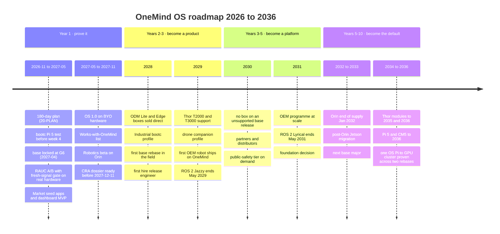
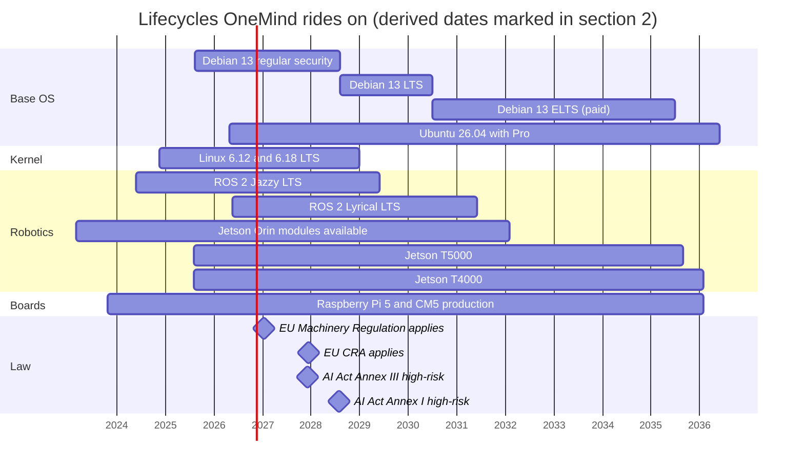

# 21 · Roadmap: year 1, years 2–3, years 3–5, years 5–10

**Owner:** ROADMAP (synthesis) · **Date:** 2026-11-11 · **Status:** drafted; no refuters (synthesis document, not a P0 decision). It changes no Tier A decision. **Synced to `01` revision 4** (2026-11-11; see the note below the explainer).
**Grounded in:** [`01-FOUNDATION-DECISION.md`](01-FOUNDATION-DECISION.md) rev. 4 (binding) · [`08-robotics-drones-physical-ai.md`](08-robotics-drones-physical-ai.md) §1, §11–§13 (robotics track and physical-AI outlook) · [`11-hardware-line.md`](11-hardware-line.md) §3, §7 (line and distributor phases) · [`16-world-context-scenarios.md`](16-world-context-scenarios.md) §4–§7 (scenarios SCN-A…D and triggers TRIG-W15-01…16) · [`17-business-licensing-gtm.md`](17-business-licensing-gtm.md) (open core, editions, OEM, segments) · [`29-PLATFORM-ECOSYSTEM-MARKETPLACE.md`](29-PLATFORM-ECOSYSTEM-MARKETPLACE.md) (plugins, certification, revenue share) · [`evidence/lifecycle-cost-2036.md`](evidence/lifecycle-cost-2036.md) (labour model) · [`23-RISK-REGISTER.md`](23-RISK-REGISTER.md) (RR-IDs).
**Takes over from:** `20-PLAN-180-DAYS.md`, which owns the first 26 weeks in detail. Year 1 below includes those weeks only as a summary and an exit gate.
**Claims:** new facts are `C-ROADMAP-001…002` ([`evidence/claims/ROADMAP.csv`](evidence/claims/ROADMAP.csv); sources in [`evidence/sources/ROADMAP.md`](evidence/sources/ROADMAP.md), saved text and `SHA256SUMS` in `evidence/sources/ROADMAP/`). Every other fact reuses a claim ID that other workstreams already verified. Anything not backed by a claim is marked **PROPOSAL** (a planning judgement) or **derived** (arithmetic on a cited fact).
**Serves requirements:** RS-1, RS-4, M-1, M-2, M-4, M-5, M-6, M-7, M-8, R-1, R-2, R-3, N-2, N-3, N-4, N-6, N-7, N-8, N-9, H-1, H-2, H-3, H-4, P-5, P-6, P-7, P-8, A-1, A-5, A-6, A-7, AI-2, AI-4, AI-5, AI-8, AI-9, U-4, UX-6, UX-8, UX-9, W-2, W-8, F-1, F-2, F-3, F-4, F-5, F-6, F-7, F-11, F-12, F-13, F-14, D-001, D-002, D-004, D-006
**Not legal or financial advice.** Revenue lines are models, not forecasts; no market number here is OneMind's own.

> ### Explain it like I'm the founder
> A ten-year plan for an operating system is not a list of features. It is a list of **promises you must keep while everything under you changes.** Between now and 2036, Debian will ship about four new major releases and Ubuntu about five more LTS releases, Kubernetes about 25–30 more minors (about three a year [C-REF4-DC-longevity-014]), ROS 2 four more long-term releases, and NVIDIA will retire the Orin chips your first robots use [C-COST-007, C-ROADMAP-002, C-W4-012, C-ROADMAP-001, C-W7-001]. None of that is a risk you can remove. What you can do is **build the machine that moves your users across those changes safely** (signed A/B updates, a health gate and restorable backups), and then sell on top of it.
>
> So the roadmap has four phases, and each one has a different job:
> 1. **Year 1 — prove it works, sell no boxes.** One image family on x86, Pi 5 and Jetson; updates that roll back by themselves; a Market; a certified list of other people's hardware. Your first income is support, pre-orders and teaching, not hardware. You are still solo.
> 2. **Years 2–3 — become a product.** The EU Cyber Resilience Act starts on 2027-12-11 [C-W6-001], right as year 2 begins, so the first sold image must already meet it. Own boxes from a factory partner (Lite, Edge), the first robot makers building "on OneMind", the Industrial profile, and your first one to three hires.
> 3. **Years 3–5 — become a platform.** Other companies ship products on OneMind: an OEM programme, a certified partner list, distributors, the public-safety tier. The big test is moving every box to the next major release of its base before its support ends, or paying for longer support: on Debian 13 that date is 2030-06-30 [C-W2-001]; on Ubuntu 26.04 coverage reaches May 2036 only with paid Ubuntu Pro, whose price is not published [C-W2-005, C-W2-006].
> 4. **Years 5–10 — become the default.** Orin robots reach end of supply in 2032 [C-W7-001]; the next NVIDIA generation arrives; humanoid and world-model robots are normal. You win if no customer is ever stranded on an unsupported version, and if a startup's first thought is "we'll ship on OneMind".
>
> Every phase has **exit criteria** (numbers that say "done, move on"), **leading indicators** (early signs you are on or off track), and **warning lights** from the world-context file (16) that would make you change course. If a warning light comes on, the response is already written down, so you don't have to improvise.

> **Revision 4 note: which base this roadmap runs on.** `01` rev. 4 makes **Ubuntu 26.04 LTS + RAUC** the base-OS decision of record (the frozen scorecard's result), with three limits: it is **conditional** on Canonical's permission or a debranded rebuild (Z-01) and on scorecard gate G5 (the Jetson flavor); it is **fragile** (Ubuntu wins 11 of 14 weight-shake runs, Debian 2, bootc 1) [C-DEC4-006]; and two pending answers can change it under a map written in advance (`01` §3.1.6 h). If bootc fails on a real Pi 5 (W2-HW-3, before week 4), the base becomes **Debian 13**. If Canonical refuses and Zeus rejects a debranded rebuild, it becomes **RHEL-family bootc**. If both happen, Zeus decides. The image recipe builds a Debian leg and an Ubuntu leg until the base is **locked at gate G6 (2027-04-11)** in `20-…`; a box shipped on either cannot later move to bootc without a reflash [C-STEEL4-bootc-025]. **How to read this file:** rows that name Debian 13 → 14, Debian 13 LTS or ELTS apply if the lock gives Debian; under Ubuntu, the same row means the 26.04 → 28.04 move or a contracted Ubuntu Pro window to May 2036 [C-W2-005]; under bootc, an AlmaLinux 10 minor-release cadence to its 2035-05-31 security end [C-W2-013]. The Jetson flavor stays on NVIDIA's L4T Ubuntu under every base, so Z-01 matters for robots in every branch [C-REF-DC-cost-007]. The rev-3 claim that "Debian is kept" was withdrawn [C-PROTO4-018].

---

## Contents

0. The roadmap in one table
1. Timelines (Mermaid)
2. The fixed calendar: dates OneMind does not control
3. Year 1 (2026-11 → 2027-11)
4. Years 2–3 (2027-11 → 2029-11)
5. Years 3–5 (2029-11 → 2031-11)
6. Years 5–10 (2031-11 → 2036-11)
7. Scenario triggers → roadmap changes (all 16)
8. What competitors did at the same stage (with constraint fit)
9. Stop, pivot and re-plan rules
10. Recommendations → requirement IDs
11. Limits and open items
12. Glossary

---

## 0. The roadmap in one table

| Phase | Job | Product and editions | Hardware | Robotics | Team | Revenue model | Hard exit criterion (one of several) |
|---|---|---|---|---|---|---|---|
| **Year 1** (2026-11 → 2027-11) | Prove the foundation | OS beta → 1.0 on BYO hardware; Market with seed apps; dashboard; Greenhouse and TAK profiles | No own boxes; "Works with OneMind" list + flash images [C-W10-037] (W10-C5) | Robotics edition beta on Orin; LeRobot-class arm demo | Founder solo, plus contracted counsel | Support, pre-orders, education, grants | First image that passes every release gate, sold or given to ≥ 25 outside users before 2027-12-11 |
| **Years 2–3** (2027-11 → 2029-11) | Become a product | Editions Lite, Edge, Pro, Robotics as hardware profiles; Industrial (bootc) profile; Mirror; WebXR view | ODM Lite and Edge boxes, direct-to-consumer (11 §7.1 phase 1) | Thor T2000/T3000; drone companion profile; first OEM robot "on OneMind" | 1–3 hires: release engineer first | Boxes, support plans, Link-style service, certification fees | The locked base's first major move (Debian 13 → 14, or Ubuntu 26.04 → 28.04 unless Pro is contracted) done in the field on ≥ 95% of active boxes, no reflash |
| **Years 3–5** (2029-11 → 2031-11) | Become a platform | OEM programme at scale; Cluster; public-safety tier (RKE2/FIPS on demand) | Partners and distributors (11 §7.1 phases 2–3); optional robot reference hardware | Robot fleets; EU Machinery-ready logging in use; meta-tegra decision revisited | 5–12 people (PROPOSAL); a foundation considered | OEM per-device fees, fleet console, partner revenue share | Every shipped SKU still inside its declared CRA support period; ≥ 10 third-party products shipping on OneMind |
| **Years 5–10** (2031-11 → 2036-11) | Become the default | One OS from Pi to GPU cluster across two more base majors (Debian or Ubuntu, per the G6 lock) and the post-Orin Jetson generation | Second-source silicon (RK3588-class, riscv64 if credible) | Orin end-of-supply migration (2032); humanoid / VLA era | Company or foundation that outlives the founder's attention | Platform economics (OEM, fleet, Market, certification); hardware a minority | No fielded robot or box stranded on an unsupported branch; a third party can rebuild and sign a release without OneMind staff |

---

## 1. Timelines

### 1.1 The roadmap

### 1.2 The external calendar the roadmap must fit (dates from §2)

*Start dates for Ubuntu 26.04, Jazzy, Orin and Pi 5 bars are approximate and only position the bar; the end dates are the cited ones in §2.*

---

## 2. The fixed calendar: dates OneMind does not control

| Date | Event | What the roadmap must have done by then | Claim |
|---|---|---|---|
| 2026-10-30 | JetPack 5 (r35) ended | Nothing on r35; Jetson flavor on JetPack 7.2+ | [C-REF-W7L-001] |
| 2026-12-13 | Gate G1 in `20-…`: bootc on a real Pi 5 (W2-HW-3) read against the pre-registered map | S1 reading recorded; Z-39/Z-40 logged before the test | `01` §3.1.6 (h) |
| 2027-01-14 | EU Machinery Regulation applies | Robot decision log (W7-R11) in the OS audit layer for any EU robot | [C-W7-045, C-W7-046] |
| Q1 2027 | Jetson T3000/T2000 scheduled | Test the r39 image on the new modules when dev kits ship | [C-W7-048] |
| 2027 | Android developer verification goes global | PWA primary; verified Android developer account; APK channel outside Play | [C-W15-010] |
| 2027-04-11 | Gate G6 in `20-…`: **shipping base locked** (Ubuntu, Debian or bootc) before anyone else installs OneMind | One base for the alpha and every later image; Z-01 answered or the choice sent to Zeus (Z-38) | REC-DEC-42 |
| ~mid-2027 (derived) | Debian 14 "forky" likely released (Debian released 11, 12 and 13 about two years apart; forky is testing) | Forky CI leg green before release; rebase test T-W3-04 measured (both legs until the lock) | [C-COST-007] |
| 2027-12-02 | AI Act Annex III high-risk obligations | Gateway-enforced approvals stay the default everywhere | [C-W6-042] |
| **2027-12-11** | **EU CRA applies** (reporting already since 2026-09-11) | First sold image CRA-ready: support period per SKU, SBOM, vulnerability handling | [C-W6-001, C-W6-005] |
| ~Apr–May 2028 (derived) | Ubuntu 28.04 LTS, then the next ROS 2 LTS one month later | Decide the ROS 2 container line for 2028–2033; GPU flavor tracks Ubuntu LTS | [C-ROADMAP-001, C-ROADMAP-002] |
| 2028-08-02 | AI Act Annex I (product safety) high-risk obligations | Robotics SKUs with AI in a safety path have their conformity route | [C-W6-042] |
| 2028-08-09 | Debian 13 regular security ends; LTS begins | If the base is Debian: most boxes already on Debian 14 | [C-W2-001] |
| Dec 2028 | Linux 6.12 and 6.18 LTS projected EOL | Kernel hop shipped as an image update (kernel contract, REC-DEC-12) | [C-W18-001] |
| May 2029 | ROS 2 Jazzy ends | All robot containers on Lyrical or newer | [C-W7-029] |
| **2030-06-30** | **Debian 13 LTS ends** (ELTS paid to 2035-06-30, not shareable to third parties without a special agreement; only amd64 confirmed for the whole period [C-REF4-DC-longevity-003]) | If the base is Debian: zero supported boxes on Debian 13 | [C-W2-001, C-REF-W8-longevity-003, C-COST-006, C-W2-004] |
| ~Apr 2031 (derived) | Ubuntu 26.04 standard security maintenance ends (five years from release) | If the core is Ubuntu: every box on 28.04, or covered by a contracted Pro for Devices | [C-ROADMAP-002] |
| May 2031 | ROS 2 Lyrical ends | Next ROS 2 LTS in production | [C-W7-029] |
| Jan 2032 | Jetson Orin modules end of supply (AGX Orin Industrial Jul 2033) | Post-Orin robot SKU available; Orin fleets on their last planned branch | [C-W7-001, C-W10-029] |
| Aug 2035 / Jan 2036 | Jetson T5000 / T4000 end of supply | Successor-module support in place | [C-W7-002] |
| Jan 2036 | Raspberry Pi 5 and CM5 production commitment ends ("at least") | Edge successor board chosen | [C-W2-029, C-W10-035] |
| May 2036 | Ubuntu 26.04 Pro coverage ends | GPU flavor on a newer Ubuntu LTS; if the core is Ubuntu, every box on a newer LTS (or on the paid Legacy add-on to May 2041) | [C-W2-005] |

**The arithmetic that shapes the plan (derived):** a box sold in 2028 and supported for the CRA minimum of five years [C-W6-002] lives through at least one base rebase (or a paid extended-support window), one kernel-series hop, about 15 Kubernetes minors, stepped through in order (about three a year [C-REF4-DC-longevity-014]; corrected in the rev-4 sync: this sentence said "about four", which counted k3s minor lifetimes of 13–18 months [C-W4-012] instead of releases) and one ROS 2 LTS change. Labour, not licences, dominates that cost: about 1,680 base hours plus 1,480 CRA hours to 2036 on Debian at the middle assumption (computed, not a sourced fact: `evidence/lifecycle-cost-2036.md` COST-1, from `evidence/sources/COST/cost-model.py`). The Ubuntu figure is not comparable yet: it depends on a Pro for Devices price that Canonical has not published (RR-09 has no cost bound) [C-W2-006, C-DEC4-010]. **That is the main reason for every hiring decision below.**

---

## 3. Year 1 (2026-11 → 2027-11): prove the foundation

### 3.1 Product and editions

- **Months 0–6:** the 180-day plan (`20-…`): bake-off on x86 (Dell 5540, Beelink U55), Pi 5 and Jetson Orin Nano Super; the RAUC A/B image with the fresh-signal health gate on real hardware; k3s on platform nodes and NATS leaves below; restic backups with verified restores; dashboard MVP; Market controller (E1) and the other day-one sockets E2–E10 with signed-only enforcement (01 §4.8) [C-W19-047, C-REF-W19-security-004].
- **Months 6–12:** **OneMind OS 1.0** as a free, downloadable image on bring-your-own hardware (install paths P1–P5; scripts are a developer preview only, REC-DEC-30). Editions are **hardware profiles and support levels, not feature tiers** (REC-W16-04): Lite and Pro on x86, Edge on Pi 5 8 GB + NVMe, Robotics beta on Orin.
- **Profiles (E8):** Greenhouse and TAK field node (09 §8), signed and installable without a new image. These are the first-100-customer bundles (17 §11.3).
- **Must-have promises at 1.0:** works offline and LAN-only; one-click export; restore onto new hardware; published end-of-support date (REC-W16-10). Offline-complete lifecycle REC-W15-01 at the beta gate.
- **Clients:** PWA first; thin Android app with an APK channel outside Play (REC-W15-06); passkeys only, no on-box biometrics (REC-W9-11).
- **Founder's existing cloud:** DOKS keeps public apps, relay, off-site backups and the image/signing CI (05 §conversion step 5); Hermes and NATS contracts migrate under AI-9. Treat the conversion as 13 dependencies, not three [C-W4-063].

### 3.2 Hardware

- **No own-brand boxes** (W10-C5): DRAM contract prices were forecast up 90–95% in one quarter of 2026 [C-W10-037]; the Orin Nano Super kit went from $249 to $399 [C-W10-025, C-W10-026]; the 16 GB Pi 5 went to $385 [C-W10-034].
- Publish a **"Works with OneMind" certified list** and flash images; sell bundle *guides* that point to vendors' own channels (11 §7.1 phase 0).
- **ODM shortlist** by month 9 against W10-R9 (TPM 2.0, custom Secure Boot keys, auto power-on, LVFS, embedded-option silicon: N150, not N300 [C-W10-039, C-W10-040]); quotes requested, nothing ordered before the year-1 exit gate.
- **CI legs:** `FROM ubuntu:26.04` (the decision-of-record leg) and Debian amd64 and arm64, both shipping candidates until the G6 lock (REC-DEC-17, REC-DEC-42), after which the other leg may stay as a canary; AlmaLinux/CentOS bootc canary, with Fedora IoT optional (REC-DEC-04, REC-DEC-49); and a build-only **riscv64** leg (REC-W15-03; Debian has riscv64 as an official architecture [C-W15-021]).

### 3.3 Robotics

From 08 §13 [C-W7-007, C-W7-008, C-W7-047, C-W7-051]:
- Every Jetson flashed **A/B from the factory** (REC-DEC-18); Jetson update backend per REC-DEC-35.
- LAB-W7-1/2/3/6: real time on x86/Pi 5/Orin, container ROS 2, Isaac ROS on the core leg on x86, and the **meta-tegra + linux-yocto 6.18** Jetson image [C-STEEL-jb-002] as the evaluated alternative to L4T.
- `robot-runtime` namespace class (W7-R9), ROS ↔ NATS robot gateway (W7-R10), robot decision log (W7-R11).
- First "connect a robot" demo: a LeRobot SO-101-class arm through an MHS-shaped adapter, QR join, observe-only start and approval-gated motion (REC-W19-08).
- Market lists Isaac ROS, Open-RMF, LeRobot and a MAVLink gateway as apps. Drones only as integrated third-party devices (08 §11.2).

### 3.4 Team

- **Founder solo** (M-6). Contracted, not hired: counsel for Canonical/CRA/trademark (Z-01, Z-05, REC-W16-03); an accountant for incorporation, which NVIDIA Inception requires [C-W16-031].
- **Capacity rule:** anything not on the release-gate path is cut first (08 §13 cut list: LAB-W7-6 and drones move to year 2).
- **Learning path** (`27-…`) runs alongside; the founder must be able to do a rebase and a key rotation alone before year 2.

### 3.5 Revenue model

| Line | Model | Evidence / anchor |
|---|---|---|
| Support (Personal) | Paid human help; a year included with any pre-order | Start9 $200/yr [C-W16-021] |
| Pre-orders / crowdfunding for the year-2 boxes | Tests price before inventory | Olares Kickstarter $2.34M [C-W16-018] |
| Education | Courses and community (W-2) | Circle Business $199/mo cost anchor [C-W16-046] |
| Grants | NLnet NGI Zero (€5k–50k; next deadline 2027-01-03), Sovereign Tech Fund for shared upstream work | [C-W16-047, C-W16-048] |
| Not in year 1 | Hardware margin, OEM fees, paid plugins | No boxes (W10-C5); Market fee 0% on first USD 1M per developer anyway (REC-W19-10) [C-W19-042] |

Security updates are free for the declared support period and are never sold (17 §7, [C-W6-002]).

### 3.6 Measurable exit criteria (all must pass to start years 2–3)

| ID | Criterion | Measure | Source of the bar |
|---|---|---|---|
| EX-Y1-01 | Release gates pass on real hardware | F1/F2 power-pull, F-PI5, F-SB-1…3, LAB-W7-4 rollback: 100% pass on Dell 5540, Pi 5 and Orin | REC-DEC-34 |
| EX-Y1-02 | Health gate never commits a broken release | 0 bad commits across ≥ 200 forced-bad-update runs over the three boards | [C-LAB-rauc-k3s-gate-008] |
| EX-Y1-03 | Restore works | Whole-box restore onto new hardware ≤ 60 min, monthly drill green 6 months running | REC-DEC-11, [C-LAB-k3s-footprint-restore-011] |
| EX-Y1-04 | Offline lifecycle | A box offline 90 days accepts its next signed update from USB; air-gapped rebuild drill T-W15-01 passes | REC-W15-01, REC-W15-11 |
| EX-Y1-05 | CRA-ready before 2027-12-11 | Support period per SKU, SBOM + VEX per release, vulnerability-handling process, sovereignty dossier published | [C-W6-001], REC-W15-07 |
| EX-Y1-06 | Outside users | ≥ 25 outside users run 1.0 for ≥ 30 days; ≥ 10 pay for support or a pre-order (PROPOSAL thresholds) | 17 §11.3 |
| EX-Y1-07 | Robots | 3 third-party robots/devices onboarded by QR by a non-developer in < 10 min each; 1 in-field JetPack point upgrade on a test fleet | 08 §13 |
| EX-Y1-08 | Market | ≥ 30 seed apps signed, digest-pinned, licence rows in the matrix; revocation list drilled once | REC-W19-06, critic N5 |
| EX-Y1-09 | Founder decisions closed | Z-01 (Canonical), Z-02 (update default), Z-03 (engine), Z-04 (keys), Z-16, and (rev. 4) Z-38, Z-39, Z-40 answered | 26-… |
| EX-Y1-10 | Base locked by the rules (rev. 4) | W2-HW-3 run before G1; the shipping base fixed at G6 (or G7) by `01` §3.1.6 (h) or by a founder override logged in `scorecard-weights.md` §8 before the lock; no Ubuntu-based image shipped before Z-01 is answered | REC-DEC-42, REC-DEC-44 |

### 3.7 Leading indicators (watch monthly)

- Founder hours per release and per k3s minor bump (target: a weekly kernel bump < 1 h, T-W18-4); **trend up for 3 months = re-plan**.
- Gate false-positive and false-negative counts per board.
- Time from a NVIDIA JetPack release to OneMind's Jetson image on it (target ≤ 60 days, 08 §12.2).
- Pre-order conversion from waitlist; support tickets per active box.
- Third-party plugin submissions and review queue age (RR-23, RR-24).
- Founder-hardware tests still `blocked` (should reach zero by month 6).

### 3.8 Scenario triggers that would change year 1

| Trigger | Change |
|---|---|
| TRIG-W15-02 (mineral controls resume after the 2026-11-10 suspension end [C-W15-004]) | Check now; re-price any robotics kit bundle |
| TRIG-W15-03 (module allocation, > 30% list rise, > 16-week lead time) | Bake-off continues on owned units; certified list adds a second board per tier |
| TRIG-W15-13 (Android verification blocks the APK path) | PWA-only client; F-Droid-class channel |
| TRIG-W15-15 (NVIDIA licence/lifecycle change against custom images) | Promote the meta-tegra image from evaluated target to default (REC-DEC-18) |
| Canonical says no or overprices (RR-09) | Core: the pre-registered map gives **bootc** if a debranded rebuild is rejected (or Zeus decides, if W2-HW-3 also failed) (`01` §3.1.6 h). Jetson on meta-tegra; GPU-server tier on the new core + per-image NVIDIA modules (REC-DEC-37) |

---

## 4. Years 2–3 (2027-11 → 2029-11): become a product

### 4.1 Product and editions

- **Editions sold:** Lite, Edge (as "Edge nodes join a OneMind hub"; a sub-4 GB kit is a leaf, not a full node: 17 §6.2 flag), Pro, Robotics (once Z-01 clears the Jetson rootfs or meta-tegra is the default), Omni by quote.
- **Industrial profile** on bootc, built on **AlmaLinux 10 or RHEL 10 image mode**; CentOS Stream 10 (ends 2030-05-31 [C-REF4-DC-longevity-001]) and Fedora IoT only as CI canaries (REC-DEC-04, REC-DEC-49). Decided by LAB-W8-4 (FDO zero-touch on Debian and EL10 bootc) and the Flight Control simulation; CIP SLTS kernel per industrial customer (REC-W18-5).
- **Mirror** (UX-6): config clone and box-to-box replication from year 1; true HA on 3 etcd servers in Pro/Cluster (12 §9.2; REC-DEC-38).
- **Fleet and zero-touch:** PXE/fleet install path P7, FDO onboarding, 10k-device design as many site clusters plus NATS [C-W8-049] (09 G4-M4).
- **Box-to-box update relay** (REC-W15-02) for villages and field teams.
- **AI:** optional A2A adapter; opt-in on-box face/voice ID behind consent and region gates (REC-W9-11).
- **XR:** WebXR "spatial ops" view (REC-W11-14).
- **First base rebase** shipped as a normal A/B update (REC-DEC-16), with founder-hours recorded: Debian 13 → 14 if the base is Debian; under Ubuntu, 26.04 → 28.04 unless a Pro for Devices contract covers the fleet. The old slot's RAUC must install the new release's bundles two releases ahead (DC-05, `22-…` LT-VM-03).

### 4.2 Hardware

- **ODM direct-to-consumer:** Lite (N150, 16 GB, 2× NVMe, TPM 2.0, own Secure Boot keys) and Edge (Pi 5 8 GB / CM5 + NVMe) in small batches (11 §7.1 phase 1). Prices published only after landed-BOM quotes (11 §7.3); memory-indexed price clause (16 SCN-A).
- **Robotics:** production Jetson modules on partner carriers only, never dev kits [C-W10-027] (W10-R8); T2000/T3000 support [C-W7-048].
- **Second arm64 SoC family** (RK3588-class; mainline NPU driver since 6.18 [C-W7-049]) on the certified list (REC-W15-03).
- **Every SKU sheet** states "security updates until", bounded by module lifecycle, plus 2-year EU seller liability in the warranty reserve [C-W10-048] (W10-R10).

### 4.3 Robotics

- Thor T2000/T3000; ROS 2 Lyrical containers default, Jazzy until May 2029 [C-W7-029]; the 2028 ROS 2 LTS added when released [C-ROADMAP-001].
- **Drone companion profile** (PX4 preferred for locked hardware, BSD-3 [C-W7-052]); update bundle carries flight-controller firmware as a payload (08 §11.2). Drones remain ground and fleet software, not radio hardware, because of the FCC Covered List action on foreign drones [C-W15-019] (partial: law-firm summary; the FCC page returned 403).
- **First OEM robot "built on OneMind"** under the OEM programme (REC-W16-07).
- MHS driver host added if Anthropic publishes a spec [C-W7-047] (W7-R12).
- meta-tegra vs L4T decision made final per LAB-W7-6 results.

### 4.4 Team (PROPOSAL)

| Order | Role | Why first | Takes from the founder |
|---|---|---|---|
| 1 | **Release engineer** (image, kernel, RAUC, signing, CI) | Base + CRA labour dominates the 10-year cost (lifecycle-cost COST-1); RR-03, RR-12, RR-35 | Rebases, driver-pack builds, kernel bumps |
| 2 | **Support and community lead** | Support plans are the first recurring revenue; Market review queue (RR-23) | Tickets, docs, plugin review |
| 3 | **Robotics integration engineer** | OEM onboarding and Jetson branch upgrades (COST-7) | Partner robots, LAB-W7 series |

Gate for each hire: the revenue lines in §4.5 cover it for 12 months, or a grant/round does. Contract security review (penetration test) once per year from the first sold box.

### 4.5 Revenue model

| Line | Model | Anchor |
|---|---|---|
| Boxes | Landed cost ÷ (1 − margin); margin is a founder decision | 11 §7.3; Umbrel Home $499–949, HA Green $199 [C-TD-umbrelos-047, C-W16-016] |
| Support | Community free; Personal ~$100–200/yr; Business per node/yr | [C-W16-021, C-W16-028] |
| Hosted "Link"-style service | Relay, off-site backup; optional, never required | HA Link $65/yr [C-W16-014] |
| Fleet console | Per device per month | balena $2–3 [C-W16-030] |
| "Works with OneMind" certification | Annual fee near HA's CHF 500 level | [C-W16-015, C-W19-020] |
| OEM programme | Programme fee + per-device signed-update/fleet fee | REC-W16-07 |
| Paid plugins | 0% on first USD 1M per developer, then 15% | [C-W19-042] |

### 4.6 Measurable exit criteria

| ID | Criterion | Measure |
|---|---|---|
| EX-Y3-01 | Field rebase | The locked base's first major move (Debian 13 → 14, or Ubuntu 26.04 → 28.04 where no Pro contract covers the box) delivered by A/B update to ≥ 95% of active boxes with 0 reflashes and ≤ 0.5% rollbacks needing support; founder/engineer hours recorded vs the COST model |
| EX-Y3-02 | k3s treadmill | Every k3s minor shipped within 90 days of upstream, none skipped, restore drill green per shipped minor (REC-DEC-28) [C-W4-012] |
| EX-Y3-03 | Hardware business | ≥ 2 ODM batches sold; RMA rate measured and ≤ the warranty reserve; per-SKU support-end dates honoured |
| EX-Y3-04 | Robotics | ≥ 1 OEM ships a robot "built on OneMind"; ≥ 1 in-field Jetson **branch** (not point) upgrade on a customer fleet |
| EX-Y3-05 | Ecosystem | ≥ 25 certified devices/adapters; ≥ 10 third-party publishers at Verified tier; kill list drilled twice with 0 unsigned extensions merged (RR-11) |
| EX-Y3-06 | CRA in operation | Every actively exploited vulnerability reported on time under Art. 14; notified-body parallel track completed or closed (REC-DEC-39) [C-W6-001] |
| EX-Y3-07 | Bus factor | A second person can cut, sign (2-of-3) and ship a release without the founder |
| EX-Y3-08 | Unit economics | Recurring revenue (support + service + fleet + certification) covers the release engineer's cost (PROPOSAL bar) |

### 4.7 Leading indicators

- Rebase canary results on the forky CI leg months before the release.
- Kernel 6.12/6.18 EOL distance (Dec 2028 [C-W18-001]) vs the kernel-hop plan.
- Attach rate of support plans per box; churn of Link-style subscribers.
- Partner pipeline: certification applications per quarter; OEM letters of intent.
- NVIDIA module price/lead time (TRIG-W15-03); DRAM price index [C-W10-038].
- Market: median review time; share of installs from Verified vs Community.

### 4.8 Scenario triggers that would change years 2–3

| Trigger | Change |
|---|---|
| TRIG-W15-01 (licence needed for Jetson-class modules) / TRIG-W15-05 (Covered List or tariffs name SBCs, Rockchip, NPUs) | Promote the non-NVIDIA robotics SKU (REC-W15-04) or drop/re-source the affected SKU in the US |
| TRIG-W15-06 (EU tender scores open source / sovereignty for edge) / TRIG-W15-09 (funding call fits) | Open an EU entity (Q197) and bid with a partner; pull the public-safety and sovereignty dossier forward |
| TRIG-W15-07 (CRA harmonised standard for OSes in the OJ) | Move to the self-assessment route if applicable; close the notified-body track |
| TRIG-W15-10 / -11 (shutdowns over threshold; > 48 h outage in a market) | Raise offline features and the resilience bundle in priority; test UPS paths |
| TRIG-W15-14 (Apple/Google local-AI hub with third-party device control) | Sharpen "leave any time"; Matter interop first; don't chase feature parity |
| TRIG-W15-16 (non-NVIDIA accelerator with mainline driver + maintained ROS 2/VLA path) | Add it as a supported robotics tier |

---

## 5. Years 3–5 (2029-11 → 2031-11): become a platform

### 5.1 Product and editions

- **All editions** including **Cluster** (multi-node, multi-site via NATS leaf and, for enterprise fleets, Open Cluster Management-class tooling (05)).
- **Public-safety / regulated tier**: RKE2 with FIPS 140-3 modules when a buyer requires it (REC-DEC-03, Z-25), CJIS-style TLS profile (REC-DEC-39), NDAA/TAA paperwork (11 §7.1 phase 3).
- **Base retirement:** no supported box on a base release past its free or contracted support (Debian 13: 2030-06-30 [C-W2-001]; Ubuntu 26.04: about April 2031 for standard security maintenance (derived: five years from release [C-ROADMAP-002]), May 2036 with Pro [C-W2-005]); the next major of the locked base as a canary in CI.
- **OneMind desktop node** on bootc only if demanded (12 option C).
- **Native XR teleop** apps only where latency requires, behind physical-actuation approval (12 §XR step 3).
- **Federation / multi-site sharing** (Blueprint M6) between owners and sites, with revocation.

### 5.2 Hardware

- **Partners and distributors** (11 §7.1 phases 2–3): regional resellers, robotics integrators, public-sector resellers.
- **Optional OneMind robot reference hardware** (08 §13 years 3–5), only if the OEM channel shows demand; if OneMind sells its own Jetson hardware, meta-tegra becomes the default (08 §16 Q1).
- **Edge successor board** evaluated (Pi 5/CM5 commitment runs to at least Jan 2036 [C-W10-035]); riscv64 box decision (16 Q241: a 2028–2030 decision, judgement).

### 5.3 Robotics

- Robot fleets managed through the fleet console; staged rollouts and holds per OEM channel (REC-DEC-40).
- EU AI-driven machinery certification becomes normal (08 §12.3 PROPOSAL); the decision log and MCU safety split are already in place (W7-R6, W7-R11).
- ROS 2 Lyrical EOL May 2031 [C-W7-029]: fleets on the 2030 LTS (derived from [C-ROADMAP-001]).
- Rust robot runtimes (dora-rs, copper-rs) handled as Market apps if they gain share (08 §12.3).

### 5.4 Team (PROPOSAL)

- **5–12 people:** release engineering (2), platform/k3s and NATS, robotics and partner engineering, security and compliance (CRA, IEC 62443 path, RR-31), support, community/education.
- **Governance:** consider a foundation that owns the trademarks and licenses them to the company, the Open Home Foundation model [C-W16-012] (17 §12: years 3–5 option). Decide by end of year 5.

### 5.5 Revenue model

Shift from hardware margin toward platform revenue: OEM per-device signed-update and fleet fees, fleet console, certification, Business support, distributor margin on the full line, Market revenue share above the 1M threshold [C-W19-042]. Benchmarks: Home Assistant's foundation took CHF 8.84M in 2025 from licensing and donations with no outside investors [C-W16-013, C-W16-014]; Sandstorm shows the danger of a business that depends on enterprise sales [C-W16-050].

### 5.6 Measurable exit criteria

| ID | Criterion | Measure |
|---|---|---|
| EX-Y5-01 | Support promises kept | 100% of shipped SKUs inside their declared CRA support period receive security updates; 0 boxes on an unsupported base release (for Debian: 0 on Debian 13 after 2030-06-30) |
| EX-Y5-02 | Platform | ≥ 10 third-party products (robots, gateways, boxes) shipping with "OneMind OS inside" |
| EX-Y5-03 | Fleet scale | A real customer fleet of ≥ 1,000 devices across ≥ 10 sites updated in staged waves with ≤ 1% held for manual action |
| EX-Y5-04 | Revenue mix | Platform revenue (OEM, fleet, certification, support) ≥ 50% of total (PROPOSAL bar) |
| EX-Y5-05 | Sovereignty proof | Sovereignty dossier mapped to the EU framework's objectives accepted in ≥ 1 public tender or regulated buyer review [C-W15-015] |
| EX-Y5-06 | Ownership | Governance decision taken (foundation or not) and key escrow tested by an independent party (REC-W16-10) |

### 5.7 Leading indicators

- Share of new boxes sold by partners vs direct; partner churn.
- Time to certify a new device; certification backlog.
- Paid extended-support need (Debian ELTS past 2030, or Ubuntu Pro bought only to avoid a rebase) as a sign the rebase story is failing.
- Robotics: share of fleets on Thor vs Orin ahead of Jan 2032.
- Contributor count outside the company (DCO sign-offs) as the open-core health signal.

### 5.8 Scenario triggers that would change years 3–5

| Trigger | Change |
|---|---|
| TRIG-W15-04 (Taiwan Strait disruption > 2 weeks) | Freeze new SKUs; ship software-only and BYO installs (P-7); partners sell existing stock |
| TRIG-W15-08 (SEAL-style criteria extended to devices) | Map the dossier to the new criteria; pursue public tenders as the main channel |
| TRIG-W15-12 (satellite geofenced in a market) | Mesh and cellular fallbacks first in docs and bundles |
| TRIG-W15-15 again (NVIDIA lifecycle change) | Execute the meta-tegra or non-NVIDIA route fleet-wide |
| RR-53 (well-funded fork of the Apache core) | Compete on trademark, certification, update service and support; do not relicense (REC-W16-02) |

---

## 6. Years 5–10 (2031-11 → 2036-11): become the default

### 6.1 Product and editions

- **One OS from Pi to GPU cluster, proven across at least two base rebases** (F-14). The Pi greenhouse and the Isaac-class simulation cluster run the same image families, Market and app contract.
- **Accelerator-neutral app contract enforced** (REC-W15-09): apps ask for capabilities, never a vendor; ONNX + per-backend engines (W7-R13).
- **Self-hosted build and distribution** is routine: yearly air-gapped rebuild drill (REC-W15-11).
- **Phones:** OneMind phone OS only if a partner case justifies it (REC-W14-08); otherwise the PWA and managed-device level remain.

### 6.2 Hardware

- **Orin end of supply January 2032** [C-W7-001]: Orin SKUs on their last planned branch with a declared end date; a post-Orin robotics SKU in production. Thor-class to Aug 2035 / Jan 2036 [C-W7-002].
- **Edge successor** in production before Jan 2036 [C-W10-035].
- At least two silicon sources per edition (x86 + arm64 from two vendors; riscv64 if credible) (SCN-A).

### 6.3 Robotics

- The post-Orin Jetson generation and non-NVIDIA robot computers both supported (08 §12.3 2030–2036 row).
- Humanoids, VLA and world models on-robot are expected to be mainstream (08 §12.3, PROPOSAL, not a sourced forecast); OneMind's role stays the OS, update chain, safety-gated capability layer and fleet, not the model.
- **One planned in-field branch upgrade per robot lifetime** honoured on every fleet (08 §2.4).

### 6.4 Team

- A company (or company + foundation) that can keep releasing without the founder in the loop (PROPOSAL size: 15–40). Board-level owner for the support-period promises.

### 6.5 Revenue model

Platform economics dominate: OEM licences and per-device services, fleet, certification, Market share, support. Hardware is sold where it makes the platform easier to adopt, not as the main margin source (PROPOSAL, following the Home Assistant pattern [C-W16-012]).

### 6.6 Measurable exit criteria (the 2036 definition of success)

| ID | Criterion | Measure |
|---|---|---|
| EX-Y10-01 | No stranded customer | 0 fielded boxes or robots on an unsupported branch inside their declared support period |
| EX-Y10-02 | Release without OneMind | An independent party rebuilds, signs (with its own keys) and boots a OneMind release from public sources and mirrors |
| EX-Y10-03 | Default for robots | "Connect a robot → use OneMind": ≥ 100 certified robot/device classes; a new class certified in ≤ 30 days |
| EX-Y10-04 | Silicon independence | Every edition has ≥ 2 supported silicon sources; a top-vendor exit costs ≤ 1 release cycle |
| EX-Y10-05 | F-14 proven | The same image family and app contract run on a 4–8 GB Pi node and a multi-node GPU cluster in production customers |

### 6.7 Leading indicators

- NVIDIA lifecycle page changes and new L4T majors (TRIG-W15-15).
- Share of Market apps that run on ≥ 2 accelerator families.
- Number of OEMs that would survive OneMind's exit (escrow, owner keys, self-hosted Market).
- Kubernetes and base-OS treadmill cost per year (rebases, or the Pro fee under Ubuntu) vs revenue per box.

### 6.8 Scenario triggers that would change years 5–10

All sixteen remain live (§7). The two with the largest effect in this period: **TRIG-W15-16** (a non-NVIDIA accelerator becomes first-class: shift the robotics default) and **TRIG-W15-04** (Taiwan disruption: software-only mode).

---

## 7. Scenario triggers → roadmap changes (all 16)

Source: 16 §7. "Most exposed phase" is where a firing trigger changes the most.

| Trigger | Scenario | Most exposed phase | Pre-decided roadmap change |
|---|---|---|---|
| TRIG-W15-01 | A | Years 2–3 | Promote non-NVIDIA robotics SKU; pause GPU-SKU export plans |
| TRIG-W15-02 | A | Year 1 (check now) | Buy ahead on batteries/magnets for robot kits; re-price |
| TRIG-W15-03 | A | Years 1–3 | Second-source SKU; memory-indexed pricing |
| TRIG-W15-04 | A | Any | Freeze new SKUs; software-only/BYO installs |
| TRIG-W15-05 | A | Years 2–3 | Drop or re-source the affected US SKU |
| TRIG-W15-06 | B | Years 2–5 | EU entity; bid with partner; publish dossier |
| TRIG-W15-07 | B | Years 2–3 | Self-assessment route if applicable |
| TRIG-W15-08 | B | Years 3–5 | Map dossier to new criteria |
| TRIG-W15-09 | B | Years 1–3 | Apply for funding for reusable components |
| TRIG-W15-10 | C | Any (yearly, March) | Raise offline features in priority |
| TRIG-W15-11 | C | Any | Market resilience bundle; test UPS paths |
| TRIG-W15-12 | C | Years 3–5 | Mesh/cellular fallbacks first |
| TRIG-W15-13 | D | Year 1 | PWA-only; F-Droid-class channel |
| TRIG-W15-14 | D | Years 2–3 | Sharpen "leave any time"; Matter interop |
| TRIG-W15-15 | D | Years 1–10 (every JetPack release) | meta-tegra or non-NVIDIA route |
| TRIG-W15-16 | D/A | Years 2–10 | Add a supported robotics tier |

**Review cadence:** walk this table twice a year (REC-W15-12) and record which lights are on in `23-RISK-REGISTER.md`.

---

## 8. What competitors did at the same stage (with constraint fit)

| Product | Path it actually took | Constraints | Constraint fit for OneMind | Roadmap lesson |
|---|---|---|---|---|
| **Home Assistant / HAOS** | Open software first; commercial company (Nabu Casa) funds a foundation that owns brands; hardware (HA Green) sold through retailers; Works-with-HA certification [C-W16-012, C-W16-015, C-W10-021] | Docker, no Kubernetes, no robotics, very large community | **Medium-high** for business model and governance; low for robotics | Foundation + certification + subscription is a proven 10-year path without VC (§5.4) |
| **umbrelOS** | Software first, then own boxes (Home, Pro) sold direct; non-commercial licence blocks OEMs [C-TD-umbrelos-045, C-TD-umbrelos-047] | Debian + Docker, consumer, small team | **High** for year-2 DTC boxes; **low** for OEM (licence) | Copy the DTC box step; don't copy the licence (REC-W16-02) |
| **Olares** | Kickstarter-funded AI box; k3s; licence moved to AGPL [C-W16-018, C-W16-006] | k3s, AI-first, VC-funded | Medium (k3s matches; funding doesn't) | Crowdfunding tests price before inventory (§3.5) |
| **StartOS (Start9)** | Builds for x86_64, aarch64 and riscv64 from a small team; paid support [C-TD-startos-006, C-W16-021] | Debian-based, sovereignty audience, small team | **High** for silicon portability | Keep riscv64 in CI from year 1 |
| **balena** | Cloud fleet product, per-device pricing [C-W16-030] | Cloud-managed, vendor-hosted | Medium (pricing yes, cloud dependence no) | Per-device fleet fees are a real revenue line (§4.5) |
| **Sandstorm** | Open project thrived; business failed on enterprise sales [C-W16-050] | Small team, enterprise pivot | High (as a warning) | Public safety and enterprise wait until years 3–5 |

---

## 9. Stop, pivot and re-plan rules

These are pre-decided so that a bad quarter does not become an improvised pivot.

| Signal | Rule |
|---|---|
| Founder hours per release rise for 3 straight months, or exceed the COST model's middle case by > 50% | Cut scope to x86 + Pi 5; Jetson moves to partner-maintained images; hire the release engineer before any new feature |
| EX-Y1-01 fails on a board after two fix cycles | That board leaves the 1.0 support list; ship without it |
| Canonical answer blocks Ubuntu-based flavors (RR-09) | Before the G6 lock: the map in `01` §3.1.6 (h) decides the core (bootc, or Zeus if W2-HW-3 also failed). After a lock on Ubuntu: Canonical's refusal leaves only a debranded rebuild for fielded boxes, because a move to bootc needs a reflash [C-STEEL4-bootc-025]. In every case meta-tegra becomes the Jetson default, and the GPU tier moves to the new core with per-image modules |
| EX-Y3-01 rebase fails on > 5% of boxes | Freeze new SKUs until the rebase path is fixed; buy time with ELTS only for internal use, not for redistribution (COST-4) |
| No OEM or certified partner by end of year 3 | Re-plan the robotics moat: robotics stays a Market + edition, and the company leans on home/homestead and TAK segments |
| Any physical action executed without a human approval in the field (RR-06) | Stop shipping AI device-control features until the gateway is fixed and audited |

---

## 10. Recommendations → requirement IDs

| ID | Recommendation | Requirement IDs |
|---|---|---|
| REC-RM-01 | Adopt the four-phase roadmap with the exit criteria in §3.6, §4.6, §5.6 and §6.6 as hard gates; no phase starts until the previous phase's criteria pass or the founder records an exception | RS-1, M-6, M-8, F-1 |
| REC-RM-02 | Plan every SKU against the fixed calendar in §2; the support-end date on each SKU sheet is computed from it | R-3, H-1, M-8, F-2 |
| REC-RM-03 | No own-brand hardware in year 1; ODM Lite/Edge in years 2–3; partners and distributors from years 2–5 | H-1, H-2, H-3, H-4, P-5, A-7 |
| REC-RM-04 | Robotics track per 08 §13, with an in-field Jetson branch upgrade as a year-3 exit criterion and the Orin migration as a year-5–10 criterion | M-7, N-7, N-8, F-2, F-3, F-7 |
| REC-RM-05 | Hire order: release engineer, support/community, robotics integration; each hire gated by funded runway | M-6, R-2, R-3 |
| REC-RM-06 | Revenue sits outside the image (support, service, fleet, certification, OEM, boxes, education); security fixes are never sold | D-001, M-1, M-2, R-2, R-3, W-2 |
| REC-RM-07 | Walk the trigger table (§7) twice a year and log lights in `23-…` | M-8, F-1, F-13 |
| REC-RM-08 | First sold image CRA-ready before 2027-12-11, with the sovereignty dossier | M-2, M-8, R-3, H-1 |
| REC-RM-09 | Keep silicon portability as a continuous cost (riscv64 CI leg, second arm64 SoC, accelerator-neutral contract) | N-2, N-3, F-2, F-14 |
| REC-RM-10 | Ecosystem milestones (certification, Verified publishers, OEMs) are exit criteria, not marketing goals | A-5, A-6, F-4, F-5, W-8 |
| REC-RM-11 | Decide governance (foundation or not) by end of year 5; test key escrow independently | M-8, D-001, R-3 |
| REC-RM-12 | Offline-complete lifecycle and self-hosted build as year-1 gates, then yearly drills | N-6, M-1, F-13, F-8 |
| REC-RM-13 | Pre-decided stop/pivot rules (§9) adopted with the plan | M-6, AI-4, AI-5, U-4 |
| REC-RM-14 | Clients stay web-first; XR and native teleop phased (WebXR years 2–3, native years 3–5) | UX-8, UX-9, M-5 |
| REC-RM-15 | The Industrial profile and fleet/zero-touch arrive in years 2–3; F-14 is proven at both ends in production by years 5–10 | F-11, F-12, F-14, N-4, P-8, N-9 |

---

## 11. Limits and open items

- **No refuters ran on this file.** It is a synthesis; each P0 element it relies on was refuted in its own workstream (01 §5).
- **Thresholds marked PROPOSAL** (user counts, revenue mix, team sizes) are planning judgements, not evidence. Zeus should set them (add to `26-…` as a founder decision on targets).
- **Derived dates** (Debian 14 mid-2027, Ubuntu 28.04 and the 2028 ROS 2 LTS, Jetson r39 branch end) are arithmetic on stated cadences [C-COST-007, C-ROADMAP-001, C-ROADMAP-002, C-W7-004]; none is a vendor announcement. Re-check by 2027-05-11.
- **Not modelled:** company cash flow and break-even (landed BOM and OS-support fees are missing, 17 §14); NVIDIA's post-Thor module roadmap (not announced in any source opened); humanoid market forecasts (left as PROPOSAL, 08 §12.3).
- **KubeCon NA 2026 days 3–4** were not re-checked (critic pass-2 N12); the NVIDIA-on-k3s items in years 2–3 should be re-read against them.
- **Depends on `20-PLAN-180-DAYS.md`**; if its gates differ, `20-…` wins for the first 26 weeks.
- **Rev. 4 sync (2026-11-11):** base-specific rows were made conditional on the G6 lock, because `01` rev. 4 makes Ubuntu 26.04 the decision of record while Debian 13 and bootc remain pre-registered outcomes. The Ubuntu 26.04 standard (non-Pro) end, about April 2031, is derived from the five-year rule [C-ROADMAP-002], not a dated vendor statement. The labour model (COST-1) is still Debian-only; an Ubuntu figure needs Canonical's price.

---

## 12. Glossary

| Term | Meaning |
|---|---|
| **Roadmap phase** | A period with one main job and exit criteria that say when it is done. |
| **Exit criterion** | A measurable test that must pass before the next phase starts. |
| **Leading indicator** | An early number that predicts whether an exit criterion will pass. |
| **Trigger (warning light)** | A world event, chosen in advance, that sets off a pre-decided change (16 §7). |
| **Rebase** | Moving a fielded box to the next major OS release through an A/B update, without reflashing. |
| **Branch upgrade (Jetson)** | Moving a robot to a new NVIDIA Jetson Linux major line (e.g. r36 → r39), which NVIDIA requires for fixes. |
| **ODM / OEM** | ODM: the factory that designs and builds a box for you. OEM: a company selling a product under its own brand. |
| **DTC** | Direct to consumer: selling from your own store. |
| **CRA support period** | The time, stated at purchase, during which the maker must ship security updates (at least five years unless use is shorter) [C-W6-002]. |
| **ELTS** | Paid Extended LTS for old Debian releases, from Freexian. |
| **Platform revenue** | Money from others building on OneMind (OEM, fleet, certification, Market), as opposed to selling boxes. |
| **Bus factor** | How many people would have to disappear before the project stops. |
| **Foundation** | A non-profit that owns the brand and code governance, like the Open Home Foundation. |
| **PROPOSAL / derived** | PROPOSAL: a planning judgement. Derived: arithmetic on a cited fact. Neither is a sourced fact. |
