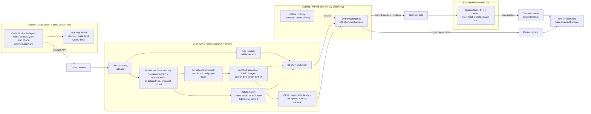

# 28 · Kernel and image ownership, and the development toolchain (W18)

**Workstream:** W18 (Tier A, P0) · **Date:** 2026-11-10 (revision note added 2026-11-11 for `01` rev. 4) · **Status:** refuted and answered (refuters and the K2 steelman ran; responses in `01` §5.5, §5.9.2, §6.10); P0-7 superseded (see the revision note below)
**Answers:** F-7, F-8, F-15 · decision-critical DC-21 (kernel route), DC-22 (platform first or image first), input to DC-20 (distro base vs build-from-source)
**Bank questions owned:** Q324, Q325, Q326, Q327, Q286, and the kernel half of Q10 (statuses in `evidence/qbank/W18.md`)
**Evidence:** claims `C-W18-001`…`C-W18-069` in `evidence/claims/W18.csv`; sources and archive hashes in `evidence/sources/W18.md`; one lab spike (Mac build path) recorded there under "Lab evidence".
**Scoring:** decision S5 (kernel route) uses the frozen weights in `evidence/scorecard-weights.md` v1.0, unchanged.
**Revision note (2026-11-11, aligned with `01-FOUNDATION-DECISION.md` rev. 4):** this file was written on 2026-11-10, when ADR-001's Debian 13 core and the Rugix updater were the plan. Four things have changed since, and they override the text below where it differs:
1. **Base OS.** The S1 decision of record is now **Ubuntu 26.04 LTS + RAUC**, the frozen-protocol result. It is fragile (11 of 14 sensitivity runs) and CONDITIONAL on Canonical's permission or a debranded rebuild (Z-01) and on G5. A Debian 13 leg is built from the same definition until the shipping base is locked. Debian is the pre-registered result if bootc's Pi 5 test W2-HW-3 fails (`01` §3.1.6, REC-DEC-42) [C-DEC4-001, C-DEC4-006]. **The kernel route does not change.** K1 stays "the board maintainer's kernel", which on the Ubuntu leg means Canonical's kernel, Canonical's `linux-raspi` on Pi 5 and NVIDIA L4T on Jetson (`01` §3.5 note). Where this file says "Debian stock", read it as the Debian leg.
2. **Image tool.** P0-7 and §7's "Rugix Bakery" choice are **superseded**. `01` moved the updater to RAUC, and the build brief (`30` BD-05) uses a Containerfile-defined rootfs plus OneMind's own lab-proven assembler, with mkosi as the named fallback. Rugix Bakery's stated advantage was that it pairs with the Rugix updater.
3. **Secure Boot with out-of-tree modules (§6.3 trigger 4, DC-21).** `01` rev. 2 planned K2-hybrid for the enforcing release. Rev. 4 makes a **OneMind shim with its own `vendor_cert`** T-W19-03's first arm: it makes the stock kernel trust OneMind's module key with no console step (read from source, not yet run). K2-hybrid is used only if that arm fails (REC-DEC-48).
4. **Refuters and citations.** §11's "refuters pending" is closed. P0-1 and P0-2 have technical, cost and robotics refuters, the kernel route has the K2-hybrid steelman (`01` §5.5, §6.10), and DC-21 has dedicated round-4 refuters (`01` §5.9.2). C-W18-027 (CUDA) is superseded by [C-CIT4-003]: CUDA 13.5 supports Debian 13 on x86_64 and SBSA servers, **not on Jetson**, whose only rows are Ubuntu 24.04.

> ### Explain it like I'm the founder
> You asked whether OneMind should "own its kernel" and "own its image", and how to build all of it from your Mac.
>
> **Short answer: own the image, own the kernel *configuration contract*, own the update and signing chain, own the SDK. Do not write a kernel, and do not compile one at launch.**
>
> - **The kernel family is Linux.** Kubernetes only runs on Linux (and Windows for workers) [C-W18-029]. CUDA only exists for Linux and Windows [C-CIT4-003]. Jetson, Raspberry Pi and ROS 2's Tier 1 platforms are all Linux [C-W18-019, C-W18-016, C-W18-034]. macOS's kernel (Darwin/XNU), FreeBSD and the microkernels (seL4, Zircon, HongMeng) each fail at least one of those. TrueNAS, the best-known FreeBSD appliance, moved its new development to Linux for exactly these reasons [C-W18-033].
> - **"Our own OS" means what Umbrel and Home Assistant did, not what Huawei and Google did.** Umbrel ships Debian's own kernel plus Raspberry Pi's kernel and owns everything above it [C-W18-012, C-W18-013]. Home Assistant OS builds the upstream kernel with its own config files and pays for it with about one kernel-update pull request a week, mostly by one maintainer [C-W18-008, C-W18-010]. Huawei built a new microkernel and still had to make it Linux-compatible to reuse drivers [C-W18-036].
> - **Kernel route at launch:** use the kernel each board's maintainer already patches: Debian's on PCs, Raspberry Pi's on Pi 5, NVIDIA's on Jetson. (Since `01` rev. 4 the base of record is Ubuntu 26.04, so on that leg it is Canonical's kernel on PCs and Pi 5; the route is the same.) That is ADR-001's plan and it scored highest on the frozen scorecard in all 14 sensitivity runs (§5). Keep a written "kernel contract" (the features OneMind needs) checked in CI, so we can switch to building our own kernel (the Home Assistant way) the day a trigger fires.
> - **Real time is no longer a custom kernel.** PREEMPT_RT has been a normal config option in mainline Linux since 6.12 on x86, arm64 and RISC-V [C-W18-005]. Debian ships an RT kernel package [C-W18-006], NVIDIA ships an RT build for Jetson [C-W18-019, C-W18-020], and we turned it on for both architectures in our lab without a single patch [C-W18-067].
> - **Your Mac is a good build machine, but every build runs inside Linux.** On an M3-or-newer Mac, a free Lima VM gives you full Linux with KVM inside it [C-W18-054, C-W18-065]. In our lab that VM compiled a full arm64 kernel in 5.5 minutes and cross-compiled an x86 kernel in under 2 minutes [C-W18-066]. You can now set up a Jetson dev kit from a Mac with NVIDIA's new USB installer [C-W18-023]. What still needs other hardware: Isaac Sim (an RTX GPU) [C-W18-058] and production Jetson flashing and fusing (a Linux host) [C-W18-021].

---

## Contents

1. The answer in one page (P0 conclusions)
2. Kernel families (F-15): why Linux, and what Darwin means for the Mac
3. What "our own OS" realistically means: who did it, and at what cost
4. The five "own kernel" options (a)–(e), plus CIP
5. Kernel route scorecard (S5), gates and sensitivity
6. The recommended kernel plan per board, and the kernel contract
7. Image build tooling (Q326)
8. Platform first or image first? (DC-22, Q286)
9. The Mac development setup (Q327, F-8), with lab results
10. CI/CD pipeline for images, apps and signing (diagram)
11. Verification: pre-refutation, runner-up steelman, flip conditions
12. What competitors do (consolidated, with constraint fit)
13. Risks, open questions for Zeus, corrections to earlier files
14. Recommendation → requirement trace
15. Glossary

---

## 1. The answer in one page (P0 conclusions)

| # | Conclusion | Confidence | Evidence |
|---|---|---|---|
| **P0-1** | **Linux is the only kernel family that passes OneMind's gates.** Kubernetes control planes run only on Linux [C-W18-029]; CUDA is Linux/Windows only [C-CIT4-003]; NVIDIA's FreeBSD driver is x64-only and has no CUDA path [C-W18-028]; ROS 2 Tier 1 is Ubuntu and Windows, macOS is Tier 3 amd64-only, and no BSD is listed [C-W18-034]. | High | §2 |
| **P0-2** | **No non-Linux kernel (seL4, Zircon/Fuchsia, HongMeng, Redox) is viable for OneMind in 5–10 years.** The one production general-purpose microkernel at scale, Huawei's HongMeng, had to be made Linux API/ABI-compatible to reuse Linux apps and drivers [C-W18-036]; seL4's verification excludes IOMMU and boot and covers specific configurations [C-W18-035]; Redox is pre-1.0 (0.9.0) [C-W18-040]. Re-check in 2031. | High | §2, §4(e) |
| **P0-3** | **Kernel route at launch = (a)+(c): the board maintainer's kernel** (Debian stock on x86_64/generic arm64, Raspberry Pi's kernel on Pi 4/5/CM5, NVIDIA's L4T kernel on Jetson). It scores 71.0 vs 66.0 for the HAOS-style own build and 64.0 for CIP, and wins all 14 ±5 weight perturbations (minimum margin 3.53). This **confirms ADR-001 D2** on the kernel question. *(Rev. 4: on the Ubuntu leg, the decision of record, K1 is Canonical's kernel on x86_64/arm64 and `linux-raspi` on Pi 5; the S5 result is unchanged, `01` §3.5.)* The proven, constraint-matched precedent is umbrelOS [C-W18-012, C-W18-013]. | Medium-high (doc-only cells; refuters pending) | §5 |
| **P0-4** | **Upstream LTS kernels alone do not reach 2036;** every route depends on hopping kernel series about every 2 years or on a vendor/CIP. kernel.org LTS terms start at 2 years [C-W18-002] and the current 6.12 and 6.18 both end Dec 2028 [C-W18-001]; Debian LTS has precedent for moving a release onto a newer LTS series (bullseye got linux-6.1) [C-W18-007]; CIP 6.12 runs to mid-2035 [C-W18-003]. In an A/B image product a series hop is just another image update. | High | §4, §6 |
| **P0-5** | **PREEMPT_RT is a config option, not a patched kernel.** Mainline v6.12 defines it for x86, arm64 and RISC-V [C-W18-005]; Debian 13 packages it [C-W18-006]; NVIDIA documents an RT build for Jetson [C-W18-020]; our lab enabled it on 6.18.62 for arm64 and x86_64 with no patches [C-W18-067]. Route (d) "patched OneMind kernel" is therefore not needed for real time. | High | §4(d) |
| **P0-6** | **The Jetson kernel is the weakest link.** JetPack 7.2 ships kernel 6.8 [C-W18-019], which is not a kernel.org longterm series [C-W18-001], while Orin modules are sold to January 2032 [C-W18-024]. OneMind can't fix this by building its own kernel, because CUDA depends on NVIDIA's out-of-tree modules for that kernel [C-W18-020]. Track NVIDIA's L4T security cadence as a top risk. | High (facts), Medium (impact) | §6 |
| **P0-7** | ~~**Image tool: Rugix Bakery for the core flavors**~~ **Superseded (see the revision note): Containerfile rootfs + OneMind assembler, mkosi fallback (`30` BD-05).** Original text: (amd64 EFI, arm64 EFI, Pi), exactly as umbrelOS does [C-W18-015]; it runs on macOS through Docker [C-W18-046]. Jetson needs NVIDIA's own flashing path because Rugix has no Jetson integration [C-W18-047]. Runner-up: mkosi (Linux-only host, strongest for UKI and verity later) [C-W18-049]. | Medium-high | §7 |
| **P0-8** | **Order: platform first inside an image-first plan.** Build Core as a script install on plain Debian in weeks 1–4 (the bring-your-own path and the dev loop), and produce the image from the same layers from about week 3. Home Assistant shipped its platform 4.5 years before its OS image [C-W18-062]; Umbrel shipped a Pi image first [C-W18-063]; Olares still ships no image [C-W18-064]. | Medium | §8 |
| **P0-9** | **Mac setup: Lima (vz) Debian VM + Docker engine + native-arch CI runners.** On M3 or later with macOS 15+, nested KVM works [C-W18-054]; verified in our lab [C-W18-065]; kernel builds take minutes [C-W18-066]. Linux kernels, Yocto, Buildroot and mkosi do not build natively on macOS [C-W18-061, C-W18-050, C-W18-051, C-W18-049]. GitHub's arm64 runners are free for public repos [C-W18-057], and umbrelOS builds each architecture on native runners [C-W18-014]. | High | §9, §10 |
| **P0-10** | **Jetson from a Mac is now possible for dev kits, not for production.** JetPack 7.2+ installs from a USB ISO made on a Mac, without an Ubuntu host [C-W18-023]; production flashing still assumes an Ubuntu host [C-W18-021], and SDK Manager does not list macOS [C-W18-022]. Isaac Sim needs an RTX 4080-class GPU on Linux/Windows or a DGX Spark [C-W18-058]. | High | §9 |

---

## 2. Kernel families (F-15)

### 2.1 What the families are

- **Linux** is a *monolithic* kernel: drivers, filesystems and networking run inside the kernel. It is GPLv2, which means anyone shipping it must offer the source. Containers are built from Linux features (namespaces and cgroups), which is why Kubernetes is Linux-native.
- **Darwin/XNU** (macOS, iOS) is a *hybrid*: Apple's README describes XNU as "a hybrid kernel combining the Mach kernel developed at Carnegie Mellon University with components from FreeBSD and a C++ API for writing drivers called IOKit", and the source ships under the Apple Public Source License 2.0 [C-W18-030].
- **The BSDs** (FreeBSD, OpenBSD) are monolithic Unix kernels under permissive BSD licenses. FreeBSD's container primitive is the **jail**, "a type of operating system-level virtualization" built on chroot; a Linux userland can run inside a jail through Linux binary compatibility [C-W18-032].
- **Microkernels** (seL4, Zircon, HongMeng, Redox) keep only the minimum in the kernel and run drivers as separate user-space processes. That is safer in theory, but every driver must be written for that kernel.

### 2.2 Comparison against OneMind's needs

| Family / kernel | Drivers and boards | NVIDIA / Jetson | Containers and Kubernetes | ROS 2 | License | Verdict for OneMind |
|---|---|---|---|---|---|---|
| **Linux** | Mainline device trees exist for Pi 5, Jetson Orin and Thor [C-W18-018]; vendor kernels for all three [C-W18-016, C-W18-019] | CUDA 13.5 supports Debian 13 on x86_64 and SBSA servers, but its only Jetson rows are Ubuntu 24.04 (JetPack 7.2) [C-CIT4-003]; JetPack is Linux [C-W18-019] | Kubernetes control plane runs only on Linux [C-W18-029] | Tier 1 on Ubuntu amd64/arm64 [C-W18-034] | GPL-2.0 with syscall note (source offer) [C-W18-069] | **Choose.** Passes every gate (§5). |
| **FreeBSD** | Strong on x86 servers (TrueNAS CORE, pfSense); no evidence of Pi 5 or Jetson support found | NVIDIA driver for FreeBSD x64 only, none for arm64 [C-W18-028]; no CUDA [C-CIT4-003] | Jails, plus a Podman OCI chapter [C-W18-032]; not a Kubernetes node OS [C-W18-029] | Not listed in REP 2000 [C-W18-034] | BSD-2 | **Reject.** Fails G2 (Jetson) and G5 (Kubernetes). TrueNAS moved new work to Linux because "the bulk of the open source innovation we rely on is created and supported on Linux first" [C-W18-033]. |
| **OpenBSD** | Security-focused; not researched further | No NVIDIA driver listed [C-W18-028] | Not a Kubernetes node OS [C-W18-029] | Not listed [C-W18-034] | ISC/BSD | **Reject** (same gates). |
| **Darwin/XNU** | Apple hardware only | No CUDA [C-CIT4-003] | No Linux containers natively; Apple's own `container` tool runs each Linux container in a lightweight VM [C-W18-031] | macOS Tier 3, amd64 only [C-W18-034] | APSL 2.0 [C-W18-030] | **Reject as a product kernel.** It matters only as the founder's *development host* (§9). |
| **seL4** | Verified configs include Pi 4B/5B and x64 PC99, but IOMMU and boot are outside the proof [C-W18-035]; drivers are your job | None | None | None | Kernel GPLv2, user BSD-2 [C-W18-035] | **Reject for the OS.** Possible future use: a verified *safety island* (an MCU-class supervisor) beside Linux. |
| **Zircon (Fuchsia)** | Shipped commercially as the Nest Hub OS (SECONDARY) [C-W18-039] | None | None | None | Permissive (not verified) | **Reject.** One consumer device class after years of investment. |
| **HongMeng (HarmonyOS NEXT)** | Huawei devices; "tens of millions" deployed [C-W18-036] | None | None | None | Closed (SECONDARY) [C-W18-037] | **Reject; learn the lesson.** Even Huawei kept Linux API/ABI compatibility to reuse drivers [C-W18-036], and its open-source sibling OpenHarmony still uses a Linux kernel for full-size devices (SECONDARY) [C-W18-038]. |
| **Redox** | VMs and a few PCs | None | None | None | MIT; 0.9.0 [C-W18-040] | **Reject.** Research OS. |

### 2.3 What Darwin means for developing on the Mac

macOS cannot run a Linux container or build a Linux kernel by itself. Every Linux container on a Mac runs inside a Linux VM: Docker Desktop, OrbStack, Lima, Colima and Apple's own `container` tool all do this [C-W18-031, C-W18-053]. A 2024 patch series to let the kernel build natively on macOS was posted, but there is no macOS build guide in mainline's `Documentation/kbuild` today, so treat native macOS kernel builds as unsupported [C-W18-061]. The practical consequence is simple: **the Mac is the editor, the terminal and the VM host; Linux does all the building** (§9).

---

## 3. What "our own OS" realistically means: who did it, and at what cost

"Owning the OS" has five layers. Each product below owns a different set:

| Product | Kernel | Image build | Update chain | What they own | Team constraint | Constraint fit with OneMind |
|---|---|---|---|---|---|---|
| **umbrelOS** | Debian stock (`linux-image-${TARGETARCH}`) on PCs [C-W18-012]; Raspberry Pi's kernel on Pi [C-W18-013] | Dockerfile rootfs + Rugix Bakery [C-W18-015] | Rugix A/B (context/03) | Image, update chain, apps, UI. **No kernel build.** | Small company | **High**: Debian appliance, Pi 5, small team. No Kubernetes, no robotics. |
| **Home Assistant OS** | Upstream LTS 6.18.58 + HAOS config fragments [C-W18-008]; Raspberry Pi fork on Pi 5 [C-W18-009]; only 3 patches [C-W18-011] | Buildroot, one image per board | RAUC (context/03) | Image, **kernel config**, update chain, apps | Funded team (Nabu Casa) | **High** for appliance UX; no Kubernetes, no robotics. |
| **Olares** | Whatever the host has (installs on Ubuntu/Debian; `research/competitors/olares.md`) | None (script installer) [C-W18-064] | No OS A/B | Platform only | Funded team | **Medium**: k3s match; owns no image or kernel. |
| **Talos Linux** | Builds its own kernel from latest stable (7.3.1) with its own configs and patches [C-W18-045] | Own | Own A/B | Everything | Vendor (Sidero) | **Medium**: Kubernetes-native; limited Pi 5/Jetson (context/03). |
| **ChromeOS** | Tracks upstream with Google's own changes, rebases every 3–6 months, merges stable continuously, split configs [C-W18-043] | Own | Own A/B | Everything, including kernel branches | Google | **Low**: thousands of devices per board, huge team. Copy the *config discipline*, not the effort. |
| **SteamOS 3** | Valve's own kernel (SECONDARY) | Own (Arch-based) | A/B + RAUC + casync/desync [C-W18-044] | Image, kernel, update chain | Valve + Collabora | **Low-medium**: one hardware product, contractor team. Shows RAUC at consumer scale. |
| **Android (AOSP/GKI)** | Before GKI up to 50% out-of-tree; GKI moved board code into vendor modules [C-W18-041]; from 6.6 each common kernel gets 4 years [C-W18-042] | Own | Own A/B | Everything | Google + OEMs | **Low**, but the **lesson is central**: vendor kernels fragment; a stable module interface fixes it. |
| **HarmonyOS NEXT** | Own HongMeng microkernel, Linux-ABI compatible [C-W18-036] | Own | Own | Everything | Huawei | **None**. Cost not published in any primary source we found. |
| **TrueNAS** | Moved from FreeBSD (CORE) to Linux (SCALE) for features and hardware [C-W18-033] | Own | Own | Image and update chain | iXsystems | **Medium**: appliance; shows the cost of the wrong kernel family. |

**What "our own OS" should mean for OneMind:** own the **image** (layers, partition layout, profiles), the **kernel contract** (required features, checked in CI) and later the kernel config, the **update and signing chain**, and the **SDK/app platform**. That is the umbrelOS/HAOS level of ownership, which a small team has sustained in production. Everything beyond it (own kernel branches, own kernel) is a Google/Huawei-scale commitment with no benefit for OneMind's gates.

---

## 4. The five "own kernel" options

### 4.1 Kernel lifecycles that matter (to 2036)

| Kernel line | Who patches it | Support end | Claims |
|---|---|---|---|
| Upstream 6.12 LTS / 6.18 LTS | Kernel stable team | Dec 2028 (both) | [C-W18-001] |
| Upstream policy | | New LTS starts at 2 years, may be extended; "not set in stone" | [C-W18-002] |
| Debian 13 kernel (6.12 series) | Debian security/LTS teams | Debian LTS to 2030-06-30; ELTS (paid) to 2035-06-30 (context/03, VERIFIED VUD §1.1); bullseye precedent of switching LTS to a newer series | [C-W18-007] |
| CIP 6.12-cip SLTS | CIP (Linux Foundation project) | Mid-2035; each SLTS up to 10 years | [C-W18-003]; 6.1-cip to 2033-08 (SECONDARY) [C-W18-004] |
| Raspberry Pi `rpi-6.18.y` | Raspberry Pi Ltd, merging upstream stable | Follows upstream 6.18 (Dec 2028), then the next branch; Pi 5 produced to at least Jan 2036 | [C-W18-016, C-W18-001, C-W18-017] |
| NVIDIA L4T kernel (JetPack 7.2) | NVIDIA, built from a "kernel-noble" tree | Kernel 6.8, not a kernel.org LTS; Orin modules sold to Jan 2032; T5000/T4000 to 2035/2036 | [C-W18-019, C-W18-020, C-W18-001, C-W18-024] |
| Android common kernels | Google | 4 years from 6.6 (android17-6.18 to 2030-07-01) | [C-W18-042] |

### 4.2 Options compared

| Option | What it is | Who does it | Solo maintenance (estimate, see note) | Security patch flow | Board coverage | NVIDIA compatibility | Real-time fit |
|---|---|---|---|---|---|---|---|
| **(a) Stock distro kernel** | Ship Debian's signed kernel package | umbrelOS on PCs [C-W18-012] | Lowest: refresh the apt snapshot and rebuild the image; no kernel compile | Debian security team; arrives with the next image build | x86_64 and generic arm64 only. Pi 5 is not officially supported by Debian's own kernel (context/03 row 55); Jetson needs L4T | NVIDIA's CUDA supports Debian 13 [C-CIT4-003]; open modules build against any kernel ≥4.15 [C-W18-026] | Debian RT package available [C-W18-006] |
| **(b) Upstream LTS + OneMind config** | Build kernel.org LTS with our own config fragments | HAOS [C-W18-008]; ChromeOS [C-W18-043]; Talos (latest stable) [C-W18-045] | HAOS-level: ~51 version bumps a year on one board family, mostly one person plus a bot [C-W18-010]; plus an LTS hop every ~2 years (HAOS: 6.12→6.18 on 2026-04-20) [C-W18-010] | Our own bump cadence (HAOS ≈ weekly) | x86/generic arm64 from upstream; Pi 5 still uses the Raspberry Pi fork even in HAOS [C-W18-009]; Jetson stays on L4T for CUDA | x86: same as (a). Jetson: not possible with CUDA, which needs NVIDIA's modules for NVIDIA's kernel [C-W18-020] | Config option [C-W18-005, C-W18-067] |
| **(c) Vendor BSP kernels** | Raspberry Pi's fork, NVIDIA's L4T | umbrelOS and HAOS on Pi [C-W18-013, C-W18-009]; every Jetson product | Low if consumed as packages (Pi: `linux-image-rpi-2712` [C-W18-013]); higher if rebuilt | Vendor cadence; Pi merges upstream stable [C-W18-016]; L4T cadence not measured here (risk) | The only supported path for Pi 5 peripherals and Jetson GPUs | Native on Jetson [C-W18-019] | L4T RT build [C-W18-020]; Pi: OneMind would build RT itself (Ubuntu offers a Pi RT kernel [C-W18-060]) |
| **(d) Patched OneMind kernel** | (b) plus our own patches (RT, security, drivers) | SteamOS-style (SECONDARY) | Highest: every patch must be rebased on every bump | Slowest: our patches gate every update | Same as (b) | Same as (b) | **Not needed for RT** since 6.12 [C-W18-005] |
| **(e) Microkernel / new kernel** | seL4, Zircon, HongMeng, Redox, or our own | Huawei [C-W18-036], Google [C-W18-039] | Not feasible for one developer (no drivers, no CUDA, no Kubernetes) | n/a | None of our boards with GPU support | None [C-CIT4-003] | seL4 has real-time-oriented MCS configs, proofs in progress [C-W18-035] |
| **CIP SLTS** | Industrial 10-year kernel from the CIP project | CIP members (industrial vendors) | Like (b), but on a branch maintained to 2035 [C-W18-003] | CIP's cadence | Member reference hardware; no evidence of Pi 5 or Jetson coverage found (wiki blocked, §13) | x86 like (b) | CIP has RT branches (not verified here) |

**Note on the maintenance estimates.** The only measured number is HAOS's history: 51 kernel-bump commits in 12 months on its x86 defconfig, 38 by one maintainer, 7 automated, and one typical bump PR touching 11 files [C-W18-010]. Turning that into hours (roughly 0.5–2 hours per bump including boot tests, so about 25–100 hours a year per kernel line) is the author's **estimate**, not a measured fact. It goes into `22-HARDWARE-LAB-TEST-PLAN.md` as a dry-run measurement for the C5 lab anchor.

### 4.3 Patch latency and why it decides between (a) and (b)

With (a), the kernel fix reaches users when (1) Debian publishes it and (2) OneMind rebuilds and publishes an image. With (b), the fix reaches users when OneMind bumps, builds, tests and publishes. Because OneMind ships A/B images, step (2) exists in both routes: the image pipeline, not the kernel source, sets the floor. The real difference is **who notices the fix**. Route (a) outsources that to Debian's security team; route (b) makes it OneMind's weekly job. For one developer, (a) is the right default as long as Debian's cadence is acceptable. **Measure it:** record Debian kernel DSA dates against upstream stable releases for 6 months (lab test T-W18-3 in §9.4).

---

## 5. Kernel route scorecard (decision S5)

Candidates are complete per-board routes, because no single kernel source covers x86, Pi 5 and Jetson (§4.2):

- **K1 · Board maintainer's kernel (a)+(c):** Debian stock on x86_64/generic arm64, Raspberry Pi's kernel on Pi, NVIDIA L4T on Jetson. (ADR-001 D2; umbrelOS pattern.)
- **K2 · OneMind-configured LTS (b)+(c):** our own build of the upstream LTS with OneMind fragments on x86/arm64; Raspberry Pi fork rebuilt with OneMind fragments; L4T rebuilt with OneMind fragments. (HAOS pattern.)
- **K3 · CIP SLTS + vendor (CIP)+(c):** CIP 6.12-cip on x86/supported boards; Pi and Jetson vendor kernels.
- **K4 · Patched OneMind kernel (d):** K2 plus carried patches.
- **K5 · Microkernel or new kernel (e).**

### 5.1 Gates

| Candidate | G1 License | G2 Hardware | G3 Support to 2036 | G4 IoT/IIoT (kernel parts: RT) | G5 One OS Pi→cluster |
|---|---|---|---|---|---|
| K1 | PASS: GPL-2.0 with syscall note, standard source offer [C-W18-069] | CONDITIONAL: three kernel sources (flavor split), Pi via Raspberry Pi's repo as umbrelOS does [C-W18-013]; Jetson via L4T [C-W18-019] | CONDITIONAL: Debian LTS to 2030, ELTS to 2035 at unpublished price (context/03); series-hop precedent [C-W18-007]; L4T horizon unknown | PASS: RT packages for Debian [C-W18-006] and Jetson [C-W18-020]; Pi RT must be built (CONDITIONAL sub-check) | PASS: Linux at both ends [C-W18-029] |
| K2 | PASS [C-LIC-017] | CONDITIONAL: Pi fork and L4T still required [C-W18-009, C-W18-020] | CONDITIONAL: LTS hops every ~2 years at our cost [C-W18-002]; Jetson still on L4T | PASS: RT is a config option [C-W18-005, C-W18-067] | PASS [C-W18-029] |
| K3 | PASS [C-LIC-017] | CONDITIONAL: CIP board coverage for Pi 5/Jetson not shown; vendor kernels there [C-W2-032, C-W18-009, C-W18-019] | CONDITIONAL: 6.12-cip to mid-2035 [C-W18-003], one hop to cover 2036; Jetson still on L4T | PASS (CIP RT not verified; mainline RT applies) [C-W18-005] | PASS [C-W18-029] |
| K4 | PASS [C-LIC-017] | CONDITIONAL (as K2) [C-W18-009, C-W18-020] | CONDITIONAL (as K2, plus patch debt) [C-W18-002] | PASS [C-W18-005] | PASS [C-W18-029] |
| K5 | PASS (seL4 GPLv2/BSD) [C-W18-035] | **FAIL**: no CUDA/Jetson path [C-CIT4-003, C-STEEL-jb-015] | **FAIL**: no documented path (unproven = FAIL) | **FAIL**: no industrial drivers (unproven = FAIL) | **FAIL**: no Kubernetes [C-W18-029] |

K5 is **not ranked** (gate failures), but evaluated above so the founder can see it was considered.

### 5.2 Weighted scores (frozen weights; one claim per cell; all cells `doc-only` except where the lab is cited)

| Candidate | C1 (20) | C2 (20) | C3 (15) | C4 (15) | C5 (10) | C6 (10) | C7 (10) | Total | Rank |
|---|---|---|---|---|---|---|---|---|---|
| **K1** | 3: Debian LTS to 2030 + paid ELTS; documented series hop [C-W18-007] | 4: official Jetson kernel [C-W18-019]; NVIDIA CUDA for Debian 13 on x86_64 and SBSA (not Jetson, where CUDA rides the L4T kernel) [C-CIT4-003]; RT available [C-W18-006] | 3: distro-signed kernels, distro security flow; A/B handled by S2 [C-W18-012] | 4: umbrelOS (code) [C-W18-012, C-W18-013]; HAOS also uses the Pi vendor kernel [C-W18-009]; Jetson products on L4T | 4: no kernel compile; Dockerfile/Bakery declarative image [C-W18-015]; Mac-capable via VM [C-W18-046, C-W18-066] (`pending-lab` for 5) | 3: GPLv2 source offer duty [C-LIC-017, C-W18-069] | 4: Debian/Ubuntu/NVIDIA ecosystems; NVIDIA lists Debian 13 for CUDA on x86_64 and SBSA, not on Jetson [C-CIT4-003] [C-STEEL-jb-015] | **71.0** | **1** |
| **K2** | 3: free LTS hops at our cost [C-W18-001, C-W18-002] | 3: x86 fine; custom configs on Jetson diverge from the vendor-tested build [C-W18-020] | 3: own signing needed; bump cadence ours [C-W18-010] | 5: HAOS, constraint-matched, years in production, code at SHA [C-W18-008, C-W18-010]; ChromeOS [C-W18-043] | 3: weekly bumps; kernel builds in CI under 1 h (lab: 2–6 min per arch) [C-W18-066] | 3: GPLv2 [C-LIC-017] | 3: vendors certify distros, not our config; HAOS builds this way [C-W18-008] | 66.0 | 2 |
| **K3** | 4: 10-year SLTS, multi-member foundation [C-W18-003] | 3: Pi/Jetson through vendor kernels; CIP coverage of them not shown [C-W18-009, C-W18-019] | 3: CIP secure development process (62443-4-1 scope) [C-REF-W8-security-004] | **2** (rev. 3; was 3): one industrial product confirmed from code (Siemens IOT2050 on isar-cip-core); anchor 3 needs two [C-W8-038] | 3: own kernel build from the CIP branch; kernel builds in CI under 1 h [C-W18-066] | 3: GPLv2 [C-LIC-017] | 3: industrial vendor ecosystem [C-W8-038, C-REF-W8-longevity-006] | 61.0 (rev. 3; was 64.0) | 3 |
| **K4** | 2: patch debt shortens practical support [C-W18-002] | 3: as K2 [C-W18-020] | 2: patches delay fixes [C-W18-011] | 2: HAOS ships a kernel with carried patches [C-W18-011] (rev. 3: was SteamOS, whose cited claim is about A/B, not kernel patches) | 2: rebase every patch every bump [C-W18-010] | 3: GPLv2 [C-LIC-017] | 2 [C-W18-011] | 46.0 | 4 |

Formula: total = Σ(weight × score) / 5 (frozen protocol).

**Margin:** K1 leads K2 by 5.0 points (not a tie; the tie threshold is 3.0).

### 5.3 Sensitivity analysis (14 runs, ±5 on each weight, others rescaled)

| Perturbation | Winner | Margin over runner-up | Runner-up |
|---|---|---|---|
| C1 +5 / −5 | K1 / K1 | 4.69 / 5.31 | K2 / K2 |
| C2 +5 / −5 | K1 / K1 | 5.94 / 4.06 | K2 / K2 |
| C3 +5 / −5 | K1 / K1 | 4.70 / 5.30 | K2 / K2 |
| C4 +5 / −5 | K1 / K1 | **3.53** / 6.5 (rev. 3; was 6.23) | K2 / K2 (rev. 3; was K3) |
| C5 +5 / −5 | K1 / K1 | 5.83 / 4.17 | K2 / K2 |
| C6 +5 / −5 | K1 / K1 | 4.72 / 5.28 | K2 / K2 |
| C7 +5 / −5 | K1 / K1 | 5.83 / 4.17 | K2 / K2 |

**Robust:** K1 wins all 14 runs (rev. 3 re-checked: every cell is cited, K3 fell to 61.0, and the K1-vs-K2 runs are unchanged; `evidence/scorecard-rev3.md` §7). The closest case is more weight on "proven in production" (C4 +5), because HAOS proves K2 so well. **Gate relaxation:** no ranked candidate failed a gate; K5 fails four, so relaxing one gate does not rank it.

**Pending-lab cells:** K1-C5 (a 30-minute image rebuild and <2 h/month maintenance dry run would lift it to 5); K2-C5 (dry-run weekly bump cost). Both are in §9.4.

---

## 6. The recommended kernel plan per board, and the kernel contract

### 6.1 Per board

| Board / tier | Kernel at launch | RT variant (Robotics/Industrial profiles) | Exit route if a trigger fires | Claims |
|---|---|---|---|---|
| x86_64 boxes (Lite/Pro/GPU) | Ubuntu leg (decision of record, rev. 4): Canonical's generic kernel; Debian leg: Debian 13 stock `linux-image-amd64`, signed, from the pinned snapshot (umbrelOS pattern) | Debian `linux-image-rt-amd64` (package family verified for arm64 [C-W18-006]; amd64 page blocked, verify) | K2 (HAOS-style 6.18 LTS build) or K3 (CIP 6.12-cip for an Industrial SKU) | [C-W18-012, C-W18-006, C-W18-003] |
| Generic arm64 (RK3588-class later) | Ubuntu leg: Canonical's arm64 kernel; Debian leg: Debian stock `linux-image-arm64` | Debian `linux-image-rt-arm64` [C-W18-006] | K2 with board fragments | [C-W18-012] |
| Raspberry Pi 5 / CM5 (Edge) | Ubuntu leg: Canonical's `linux-raspi` on its certified Pi 5 image [C-W2-057] (open boot bug on pre-2025-02 EEPROMs [C-DEC-006]); Debian leg: Raspberry Pi's `linux-image-rpi-2712` from archive.raspberrypi.com (umbrelOS pattern) | Build `rpi-6.18.y` with PREEMPT_RT (the one place OneMind would compile a kernel; deferred until a robotics Pi profile needs it) | Build `rpi-6.18.y` + OneMind fragments (HAOS pattern) | [C-W18-013, C-W18-016, C-W18-009] |
| Jetson Orin / Thor (Robotics) | NVIDIA L4T kernel from JetPack 7.2 (6.8) | NVIDIA's documented RT build [C-W18-020] | None that keeps CUDA; watch meta-tegra (tracks JetPack 7.2.1) for a Yocto flavor [C-W18-025] | [C-W18-019, C-W18-024] |

### 6.2 The kernel contract (what OneMind actually owns on day one)

A versioned file in the OS repo, `kernel-contract.yaml`, listing every kernel feature OneMind depends on: cgroup v2 and namespaces (k3s), overlayfs and squashfs/erofs (images), WireGuard (mesh), KVM (VMs on Pro), SocketCAN and USB serial (robots), V4L2 (cameras), dm-verity and TPM 2.0 (later security), eBPF/BTF (only if Cilium is chosen by W4), and PREEMPT_RT for the RT variant. CI reads each flavor's `/boot/config-*` from the built image and fails the build if a required option is missing. This is cheap, and it is exactly what makes an exit to K2 a config-file exercise rather than a redesign. (HAOS's fragments [C-W18-008] are the model for how the contract later becomes kernel config.)

### 6.3 Triggers that move a board from K1 to K2 (or K3)

1. A contract feature is missing from the vendor kernel and the vendor won't enable it.
2. Measured Debian kernel patch latency (T-W18-3) exceeds 14 days for a "high" CVE twice in 6 months.
3. A customer contract needs a 10-year kernel (then K3/CIP for that SKU).
4. Secure Boot with OneMind's own keys requires a kernel signed by us anyway (W6 decides; with own keys, building our own kernel costs little extra). *Rev. 4:* this trigger is likely **not** met. A OneMind shim with its own `vendor_cert` lets the stock kernel trust OneMind's module key. It is T-W19-03's first arm, and K2-hybrid is used only if it fails (`01` REC-DEC-48).

---

## 7. Image build tooling (Q326)

| Tool | What it builds | Host needs | Mac path | Pi 5 | Jetson | Signing / verity story | Reproducibility | License | Fit for OneMind |
|---|---|---|---|---|---|---|---|---|---|
| **Rugix Bakery** | Debian/Alpine/Raspberry Pi OS images from layers (umbrelOS feeds it a Dockerfile-built rootfs) [C-W18-015] | Docker or Podman [C-W18-046] | **Runs on Apple silicon** via Docker; foreign arch via binfmt [C-W18-046] | Yes (umbrelOS Pi image) [C-W18-013] | **No integration** [C-W18-047] | Rugix bundles signed (context/03) | Snapshot-pinned apt (umbrelOS) | MIT or Apache-2.0 (context/03) | **Choose for core flavors** |
| **debos** | Debian images from YAML recipes | Linux with `/dev/kvm` for its fakemachine [C-W18-048] | Inside Lima with nested KVM on M3+ [C-W18-054, C-W18-065] | Community recipes | No | External | Good with snapshot | Apache-2.0 | Viable alternative; adds KVM dependency |
| **mkosi** | Debian, Ubuntu, Fedora, RHEL… images, UKIs | Linux ≥5.12, systemd ≥254 [C-W18-049] | Linux VM only | Not shown | No | Strong (UKI, verity, systemd-repart) | Good | LGPL-2.1+ [C-W18-049] | **Runner-up**; revisit when W6 schedules UKI + dm-verity |
| **Buildroot** | From-source minimal images (HAOS) | Linux only [C-W18-051] | VM only | Yes (HAOS) [C-W18-009] | No official | External (RAUC) | Good | GPL-2.0 (tool) | Runner-up for a minimal appliance (DC-20, W2) |
| **Yocto / OpenEmbedded** | From-source images with BSP layers | Linux; ≥140 GB disk, 32 GB RAM suggested [C-W18-050] | VM or CI only | meta-raspberrypi | **meta-tegra tracks JetPack 7.2.1** [C-W18-025]; JetPack 7.2 officially supports Yocto [C-W18-019] | SPDX, signing via layers | Strong | MIT (layers vary) | Watch for Jetson/Industrial; too heavy for one developer now (C5) |
| **bootc / image-builder** | Disk images from bootable OCI containers (Fedora/CentOS/RHEL) | Privileged root podman [C-W18-052] | Podman machine (not tested here) | Fedora IoT path (W2) | No | ostree/composefs | Good | Apache-2.0 [C-W18-052] | Only if W2 picks Fedora/bootc |
| **Kairos** | Immutable images from existing distros | Docker | Docker | No Pi 5 (context/03) | Orin/Thor models (context/03) | Trusted Boot (context/03) | Good | Apache-2.0 | Jetson-flavor candidate (W3/W7) |
| **NVIDIA L4T flash tools / Jetson ISO** | Jetson rootfs + bootloader flashing | Ubuntu host for flashing [C-W18-021]; ISO installer needs no host [C-W18-023] | ISO: yes. Initrd flash: Linux host | n/a | **Required** | Jetson secure boot (fuses, W6) | Vendor | NVIDIA license (W6 license matrix) | **Required for the Jetson flavor** |

**Superseded (rev. 4 note, item 2):** the build brief uses a Containerfile-defined rootfs (two legs, `FROM ubuntu:26.04` and `FROM debian:trixie`) plus OneMind's own assembler, with mkosi as fallback (`30` BD-05). The original decision follows for the record. **Decision (Q326, original):** build the core flavors (amd64-EFI, arm64-EFI, Pi) with **Rugix Bakery fed by a Dockerfile-defined rootfs**, the umbrelOS pattern [C-W18-015]. Reasons: it is proven by a constraint-matched competitor, it runs on the founder's Mac [C-W18-046], its rootfs definition is a Dockerfile (an AI agent and a beginner can both read it), and it pairs with the Rugix updater ADR-001 chose. Build the **Jetson flavor on NVIDIA's path**: a rootfs assembled from the same Dockerfile layers on top of NVIDIA's L4T Ubuntu base, flashed in production by NVIDIA's tools from a Linux runner [C-W18-021], and installed on dev kits from the Jetson ISO [C-W18-023]. The Jetson A/B updater is W3's decision (DC-07/DC-09).

---

## 8. Platform first or image first? (DC-22, Q286)

| Product | What shipped first | Then | Gap | Lesson |
|---|---|---|---|---|
| Home Assistant | HA Core (repo 2013-09-17) | HassOS image 0.1 (2018-04-17); Supervised installer (2019) | ~4.5 years | The platform built the community; the image came when appliance UX mattered [C-W18-062] |
| Umbrel | `umbrel-os` Pi image (first release 2020-02-25) | `umbrel` platform repo (2020-07-06), installable on Linux | Image first, by months | An image gave a working product on day one for one board [C-W18-063] |
| Start9 | StartOS image (repo 2020-11-13) | — | Image first | Image-first appliance from the start [C-W18-064] |
| CasaOS → ZimaOS | Script installer on existing Linux (2021-09-26) | ZimaOS image (2023-09-26) | ~2 years | Script first, then an image for their own hardware [C-W18-064] |
| Olares | Script installer on Ubuntu/Debian (2024-04-29) | No OS image | — | Fastest start, but no OS-level rollback (context/03) [C-W18-064] |

**Answer.** The evidence does not say "platform only" or "image only". The constraint-matched products that sell boxes (Umbrel, Start9, Zima) all have an image; the ones that grew fastest as software (HA, Olares, CasaOS) started as installers. OneMind's P0 promises (A/B rollback, health-gated commit) live in the image, and BYO hardware (P-7) needs the installer. So:

1. **Weeks 1–4:** Core (k3s + capability layer + dashboard skeleton) installs by script onto a plain Debian 13 VM (rev. 4: or an Ubuntu 26.04 VM; both legs share the layers). That VM is also the Mac dev loop (§9).
2. **From week 3:** the *same* layers (the Dockerfile) produce the A/B image (originally "the Rugix image"; now RAUC images from OneMind's assembler, `30` BD-05). The install script and the image recipe share one source, so there is no second product.
3. **Gate:** the image ships to users only when the W3 rollback spike passes. Until then, the script install is the preview channel.

ADR-001 D1 ("ship our own image, including on BYO hardware") **stands**, sequenced as above. This is a `founder-decision` confirmation item for `26-OPEN-QUESTIONS-FOR-ZEUS.md`.

---

## 9. The Mac development setup (Q327, F-8)

### 9.1 Lab results (this run)

Spike `w18-mac-toolchain`: criteria written before the run; disposable Lima VM, no host mounts, no credentials; deleted afterwards (details and hashes in `evidence/sources/W18.md#lab`).

| Hypothesis | Criterion | Result |
|---|---|---|
| H1 Nested KVM in a Lima vz VM | `/dev/kvm` present and openable | **PASS** (root; users need the `kvm` group) [C-W18-065] |
| H2 Native arm64 kernel build (6.18.62 defconfig, Image + modules) | < 30 min | **PASS: 333 s** [C-W18-066] |
| H3 Cross x86_64 kernel build (6.18.62 x86_64_defconfig, bzImage + modules) | < 30 min | **PASS: 101 s** [C-W18-066] |
| H4 PREEMPT_RT selectable without patches | `CONFIG_PREEMPT_RT=y` on both | **PASS** [C-W18-067] |
| H5 x86_64 binaries in the arm64 VM | runs via binfmt | **PASS** [C-W18-068] |

Host: Apple M5 Max, macOS 27.2, 10 vCPU / 16 GiB VM; one run each. The research host is **not** confirmed to be the founder's Mac (his model is still unknown, Q290). On an M1/M2 Mac, H1 would fail by Lima's own documentation (nested virtualization needs M3+ and macOS 15+) [C-W18-054]; everything else should still work, more slowly.

### 9.2 What runs where

| Task | Where it runs | Tool | Why / constraint | Claims |
|---|---|---|---|---|
| Editing, Git, AI coding agents | macOS | Any editor, `gh`, Claude Code | — | — |
| Linux build-and-test machine | Lima VM, `vz`, Debian 13 arm64 | Lima (Apache-2.0, CNCF Incubating) | Native speed; can't run x86 guests; Rosetta for x86 binaries | [C-W18-053] |
| Containers | Docker engine inside the Lima VM (or Colima) | Docker CE / Colima (MIT) | Free. OrbStack costs $8/user/month commercially [C-W18-055]; Docker Desktop is free only under 250 staff and $10M revenue [C-W18-056]; Apple `container` needs macOS 26 [C-W18-031] | [C-W18-055, C-W18-056, C-W18-031] |
| amd64 images on an arm64 Mac | Same VM | buildx + Rosetta or QEMU user mode | Slower than native; use native CI runners for releases | [C-W18-053, C-W18-068] |
| Kernel builds (config checks, RT, Pi RT later) | Lima VM | make, gcc cross toolchains | Minutes, not hours [C-W18-066]; not supported natively on macOS [C-W18-061] | [C-W18-066, C-W18-061] |
| Core image builds | Lima VM or CI | Containerfile rootfs + OneMind assembler (rev. 4; was Rugix Bakery, superseded by `30` BD-05) | `docker buildx` runs in the VM; the assembler's disk tools (`sgdisk`, `mkfs.*`, `ukify`, `rauc bundle`) need Linux, so they run in the VM or CI | `30` BD-05 |
| debos / mkosi / Yocto / Buildroot | Lima VM (M3+ for debos KVM) or CI | — | Linux-only hosts [C-W18-048–051] | [C-W18-048, C-W18-049, C-W18-050, C-W18-051] |
| Boot tests of images | QEMU in the Lima VM (arm64 with KVM on M3+), x86 in CI | QEMU | x86 full-system emulation on arm64 is slow; Lima calls foreign-arch VMs "extremely slow" | [C-W18-053] |
| Local Kubernetes | k3s inside the Lima VM (same as the product) | k3s | One cluster that behaves like a box | — |
| ROS 2 | Linux containers in the VM | Docker | macOS is Tier 3, amd64 only | [C-W18-034] |
| Isaac Sim | Cloud RTX GPU or a founder RTX box | Isaac Sim 6.0 | Needs RTX 4080-class on Linux/Windows, or DGX Spark | [C-W18-058] |
| Flash a Pi 5 | macOS | Raspberry Pi Imager (custom image) | Available for macOS | [C-W18-059] |
| Set up a Jetson dev kit | macOS → USB stick | Jetson ISO + Balena Etcher (JetPack 7.2+) | No Ubuntu host; needs JetPack 6-generation firmware (installer can update it) | [C-W18-023] |
| Production Jetson flashing, fusing, custom carriers | A Linux host (the Beelink or Dell running Ubuntu 24.04, or a CI runner) | NVIDIA flash tools / SDK Manager | Ubuntu host assumed; macOS not supported; SDK Manager lists Ubuntu 24.04 ARM from JetPack 7.2 (a VM with USB pass-through is **untested**) | [C-W18-021, C-W18-022] |

### 9.3 Recommended setup (copy-paste level detail goes in `30-NEXT-ULTRACODE-BUILD-BRIEF.md`)

1. Homebrew → `lima`, `qemu`, `gh`.
2. `limactl start --name=onemind-dev --vm-type=vz --nested-virt --cpus=8 --memory=16 --disk=100 template:debian-13` (add `--mount-none` for anything that runs third-party code; mount only the repo for daily work).
3. Inside: Docker CE, buildx with QEMU/Rosetta, the image-assembly tools listed in `30` D-B1.1 (rev. 4: replaces `rugix-bakery`), k3s, cross toolchains.
4. Keep **signing keys off the Mac**: the offline root key on a hardware token kept offline; CI holds only short-lived online signing credentials (W3/W6 own the key ceremony).
5. Releases are built by CI on **native** amd64 and arm64 runners, never by emulation on the Mac (umbrelOS pattern [C-W18-014]; GitHub arm64 runners free for public repos [C-W18-057]).

### 9.4 Founder-runnable tests (for `22-HARDWARE-LAB-TEST-PLAN.md`)

| ID | Test | Pass criterion | Decision it feeds |
|---|---|---|---|
| T-W18-1 | On the founder's Mac: `sysctl -n machdep.cpu.brand_string; sw_vers -productVersion`, then H1 from §9.1 | M3+ and macOS 15+ → `/dev/kvm` present | Whether debos/QEMU-KVM run locally or only in CI |
| T-W18-2 | Full core image rebuild (Rugix Bakery, amd64 + Pi) in the Lima VM and in CI | < 30 min each (C5 anchor 5) | K1-C5 score 4 → 5 |
| T-W18-3 | For 6 months, log the date of each Debian `linux` DSA against the upstream stable release with the same fix | Median ≤ 7 days; no "high" CVE > 14 days | §6.3 trigger 2 (K1 → K2) |
| T-W18-4 | Dry-run "HAOS route": weekly 6.18.y bump + boot test for 4 weeks | Record hours | K2-C5 score; §4.2 estimate |
| T-W18-5 | Jetson Orin Nano Super: create the Jetson ISO USB on the Mac, install JetPack 7.2.1, record firmware path | Installs without an Ubuntu host | Confirms P0-10 on hardware |
| T-W18-6 | Ubuntu 24.04 arm64 VM on the Mac with USB pass-through (QEMU, not vz) + SDK Manager flashing a Jetson in recovery mode | Flash completes | Whether a separate Linux host is needed at all |
| T-W18-7 | cyclictest on Debian `linux-image-rt` vs stock on the Beelink/Dell with k3s running (shared with W7 Q11) | Report p99.9 / max latency | RT variant default for Robotics profile |

---

## 10. CI/CD pipeline for images, apps and signing

How to read it: everything is built on CI runners whose CPU matches the target (umbrelOS does this [C-W18-014]); the Mac only runs the fast local loop. The kernel contract is checked before any image is baked. Nothing reaches users without a signature from a key that the offline root certified, and nothing reaches "stable" without the hardware lab. (Signing design, revocation and anti-downgrade belong to W3/W6; this diagram fixes only where they sit in the pipeline.)

---

## 11. Verification

### 11.1 Author-side pre-refutation (the strongest objections I could find)

| Objection | Lens | Response | Effect |
|---|---|---|---|
| "Debian's kernel alone can't reach 2036; you'll be stuck in 2030." | Longevity | True for one release; false for the product. A/B images let OneMind move to Debian 14/15 kernels as normal updates, and Debian has shipped a newer LTS series inside an LTS release before [C-W18-007]. CIP (to 2035) is the fallback [C-W18-003]. | Keeps K1; G3 stays CONDITIONAL |
| "HAOS proves own-config kernels work for small teams, so K1 is timid." | Technical | Agreed it works [C-W18-010]. It costs ~a weekly PR, and it does not remove the Pi fork or L4T [C-W18-009, C-W18-020]. K1 keeps K2 as a documented exit with triggers (§6.3). | K2 is the runner-up, not rejected |
| "Without your own kernel you can't do Secure Boot with your own keys." | Security | Debian's kernels are signed for the distro's own Secure Boot chain (background, not verified in this run; W6 owns it); with OneMind-owned keys, re-signing or building becomes necessary. That is trigger 4 in §6.3, decided by W6. | Possible future flip, flagged |
| "Jetson on 6.8 is a security liability." | Security / vendor risk | Correct and unfixable by OneMind while CUDA needs NVIDIA's modules [C-W18-019, C-W18-020]. Risk R-W18-1. | No route avoids it |
| "Rugix is a small vendor." | Vendor risk | DC-06 (W3) owns Rugix's bus factor. For the *build* side, the rootfs is a plain Dockerfile, so mkosi/debos can take over the image step without redoing layers. | Exit path exists |
| "Mac-based builds aren't reproducible." | Technical | Releases are built only in CI on native runners [C-W18-014]; the Mac never produces a shipped artifact. | Holds |

### 11.2 Steelman of the runner-up (K2, "own the kernel config like HAOS")

*Argued for K2, as the protocol requires.* Home Assistant OS, the closest consumer appliance to OneMind, builds the upstream LTS kernel with its own fragments for every board family, and has done so continuously, with one person plus a bot doing ~51 bumps a year [C-W18-008, C-W18-010]. That gives HAOS three things K1 lacks: (1) **one kernel version across x86 and generic arm64**, so bugs reproduce everywhere; (2) **its own patch cadence**, about weekly, independent of a distro's security team; (3) **control of config**, for example turning on the Intel NPU driver or new Wi-Fi firmware the week it is needed (both visible in HAOS's commit history [C-W18-010]). The cost is small in absolute terms, and AI agents can draft bump PRs the way Renovate already does. If OneMind plans its own Secure Boot keys anyway, it will sign kernels itself, and building them is a small step from there.
**Why K1 still wins now:** K2 doesn't remove the two vendor kernels (Pi, Jetson) [C-W18-009, C-W18-020], it turns a free service (Debian security) into a weekly chore during the 180 days when the founder has the least time, and the scorecard prefers K1 in all 14 runs. **What would flip it:** any of the §6.3 triggers, or T-W18-4 showing the weekly bump costs under 1 hour.

### 11.3 Independent refuters

**Update (rev. 4 of `01`):** they have run. W18's P0-1 and P0-2 have technical, cost and robotics refuters (all **weakened**, with written responses in `01` §5.5). The K2-hybrid steelman is in `01` §6.10. DC-21 (the kernel route) has dedicated round-4 technical and longevity refuters in `01` §5.9.2, both **weakened**. They produced the shim route (§6.3 trigger 4) and the note that 6.12 and 6.18 both end in Dec 2028, so K2 gains no support window. The original note follows for the record: Not yet run (this agent cannot spawn sub-agents). The orchestrator should send the P0 claims in §1, with only their cited sources, to at least three refuters (technical, longevity/vendor risk, security), plus a robotics-fit refuter for P0-5 and P0-6. Results go in a table here and in `01-FOUNDATION-DECISION.md`.

### 11.4 What evidence would flip each decision

- **Kernel family (P0-1, P0-2):** Kubernetes or CUDA officially supporting a non-Linux kernel on arm64; or a microkernel with NVIDIA GPU support and Linux driver reuse released as open source.
- **Kernel route (P0-3):** §6.3 triggers; Debian dropping the RT flavor; Raspberry Pi stopping its trixie kernel packages.
- **Image tool (P0-7):** *superseded (rev. 4 note, item 2); the original flip list follows:* Rugix Bakery abandoned; W2 choosing Fedora/bootc (then image-builder); W6 requiring UKI + dm-verity in year 1 (then mkosi).
- **Order (P0-8):** the W3 rollback spike failing on Rugix and RAUC (the image slips, so the script install becomes the product for longer).
- **Mac path (P0-9, P0-10):** the founder's Mac being M1/M2 (only KVM-dependent steps move to CI); a Jetson flash from a VM with USB pass-through working (T-W18-6) removes the need for a separate Linux host.

---

## 12. What competitors do (consolidated)

| Competitor | Kernel family / source | Image tool | Mac/dev story | Constraint fit | OneMind copies | OneMind does better |
|---|---|---|---|---|---|---|
| umbrelOS | Linux; Debian stock + Raspberry Pi kernel [C-W18-012, C-W18-013] | Dockerfile + Rugix Bakery [C-W18-015] | Native per-arch CI runners [C-W18-014] | High (appliance, Pi 5, small team; no k8s/robotics) | Kernel route, image tool, CI shape | Kernel contract in CI; Jetson flavor; RT variant |
| Home Assistant OS | Linux; upstream LTS + fragments; Pi fork [C-W18-008, C-W18-009] | Buildroot | Linux hosts | High (appliance; no k8s/robotics) | Config-fragment discipline (exit route K2) | Avoid weekly kernel chores until a trigger fires |
| Olares | Linux; host's kernel | None (script) [C-W18-064] | Script installer | Medium (k3s; no image) | Script install as BYO/dev path | Owns the image and rollback |
| Talos | Linux; own build of latest stable [C-W18-045] | Own | — | Medium | — | Pi 5/Jetson coverage via vendor kernels |
| TrueNAS | FreeBSD → Linux [C-W18-033] | Own | — | Medium | The lesson: choose Linux first | — |
| SteamOS | Linux; own kernel (SECONDARY); RAUC A/B [C-W18-044] | Own | — | Low-medium | RAUC proof at consumer scale (W3) | — |
| Android (GKI) | Linux; GKI + vendor modules [C-W18-041] | Own | — | Low | The stable-interface lesson | — |
| HarmonyOS NEXT | HongMeng microkernel, Linux-ABI compatible [C-W18-036] | Own | — | None | — | Not repeating it |

---

## 13. Risks, open questions for Zeus, corrections

### 13.1 Risks (for `23-RISK-REGISTER.md`)

| ID | Risk | Likelihood | Impact | Mitigation | Trigger |
|---|---|---|---|---|---|
| R-W18-1 | Jetson L4T kernel (6.8, not an upstream LTS) lags on security fixes for Orin through 2032 [C-W18-001, C-W18-019, C-W18-024] | Medium | High (robots in the field) | Track L4T release notes; network isolation of robot nodes; meta-tegra watch [C-W18-025] | A published kernel CVE unfixed in L4T for 30+ days |
| R-W18-2 | Upstream LTS terms shorten (2-year start [C-W18-002]); Debian kernel series hop needed mid-life | Medium | Medium | Kernel contract + A/B makes a hop an image update; CIP fallback [C-W18-003] | kernel.org projected EOL earlier than Debian LTS |
| R-W18-3 | Raspberry Pi stops packaging kernels for the Debian release OneMind tracks | Low | High for Edge tier | K2 build of `rpi-6.18.y` (HAOS already does it [C-W18-009]) | Missing `linux-image-rpi-2712` in a new suite |
| R-W18-4 | The founder's Mac is M1/M2: no nested KVM [C-W18-054] | Unknown (Q290) | Low | Move KVM-dependent steps to CI | T-W18-1 |
| R-W18-5 | Docker Desktop/OrbStack licence costs as the company grows [C-W18-055, C-W18-056] | Medium | Low | Default to Lima/Colima + Docker CE | Headcount ≥ 250 or revenue ≥ $10M |

### 13.2 Open questions (for `26-OPEN-QUESTIONS-FOR-ZEUS.md`)

1. **Confirm the sequencing in §8** (script install on Debian in weeks 1–4, image from week 3; ADR-001 D1 unchanged). *Recommendation: yes.* (`blocked: founder-decision`)
2. **Which Mac do you have?** (`sysctl -n machdep.cpu.brand_string`). M3 or newer means full local KVM. (`blocked: founder-hardware`, shared with Q290)
3. **Do you want an Industrial SKU with a 10-year kernel in years 2–3?** If yes, budget a CIP evaluation (membership terms not found publicly; wiki blocked). *Recommendation: decide after the first industrial customer conversation.*
4. **Is a separate Ubuntu box for Jetson production flashing acceptable** (the Beelink or Dell), or should T-W18-6 try to remove it?

### 13.3 Corrections to earlier repo files (for the docs owner; this agent does not edit `context/`)

- `context/03-repo-findings-index.md` row "umbrelOS base" says umbrelOS uses a **trixie-backports kernel/firmware** on amd64/arm64. At `getumbrel/umbrel@a72dac2`, `packages/os` references no backports source, and the Dockerfile installs `linux-image-${TARGETARCH}` from the snapshot-pinned trixie archive [C-W18-012]. Treat the backports statement as outdated.
- The "Jetson SDK Manager needs an x86 Ubuntu host" assumption in the brief is outdated for dev kits: JetPack 7.2 installs from a USB ISO without a host [C-W18-023], and SDK Manager lists Ubuntu 24.04 ARM hosts from 7.2 [C-W18-022]. It still holds for production flashing [C-W18-021].
- The CIP wiki (the canonical SLTS table) returned HTTP 403 to this run's fetcher; 6.1-cip and 5.10-cip dates are SECONDARY [C-W18-004]. Re-open it in a browser before relying on them.

---

## 14. Recommendation → requirement trace

| Rec ID | Recommendation | Requirement IDs | Section |
|---|---|---|---|
| REC-W18-1 | Linux is the kernel family; no microkernel or new kernel (re-check 2031) | F-15, F-7, F-2, N-8, N-9, M-7, F-14 | §2, §4(e) |
| REC-W18-2 | Launch kernel route K1: the board maintainer's kernel per base leg. Ubuntu leg (decision of record, rev. 4): Canonical's kernel (x86/arm64), `linux-raspi` (Pi). Debian leg: Debian stock (x86/arm64), Raspberry Pi kernel (Pi). NVIDIA L4T (Jetson) on both | F-7, R-3, M-6, N-2, H-3, F-14 | §5, §6.1 |
| REC-W18-3 | PREEMPT_RT as an opt-in kernel variant for Robotics/Industrial profiles, from distro/vendor packages | F-7, F-11, M-7, N-7, P-8 | §4(d), §6.1 |
| REC-W18-4 | Own a versioned kernel contract checked in CI; K2 (HAOS-style) as the documented exit with four triggers; for Secure Boot with out-of-tree modules, the OneMind-shim route first (`01` REC-DEC-48) | F-7, R-3, M-6, R-1 | §6.2, §6.3 |
| REC-W18-5 | CIP SLTS as the Industrial-SKU kernel option (years 2–3), decided per customer | F-11, R-3, H-1 | §4, §13.2 |
| REC-W18-6 | "Our own OS" = own image, kernel contract/config, update and signing chain, SDK; not a kernel | F-7, P-4, M-8, F-4 | §3 |
| REC-W18-7 | ~~Rugix Bakery + Dockerfile rootfs for core flavors~~ **superseded by `30` BD-05:** Containerfile rootfs (two legs) + OneMind assembler for core flavors; NVIDIA tools/ISO for Jetson; mkosi as runner-up and fallback | F-7, F-8, P-8, R-1, N-2 | §7 |
| REC-W18-8 | Platform-first sequencing inside an image-first plan (shared layers) | F-9, M-6, P-7, P-4, P-9 | §8 |
| REC-W18-9 | Mac setup: Lima vz Debian VM (nested KVM on M3+), Docker CE, k3s in VM; ROS 2 in containers; Isaac Sim on cloud/RTX | F-8, UX-8, N-7, M-6 | §9 |
| REC-W18-10 | CI on native per-arch runners; kernel contract gate; signed bundles via offline-root-certified online key; HIL gate before stable | F-8, R-1, R-2, U-4, H-1 | §10 |
| REC-W18-11 | Founder tests T-W18-1…7 | F-8, F-7, N-7, M-7 | §9.4 |

---

## 15. Glossary

- **Kernel:** the core program that talks to the hardware and shares it between programs. Linux is one.
- **Monolithic kernel / microkernel / hybrid:** monolithic keeps drivers inside the kernel (Linux, BSD); a microkernel keeps almost nothing inside and runs drivers as separate programs (seL4, Zircon, HongMeng); a hybrid mixes both (XNU).
- **LTS kernel:** a kernel version the stable team keeps patching for years (kernel.org's longterm list).
- **SLTS / CIP:** "super long-term support" kernels from the Civil Infrastructure Platform, maintained up to 10 years for industrial devices.
- **Vendor BSP kernel:** a board maker's own kernel fork (Raspberry Pi's, NVIDIA's L4T) with drivers not yet, or never, in mainline.
- **Out-of-tree module:** a driver built separately from the kernel source (NVIDIA's GPU drivers); it must be rebuilt for each kernel.
- **Device tree:** a file that describes a board's hardware to the kernel. Having one in mainline doesn't mean every chip on the board works.
- **Kernel config / fragment:** the on/off list of kernel features. Fragments are small files merged into a full config (HAOS's method).
- **Kernel contract:** OneMind's list of required kernel features, checked in CI for every flavor (this document's proposal).
- **PREEMPT_RT:** the real-time option that makes Linux respond within predictable time limits; mainline since 6.12.
- **GKI:** Android's Generic Kernel Image: one kernel from Google, with board code moved into vendor modules.
- **Image / rootfs:** the complete, ready-to-flash operating system; the rootfs is its main filesystem.
- **Flavor:** an image variant for one hardware family (amd64, Pi, Jetson).
- **Rugix Bakery / debos / mkosi / Buildroot / Yocto:** tools that build OS images (see §7).
- **Lima / vz / nested virtualization:** Lima runs Linux VMs on a Mac; vz is Apple's built-in hypervisor; nested virtualization lets that VM run its own VMs (it gets `/dev/kvm`).
- **Rosetta / binfmt / QEMU user mode:** ways to run x86_64 programs on an arm64 machine by translating instructions.
- **Native runner:** a CI machine whose CPU matches the build target, so no emulation is needed.
- **HIL (hardware-in-the-loop):** automated tests on real boards before a release goes to users.
- **APSL / GPLv2 / BSD / MIT / LGPL:** software licenses. GPLv2 requires offering the source of the kernel you ship; BSD and MIT are permissive.
