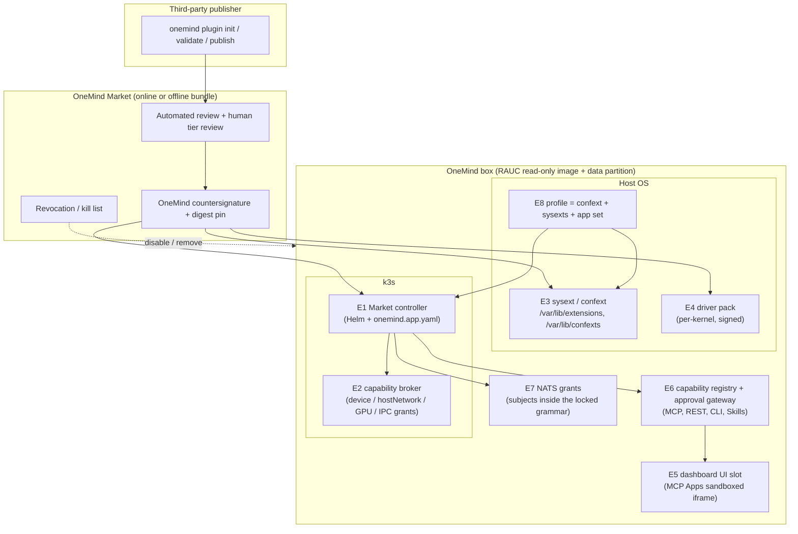

# 29 · Platform and plugin ecosystem: OneMind as the robot and physical-AI OS (W19)

**Date:** 2026-11-11 · **Workstream:** W19 (Tier B; the extension points are P0 and answer **DC-16**) · **Status:** draft complete; DC-16 answered with code, a VM lab and primary sources; **15 independent refuters ran after this draft** and their results, including the new E10 and the per-vendor driver packs, are in `01` rev. 2 §4.8 and §5.10, which supersede this file where they differ (§17)
**Requirements served:** A-1, A-2, A-5, A-6, AI-1, AI-3, AI-5, AI-7, P-4, P-8, F-3, F-4, F-5, F-6, F-14, W-8, R-1, U-4, M-1, M-6, M-7, N-3, N-4, N-10 (see §19)
**Claims:** `evidence/claims/W19.csv` (C-W19-001…049) plus earlier IDs from the Tier A ledgers · **Sources:** `evidence/sources/W19.md` · **Lab:** `evidence/lab/w19-sysext/` · **Question statuses:** `evidence/qbank/W19.md`
**Builds on:** `01-FOUNDATION-DECISION.md` (Debian 13 core, RAUC A/B read-only image, k3s on ≥ 4 GB + SSD nodes, NATS leaves below, restic), the Tier A teardowns (HAOS, umbrelOS, Olares) and the `onemind.app.yaml` draft in `research/platform/ai-native-protocols-and-ux.md` §10.

> ### Explain it like I'm the founder
> A plugin system is a promise: *"anyone can add to OneMind without asking us to change the OS."* We checked whether the chosen foundation can keep that promise. It can, on one condition: **nine "sockets" must be built into release 1.** Most plugins (apps, widgets, AI tools, automations) live inside k3s and never touch the OS. The hard ones are **drivers and OS profiles**, because the OS image is read-only. We tested the fix in a throwaway Debian 13 VM: a standard Linux feature called **system extensions** lets a signed add-on image lay new files over the read-only OS and peel them off again cleanly. It worked for a program, a USB rule, a settings profile and a kernel driver [C-W19-006…009].
> One catch: **kernel drivers must be built by OneMind's own pipeline for each OneMind kernel.** A startup cannot ship a driver binary that drops into any box. That is how Flatcar does it [C-W19-005], and it is also how you keep a robot fleet safe.
> The second lesson comes from other ecosystems. Omarchy, Obsidian, HACS and Umbrel's community stores all install **unsigned code from whatever is on GitHub today** [C-W19-011, C-W19-012, C-W19-021, C-W19-033]. VS Code signs every extension and can remove malware from users' machines [C-W19-023]. npm and Open VSX were hit by self-spreading worms in 2025 [C-W19-025, C-W19-026]. OneMind controls robots, so it takes the strict path: **pinned, signed, permission-declared plugins, with a remote "pull this now" list** from day one.

---

## 1. The answer (DC-16)

**Question (Q335, A-5/A-6):** which extension points must the base OS expose on day one so that no plugin type ever needs a fork of the OS?

**Answer:** no plugin type needs a fork under the Tier A design, provided these **nine extension points (E1–E9) ship in release 1** [C-W19-047]. Two of them (E3 and E4) are OS-level and must be designed into the image now. The rest live in k3s and the capability layer, but their *contracts* must be frozen early, because changing a public plugin contract later breaks every plugin.

| ID | Extension point | Lives in | What it lets a plugin do | Why it must exist on day one (evidence) |
|---|---|---|---|---|
| **E1** | **Market/app controller** reading `onemind.app.yaml` + Helm | k3s | Install, upgrade, roll back, uninstall an app | The core of A-1; every competitor has one (HA `config.yaml` [C-TD-home-assistant-os-026], `umbrel-app.yml` [C-TD-umbrelos-026], OAC [C-TD-olares-028]) |
| **E2** | **Capability broker** for host grants: device nodes, host network, IPC/shared memory, GPU, raw sockets, real-time priority | k3s admission + node agent | Get a *declared, user-approved* exception to the pod sandbox | Home Assistant needs host networking [C-W8-026, C-W8-025]; ROS 2 shared-memory DDS needs host network + host IPC [C-W7-033]; Umbrel grants GPU only on `permissions: GPU` [C-TD-umbrelos-027]; Olares *bans* host networking in its linter [C-TD-olares-028], which a robot OS cannot do |
| **E3** | **Host extensions:** `systemd-sysext` (adds to `/usr`, `/opt`) and `systemd-confext` (adds to `/etc`), images on the data partition, matched by a OneMind `SYSEXT_LEVEL` | OS image | Add host binaries, udev rules, `/etc` drop-ins and profile settings, then remove them cleanly | The image is read-only and RAUC replaces the slot; changes outside declared paths vanish (Rugix lab [C-LAB-debian-rugix-012]; umbrelOS #2124 [C-TD-umbrelos-053]). Lab: works on Debian 13 / systemd 257 [C-W19-004, C-W19-006, C-W19-007, C-W19-009] |
| **E4** | **Driver packs:** signed kernel-module sysexts, built per OneMind kernel by the OneMind pipeline | OS image + release pipeline | Ship vendor drivers (CAN adapters, NPUs, cameras) without changing the base image | A module loads only with a `modules.dep` built for that exact kernel, and unsigned modules taint the kernel [C-W19-008]; Flatcar binds such extensions to the OS release in its A/B update [C-W19-005]; Secure Boot lockdown refuses unsigned modules [C-STEEL-KRU-013] |
| **E5** | **UI slot:** sandboxed iframe widgets (MCP Apps `ui://`) and app entrances in the dashboard | Dashboard | Add tiles, panels, robot views | MCP Apps already defines the sandbox (separate origin, CSP from declared domains) [C-W19-035]; Foxglove's custom panels show the robotics need [C-W19-037] |
| **E6** | **Capability registry + approval gateway** (MCP / REST / CLI / Agent Skills projected from the manifest) | Capability layer | Register AI tools, skills and agents with scopes and "destructive" flags | AI-3 ("install = registered for AI") and AI-5 (human approval); prompt injection against device control is a top risk [C-W6-068] |
| **E7** | **NATS subject and account grant** per plugin, inside the locked subject grammar | NATS | Publish telemetry, receive commands, serve RPC | NATS is the bus on every node, and the leaf tier is the robot/sensor tier (01 §1); the grammar is fixed (`tel.`, `det.`, `evt.`, `cmd.`, `svc.`, `agents.`), so plugins get *grants* inside it, never new patterns |
| **E8** | **Profiles:** a signed bundle = confext + optional sysexts + an app set + config defaults | OS image + Market | Turn a box into a greenhouse controller, TAK node or industrial gateway (P-8) | Profiles are what ADR-001 promises for P-8; E3 makes them installable without new images |
| **E9** | **Trust root:** publisher signing, OneMind countersignature, exact-digest pinning, a revocation ("kill") list, plugin API levels | Release/signing chain | Make every other socket safe | Ecosystems that clone mutable `HEAD` cannot bind review to what runs [C-W19-012, C-W19-033]; VS Code signs and auto-uninstalls block-listed extensions [C-W19-023]; HACS force-uninstalls "critical" repos every 6 h [C-W19-015] |

**The one real constraint [C-W19-048]:** a third party cannot install a kernel driver at runtime. The driver must be **built and signed per OneMind kernel** by the OneMind pipeline (a contributed recipe, Flatcar-style). And because a driver sysext overrides the kernel's module index files (`modules.dep` and friends), **only one sysext per kernel should own those indexes**. Two vendor driver sysexts each carrying their own index would mask each other. *(That last point is an inference from overlay semantics; the lab tested one driver pack, not two.)* OneMind therefore ships **one combined, signed "driver-pack" sysext per kernel**, built from all approved driver recipes.

**ADR-001 effect [C-W19-049]:** D1 and D3 are **confirmed with an addition**. The flip condition ("a day-one plugin type needs host changes the image can't provide without a fork") is **not met**. The image must reserve these from release 1, all cheap now and expensive later:
1. `SYSEXT_LEVEL=` (the OneMind plugin API level) in `/usr/lib/os-release`;
2. `/var/lib/extensions` and `/var/lib/confexts` on the persistent data partition, plus a `systemd-sysext`/`confext` merge before k3s starts;
3. a OneMind kernel module-signing key (and `CONFIG_MODULE_SIG`) in the kernel config, so driver packs keep working when Secure Boot arrives (01 §1 "day-1 layout prerequisites");
4. `dm-verity` signing for extension images, reusing the release signing chain.

---

## 2. Glossary

| Term | Plain meaning |
|---|---|
| **App** | A service you install from the Market. Runs as pods in k3s. Packaged as Helm + `onemind.app.yaml`. |
| **Plugin** | Anything a third party adds to OneMind through a declared extension point. Apps are one plugin type of seven (§3). |
| **Integration** | A plugin that connects OneMind to an outside system or device (a cloud API, a robot, a PLC). Usually an adapter (type 4) plus AI tools (type 5). |
| **Profile** | A named, signed bundle that turns a box into something specific (greenhouse, TAK node). Type 7. |
| **Bundle** | A product offer: hardware + profile + apps (A-7). A business object, not a technical one. |
| **Extension point** | A socket in the OS where plugins plug in (E1–E9). |
| **sysext / confext** | systemd features that lay a read-only add-on image over `/usr`/`/opt` (sysext) or `/etc` (confext) and can be removed cleanly [C-W19-001, C-W19-003]. |
| **SYSEXT_LEVEL** | A version string in os-release. An extension is merged only if it matches [C-W19-002]. OneMind uses it as the "plugin API level". |
| **Driver pack** | A sysext containing kernel modules built for one exact OneMind kernel. |
| **Sandbox** | The walls around a plugin: container + Pod Security, iframe + CSP, WASM, etc. |
| **Capability** | A typed action an app exposes (e.g. `robot.arm.move`), with a scope and an effect (read/write/destructive). |
| **Grant** | A user-approved exception: "this plugin may use `/dev/ttyACM0`". |
| **Kill list** | A signed list of plugin versions OneMind boxes must disable or remove (HACS "critical" [C-W19-015], VS Code block list [C-W19-023]). |
| **Digest pinning** | Installing a plugin by its content hash, so what was reviewed is exactly what runs. |
| **Verified publisher** | A publisher whose identity (domain, organisation) OneMind has checked. |
| **Quality tier** | Bronze/Silver/Gold/Platinum, like Home Assistant's quality scale [C-W19-018]. |
| **Works with OneMind** | A hardware certification programme, like Works with Home Assistant [C-W19-020]. |
| **MHS** | Anthropic's Model Hardware Standard (research preview; no public spec yet) [C-W7-047]. |

---

## 3. Plugin types and what each needs from the OS (Q254, Q335)

| # | Plugin type | Examples | Runs where | Extension points used | Sandbox | Needs host changes? |
|---|---|---|---|---|---|---|
| 1 | **Market app** | Jellyfin, Frigate, a robotics fleet UI | k3s pods | E1, E6, E7, (E2) | Pod Security *restricted* by default; gVisor tier for untrusted | No, unless it asks for a grant (E2) |
| 2 | **Dashboard widget / UI extension** | Greenhouse gauge, robot teleop panel | Browser, sandboxed iframe | E5, E6 | iframe on its own origin + CSP from declared domains [C-W19-035] | No |
| 3 | **Desktop/shell plugin** (Hyprland edition) | Bar widget, menu, overlay | User session on the desktop edition | Omarchy-compatible manifest in `$HOME` | **None possible in-process** (Omarchy: "arbitrary, unsandboxed code" [C-W19-011]) → OneMind restricts to Verified publishers | No: lives in the user's home directory, not the image |
| 4 | **Device / driver / protocol adapter** | ROS 2 driver for a robot arm, Modbus/OPC UA bridge, MAVLink bridge, MHS device profile | k3s pod (userspace) + optional host parts | E1, E2, E3 (udev), E4 (kernel), E6, E7 | Pod + narrow grants | **Sometimes**: udev rules via E3; kernel modules via E4 |
| 5 | **AI skill / agent / tool** | Agent Skill bundle, MCP server, "drive this robot" agent | k3s pod (agent sandbox) | E6, E7, E1 | Agent sandbox (gVisor), egress proxy, approval gateway | No |
| 6 | **Automation / workflow** | "If soil < 20 %, open valve 2", Node-RED flow, n8n flow | Automation engine pod | E6, E7 | Runs inside the engine; every action goes through E6 scopes | No |
| 7 | **OS / image profile** | Greenhouse, TAK node, industrial gateway, kiosk | Host + Market | E8 (which uses E3, E4, E1) | Signed + verity, OneMind or Certified publishers only | **Yes**, through E3/E4 only, never by editing the image |

**Why this split works:** types 1, 2, 5 and 6 are pure Kubernetes/web plugins. Type 3 lives in a user's home directory, exactly as Omarchy does (`~/.config/omarchy/plugins` [C-W19-011]). Types 4 and 7 are the only ones that touch the host, and E3/E4 cover every host change they need. That covers all seven, so there is no fork case.



---

## 4. What proven ecosystems do (code level)

Constraint-fit asks whether a pattern can be the **default** for OneMind (a Linux appliance OS that controls physical devices, run by a solo founder at first, Apache-2.0 open core).

| Ecosystem | Manifest and validator (code) | Sandbox | Signing / pinning | Review and tiers | Kill switch | Scale | Constraint fit with OneMind |
|---|---|---|---|---|---|---|---|
| **Omarchy** (Arch + Hyprland desktop) | `manifest.json`, `schemaVersion: 1`, required `id/name/version/kinds/entryPoints`, reserved `omarchy.*` IDs, safe relative paths, no symlinks [C-W19-010] | **None**: "arbitrary, unsandboxed code" [C-W19-011] | git clone of mutable `HEAD`; marketplace admits install isn't verification-bound [C-W19-012] | Marketplace: exact-SHA scan, fail-closed, maintainer approval; AI may not decide outcomes [C-W19-013] | Delisting only | Young (validator and marketplace active Nov 2026) | **High for type 3 manifest shape and validator CLI; low for trust** (no signing or pinning on the box) |
| **Home Assistant integrations** | `manifest.json` validated by hassfest; `version` mandatory for custom integrations [C-W19-019] | **None**: integrations run in-process in Python | Core: shipped with HA. Custom: none | **Quality scale**: 20 Bronze, 10 Silver, 21 Gold, 3 Platinum rules [C-W19-018, C-W19-046] | Core hard-codes `BLOCKED_CUSTOM_INTEGRATIONS` by version [C-W19-017] | Very large (HACS alone lists 5,165 integrations [C-W19-014]) | **High for quality scale and version blocklist**; in-process model unsuitable for robots |
| **HACS** | Checks: manifest schema, brands, ≥1 release, `hacs.json`, no clash with core [C-W19-016] | None | GitHub releases, no signature | Inclusion review only | **"critical" list every 6 h → auto-uninstall + restart** [C-W19-015] | 5,165 integrations, 1,113 frontend plugins, 551 removals [C-W19-014] | **High for the kill-switch pattern** |
| **HA add-ons/apps (HAOS)** | `config.yaml`: `host_network`, `privileged`, `full_access`, `apparmor`, `hassio_role` [C-TD-home-assistant-os-026] | Docker + AppArmor by default [C-TD-home-assistant-os-027] | Optional signing | **Security rating 1–8** computed from declared privileges [C-TD-home-assistant-os-025, C-W6-054] | — | Large | **High**: the declared-privilege + visible-rating model is E2's template |
| **Works with Home Assistant** | — | — | — | Lab testing, CHF 500/yr, local control, Gold integration, FCC/CE [C-W19-020] | Badge withdrawal | — | **High** template for "Works with OneMind" |
| **umbrelOS apps + community stores** | `umbrel-app.yml` with `permissions`, `dependencies`, `widgets` [C-TD-umbrelos-026]; community store = git repo + `umbrel-app-store.yml`, ID prefix [C-W19-032] | Docker; GPU only on `permissions: GPU` [C-TD-umbrelos-027]; no OS-enforced privileged ban [C-TD-umbrelos-029] | Store repos cloned from default branch every 5 min, unsigned [C-W19-033] | Official store: PR lint with `pull_request_target` [C-TD-umbrelos-028]; community: none | None found | Hundreds of apps | **Medium**: copy the store-ID prefix and the multi-store model, not the unsigned updates. PolyForm-NC: patterns only |
| **Olares OAC** | Helm + `OlaresManifest.yaml`, linter (folder, manifest, dry-run, no hostNetwork/PID/IPC, limits, RBAC) [C-TD-olares-028]; `olares` version range in dependencies [C-W19-034] | k8s; but privileged check **off by default** and exempts `beclab/` images [C-W19-034, C-TD-olares-029] | — | Allowlist for the riskiest permission (10-year CLI token) [C-W19-034] | — | Market | **High for format (k3s + Helm + manifest)**; fix the self-exemption. AGPL: patterns only |
| **VS Code Marketplace** | `package.json` + `engines.vscode` semver range [C-W19-024] | **None**: extension host "has the same permissions as VS Code itself" [C-W19-023] | **Marketplace signs every extension; verified at install** [C-W19-023] | Malware scan on every publish and update; verified publishers (domain); secret scanning [C-W19-023] | **Block list + automatic uninstall** [C-W19-023] | Very large | **High for supply-chain controls**; its open sibling Open VSX shows the cost of weak tokens [C-W19-025] |
| **Obsidian** | `community-plugins.json`: id/name/author/description/repo only [C-W19-021] | None: "cannot reliably restrict plugins" [C-W19-022] | Repo name only, no pin [C-W19-021] | Initial review, auto-scan of each version [C-W19-022] | Removal list (175) [C-W19-021] | 10,232 plugins [C-W19-021] | **Low for trust**; good proof that a simple manifest + Restricted Mode by default grows a large community |
| **Grafana** | `plugin.json` + `grafanaDependency` semver range | Frontend plugins in-app; backend plugins as separate processes | **Signature levels** Private/Community/Commercial/Enterprise/Marketplace [C-W19-030] | Validator: osv-scanner, govulncheck, gosec, ClamAV, provenance attestation, LLM review [C-W19-031] | — | Large | **High**: signature levels map directly to OneMind's tiers and paid plugins |
| **WordPress** | readme + header; 18 directory guidelines (GPL, no obfuscation, no remote executable code) [C-W19-029] | None (PHP in-process) | Directory-served updates | Human review | Directory can **replace a plugin via auto-update**: ACF → SCF fork, 2024-10-12 [C-W19-028] | Very large | **Warning case**: a kill switch is also a governance weapon (§8.4) |
| **Chrome Web Store** | `manifest.json` permissions, optional and host permissions; warnings shown, changes may re-prompt [C-W19-045] | Strong browser sandbox | Store-signed | Review | Remote disable | Very large | **High for permission UX** (declare, warn, re-prompt on change) |
| **Backstage** | npm packages composed into one SPA (legacy docs v1.56.0) | None | npm | — | — | Large | **Low for a consumer OS** (rebuild to add a plugin); keep for the operator portal only (Q255, W4) |
| **ROS / rosdistro** | `package.xml` (REP 149) + `distribution.yaml` per distro with status per repo [C-W19-038] | None (native) | Release repos tagged by version; synced about every two weeks [C-W19-038] | Human PR review in rosdistro | EOL distros sealed | Jazzy 859 repos; Lyrical 741, **targets Debian trixie** [C-W19-038] | **High for robot adapters**: OneMind adapters should wrap ROS packages, not replace them |
| **Viam modules** | `meta.json`: `module_id`, models as `api` + `model`, build arch list, optional `first_run` setup [C-W19-036] | Separate process | Registry versions | — | — | Robotics peers | **High**: typed "api + model" pairs are exactly what OneMind robot adapters need |
| **MCP Apps** | `ui://` resources tied to tools | **Mandatory sandboxed iframe on a different origin, CSP from declared domains** [C-W19-035] | — | — | — | New standard (spec 2026-01-26) | **High**: E5 adopts it as is |

**What made each succeed:** a tiny manifest and a validator CLI the author runs locally (Omarchy, hassfest, OAC, Grafana); a visible quality ladder (HA scale, Grafana levels); a second, looser channel next to the official store (HACS, Umbrel community stores, Omarchy marketplace); and a way to pull bad code fast (HACS critical list, VS Code block list, HA core blocklist).
**What made each fail or bleed:** unsandboxed code plus unpinned updates (Omarchy, Obsidian, HACS, umbrel stores), long-lived publish tokens (npm, Open VSX), and kill switches without governance (WordPress).

---

## 5. Security incidents and what OneMind copies from the response

| Incident | What happened | Root cause | Registry's response | OneMind rule |
|---|---|---|---|---|
| **npm Shai-Hulud** (Sept 2025) | Self-replicating worm through compromised maintainer accounts and malicious post-install scripts; 500+ packages removed [C-W19-026] | Long-lived tokens; install scripts run automatically | 7-day granular tokens, trusted publishing from CI, FIDO 2FA, tokens off by default [C-W19-026] | **Publish only from CI with OIDC "trusted publishing"**; no install-time scripts in plugins (a Helm hook or `first_run` needs a declared capability and review) |
| **Open VSX GlassWorm** (Oct 2025) | Leaked publisher tokens used to publish malicious extensions [C-W19-025] | Tokens committed to public repos | Revoked tokens, shorter lifetimes, token prefixes for secret scanning, scanning at publication [C-W19-025] | Prefixed, short-lived publisher tokens; secret scanning of every bundle |
| **AUR CHAOS RAT** (July 2025) | Three `-bin` browser packages pulled a RAT; live two days [C-W19-027, SECONDARY] | Anyone can upload; no review; script fetched at install | Removal after community reports | **No "community = unreviewed" channel for host-touching types (4, 7)**; community channel limited to sandboxed types (1, 2, 5, 6) |
| **WordPress ACF → SCF** (Oct 2024) | Directory forked a popular plugin and auto-switched sites [C-W19-028] | Directory controls updates and identity | — | Kill list may only **disable/remove**, never substitute another publisher's code; every entry is public with a reason (§8.4) |
| **VS Code Marketplace** (ongoing) | Malicious extensions found repeatedly | Extensions have full editor permissions [C-W19-023] | Signing, multi-engine scan, verified publishers, block list with auto-uninstall [C-W19-023] | Copy all of it, and add permission scoping (VS Code has none) |
| **Olares self-exemption** (code) | Privileged check skips any image path containing `beclab/` [C-TD-olares-029] | Vendor trusts its own namespace by string match | — | **No first-party exemptions**: OneMind's own apps pass the same linter |

---

## 6. The plugin manifest (`onemind.app.yaml`, schemaVersion 1, extended for all seven types)

One manifest for every type, with a `kind` field. The app fields come from the existing draft (`research/platform/ai-native-protocols-and-ux.md` §10.1). W19 adds `kind`, `compat`, `grants`, `host`, `bus`, `signing` and `offline`.

```yaml
schemaVersion: 1
id: io.acmerobotics.so101-adapter        # reverse-DNS; namespace = verified publisher; onemind.* reserved (Omarchy rule)
name: SO-101 arm adapter
version: 1.3.0                           # semver, required (hassfest rule)
kind: adapter                            # app | widget | shell | adapter | skill | automation | profile
license: Apache-2.0                      # SPDX; checked against the licence policy
publisher: { name: Acme Robotics, verified: true }
compat:                                  # VS Code engines / Grafana grafanaDependency / Olares olares range
  onemind: ">=1.0 <2.0"                  # OneMind plugin API (= SYSEXT_LEVEL major)
  arch: [arm64, amd64]
  kernel: { driverPack: ">=2026.11" }    # only if E4 is needed
  hardware: { requires: [usb.serial], recommends: [gpu.cuda>=12] }   # matched by capability detection (NFD)
runtime: { chart: ./chart, sandbox: restricted }   # restricted | gvisor | privileged-grant
grants:                                  # E2: each one shown to the user, each one lowers the trust rating (HA model)
  devices: [{ match: "usb:1209:0001", as: /dev/onemind-robot0 }]
  hostNetwork: false
  hostIPC: false
  realtime: { priority: 50 }             # RT scheduling for the control loop pod
host:                                    # E3/E4: only for adapter and profile kinds
  udev: ./host/99-so101.rules            # packed into a sysext by `onemind plugin pack`
  modules: []                            # kernel modules: recipe reference only, built by the OneMind pipeline
bus:                                     # E7: grants inside the locked NATS grammar
  publish: ["tel.robot.{instance}.>", "evt.robot.{instance}.>"]
  subscribe: ["cmd.robot.{instance}.>"]
  serve: ["svc.so101.{instance}.>"]
capabilities:                            # E6 (from the §10.1 draft)
  - id: robot.arm.move
    effect: actuate                      # read | write | destructive | actuate (physical motion = always approval-gated)
    scope: device:so101:motion
    requiresApproval: true
    safety: { maxSpeed: 0.5, workspace: ./safety/workspace.json, estop: required }
    exposure: { mcp: tool, cli: "onemind robot so101 move", mhs: profile }
dashboard: { widgets: [{ id: teleop, render: mcp-app, ui: "ui://so101/teleop" }] }   # E5
signing: { provenance: required }        # SLSA provenance from CI (Grafana validator pattern)
offline: { bundle: true }                # build an offline .ompkg (§10)
```

**Validator rules (`onemind plugin validate`), merged from the ecosystems read:**
1. Schema version known; required fields; semver `version`; `id` matches publisher namespace; `onemind.*` reserved [C-W19-010].
2. Paths relative, existing, no `..`, **no symlinks** [C-W19-010].
3. Every declared `kind` has its entry point (Omarchy's "a kind is a promise" rule [C-W19-010]).
4. Helm dry-run; Pod Security *restricted* unless a grant explains the exception; resource limits set (OAC [C-TD-olares-028]).
5. Grants are computed into a visible **trust rating** (HA's 1–8 model [C-TD-home-assistant-os-025]).
6. NATS subjects must match the grammar; no wildcard publish on `cmd.>`.
7. Any capability with `effect: actuate` or `destructive` must set `requiresApproval: true`; `actuate` needs a `safety` block.
8. Supply chain: osv-scanner and govulncheck on dependencies, a malware scan, secret scan and provenance check (Grafana [C-W19-031], VS Code [C-W19-023]).
9. Static findings like the Omarchy baseline: `curl | sh`, broad `sudo`, bundled executables → review required [C-W19-013].
10. Deterministic outcomes only: AI may *assist* reviewers but never decide pass/fail [C-W19-013].

---

## 7. SDK, CLI and developer experience

| Command | Does | Borrowed from |
|---|---|---|
| `onemind plugin init --kind adapter` | Scaffold manifest, chart, tests, CI workflow with trusted publishing | Backstage scaffolder, `create-plugin` (Grafana) |
| `onemind plugin validate [dir]` | Runs §6 rules locally; same code as the store (Omarchy: the CLI mirrors the runtime registry [C-W19-010]) | omarchy-plugin-validate, hassfest, OAC linter |
| `onemind plugin dev --box <name>` | Live-install onto a dev box or a k3d/Lima VM from the Mac (W18 toolchain) | VS Code extension development host |
| `onemind plugin test` | Conformance tests per kind, including a sim robot (Gazebo/Isaac where available) for adapters | ROS launch tests |
| `onemind plugin pack` | Produce OCI artifacts: chart, images by digest, sysext/confext images, SBOM, provenance; optional offline `.ompkg` | Flatcar sysext-bakery [C-W19-005] |
| `onemind plugin publish` | Push from CI only (OIDC trusted publishing); opens a review | npm/PyPI trusted publishing [C-W19-026] |
| `onemind plugin install <id>@<version>` / `--file x.ompkg` | Online or offline install, verifying signatures and digests | — |
| `onemind plugin rollback|disable|remove` | Per-plugin rollback (Helm rollback + restic snapshot, 06 §Q156), clean removal | — |

**DX targets** (measured in the build session, not yet): from `init` to a working widget on a dev box in under 15 minutes; `validate` under 10 seconds; the same validator binary in CI, in the store and on the box.

---

## 8. Security model

### 8.1 Sandboxing per type
| Type | Default | Escalation path |
|---|---|---|
| App, adapter (userspace), skill, automation engine | Pod Security *restricted*, NetworkPolicy default-deny egress, AppArmor `RuntimeDefault` [C-W6-064] | Declared grants (E2) → user consent → lower trust rating |
| Untrusted or AI-generated code | gVisor RuntimeClass (agent sandbox) | none |
| Widget | iframe on its own origin, CSP from declared domains [C-W19-035] | declared `connectDomains` only |
| Shell plugin | In-process, no sandbox possible [C-W19-011] | Verified publishers only; off by default (Obsidian "Restricted Mode" pattern [C-W19-022]) |
| Host extension / driver pack / profile | dm-verity signed images; merge only when `SYSEXT_LEVEL` matches [C-W19-002, C-W19-009] | OneMind or Certified publishers only |

### 8.2 Signing and trust chain
- **Publisher key** (Sigstore keyless from CI, identity = verified publisher) signs the artifact.
- **OneMind store countersignature** after review, bound to the **exact digest** (the Omarchy marketplace's exact-SHA binding [C-W19-013], enforced on the box, which Omarchy itself does not do [C-W19-012]).
- Box verifies both before install and on every update; **the box installs digests, never branches or tags** (umbrel stores, Obsidian and Omarchy all follow mutable heads [C-W19-012, C-W19-021, C-W19-033]).
- The store key hangs off the same offline root as OS releases (04 / 07 signing design).

### 8.3 Permissions and AI
Every grant and every capability scope is shown at install and revocable later. AI agents act with the *intersection* of the user's role and the agent's grant (§10.2 of the AI draft). `actuate` and `destructive` capabilities always pause for human approval at the gateway (AI-5), because prompt injection has no fool-proof prevention [C-W6-068].

### 8.4 Revocation (kill list), with governance
- Boxes fetch a **signed revocation list** (like HACS every 6 h [C-W19-015]; also at boot and before any plugin update). Offline boxes apply it when it arrives by USB bundle or leaf sync.
- Actions allowed: **disable** (default) or **remove**. For type 4/7 plugins controlling hardware, **disable means "stop and leave the device in its safe state"**, never an abrupt kill of a moving robot. A safe-stop hook is mandatory for adapters.
- **Never substitute** another publisher's code (WordPress ACF → SCF lesson [C-W19-028]). Every entry is public, with a reason and a link (HACS stores reason and link [C-W19-015]).
- Owner override for self-built/private plugins (sovereignty), logged.

---

## 9. Review and quality tiers

| Tier | Who | What is checked | Where it can be installed | Model |
|---|---|---|---|---|
| **Private** | Anyone, for own boxes | Validator only; self-signed key the owner enrolls | Owner's boxes only | Grafana *Private* [C-W19-030] |
| **Community** | Any publisher | Automated review (§6 rules 1–10), scan, provenance | Any box; types 1, 2, 5, 6 only | HACS / umbrel community stores, but signed and pinned |
| **Verified** | Verified publisher (domain + org) | Automated + human review of grants and capabilities; Bronze quality minimum | Any box; all types except 7 | VS Code verified publisher [C-W19-023] |
| **Certified** | Verified + agreement + fee | Lab test on reference hardware; Gold quality minimum; safety review for `actuate` | All types, incl. profiles and driver recipes | Works with HA [C-W19-020], Grafana Commercial |
| **OneMind** | First party | Same pipeline, no exemptions | All | (contrast Olares self-exemption [C-TD-olares-029]) |

**Quality ladder (separate from trust):** Bronze/Silver/Gold/Platinum rules copied in spirit from HA's 54 rules [C-W19-018], adapted: Bronze = installs, uninstalls cleanly, has docs and a removal guide, declares all grants; Silver = backup hooks, health checks, error reporting; Gold = discovery/onboarding, diagnostics, offline-capable, translations; Platinum = typed capabilities with tests, MHS/MCP profile, simulation test for robots.

---

## 10. Versioning, compatibility, updates and offline installs

- **Plugin API level** = `SYSEXT_LEVEL` major (E3) = `compat.onemind` range in the manifest. A box refuses a plugin outside its range, just as the lab refused level 2.0 on 1.0 [C-W19-009]. Same idea as VS Code `engines` [C-W19-024], Grafana `grafanaDependency` [C-W19-031], Olares `olares` dependency [C-W19-034].
- **OS updates and plugins:** before committing an OS update, the health gate (01 §1) also checks that host extensions and the driver pack re-merged for the new level. Driver packs are **released with the OS release** and travel in the same RAUC bundle or a companion bundle (Flatcar [C-W19-005]). A plugin whose range excludes the new OS blocks the update with a message rather than breaking silently.
- **Blocklist by version** for known-bad versions (HA core pattern [C-W19-017]).
- **Updates:** user-controlled timing per plugin; security-flagged updates follow the CRA default-on policy decided in 01; pre-update restic snapshot for stateful plugins.
- **Uninstall:** Helm uninstall + optional data retention; sysext/confext removed and unmerged with nothing left in `/usr` or `/etc` [C-W19-006, C-W19-007].
- **Offline (`.ompkg`):** an OCI image layout tarball containing chart, images by digest, extension images, SBOM, provenance and both signatures, plus the latest revocation list. Install by USB, LAN mirror or NATS-leaf-synced mirror. Air-gapped boxes verify against the root key in the image.

---

## 11. Robot plug-and-play ("connect a robot → use OneMind", F-3, Q329)

```mermaid
sequenceDiagram
  participant R as Robot / device
  participant B as OneMind box (udev + NFD + broker)
  participant M as Market (online or offline mirror)
  participant U as User (dashboard / phone)
  participant G as Approval gateway
  R->>B: USB plug / mDNS / QR code on robot / BLE
  B->>B: Identify (USB VID:PID, mDNS TXT, QR payload, MHS profile if present)
  B->>M: Which certified adapters match this ID and this box's capabilities?
  M-->>B: Adapter (signed, digest-pinned) + required grants + driver-pack need
  B->>U: "SO-101 arm found. Install adapter? Needs /dev/ttyACM0, RT priority"
  U-->>B: Approve
  B->>B: Install adapter (E1), apply grants (E2), merge udev sysext (E3); driver already in driver pack (E4)
  B->>B: Capability detection + self-test in SAFE mode (no motion)
  B->>U: Calibrate? Workspace limits? E-stop present?
  U-->>B: Confirm safety settings
  B->>G: Register capabilities (read: live; actuate: approval-gated)
  G-->>U: Robot tile + teleop widget (E5); AI may read now, move only with approval
```

**Safety gates (non-negotiable):** (1) new robots start in *observe-only*; (2) motion capabilities need a declared workspace, speed limits and a hardware e-stop check before first enable; (3) every AI-initiated `actuate` call is approval-gated; (4) revocation of an adapter means safe stop. Linux and an AI agent are not the safety function (08 W7); the adapter must respect the robot's own safety controller.
**First-class at launch (recommended, assumptions stated in `qbank/W19.md` Q329):** robots that already have ROS 2 drivers on the Lyrical/Jazzy indexes [C-W19-038] and USB-serial or Ethernet discovery: LeRobot SO-100/101 arms (Hugging Face is an MHS early adopter [C-W7-047]), TurtleBot 4, PX4 drones over MAVLink, and Jetson kits. Hardware tests are founder-run (§16).

---

## 12. Hybrid self-hosted + cloud without lock-in (F-6, Q332)

| Who | Model | Price (primary) | Lesson |
|---|---|---|---|
| Home Assistant + Nabu Casa | Local-first; paid optional cloud for remote access etc. | USD 6.50/month or 65/year [C-W19-043] | Cloud as a convenience subscription funds the project |
| balena | Cloud fleet manager; open-source openBalena to self-host | First 10 devices free [C-W19-044] | A free self-hostable control plane removes lock-in fears |
| Olares, Umbrel | Covered in Tier A teardowns | — | — |

**OneMind design:** every plugin must work **local-only**. Cloud features (relay, off-site backup target, burst GPU, fleet view, store mirror) are *optional plugins of type 1/5* using the same manifest, with an `aiPolicy` and data-egress declaration. The store, revocation list and fleet manager must be **self-hostable** (open-core: the protocol and a basic server are Apache-2.0), so a sovereign customer can run their own Market. That is the openBalena lesson [C-W19-044] applied to the Market.

---

## 13. "Works with OneMind" certification and the partner path (F-5)

Modelled on Works with Home Assistant [C-W19-020] and the Android CDD idea that compatibility is a written, testable spec [C-W19-039]:
1. **Spec:** a public *OneMind Compatibility Definition* per device class (robot arm, mobile base, drone, sensor node, PLC gateway): required discovery, adapter quality tier, local control without cloud, update path, safety hooks, MHS/MCP profile.
2. **Agreement + annual fee** (start near HA's CHF 500 level so startups can afford it; *assumption*, set by Zeus).
3. **Lab test** on reference boxes (Pi 5 Lite, x86 Pro, Jetson Robotics); feedback rounds, not just pass/fail.
4. **Badge + listing**; withdrawn if the adapter is revoked or falls below Gold.
5. **Developer portal:** docs, SDK, sample adapters, sim robots, test reports, a sandbox Market.

**How platforms became the default (Q328, short):** Android made compatibility a contract (CDD + tests) before giving access to its services [C-W19-039]; ROS won by being the shared package index robotics already uses (859 repos in Jazzy [C-W19-038]), so **OneMind wraps ROS rather than competing with it**; Home Assistant grew through thousands of integrations and a community channel next to core [C-W19-014]; Viam and Foxglove give typed module and panel extension points [C-W19-036, C-W19-037]. Apple MFi, Steam and the NVIDIA partner programme were not opened in this pass (`qbank/W19.md` Q328 = partial).

---

## 14. Marketplace revenue share and licensing (F-5)

| Store | Developer keeps | Source |
|---|---|---|
| Apple App Store (small business) | 85% up to USD 1M/yr | [C-W19-040] |
| Google Play | 85% of first USD 1M/yr, 70% above | [C-W19-041] |
| Shopify App Store | 100% of first USD 1M lifetime, 85% above | [C-W19-042] |
| Grafana | Commercial plugins require a paid subscription; partner plugins sold via Grafana's marketplace | [C-W19-030] |
| HACS, Obsidian, Omarchy, Umbrel, Olares | No paid channel found | code and docs above |

**Recommendation (REC-W19-10):** free plugins are free to list. For paid plugins, **0% on the first USD 1M lifetime per developer, then 15%** (the Shopify shape [C-W19-042]). It is the most startup-friendly reference found, and OneMind needs integrators more than fee revenue in years 1–3. Certification fees and hardware bundles fund review. Paid plugins must still pass the same review. Licence policy: any OSI licence or a commercial EULA for Verified+; **AGPL/GPL plugins allowed as separate programs** (they run as separate pods/processes), never linked into OneMind core. Not legal advice; W16 owns the final model.

---

## 15. Recommendations

| ID | Recommendation | Requirements | Evidence |
|---|---|---|---|
| **REC-W19-01** | Ship E1–E9 in release 1 (contracts frozen at schemaVersion 1) | A-5, A-6, F-5, AI-3 | §1, C-W19-047 |
| **REC-W19-02** | Image reserves `SYSEXT_LEVEL`, `/var/lib/extensions`, `/var/lib/confexts`, merge-before-k3s, module-signing key | A-5, P-8, R-1, U-4 | C-W19-001…009, C-W19-049 |
| **REC-W19-03** | Kernel drivers only as per-kernel signed driver packs from the OneMind pipeline; one index owner per kernel | F-3, AI-7, U-4 | C-W19-005, C-W19-008, C-W19-048 |
| **REC-W19-04** | One manifest (`onemind.app.yaml`) with `kind` for all seven types; validator shared by CLI, store and box | A-5, A-6, AI-3, P-4 | §6, C-W19-010, C-W19-019 |
| **REC-W19-05** | Capability broker for device/hostNetwork/IPC/GPU/RT grants with a visible trust rating; no blanket bans, no exemptions | F-3, AI-7, U-4 | C-W8-026, C-W7-033, C-TD-home-assistant-os-025, C-TD-olares-029 |
| **REC-W19-06** | Digest-pinned, publisher-signed + OneMind-countersigned installs; CI-only trusted publishing; signed revocation list with disable-to-safe-state | U-4, A-6, R-1 | C-W19-012, C-W19-015, C-W19-023, C-W19-025, C-W19-026, C-W19-028 |
| **REC-W19-07** | Five trust tiers (Private, Community, Verified, Certified, OneMind) plus a separate Bronze–Platinum quality ladder | A-6, F-4, F-5 | C-W19-018, C-W19-020, C-W19-030 |
| **REC-W19-08** | Robot onboarding flow §11 with observe-only start and approval-gated motion | F-3, AI-5, AI-7 | C-W7-047, C-W6-068, C-W19-038 |
| **REC-W19-09** | "Works with OneMind" programme + public compatibility definition per device class | F-4, F-5, A-7 | C-W19-020, C-W19-039 |
| **REC-W19-10** | Paid plugins: 0% on first USD 1M lifetime, then 15% | F-5 | C-W19-042 |
| **REC-W19-11** | Self-hostable Market, revocation feed and fleet service; all plugins must work local-only | F-6, M-1, N-6 | C-W19-043, C-W19-044 |
| **REC-W19-12** | Plugins distributed on the website as browsable listings that deep-link to the box (W-8); offline `.ompkg` downloads | W-8, A-5 | §10 |
| **REC-W19-13** | Desktop (Hyprland edition) plugins: accept Omarchy's manifest shape, Verified publishers only, off by default | A-6, UX-10 | C-W19-010, C-W19-011, C-W19-022 |

---

## 16. Tests (for the build session and Zeus)

| ID | Test | Pass criteria | Decision consequence |
|---|---|---|---|
| **T-W19-01** | On the real RAUC image (x86 VM, then Pi 5): install a verity-signed sysext + confext + driver pack; switch RAUC slot to a new release with the same `SYSEXT_LEVEL`; then to a release with a new level | Extensions re-merge after the slot switch; level change refuses old extensions with a message and the health gate reports it; nothing written to the root slot | Fail → move extensions into the RAUC bundle only (release-bound), drop runtime host plugins |
| **T-W19-02** | Two driver-pack sysexts each with `modules.dep` | Confirms the masking inference in §1; expected: only the top one's modules resolve | Confirms the "one index owner" rule |
| **T-W19-03** | Secure Boot on (x86, Dell 5540): load a driver-pack module signed with the OneMind key; load an unsigned one | Signed loads; unsigned refused | Fail → revisit module signing in 07 |
| **T-W19-04** | Revocation drill: mark an installed adapter (sim robot moving) as revoked | Robot reaches safe state within its stop time; plugin disabled; event audited | Required before any `actuate` plugin ships |
| **T-W19-05** | Plug an SO-101 / TurtleBot 4 into a Pi 5 box with no internet, offline `.ompkg` | §11 flow completes; motion blocked until safety settings confirmed | Hardware: `blocked: founder-hardware` |

---

## 17. Adversarial status (honest)

The research protocol asks for three or more **independent** refuters per P0 conclusion. This session could not spawn independent agents, so those refuters did not run while this file was written. **Update 2026-11-11:** 15 independent refuters have since run; see `01-FOUNDATION-DECISION.md` §5.10 for their verdicts and the written responses (C-W19-011…028 has one refuter and E9 two, so those stay below the ≥ 3 target). What was done at writing time (not a substitute):
- **Failure-seeking evidence was gathered on purpose:** ecosystems that are unsandboxed and unpinned [C-W19-011, C-W19-012, C-W19-021, C-W19-022, C-W19-033], three supply-chain incidents [C-W19-025, C-W19-026, C-W19-027], a governance abuse case [C-W19-028] and a vendor self-exemption [C-TD-olares-029].
- **The strongest counter-argument found:** "sysext adds a second update channel next to RAUC; extensions can drift from the OS and break boot or k3s." Response: `SYSEXT_LEVEL` matching refuses mismatched extensions (lab [C-W19-009]); driver packs ship *with* the OS release (Flatcar [C-W19-005]); the health gate checks re-merge (T-W19-01).
- **What would flip DC-16:** (a) T-W19-01 shows extensions can't re-merge reliably across RAUC slot switches; (b) Secure Boot + RAUC can't verify sysext verity signatures with the OneMind key; (c) a required day-one device class needs an out-of-tree kernel module whose licence forbids OneMind from building and redistributing it (then only a "bring your own driver" unsigned mode would remain).
- **To do (orchestrator):** run technical, security and robotics-fit refuters on C-W19-047/048/049, plus a steelman for "no host plugins at all: everything baked into the image, profiles as separate images" (the HAOS-style runner-up).

---

## 18. Risks

| Risk | L / I | Mitigation |
|---|---|---|
| Driver-pack treadmill: every kernel update rebuilds every approved driver recipe | high / medium | Few, certified recipes; CI matrix per kernel; drop recipes without a maintainer |
| A malicious or compromised Verified publisher | medium / high | Digest pinning, countersignature, scan, revocation, grants visible |
| Kill switch abused or hijacked | low / high | Signed by the offline root chain; public log; disable-not-substitute; owner override |
| Community channel too strict to grow (vs HACS/Obsidian) | medium / medium | Community tier open for sandboxed types; fast automated review |
| MHS spec changes or never ships openly [C-W7-047] | medium / medium | MHS is one projection of E6, not the core contract |

---

## 19. Requirement trace

| ID | Covered by |
|---|---|
| A-1, A-2 | E1, REC-W19-01, REC-W19-04 |
| A-5 | §1, §3, §6, §7, REC-W19-01…04, REC-W19-12 |
| A-6 | §4, §9, REC-W19-06, REC-W19-07, REC-W19-13 |
| A-7 | §13 (bundles + certification) |
| AI-1, AI-3, AI-5, AI-7 | E6, §8.3, §11 |
| P-4 | §7 (SDK), §13 (developer portal) |
| P-8 | E8, REC-W19-02 |
| F-3 | §11, REC-W19-08 |
| F-4, F-5 | §9, §13, §14, REC-W19-07, REC-W19-09, REC-W19-10 |
| F-6 | §12, REC-W19-11 |
| F-14 | Same E1–E9 on Pi and cluster; sysext is part of systemd on every tier [C-W19-004] |
| W-8 | REC-W19-12 |
| R-1, U-4 | §8, §10 |
| M-1 | §12 (local-only first, self-hostable Market) |
| M-6 | §1 constraint (few certified driver recipes), §7 (one validator everywhere), §18 |
| M-7, N-7 | §11, E2 (RT and IPC grants for robots), REC-W19-08 |
| N-3 | `compat.hardware` matched by capability detection (§6), §11 |
| N-4 | §11 (QR / USB / mDNS onboarding) |
| N-10 | E6 `exposure.mhs`, §11, §18 (MHS is one projection, not the core) |

## 20. Open questions for Zeus (add to `26-…`)
1. Paid-plugin share (REC-W19-10) and certification fee level (`blocked: founder-decision`).
2. Should the Community tier be enabled on the Robotics edition at all, or only Verified+?
3. Desktop (Hyprland) edition: support Omarchy plugins directly, or a OneMind fork of the manifest?
