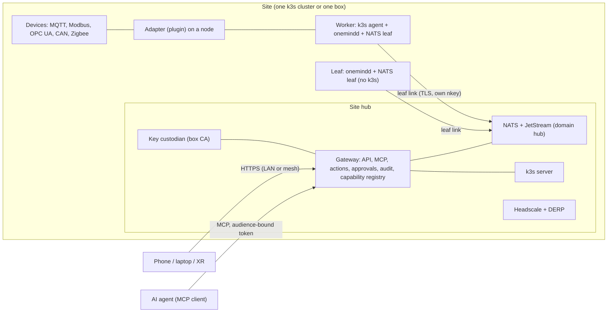
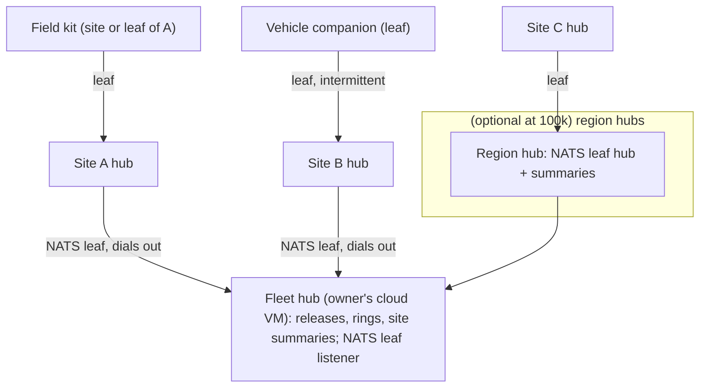

<!-- SPDX-License-Identifier: Apache-2.0 -->
# 01 · The One Mind fabric: architecture

**Date:** 2026-11-12 · **Status:** researched architecture; consistent with `docs/architecture/FABRIC.md` and `NETWORKING.md` (which it extends to many sites) and with mission 01's decisions (not reopened).
**Serves requirements:** N-1, N-5, N-6, M-1, M-2, M-4, M-7, P-4, AI-1, AI-5, UX-6, F-6, F-11, F-14

> **Explain it like I'm the founder.** Think of OneMind as a city. Each **site** (your home, a cabin, an office, a field kit) is a neighbourhood with its own town hall (the **site hub**) that keeps working even if every road out of town is closed. Inside a neighbourhood, machines talk on one language (**NATS**) over private roads (the **mesh**). Gadgets that cannot speak the language have **translators** (adapters) on a nearby machine. If you have many neighbourhoods, a **fleet hub** (usually your own cloud server) keeps the plans and the release schedule, but each town hall decides for itself and asks *you* before anything risky. Phones and headsets are **windows**: they look in and approve, they are never part of the machinery. The AI uses the same town-hall door as you do, under the same rules.

## 1. Layers

| Layer | What it is | Where decided |
|---|---|---|
| L0 Hardware classes | mini PCs, Pi 5, cloud VMs, company servers, Jetson robots, vehicle companions, sensors/MCUs/PLCs, clients | `02-JOIN-MATRIX.md` |
| L1 OS and node agent | OneMind image (Debian 13, RAUC A/B) or installer mode; `onemindd`; Jetson on L4T | mission 01; D-007 |
| L2 Underlay | WireGuard mesh per site (Headscale + DERP on the site hub); no inbound port at the edge | `04-…`; F-32; lab fb3 |
| L3 The bus | NATS: JetStream on the site hub, a leaf with an outbox on every node, site hubs leafed to a fleet hub | `04-…`; contract §12.9 |
| L4 Identity and join | owner-approved join (ticket + pairing code; FDO front end for OneMind hardware); node keys, box CA, per-node NATS permissions | `03-…`; FABRIC §3–§4 |
| L5 Gateway | one door per site for people, apps and AI; actions with risk classes and approvals; capability registry; audit | `07-…`; contract §11–§12 |
| L6 Adapters | bridges for MQTT/Sparkplug, OPC UA, Modbus, CAN, MAVLink, Zenoh/ROS 2, Matter (through an app) | `04-…`, `06-…` |
| L7 Fleet | fleet hub with desired state, rings and site summaries; sites pull | `05-…` |
| L8 Clients | one web app; phones approve; phones as TAK EUDs | `11-…` |

## 2. One site

## 3. Many sites

| Scale | Sites | Shape | Control |
|---|---|---|---|
| 1 node | 1 | hub only | gateway |
| 1,000 nodes | ~10–100 | one cluster or box per site; fleet hub | sites pull; rings |
| 100,000 nodes | thousands | leaf trees through region hubs; summaries flow up | regional rings; each site still authoritative |

## 4. The rules that hold the design together

1. **The site is the authority.** It runs with no time limit offline (contrast: Azure IoT Operations' 72 h [C-FB11-009]); the fleet hub proposes, sites apply.
2. **Everything dials out.** Leaves dial site hubs; site hubs dial the fleet hub [C-FB3-002]; no edge opens an inbound port (lab fb3 T1c).
3. **One bus, many bridges.** NATS carries OneMind's meaning; device protocols are bridged on the node nearest the device (`04-…`).
4. **One door per site, for people and AI alike**, with risk classes; `actuate` needs the target owner's step-up approval (`07-…`).
5. **Every node speaks only for itself** on the bus (per-node permissions [C-FB3-001]) and every job is signed and expires (FABRIC §5.4).
6. **No cluster spans sites**, except always-online cloud workers (`05-…`; [C-FB4-001]).
7. **Raw data stays local; meaning travels** (`06-…` §3).
8. **Safety lives on dedicated controllers**; OneMind sits on companions and never in a flight or safety loop (`10-…`).

## 5. How this extends the existing designs (no edits made)

| Existing design | Extension proposed here |
|---|---|
| FABRIC.md (one hub, workers, leaves) | sites and a fleet hub above the hub; site enrolment (MULTI-CLUSTER-1) |
| NETWORKING.md (one mesh) | one mesh **per site**; inter-site traffic over NATS leaf TLS only |
| contract §12.9 (subjects) | fleet prefix `onemind.site.<site_id>.` (proposal, ZF-05) |
| contract §12.3 (risk classes) | approval routing to the target site's owners (ZF-07) |
| CORE-UPDATE-9 (fleet staging) | rings gated on the previous ring's measured health (`09-…`) |

## Glossary

| Term | Meaning |
|---|---|
| Site | One location with its own hub, cluster or box, mesh and NATS domain |
| Site hub | The always-on OneMind machine that is the site's authority |
| Fleet hub | The owner's central OneMind that coordinates many sites but cannot act on them alone |
| Leaf | A small OneMind node (or a site hub, towards the fleet hub) that dials out and buffers |
| Adapter | A plugin that translates a device protocol into OneMind capabilities |
