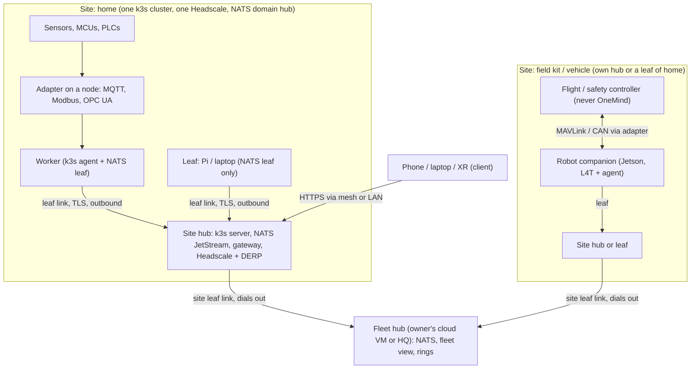

<!-- SPDX-License-Identifier: Apache-2.0 -->
# 04 · Connectivity and topology (FB-3): the one bus, the bridges, and the network under them

**Date:** 2026-11-12 · **Workstream:** FB-3 (Tier A) · **Lab:** fb3-mesh-nat **PASS** (spike 1); this run added the repo leaf-permission test and source checks.
**Serves requirements:** N-1, N-5, N-6, M-1, M-2, F-6, F-11, U-5, AI-7, N-10 · hardening H-04, H-06, H-17
**Decision-critical:** DC-F1 ("NATS is the one bus; everything else is a bridge"), refuted three ways in `evidence/refuters/DC-F1-*.md`.

> **Explain it like I'm the founder.** There are three layers, and people mix them up. **The road** is the private encrypted network (WireGuard mesh run by your own Headscale): it decides *who can reach whom*, at home, across sites, through routers that let nothing in. **The language** is NATS: every OneMind machine speaks it, through a small local NATS server that keeps messages when the road is down. **The translators** are bridges: sensors speak MQTT, factories speak OPC UA and Modbus, robots speak ROS 2/Zenoh, drones speak MAVLink. They never become the language; a OneMind node next to them translates into it. So the answer to "which is the one bus?" is **NATS**, and the answer to "what is everything else?" is **a bridge on a node, or the road underneath**.

## 1. The answer

| Layer | Choice | Status | Evidence |
|---|---|---|---|
| Underlay (reachability, encryption between machines) | WireGuard mesh: Headscale coordinator + self-hosted DERP relay on the hub, official Tailscale clients; **per site** | Decided for the home (F-32 default); lab PASS across two NATs with no inbound port | fb3-mesh-nat T1–T5 [C-LAB-fb3-mesh-nat-002…011]; Headscale scope is "a single Tailscale network … personal use, or a small open-source organisation" [C-FB3-006] |
| **The one bus** | **NATS**: JetStream on each site hub; a NATS leaf on every worker and leaf node; site hubs leaf to a fleet hub | Decided (contract §12.9, mission 01 W8-R1); confirmed here | leaf = outbound connection, no inbound port, composes into trees [C-FB3-002]; store-and-forward 1,200/1,200 after 30 min [C-LAB-fb3-mesh-nat-006] |
| Per-node isolation on the bus | top-level NATS users (nkey + per-user permissions) used by leaf logins | **Works** on nats-server v2.15.3 (repo test, run this session) | node n1's leaf could not deliver `onemind.node.n2.status` [C-FB3-001]; `leafnodes.authorization.users` does **not** accept permissions [C-LAB-fb3-mesh-nat-012] |
| Between organisations (not between your own sites) | NATS gateways or leaf links with account imports/exports | Later (federation, M6) | gateways join clusters "that can both accept connections" [C-FB3-003] |
| MQTT 3.1.1 and Sparkplug B devices | straight into NATS's built-in MQTT | Decided (W8-R1) | NATS implements MQTT 3.1.1, QoS 0/1/2, sessions in JetStream; refuses MQTT 5 [C-FB3-004]; Sparkplug topics `spBv1.0/group/type/node[/device]` [C-FB3-005] |
| MQTT 5 devices | Mosquitto app, bridged into NATS | Decided (W8-R1) | as above |
| OPC UA, Modbus TCP/RTU, CAN, Zigbee, BLE | **adapters** (plugin sockets, brief 30 B8) on the node wired to the device | To build (spike `fb-bridges` blocked) | open62541 is MPL-2.0 [C-FB11-003]; SocketCAN is in the kernel |
| ROS 2 inside a robot | Zenoh (`rmw_zenoh`) or DDS **inside** the robot; one bridge at the robot's companion | Decided pattern; bridge to build | Zenoh "unifies data in motion, data at rest, and computations" [C-FB3-007]; `rmw_zenoh` wire breaks across patch releases (C-REF-W2-robotics-003), so keep it inside one robot |
| MAVLink (drones, rovers) | `mavlink-router` on the companion; a MAVLink adapter publishes telemetry and accepts only approved mission-level commands | Pattern | mavlink-router is Apache-2.0 [C-FB11-003]; PX4 offboard safety [C-FB9-001] |
| TAK (ATAK, iTAK, WebTAK) | TAK Server is its own world; CoT bridged into NATS by a plugin | Existing founder pattern (research 09 W8-R8) | — |

## 2. Why NATS is the one bus (and not Zenoh, MQTT or Kubernetes)

1. **It already does the hard part in our lab.** A leaf with its own JetStream domain kept every event through a 30-minute outage and delivered all 1,200 in order 44 s after the link returned [C-LAB-fb3-mesh-nat-006]; mission 01's lab gave 600/600 (C-W8-050). Plain core-NATS publishes during an outage are lost (mission 01 P0-5), which is why every node keeps a local outbox stream.
2. **It needs no open port at the edge.** A leaf "opens an outbound connection to a remote NATS system" and needs "no inbound firewall rule, no public address" [C-FB3-002]. The same rule makes the fleet hub (cloud) the only place that listens.
3. **It speaks MQTT 3.1.1 itself**, so most sensors need no extra broker [C-FB3-004].
4. **It is the founder's existing nervous system** (contract §12.9 builds on it; mission 01 D-B6.5).
5. **Constraint fit:** one Go binary of a few tens of MiB per node (about 27 MiB PSS in fb3 T5 [C-LAB-fb3-mesh-nat-011]), Apache-2.0, CNCF-hosted (C-W4-056).

**Why not Zenoh as the one bus.** Zenoh is strong inside robots and for constrained devices (zenoh-pico), and PX4 now offers a direct Zenoh interface [C-FB9-001]. But `rmw_zenoh` broke wire compatibility inside one ROS 2 distribution (C-REF-W2-robotics-003), and none of OneMind's control plane (contract, outbox, jobs, audit) is built on it. Zenoh stays the robot-internal bus; one bridge per robot.

**Why not MQTT as the one bus.** MQTT has no streams, no per-node store-and-forward model and no request/reply; NATS already terminates MQTT 3.1.1 [C-FB3-004].

**Why not "Kubernetes is the bus".** Leaves and sensors run no Kubernetes; a robot or field kit must work while its cluster is unreachable. Kubernetes manages workloads; the bus carries events.

## 3. The topology at 1, 1,000 and 100,000 nodes

| Scale | Shape | Bus | Underlay | Control |
|---|---|---|---|---|
| **1 box** | hub only | NATS on the hub | LAN; mesh optional for the phone | gateway on the box |
| **~10 nodes, one site** | one k3s cluster (hub + workers) + leaves | NATS hub + a leaf on every node (FABRIC §5) | one Headscale tailnet (F-32) | gateway on the hub |
| **~1,000 nodes** | 10–100 **sites**, each its own cluster or box; a **fleet hub** | each site hub is a NATS leaf of the fleet hub (leaf links compose into trees [C-FB3-002]) | **one mesh per site**; site-to-fleet links are TLS NATS leaf connections over the internet (the fleet hub is the only listener) | site gateways keep authority; the fleet hub holds desired state and rings, sites pull (`05-…`) |
| **~100,000 nodes** | thousands of sites, grouped by region | leaf trees: site → region hub → fleet hub; JetStream domains per site; only summaries and alerts flow up by default | per-site meshes; no global tailnet | regional fleet hubs, pull model, rings by region |

**Why "one mesh per site" and not one big mesh.** Headscale states its own scope: "a single Tailscale network (tailnet), suitable for a personal use, or a small open-source organisation" [C-FB3-006]. A 1,000-site mesh would also put every site's machines in one trust domain. Sites only need one outbound TLS connection to the fleet hub (NATS leaf), which needs no mesh at all. Whether a larger coordinator (NetBird, Nebula, hosted Tailscale) is ever needed for site-to-site traffic is left open (`14-…` ZF-03).

## 4. Findings that refine the existing design (the design itself is not changed)

1. **Per-node isolation works with top-level config users; fb3's "needs accounts or JWT" is narrowed.** fb3 E2 showed nats-server rejects `permissions` on users inside the `leafnodes { authorization }` block [C-LAB-fb3-mesh-nat-012]. OneMind's own test (`internal/leaf/leaf_test.go`, PR #37) uses a different place, the server's top-level `authorization { users }`, with no authorization block inside `leafnodes`; there the per-user permissions do apply to the leaf connection, and node n1's leaf could not deliver a message on node n2's subject. Both tests passed on this session's run with nats-server v2.15.3 [C-FB3-001]. This matches `docs/architecture/NETWORKING.md` §7 as written. **Still UNVERIFIED** (NETWORKING NT-6): the exact `$JS` subjects that the hub's `ONEMIND_NODE_OUTBOX` sourcing needs under those permissions. fb3 §7.3 item 3 should be read with this narrowing; flagged, not edited.
2. **Liveness must be tuned** (fb3 observation [C-LAB-fb3-mesh-nat-007]): default pings noticed a silently dead link after 194 s (leaf) and 405 s (hub). The `stale` state (30 s) comes from heartbeats, not from NATS, so the UI is right; `leaf_link` needs `ping_interval` tuning (values UNVERIFIED; NT lab).
3. **Hard NATs relay through the hub's DERP** [C-LAB-fb3-mesh-nat-005]; size the hub's relay for the worst case, give the fleet hub a public address.
4. **Cross-site k3s workers are a special case, not the default.** NETWORKING §8 puts k3s on mesh addresses, which makes a worker at another site *possible*. k3s supports agents across networks but says "all servers should be in the same location" and warns that high latency "could also impact the health of the cluster" [C-FB4-001]. Recommendation: only always-online cloud workers join a home cluster across sites; field kits, vehicles and other houses are leaves or their own site (`14-…` ZF-02).
5. **k3s's built-in Tailscale integration is not the path.** It wants a reusable auth key and coordinator-side route approval [C-FB4-002]; OneMind's join issues single-use keys per approved node (fb3 T1a). Keep NETWORKING §8's explicit `node-ip`/`flannel-iface` approach.

## 5. What competitors and adjacent systems do (constraint-matched)

| System | Bus / transport | Offline behaviour | Constraint fit | Take |
|---|---|---|---|---|
| KubeEdge | cloud core + edge core, reliable cloud-edge messages, MQTT for devices [C-FB4-014] | edge autonomy claimed | Low: needs a central cloud control plane (`05-…`) | Pattern only |
| Azure IoT Operations | MQTT broker on Arc-enabled Kubernetes; cloud-managed | "operate offline for a maximum of 72 hours" [C-FB11-009] | Low (cloud authority) | OneMind's home is the authority; no time limit offline |
| AWS Greengrass | local MQTT between client devices and the core; cloud deployments [C-FB11-006] | core keeps running | Low (cloud-bound) | Core/client split |
| Foxglove, Formant | WebRTC from the device out to vendor TURN/SFU (C-TD-tier-c-robotics-007, -022) | buffer and upload later (C-TD-tier-c-robotics-006) | Low (vendor cloud) | Outbound-only links, as here |
| Home Assistant | single instance; remote via Home Assistant Cloud or Tailscale/ZeroTier [C-FB11-014] | local | Medium | Mesh-for-remote is the common answer |
| Synadia / NATS | leaf trees, gateways, JetStream domains [C-FB3-002, C-FB3-003] | leaf keeps working | **Exact** | Adopted |

## 6. Glossary

| Term | Meaning |
|---|---|
| Underlay | The network that carries packets between machines (here, the WireGuard mesh) |
| Leaf link | A NATS connection a small server makes outward to a bigger one; it bridges messages both ways |
| JetStream domain | A NATS server's own message store, separate from the hub's |
| Gateway (NATS) | A link between two full NATS clusters; both sides listen |
| Sparkplug B | A standard way to name MQTT topics and encode payloads for industrial devices |
| Adapter | A OneMind plugin that translates a device protocol into OneMind capabilities |
